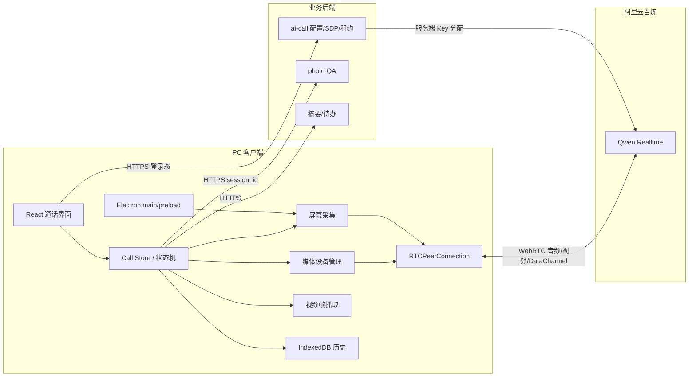
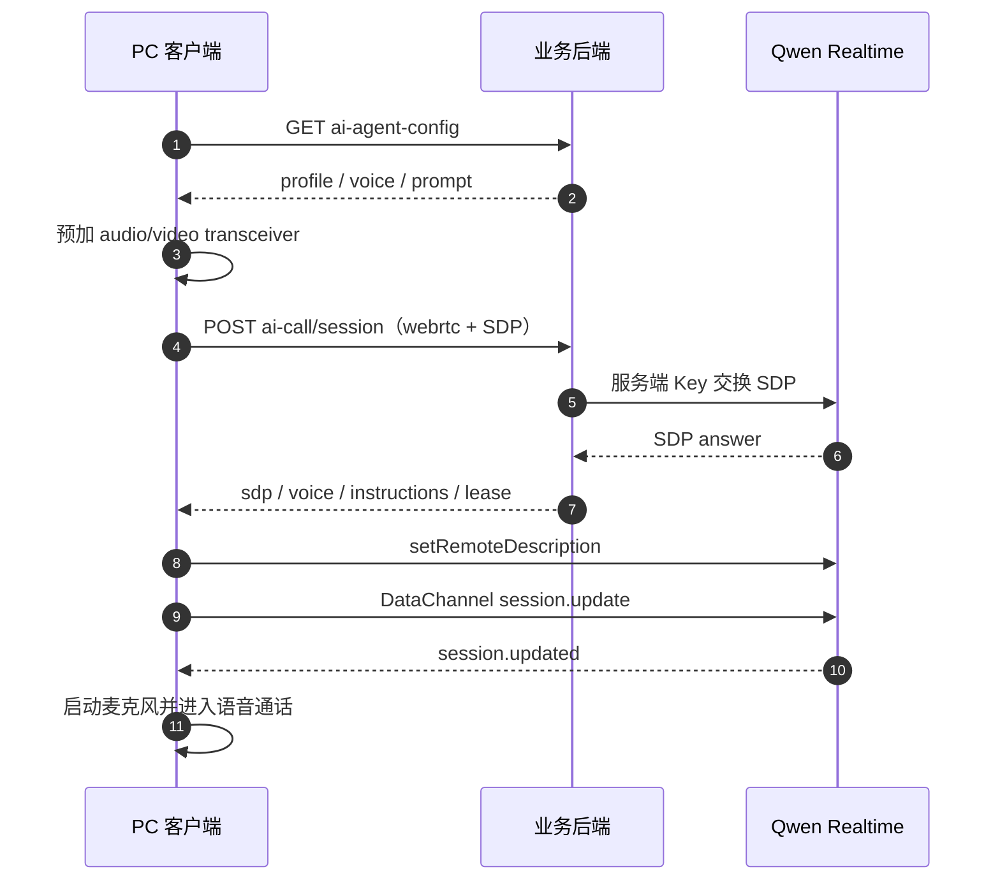
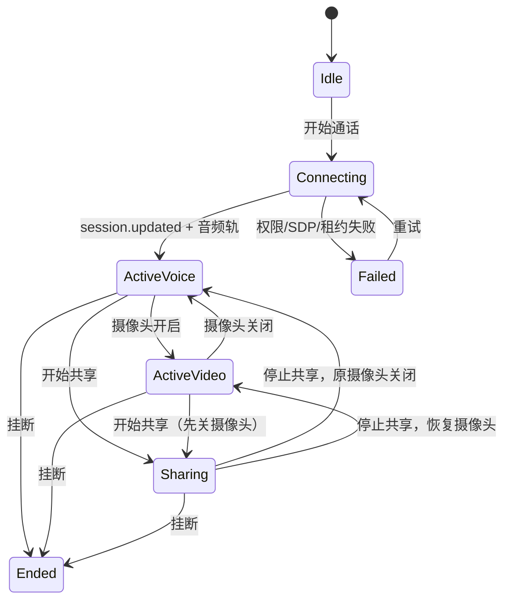

# PC 桌面端 AI 打电话设计方案

> 状态：设计稿，待评审  
> 日期：2026-10-20  
> 范围：C 端 Windows / macOS 桌面端，优先浏览器 Web，第二阶段 Electron 外壳  
> 目标：复刻 Android AI 打电话的语音、摄像头、屏幕共享、读屏和通话记录体验  
> 参考：[Android AI 音视频交互](../features/ai-audio-video-interaction.md)、[客户端多端策略](客户端多端策略_对标飞书.md)

## 1. 结论

可以做，且推荐复用现有 Web/后端能力，不直接移植 Android 实现。

核心判断：

1. **桌面端优先用现有 React Web 前端 + WebRTC 实现**，不新写原生桌面 UI；
2. **Electron 只做外壳和桌面能力增强**，不重写业务；
3. **屏幕共享使用浏览器/Electron 的 `getDisplayMedia`**，不使用 Android MediaProjection；
4. **读屏不再需要无障碍服务**，直接从共享视频轨抓帧，复用现有 photo QA；
5. **第一期只支持 WebRTC，不支持 AOQ**；
6. **摄像头和屏幕共享互斥**，共用一个 video sender，通过 `replaceTrack` 切换；
7. **桌面端没有系统级“读取任意应用”的能力**，只能读取用户主动选择共享的窗口/屏幕。

预期能力对齐度：

| 能力 | 桌面端 |
|---|---|
| 实时语音通话 | 完全可复刻 |
| 摄像头视频 | 完全可复刻 |
| 屏幕/窗口共享 | 可复刻，但每次需系统选择器 |
| AI 读屏 | 可复刻，基于共享画面抓帧 |
| 语音控制摄像头/结束通话 | 可复刻 |
| 通话记录/摘要/待办 | 可复刻，存储从 SQLite 改为 IndexedDB |
| Android 无障碍兜底 | 不需要，也无法复刻 |
| 后台常驻/全局快捷键/悬浮窗 | 浏览器做不到，需 Electron 第二阶段 |

## 2. 产品与工程边界

### 2.1 本期目标

- PC 上发起 AI 语音通话；
- 打开/关闭摄像头；
- 共享窗口、整个屏幕或浏览器标签页；
- AI 通过共享画面读取内容；
- 语音结束通话；
- 本地通话记录、摘要和待办；
- Windows / macOS 主流程可用。

### 2.2 非目标

- 不在第一期做 AOQ；
- 不实现 Android 无障碍读屏；
- 不实现系统级录制任意后台窗口；
- 不实现多人会议内的 AI Agent；
- 不实现系统音频共享；
- 不实现原生 C++/Qt 客户端；
- 不做移动端和 PC 端历史自动云同步。

## 3. 技术选型

| 层 | 选型 | 原因 |
|---|---|---|
| UI | 现有 React / Vite / panda-css | 复用 Web 组件和设计系统 |
| 桌面外壳 | Electron | 复用 Chromium WebRTC，和 Web 行为一致 |
| 实时传输 | WebRTC | 后端已支持 SDP；浏览器原生可用 |
| 屏幕采集 | `getDisplayMedia` / Electron `desktopCapturer` | Chromium 标准能力 |
| 读屏 | 共享视频帧 + Canvas JPEG + photo QA | 不依赖 Android 无障碍 |
| 本地历史 | IndexedDB（浏览器）/ Electron userData | 无 SQLite 原生依赖 |
| 身份认证 | 复用 Web OIDC / 现有登录态 | 不新建账号体系 |
| 更新 | Electron updater（第二阶段） | 桌面分发需要 |

### 3.1 为什么不是原生桌面

- UI 不能复用 React；
- WebRTC、屏幕采集、设备管理要重写；
- 与 Web 端行为容易分叉；
- 团队现有桌面策略已经明确选择 Electron（见多端策略文档）。

### 3.2 为什么不用 AOQ

- AOQ 是移动端 SDK；
- 浏览器没有对应 AOQ 客户端；
- 第一期使用 WebRTC 即可覆盖语音和屏幕共享；
- 后续若需要更低延迟，再评估 AOQ 桌面 SDK 或原生壳。

## 4. 总体架构



桌面端只负责客户端媒体和交互；模型 Key、服务端 SDP 交换和租约仍在业务后端。

## 5. 会话建立

### 5.1 接口

复用现有 AI 打电话接口：

```text
GET  /api/v1.0/rooms/ai-agent-config/
POST /api/v1.0/ai-call/session/
POST /api/v1.0/ai-call/photo/
POST /api/v1.0/direct-ai/sessions/{id}/  operation=heartbeat|close
```

第一期请求固定：

```json
{
  "profile_code": "<omni profile code>",
  "transport": "webrtc",
  "photo_qa": true,
  "sdp": "<audio + pre-negotiated video m-line>"
}
```

### 5.2 预协商视频轨

不能等用户点“共享屏幕”时才新增视频 m-line。

正确顺序：

```text
创建 RTCPeerConnection
→ addTransceiver("video", { direction: "sendonly" })
→ addTransceiver("audio", { direction: "sendonly" })
→ createOffer / setLocalDescription
→ POST SDP
→ setRemoteDescription(answer)
→ 语音阶段 video sender 不挂真实轨道
→ 摄像头/屏幕共享时 replaceTrack(track)
```

这样切换摄像头和屏幕不会触发后端不支持的重新协商。

### 5.3 建连时序



### 5.4 租约

- 使用返回的 `session_lease`；
- 按 `heartbeat_seconds` 发送 heartbeat；
- `enforce=true` 时租约失败结束通话；
- 挂断时 best-effort `close`；
- 不能把租约 TTL 当成模型连接生命周期。

## 6. 媒体链路

### 6.1 麦克风

```ts
navigator.mediaDevices.getUserMedia({
  audio: {
    echoCancellation: true,
    noiseSuppression: true,
    autoGainControl: true,
  },
  video: false,
})
```

要求：

- 首次点击“开始通话”后申请权限；
- 音频通过 `RTCRtpSender.replaceTrack` 挂到 audio transceiver；
- 真正拿到音频轨并通过 `session.updated` 后才显示“通话中”；
- 麦克风静音只控制本地音轨，不停止采集。

### 6.2 摄像头

- 使用 `getUserMedia({ video: ... })`；
- 本地预览和发送共用同一条轨道；
- 摄像头开关通过 video sender `replaceTrack`；
- 关闭时停止轨道，释放指示灯；
- 停止共享后是否恢复摄像头，必须由明确状态决定，不根据模型回复推断。

### 6.3 屏幕共享

浏览器：

```ts
navigator.mediaDevices.getDisplayMedia({
  video: {
    frameRate: { ideal: 15, max: 30 },
    width: { ideal: 1920 },
    height: { ideal: 1080 },
  },
  audio: false,
  // Chromium 专用约束
  selfBrowserSurface: "exclude",
  surfaceSwitching: "include",
})
```

Electron：

- main 进程 `desktopCapturer.getSources()` 提供源列表；
- 使用 `session.setDisplayMediaRequestHandler`；
- 不默认选中 We Meet 自己的窗口；
- 仍保留系统/应用选择器，不静默抓屏。

行为：

1. 用户点击“共享屏幕”；
2. 出现系统源选择器；
3. 用户选择窗口/屏幕/标签页；
4. 停止摄像头轨道；
5. `videoSender.replaceTrack(screenTrack)`；
6. 共享结束、用户点浏览器停止条或 track `ended`：
   - 停止 screen track；
   - 清空/恢复 video sender；
   - 按原状态恢复摄像头；
   - 更新 UI 和工具列表。

### 6.4 音频播放

- 远端 AI 音频通过 `<audio autoplay>` 或 Web Audio 播放；
- 浏览器自动播放限制：必须由“开始通话”点击解锁；
- 支持输出设备选择（`setSinkId`，浏览器支持范围内）；
- “静音播放”只控制输出，不影响工具事件和文本记录。

### 6.5 没有远端视频

AI 通话只有本地摄像头/屏幕预览和远端音频。  
不需要渲染远端视频轨；不要为 AI 创建视频接收画面。

## 7. 屏幕读取

### 7.1 原则

桌面端不实现 Android 无障碍截图。

读屏来源必须是用户当前主动共享的：

- 窗口；
- 整个屏幕；
- 浏览器标签页。

不能读取未共享的另一个应用。

### 7.2 工具

`read_screen` 只在屏幕共享且画面可见时提供给模型。

工具流程：

```text
模型调用 read_screen
→ 检查当前 share track 是否 active
→ 从视频轨抓一帧
→ 转 JPEG
→ 调 /api/v1.0/ai-call/photo/
→ photo QA 返回文字
→ function_call_output
→ 继续实时模型回答
```

### 7.3 抓帧

浏览器：

```text
HTMLVideoElement + Canvas
或 ImageCapture.grabFrame()
或 MediaStreamTrackProcessor + VideoFrame
```

要求：

- 使用当前共享轨，不使用摄像头轨；
- 抓帧前确认 track readyState 为 live；
- 目标长边不超过 1920；
- JPEG 质量 85–90；
- Base64 后不超过后端限制（当前 512KB）；
- 展示给用户的截图和上传给 photo QA 的是同一份 JPEG；
- 超时/失败返回 `screen_read_failed`，不自动改读摄像头。

### 7.4 与移动端的差异

| 项目 | Android | PC |
|---|---|---|
| 捕获源 | MediaProjection，失败时无障碍 | 用户选择的 getDisplayMedia 源 |
| 可读范围 | 系统级 | 仅当前共享源 |
| Chrome 兼容 | 部分 OEM 失败 | Chromium 自己采集，通常更稳定 |
| 权限 | 系统投屏 + 可选无障碍 | 每次系统源选择器 |
| 截图持久化 | 本地历史 | 本地 IndexedDB / userData |

## 8. 工具与状态

### 8.1 工具集合

第一期：

```text
set_camera_enabled
get_camera_state
take_photo
read_screen
end_call
```

桌面端没有：

```text
open_app
前后摄像头切换
Android 无障碍相关工具
```

`take_photo` 从当前摄像头轨抓帧；`read_screen` 从当前屏幕轨抓帧。

### 8.2 工具同步

- 共享开始时，发送一次 `session.update`，加入 `read_screen`；
- 停止共享时移除；
- 与移动端一致，增加一次延迟重发，避免 update 与 `response.done` 竞争；
- `read_screen` 的 handler 必须再次校验 `screenSharing && screenVisible`；
- 未共享时模型不应看到该工具。

### 8.3 状态机



## 9. 页面与交互

### 9.1 通话页

建议桌面布局：

```text
┌──────────────────────────────────────────────┐
│  ← AI 打电话         WebRTC       设置      │
├──────────────────────────┬───────────────────┤
│                          │                   │
│  本地摄像头 / 屏幕预览    │  实时字幕/记录     │
│                          │                   │
├──────────────────────────┴───────────────────┤
│  [麦克风] [共享屏幕] [摄像头] [挂断]          │
└──────────────────────────────────────────────┘
```

- 语音模式：中央显示语音球/波形，右侧最近记录；
- 视频模式：中央本地预览，右侧记录；
- 共享模式：中央共享画面预览，标注“AI 正在查看”；
- 停止共享后恢复摄像头或语音状态。

### 9.2 共享同意

开始共享前显示：

```text
共享屏幕？
AI 助手可以看到你选择共享的窗口/屏幕。
共享期间可随时停止。
[取消] [开始共享]
```

不使用 Android 无障碍说明；不要承诺读取未共享应用。

### 9.3 桌面增强（第二阶段）

Electron 增加：

- 独立悬浮窗；
- 全局快捷键；
- 托盘常驻；
- 系统通知；
- 多显示器源选择；
- 开机启动。

浏览器版本保留完整主流程作为回退。

## 10. 历史记录

### 10.1 存储

浏览器使用 IndexedDB，Electron 使用 userData 下的 IndexedDB/文件：

```text
sessions
  id, kind, startedAt, endedAt, mode, transport, title, summary, ...
rows
  id, sessionId, order, role, text, imageBlob
summaries
  sessionId, content, tasks
```

第一期字段：

- `startedAt` / `endedAt`；
- `role`；
- `text`；
- 图片 Blob（屏幕/拍照）；
- 摘要和待办。

PC 端可以直接记录**明确的**：

```text
mode: voice | video | screen
outcome: completed | interrupted | failed
```

避免像 Android 当前一样靠时长推断状态。

### 10.2 保留与隐私

- 默认保留最近 200 次；
- 账号隔离；
- 支持单条删除、清空；
- 屏幕截图保存到本机，不自动上传历史；
- 历史说明必须写明：

```text
本机保存文字、通话图片和屏幕读取截图，最多保留最近 200 次。
```

### 10.3 跨端同步

第一期不做。

PC 与 Android 历史各自本地保存；后续如需同步，应通过后端会话记录接口，而不是直接同步 IndexedDB/SQLite。

## 11. 权限、安全与合规

### 11.1 浏览器

- 必须 HTTPS / secure context；
- 麦克风、摄像头、屏幕共享分别授权；
- 屏幕共享每次由用户手势触发；
- 页面关闭/刷新时停止所有 track；
- 不尝试绕过 DRM 或受保护内容。

### 11.2 Electron

- `contextIsolation: true`；
- `nodeIntegration: false`；
- preload 只暴露必要的 `desktopCapturer` 和窗口 API；
- 只允许应用自己的来源加载；
- 屏幕源选择交给 main 进程，不把任意 IPC 暴露给 renderer；
- 不把 DASHSCOPE Key 或服务端 Key 写入客户端。

### 11.3 数据

- 屏幕截图和拍照属于敏感数据；
- 默认只存本机；
- 删除会话时同步删除图片；
- 共享期间 UI 持续显示状态；
- 结束通话立即停止采集。

## 12. 异常处理

| 场景 | 行为 |
|---|---|
| 麦克风拒绝 | 不建连，提示授权 |
| 摄像头拒绝 | 保持语音，提示无法开摄像头 |
| 屏幕选择取消 | 保持当前语音/视频状态 |
| 共享 track 被系统结束 | 清理共享状态，恢复摄像头 |
| photo QA 超时 | 返回 `screen_read_failed`，不读摄像头 |
| SDP 502/503 | 结束连接，提示重试，不自动切换传输 |
| 租约失败 | `enforce=true` 时结束，否则停止 heartbeat |
| 浏览器刷新 | 清理 session，提示重新开始 |
| 页面进入后台 | 浏览器允许媒体继续，但 UI/定时器可能节流；提示保持前台 |

## 13. 测试与验收

### 13.1 自动化

- WebRTC SDP/事件协议单测；
- 工具解析、去重、错误码单测；
- 媒体 track mock：麦克风、摄像头、屏幕；
- IndexedDB 历史增删改查；
- Playwright 使用 fake media：
  - 假麦克风；
  - 假摄像头；
  - `getDisplayMedia` 需人工/Chromium flag 辅助。

### 13.2 手动矩阵

| 平台 | 浏览器 |
|---|---|
| Windows 11 | Chrome / Edge |
| macOS | Chrome / Safari（Safari 仅验证兼容性） |
| Electron | Windows / macOS 安装包 |

每个平台验证：

1. 发起语音通话；
2. 打开/关闭摄像头；
3. 共享窗口；
4. 共享整个屏幕；
5. AI 读取窗口文字；
6. 停止共享恢复摄像头；
7. 挂断释放麦克风/摄像头/屏幕；
8. 历史记录含截图；
9. 拒绝权限、取消共享；
10. 关闭窗口后无残留采集。

### 13.3 验收标准

- 语音延迟与 Web 端 LiveKit 会议同一量级；
- 屏幕共享开始/停止不重连模型；
- 读屏返回的截图与展示给用户的截图一致；
- 摄像头和屏幕不会同时占用；
- 结束后系统摄像头/麦克风指示灯熄灭；
- 无服务端 Key 出现在客户端；
- 历史删除后图片文件同步删除。

## 14. 分阶段落地

### Phase 0：技术验证（3–5 天）

- 浏览器建立 WebRTC，完成 Qwen 语音通话；
- 预协商 video m-line；
- `getDisplayMedia` + `replaceTrack`；
- 从屏幕帧抓图，调 photo QA；
- 验证后端 SDP/租约/photo QA 对 PC 可用。

### Phase 1：浏览器 MVP（2–3 周）

- 通话页；
- 麦克风/摄像头/屏幕共享；
- 工具调用；
- 读屏；
- 本地历史；
- 基础错误处理；
- Windows/macOS Chrome/Edge 验收。

### Phase 2：Electron 外壳（2 周左右）

- 复用 React；
- OIDC 系统浏览器登录；
- 源选择器；
- 托盘/通知/独立窗口；
- 打包、签名、更新。

### Phase 3：桌面增强（2 周左右）

- 悬浮窗；
- 全局快捷键；
- 多显示器；
- 系统级体验对齐豆包。

> 工期为粗略估算，取决于现有 Web 登录、OIDC 回调和打包基础设施。

## 15. 风险

| 风险 | 等级 | 处理 |
|---|---|---|
| 后端不兼容带 video m-line 的浏览器 SDP | 高 | Phase 0 先验证 |
| photo QA 需要有效 session_id | 高 | 确认现有分配/租约返回值 |
| 屏幕选择器体验比移动端多一步 | 中 | 接受；Electron 再做源记忆 |
| 浏览器后台节流 | 中 | 保持前台；第二阶段 Electron |
| macOS 屏幕录制权限 | 中 | 首次引导系统设置 |
| 受保护窗口黑屏 | 中 | 明确提示，不承诺绕过 |
| IndexedDB 图片占用 | 中 | 200 条上限 + 删除清理 |
| Web 与 Electron 行为分叉 | 中 | 共用 React 和媒体层，外壳薄 |
| 多平台测试成本 | 中 | 先 Windows Chrome/Edge，再 macOS |

## 16. 待确认问题

1. 后端 `ai-call/session` 是否接受包含 video m-line 的浏览器 SDP；
2. photo QA 的 `session_id` 具体来自分配响应还是租约 ID；
3. 现有 Web 登录在 Electron 中是 OIDC PKCE 还是复用 Cookie；
4. 是否需要共享系统音频；
5. 历史是否需要与 Android 同步；
6. 是否要求悬浮窗/全局快捷键作为首版能力；
7. 是否允许 macOS 使用系统屏幕录制权限；
8. Qwen Realtime 的 DataChannel 事件名与浏览器实现是否完全一致。

## 17. 关键文件

### 后端

- `src/backend/core/api/ai_call.py`
- `src/backend/core/api/ai_call_photo.py`
- `src/backend/core/services/direct_ai_allocations.py`

### Web

- `src/frontend/src/features/rooms/livekit/prefabs/ControlBar/ControlBar.tsx`
- `src/frontend/src/features/rooms/livekit/prefabs/VideoConference.tsx`
- 新增 `src/frontend/src/features/ai-call/`（通话页、媒体层、工具层、历史）

### Android 参考

- `we-meet-android/feature-assistant/src/main/java/com/we/meet/feature/assistant/aicall/rtc/OmniWebRtcClient.kt`
- `we-meet-android/feature-assistant/src/main/java/com/we/meet/feature/assistant/aicall/rtc/OmniCallTools.kt`
- `we-meet-android/feature-assistant/src/main/java/com/we/meet/feature/assistant/aicall/rtc/ScreenFrameJpeg.kt`

## 18. 最终建议

先做 **浏览器 MVP + Phase 0 技术验证**。

如果 Phase 0 证明：

- 浏览器 SDP 可被后端接受；
- 屏幕轨可替换；
- 抓帧 photo QA 可用；
- 租约/心跳正常；

再投入 Electron 外壳和悬浮窗。

不要在验证前直接开始原生桌面重写，也不要把 Android 无障碍和 MediaProjection 逻辑带进 PC 方案。
