# 企业 AI 应用与智能体平台设计方案

日期：2026-10-11。更新：2026-10-13。版本：1.47。状态：设计与实施验证稿，生产框架待决策。读者：产品、架构、研发、测试与企业实施团队。

平台定位为聚视企业协作系统的 AI 应用开发、运行与管理平台。第一阶段服务现有企业客户，预留多企业 SaaS；优先交付新建任务、消息转任务、群聊消息总结和周报。实时音视频、对话式办公、桌面执行、定时自动化共用平台配置、工具与运行管理，但保留各自的执行机制。

本方案提出产品和工程建设设计，不代表全部新增功能已经实现、生产启用或经过容量验收。第 4 节记录方案制定时的源码基线；工期、配额及指标均为规划值，实施前通过试点校准。2026-10-11 已在基于 `aliyun-dev` 的 `feature/enterprise-ai-platform` 分支开始实施，当前范围、接口、启用步骤及验证证据见[首批实现说明](../features/enterprise-ai-platform.md)。隔离 LangGraph PoC 已验证基础恢复、真实群摘要、单任务多轮对话及外部 dsh／Pi 协调；另完成多技能只读路由的权限契约和真实千问专项。结果与未完成范围同步于第 18.5 节；正式运行基础的要求见第 18.6 节，已实现的对话路由后端首批见第 18.7 节。详细决策见 [ADR-0005](../adr/0005-enterprise-ai-platform-architecture.md)。后续规划、实验代码和正式产品实现分别验收。

## 1. 设计结论

建设一个企业 AI 应用与智能体平台，采用共享控制层、多个运行引擎、业务系统保有权威数据的架构。平台既支持明确步骤的工作流，也支持模型驱动的 Agent 工具循环，以及客户端实时多模态交互。Agent Harness 是运行层的组成部分，负责上下文、工具调度、反馈、停止条件和恢复。

首期选择五项架构决策：

1. 在现有 Django 业务服务中新增有边界的平台模块，先采用模块化单体和独立执行器，沿用 PostgreSQL、Celery、Redis、对象存储及现有认证。
2. 任务创建通过现有业务领域服务完成；消息、待办、会议、文档继续由各自系统管理。平台建立来源引用、执行记录和成果版本，不复制成第二套业务系统。
3. 新建任务与消息转任务使用结构化提取和确定性提交；群总结与周报使用固定工作流。首期不依赖开放式自主 Agent 或可视化流程编辑器。
4. Android 实时音视频沿用 AOQ／WebRTC 直连供应商；桌面端以 Qwen-Live-Harness 为实时交互 Harness 的优先基础候选，先验证后决定生产采纳。办公执行沿用现有桌面 dsh、服务端 Pi 只读复核与独立 Broker，不把业务后端改造成通用 Shell 执行环境；桌面接入分工见第 7.5 节。
5. 所有应用绑定发布版本、授权范围和执行预算。配置可复用，用户权限、会话上下文与业务数据按主体隔离。

固定流程与动态 Agent 的选择依据任务是否可以预定义步骤，而非功能名称中是否带有“智能体”。[Anthropic 工作流与 Agent 架构说明](https://www.anthropic.com/engineering/building-effective-agents)

### 1.1 成功标准

平台价值用完成工作衡量：任务是否正确落库、总结是否覆盖指定范围、周报是否准确反映进展、成果是否能继续协作。对话量和生成字数作为辅助指标。

首期应形成“授权来源 → 生成建议或成果 → 用户直接授权或补充确认 → 真实业务执行 → 可追溯回执”的完整流程。同一请求重复提交、用户切换设备、执行器重启及网络应答丢失，都不能造成重复业务操作。

### 1.2 首期范围与后续范围

| 范围 | 内容 | 阶段 |
| --- | --- | --- |
| 办公闭环 | 表单和自然语言新建任务、单条及选定消息转任务、指定群与时间段总结、手动个人周报 | P1 |
| 平台基础 | 应用模板、内置技能与安装、配置版本、来源与工具契约、执行账本、权限、预算、基础看板 | P0 至 P1 |
| 持续自动化 | 团队周报、定时周报、订阅式群总结、成果交付、对话式办公 | P2 |
| 多模态与设备 | 云端配置现有 AI 电话、语音调用办公工具、客户端能力接入、桌面实时 Harness 验证与 Agent 平台适配 | P3 |
| 对外开放 | 外部连接器、企业自建应用、SDK、私有化交付、SaaS 扩容 | P4 |

首期不开放任意代码上传、任意 MCP 地址、任意供应商地址或后台全群监听；不建立员工自动绩效评分。若企业需要新的自动化，以明确的应用范围、授权和验收单独交付。

## 2. 企业办公需求洞察

### 2.1 需求来源与验证方法

企业办公的核心困难是信息分散、事项遗漏、跨系统搬运、反复汇报和成果难以追踪。微软 2025 年 Work Trend Index 的后续报告也描述消息、会议和应用切换导致工作碎片化；报告采用微软自身遥测和跨市场调查，其观察用于需求方向参考，不能直接推断聚视客户的收益或使用强度。[微软研究](https://www.microsoft.com/en-us/worklab/work-trend-index/breaking-down-infinite-workday)

结合聚视已有消息、会议、任务、文档和 Work，优先验证如下产品假设：

| 需求假设 | 用户实际想完成的工作 | 建议能力 | 试点验证 |
| --- | --- | --- | --- |
| 不想反复填写任务字段 | 把一句要求变成可执行事项 | 自然语言建任务、歧义澄清、默认值透明 | 比较人工表单耗时、字段修正率 |
| 群讨论容易遗漏行动项 | 找出谁做什么、何时完成、依据是什么 | 消息转任务、来源关联、重复检测 | 用真实授权讨论评估漏项与误建 |
| 无法持续追群 | 在限定时间内了解变化、决策和风险 | 群总结、未读摘要、来源定位 | 看用户是否能回答关键事实及定位原文 |
| 周报需要临时拼材料 | 汇总本周真实进展和下周计划 | 来源聚合、状态核验、周报草稿 | 记录修订时间、错误状态、缺失事项 |
| 资料准备和执行分散 | 描述目标后持续推进并取得成果 | 对话式办公、工具、桌面执行 | 看任务完成率和人工接管原因 |
| 手机不便输入 | 通过语音查询并完成业务操作 | 音视频入口调用办公工具 | 评估识别、澄清与业务回执一致性 |
| 管理者担心失控和成本 | 控制谁能用哪些资料、工具和预算 | 授权、版本、审批策略、运行审计 | 权限负例、预算拒绝、事件追溯 |

开始实施前访谈 8 至 12 名员工、项目负责人和企业管理员，覆盖 2 至 3 个团队；这些数量是研究计划。每人提供 3 至 5 个已脱敏或明确授权的实际案例，记录现有流程、每步耗时、错误后果和必要数据。建立对照任务集，先比较固定工作流和人工流程，再决定是否引入更复杂的 Agent。

### 2.2 用户角色

| 角色 | 主要工作 | 产品入口与权限 |
| --- | --- | --- |
| 员工 | 建任务、整理消息、写个人周报、准备材料 | Work、聊天菜单、任务中心、移动语音；仅自身可访问资源 |
| 项目负责人 | 汇总项目进展、风险与协作事项 | 项目视图、团队周报；角色不自动扩大源数据权限 |
| 业务应用管理员 | 配置模板、提示词、工具与发布策略 | AI 控制台；管理应用不等于可读用户私有材料 |
| 企业管理员 | 成员、组织政策、预算与运行概况 | 企业设置；敏感日志访问单独授权 |
| IT 与实施人员 | 连接器、凭据、部署和故障排查 | 管理控制台；技术运维默认只看元数据 |
| 外部开发者 | 后续接入自有应用或设备 | P4 SDK 与 API；限定应用、组织和作用域 |

### 2.3 价值指标与优先级

优先级按使用频率、可验证性、数据就绪、错误影响和实现成本评估。人工表单继续保留；信息不足时生成草稿或澄清，不以“全自动率”逼迫系统猜测。

| 指标 | 计算方法 | 首期候选目标 |
| --- | --- | --- |
| 节省时间 | 同类案例人工完成时间减去 AI 路径总时间，计入检查与修订 | 试点中位数下降至少 30% |
| 任务字段正确率 | 人工标注的正确已知字段数／应提取的已知字段数 | 至少 95% |
| 总结事实准确率 | 有来源支持的正确事实数／已输出可核查事实数 | 至少 95% |
| 关键事项覆盖率 | 被总结覆盖的标注决策、风险和行动项／全部标注项 | 至少 90% |
| 周报采纳率 | 用户采纳或轻微修订的报告／完成生成的报告 | 至少 70% |
| 重复业务副作用 | 故障注入和重复请求产生的额外任务或发送 | 验收样本中为 0 |
| 未授权读取与写入 | 隔离、撤权和工具越权测试中的成功次数 | 验收样本中为 0 |

这些目标需结合试点校准；“测试中为 0”不构成系统绝无风险的保证。成果采纳、轻微修订的规则在标注规范中固定，不能仅以点击按钮认定质量。

## 3. 产品架构

### 3.1 产品分层

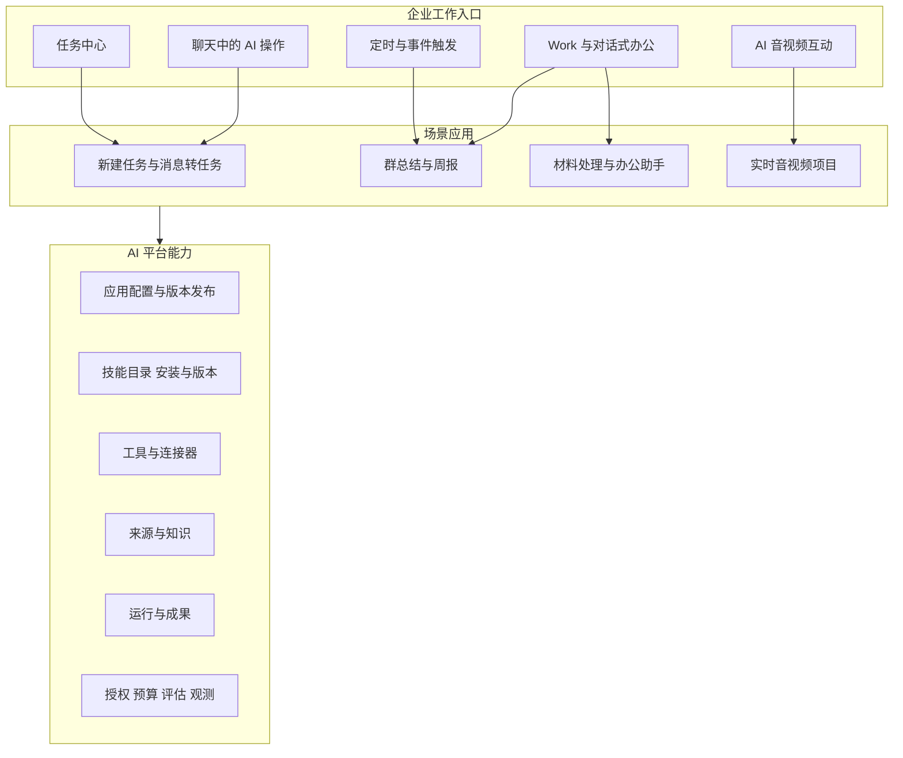

AI 入口嵌入用户正在处理的业务页面。Work 汇总执行、成果和持续对话；AI 控制台用于配置应用，不要求员工先理解模型、Harness 或连接池才能使用功能。

### 3.2 产品信息架构

| 用户工作区 | 内容 | 交互要求 |
| --- | --- | --- |
| Work 首页 | 新建工作、快捷应用、最近成果、待处理请求 | 默认推荐已发布且有权限的应用 |
| 办公助理 | 持续对话、引用资料、工作进度、操作回执 | 区分答复、计划、执行；支持取消和继续补充 |
| 我的工作 | AI 工作目标、每次执行、失败恢复、成果 | 不与人的待办混为同一列表 |
| 我的成果 | 群总结、周报、文档、文件版本 | 显示来源、覆盖范围、修订和交付状态 |
| 自动化 | 定时规则、订阅和每次运行 | 显示下一次触发、时区、授权主体和暂停原因 |
| 项目 | 项目资料、应用和成果的协作范围 | 逐资源验证权限，避免因加入项目而自动读取全部材料 |

| AI 管理控制台 | 内容 |
| --- | --- |
| 应用 | 创建、模板复制、配置、测试、版本、发布与停用 |
| 技能 | 内置与企业技能、安装、版本、依赖、评估与停用 |
| 工具与连接器 | 已安装能力、权限作用域、凭据引用、健康及版本 |
| 模型 | 能力、区域、协议、供应商配置、预算与限额 |
| 运行 | 会话、执行、等待输入、错误、成果与交付 |
| 评估 | 固定案例、回归结果、模型和配置版本比较 |
| 企业策略 | 使用范围、数据策略、预算、角色与审计 |

P1 使用表单式配置和应用模板；P2 再开放受限步骤编辑。可视化 DAG 编辑器作为 P4 可选项，需证明能降低业务配置成本后再开发。

### 3.3 产品对象与术语

| 对象 | 定义 | 与现有对象关系 |
| --- | --- | --- |
| AIProject | AI 应用的管理与发布分组，归属于企业或明确的个人试点范围 | 新增；不是 Work 项目或本地目录 |
| AIApplication | 面向某类工作的可配置应用，如群总结、个人周报、视频助手 | 新增；引用现有模型目录及运行类型 |
| ApplicationVersion | 不可变的配置快照 | 新增；记录提示词、工具、引擎及能力要求 |
| ReleaseBinding | 环境与应用版本的绑定及灰度规则 | 新增；发布与草稿分离 |
| WorkProject | 团队协作的业务资料与工作组织范围 | 后续业务对象；独立于 AIProject |
| Session | 持续对话状态及当前上下文范围 | 平台新增对话索引；实时媒体会话仍有自身生命周期 |
| SkillDefinition / SkillVersion | 可复用业务能力及其不可变契约、执行配方和评估版本 | 新增；应用引用具体技能版本，不等于单个工具 |
| SkillInstallation | 企业安装、启用及约束某技能的记录 | 新增；安装不授予资料访问或业务写入权限 |
| WorkTask | 希望 AI 完成的工作目标 | 保留现有 WorkTask，支持多个执行 |
| Run | 某次工作流、Agent 或交互执行的追踪记录 | 平台新增索引，关联 WorkRun 或其他权威执行记录 |
| Task | 交给人的待办事项 | 保留 core.Task |
| ArtifactVersion | 版本化成果、来源清单及可见范围 | 复用 Work 成果并以适配器扩展 |
| ToolDefinition | 可调用操作的输入输出契约与受信执行实现 | 新增目录，既可在云端也可在设备执行 |
| ConnectorBinding | 某企业或用户对外部系统的授权绑定 | 新增，保存凭据引用而非明文 Key |
| SourceReference | 资料的权威定位、版本及访问策略 | 新增规范；不作为访问权限授予 |
| Schedule | 以时区和规则触发应用的配置 | 新增 AI 调度；不替代 Task 重复规则 |

一个 AIProject 可以管理多个应用，一个 WorkProject 可以引用多个已发布应用。WorkTask 多次执行产生多个成果；AI 执行步骤不会自动生成多个 Task。预算按运行及模型调用核算，企业策略控制上限。

## 4. 现有能力与增量边界

源码基线：we-meet `b5d883371a0d001c554c18b34658b78c2ec5bf76`；Android `f606fcfdac843b5bc91759ed7a7b9df0b0532b27`。基线表描述仓库实现，生产开关、镜像及已安装客户端需通过各自发布记录确认。

| 能力 | 当前基础 | 平台化增量 |
| --- | --- | --- |
| 模型与提示词 | AIVendor、AIModel、AIVoice、AIPrompt、AIAgentProfile 及 Django Admin | 企业归属、应用版本、能力矩阵、发布流程 |
| 人的任务 | 创建、负责人、重复、提醒、子任务、清单与来源关联 | 抽取建议、统一提交工具、跨请求业务幂等 |
| 消息转任务 | 已有手动入口；后端检查群成员资格并保存客户端消息快照 | AI 提取前通过 IM 权威接口解析指定消息；处理历史可见性与撤回 |
| 检索问答 | global_ask 聚合会议、日程、纪要和 IM 检索片段 | 来源协议、权限贯穿执行与交付；全量总结不能用 Top K 检索替代 |
| Work 固定流程 | 私有材料、目标、执行、预算、成果和失败恢复 | 群总结、周报及任务提取的模板执行器 |
| 办公 Agent | 桌面 dsh 执行、Pi 只读复核、设备派发与独立 Broker | 平台应用快照与工具适配；保留原升级与审批边界 |
| 实时音视频 | Android AOQ／WebRTC、Omni 工具、静态拍照、服务端分配与租约 | 发布配置解析、能力协商、办公云端工具桥接 |
| 调度与一致性 | Celery、Beat、持久记录、租约与对账实践 | 应用触发实例、周期去重、调度授权和执行事件 |
| HTTP 复用 | 后端 HTTP／SDK 与独立 Work Broker 连接池 | 配置及观测规范统一，实例和凭据隔离保留 |

现有任务创建携带 `source_message` 时还会创建会话任务分享记录。新工具必须明确展示这一副作用，并验证接收群范围；若用户仅授权私人建任务，使用支持私人来源关联的领域接口，不能隐式沿用自动群分享。[现有任务创建](../../src/backend/core/api/tasks.py)

IM 权威历史拉取、跨组织隔离、完整群消息覆盖和外部 Agent 工具接入是专项门槛。现有 Organization 模型和搜索入口不能证明独立 IM 服务已经具备端到端多租户能力。

参考：[Work 当前架构](../features/work-agent-architecture.md)、[任务功能](../features/task_module_minimum.md)、[AI 音视频方案](../features/ai-audio-video-interaction.md)、[模型接入方案](../features/llm-integration.md)。

## 5. 首期功能设计

### 5.1 新建任务

提供表单创建和自然语言创建。表单调用现有任务接口，不额外调用模型。自然语言入口展示模型提取的字段及原句依据，允许修改；用户明确要求创建且字段已确定、权限有效时可直接提交，不强制重复确认。

| 项目 | 规则 |
| --- | --- |
| 输入 | 当前用户一句要求，可补充负责人、日期、清单、优先级 |
| 输出 | 已创建 Task 及回执，或需要澄清的草稿 |
| 标题与描述 | 描述目标和验收要求；未表达内容不补造 |
| 负责人 | 通过组织目录解析实际用户 ID；同名返回候选；“我”映射当前主体 |
| 日期 | 保留原表达，以用户时区和请求参考时间解析；模糊表达先澄清 |
| 默认值 | 与任务业务默认值一致，结果中标明；不能静默指派给无关人员 |
| 清单与分享 | 校验目标清单编辑权及分享范围，不从输入的组织 ID 推导权限 |
| 重复提交 | 固定 action_id；同键同内容返回原结果，同键异内容返回冲突 |
| 成功判据 | 业务服务返回实际 Task ID，前端可打开，字段与回执一致 |

示例：“下周五前让我完成客户方案，放进销售清单。”如果销售清单唯一且可写，可创建并回显解析后的具体日期。存在两个同名清单时仅询问清单，保留其他已确定字段。“帮我想想要做什么”只生成建议，不写任务。

### 5.2 消息转任务

入口位于单条消息菜单、选中多条消息后的操作栏及 Work 引用消息。P1 默认单条消息；多条提取在单条来源核验通过后开放，候选上限 10 项，逐项选择提交。

后端通过 `cid + message_id` 获取权威内容，核对当前成员资格、历史可见性、消息版本与删除状态。客户端快照可用于即时展示，但标记 `client_reported`，不能直接作为 AI 提取和跨人分享的权威材料。IM 尚无可信读取接口时保留手动功能并限制自动提取范围，不以客户端随意上传的正文代替核验。

提取结果包含任务字段、消息依据、待确认项和疑似重复任务。新建时用户明确选定候选及目标范围；重复检测只提示，不自动合并、删除或修改原任务。意图相同但合法的二次创建允许用户明确选择“另建一项”，生成新的业务 action_id。

对于讨论里的否定、条件、引用或他人转述，不直接认定为承诺；“这个不用做了”不能生成待办。负责人必须匹配真实账号，日期未约定时保持未设置并显示。多人多项部分成功时逐项回执；失败项沿用原 action_id 重试，不重新创建成功项。

### 5.3 群聊消息总结

用户选择一个群、时间范围和关注点，生成决策、行动项、风险、待确认问题和简短概览。P1 范围为用户有权访问的文字、引用及可解析富文本；附件、语音和图片在未启用解析时明确标为未覆盖。

| 情况 | 处理 |
| --- | --- |
| 群太长或消息太多 | 分页枚举，按话题及时间切块；超限要求缩小范围，不静默截断 |
| 只有搜索接口 | 作为“相关消息摘要”展示，不命名“完整群总结” |
| 话题冲突 | 并列观点和时间；无明确决议不推断最终决定 |
| 任务讨论 | 输出候选行动项；只有授权提交后才创建 Task |
| 无消息 | 不调用模型，显示“指定范围内没有可访问消息” |
| 撤回或编辑 | 版本失效重取；已生成成果按来源依赖失效规则处理 |
| 生成中退群或撤权 | 禁止新的取数和发布，取消剩余执行；已送供应商的数据不能收回 |
| 部分消息不可读 | 标注实际可访问范围；不暴露不可读消息正文或敏感元数据 |

展示 `范围、截至时间、实际处理数量、未覆盖类型、分页完成状态、来源链接`。消息总量无法权威计算时总量为未知，不能声称覆盖率为 100%。结果默认私人草稿；群内发布是独立动作，按接收群成员的阅读范围校验。

### 5.4 周报

P1 先实现个人手动周报，用户选择周期、项目及授权来源。输入可包括本人的任务、手选群聊、会议成果和材料；未就绪来源禁用并解释，不以功能入口可见表示已接入。

流程先使用确定性规则收集本周完成、状态变化、持续进行中的事项及风险，再让模型组织表达。任务完成状态以业务记录及时间为准；“周五计划完成”不能写成“已完成”。使用状态历史或可靠活动记录计算周期进展，仅有当前状态时标注限制，不能反推何时完成。

标准结构：本周完成、进行中、阻碍与风险、需协助、下周计划、来源与信息缺口。数量和统计由程序计算；个人贡献和团队成果分开，不能以消息数量衡量工作绩效。

团队周报安排 P2。每位参与者的私有材料不得因汇总而自动共享；团队版使用接收范围内可见的来源，或明确授权的成员提交稿。生成、编辑、采纳、发布和通知分别记录，每次编辑产生新版本。

2026-10-13 已完成共同任务来源私人团队草稿、独立人工交付及固定范围的团队定时报告／预授权内部交付，见第 18.43—18.45 节。自动发布单独授权并标注未经逐次人工核对，不能冒充人工采纳。成员私有提交稿、多来源汇总和外部通知仍在后续范围；发布副本不授予私人 Run 访问。

2026-10-13 已实现团队版第一阶段：明确选择共享任务清单及 2—20 名成员（含生成者），使用所有选定成员当前共同可读的任务生成、编辑私人团队草稿。选定成员是取数约束，不是成果访问授权。经 AI 应用及办公助理的固定技能入口启动，继续复用现有来源受理、批处理及版本管理；验证见第 18.43 节。成员提交稿、团队采纳／发布、成员通知、定时团队报告和其他来源仍待实施。

### 5.5 对话式办公

P2 从受限业务工具开始：查任务、查消息、引用会议、建任务、生成周报及保存成果。意图明确的单步请求走直接工具；已有模板走工作流；开放目标才交给办公 Harness。

对话中每个操作显示“将做什么、用哪些资料、在哪里执行、结果是什么”。“建议”“草稿”“已经创建”在界面明确区分。用户补充要求形成新的执行或新的动作，不能覆盖已发生的事实；工作在后台执行时，聊天界面可以返回 run 链接而不阻塞整个会话。

桌面文件、命令和目录操作继续使用原本 dsh 授权及逐项审批。Pi 保持只读复核，不因统一平台而自动获取写权限。尚未启用的云端通用执行保留原开关。

### 5.6 音视频与办公结合

P3 将已发布音视频应用配置交给现有客户端；云端控制允许范围，设备控制实际状态。用户语音请求业务操作时，Omni 工具调用由 App 经授权平台接口转到业务服务；设备工具仍在 App 执行。

“给张三建任务”返回业务 Task 回执；“生成这周周报”返回工作受理状态和 run 链接，异步完成后再通知。长任务不能占用一轮实时工具等待数分钟。通话结束默认只结束实时会话，已明确启动的办公工作继续执行；创建时告诉用户，并提供单独取消入口。

实时场景保留现有摄像头权限、前后台、静音、打断和音色规则。图片查看与上传共用同一份最终 JPEG 的现有策略继续保留。

桌面入口复用聚视 Electron 客户端的登录、目录授权和 Work 入口，优先验证 Qwen-Live-Harness 的实时对话、屏幕／摄像头理解及后台结果播报。桌面实时模型连接由本机 daemon 持有，云端业务工具经平台执行，本地文件与命令经现有 dsh 适配器执行。可先做对话式办公、材料处理与研发团队对话式编程试点；这些是产品方向，不代表现成仓库已具备聚视业务闭环。接入、凭据及生命周期门槛见第 7.5、15.3 和 18.4 节。

## 6. 应用配置与发布

### 6.1 应用模板

| 模板 | 运行方式 | 输入与结果 |
| --- | --- | --- |
| 自然语言建任务 | structured_action | 文本 → 字段／澄清 → Task 回执 |
| 消息转任务 | workflow | 消息引用 → 候选 → 已选择的 Task |
| 群聊总结 | workflow | 群与范围 → 有引用的私人总结 |
| 个人周报 | workflow | 周期与来源 → 可编辑报告 |
| 办公助理 | office_agent | 目标与资料 → 工具结果／成果 |
| AI 电话 | realtime | 音视频与工具 → 实时回复及设备操作 |

`structured_action` 是受限解析和提交流程，不新增独立通用引擎；在工作流运行器内实现。模板初始化配置，后续模板升级不自动改写企业已发布应用。

### 6.2 配置字段与责任

| 配置域 | 字段示例 | 责任 |
| --- | --- | --- |
| 归属与范围 | organization、AIProject、应用名称、可用成员 | 平台鉴权 |
| 引擎与模型 | runtime_type、model_policy、region、required_capabilities | 发布校验和运行器 |
| 对话 | prompt_version、voice、语言、变量定义 | 按类型编译到模型配置 |
| 技能 | skill_version_ids、参数、依赖映射、允许入口 | 应用发布器与技能运行适配器 |
| 工具 | tool_version_ids、允许动作、执行位置、确认策略 | 工具网关和设备适配器 |
| 数据 | source_types、最大时间段、最大条数、成果可见性 | 资料服务和交付服务 |
| 预算 | 最大调用数、token、运行时长、并行数、金额预留 | 业务账本和 Broker |
| 实时 | transport、VAD、preview_fps、upload_fps、用户覆盖范围 | 能力协商和客户端 |
| 调度 | 默认规则、触发方式、时区、漏触发政策 | 单独 Schedule 实例 |
| 日志 | 允许记录内容、保留时间、支持访问角色 | 存储与审计 |

模型和工具 Key 只存受控 Secret／凭据服务，配置记录其引用。普通用户可调选项通过明确 schema 暴露。有效配置为平台硬限制、企业策略、应用版本及已允许用户选项的交集；模型提示词不能覆盖后端权限和配额。

本地场景提示词目前可影响通话配置，迁移时明确“平台管理的企业应用”和“用户个人场景”，企业应用只允许版本声明的参数覆盖。旧客户端不具备该约束时不作为企业受控应用的合规执行端。

### 6.3 发布与兼容

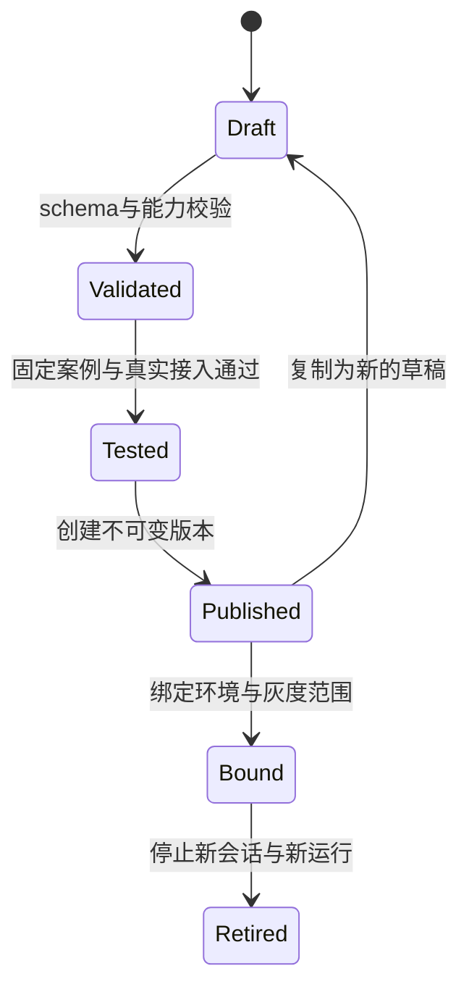

每个 run 或实时会话绑定应用版本和内容哈希，运行中不读取“最新提示词”。普通回滚仅改变新执行的版本绑定，已有执行保持快照；紧急策略撤销可以覆盖活跃运行的工具权限并请求取消，不能追溯撤回已经发生的操作。

灰度按主体稳定分组，记录命中规则，不以每次随机选择造成同一会话版本变化。旧客户端能力不足时隐藏应用或提示升级，不静默降低权限约束。跨组织迁移应用只复制非敏感配置，重新绑定来源、成员和凭据。

发布门槛包含参数合法、模型与工具兼容、预算可执行、来源已接入、客户端最低版本以及固定评估结果。Omni 工具与联网搜索的已知组合限制采用供应商能力规则处理；套件的语义判停、Omni VAD 和端侧 VAD 作为不同能力记录，不用同一开关暗示等价。

### 6.4 技能与应用的关系

采用用户提供的千问办公截图中的产品分类思路：消息提取待办、群聊内容摘要和工作周报都可作为技能。另已阅读用户提供的 `dingtalk-chat-to-todo` 技能主文件，第 9.4 节说明流程与适配。分类和技能说明不代表已核验其底层协议、权限或运行实现。本平台的技术设计独立定义。

应用面向用户提供入口与配置；技能封装某项可复用业务能力；工作流规定执行步骤；Harness 管理 Agent 的模型调用、工具执行与停止；工具提供具体操作；连接器对接数据系统及授权。一次技能执行可以包含多个模型调用与工具调用，不能将技能安装记录当作连接器授权。

| 首期技能 | 标识 | 执行配方 | 结果 |
| --- | --- | --- | --- |
| 新建任务 | create-work-task | 受限字段提取、人员解析、授权提交 | 字段建议或 Task 回执 |
| 聊天消息提取待办 | chat-to-todo | 权威取数、候选提取、选择、去重、提交 | 候选清单及逐项回执 |
| 群聊内容摘要 | group-chat-summary | 完整分页、分块、合并、引用核验 | 带覆盖范围的摘要草稿 |
| 工作周报 | weekly-work-report | 周期取数、统计、组织、核验 | 私人报告草稿 |

同一技能可以被消息菜单、Work 快捷应用、办公助理或调度规则调用，复用权限检查和测试，不为每个入口重写提示词与逻辑。周报可使用摘要能力，但子技能也必须固定版本、累计预算并继承调用主体，不能绕过来源权限。

P1 只提供审核后的内置技能与企业安装配置，不开放任意脚本上传。P2 开放基于受信步骤和工具的企业技能；P4 再评估外部技能市场、签名、审核和隔离执行。支持可读的技能说明文件时，它只是包内容的一部分，不能通过自然语言声明扩大权限。

### 6.5 实时应用的配置责任与能力协商

实时应用将配置来源分成三类，发布快照同时声明默认值、允许覆盖的字段和合法范围。控制台配置某项设备能力，只代表应用允许使用它；具体实现、系统权限和实际状态仍由客户端确认。

| 配置来源 | 示例 | 生效规则 |
| --- | --- | --- |
| 项目发布配置 | 人设、模型策略、工具版本、默认音色、默认交互方式 | 由管理员发布；企业受控应用禁止客户端任意改写 |
| 允许的用户设置 | 音色、VAD、本地预览 fps、模型上传 fps | 只覆盖版本明确开放的字段，同时满足供应商、客户端及企业约束 |
| 设备能力与实际状态 | 已实现工具、支持的协议、镜头、权限、前后台、摄像头状态 | 客户端声明实现能力，并在操作时重新检查；模型和控制台不能声明设备操作已经成功 |

会话准入接收应用 ID、环境、客户端版本、支持的协议和工具契约版本，服务端依据登录身份解析可用发布版本。返回应用版本、配置哈希、有效参数、允许工具、必要能力及连接材料；App 按传输协议编译配置并注册工具。缺少必要能力时拒绝接入或提示升级，可选能力缺失时按发布配置明确隐藏。

工具注册范围取企业／应用授权、发布版本、模型与协议支持、客户端已实现能力的交集。设备权限是否已授予属于执行时状态：尚未获得摄像头权限可以保留请求授权的工具，但不能据此直接开启摄像头。后端业务工具每次执行仍校验登录主体和资源范围。

每通电话沿用启动时的发布快照；允许的通话内设置变更单独记录，不重新读取最新草稿。普通发布与回退只影响新会话；强制撤权及结束请求按第 15.3 节的实际供应商能力处理。

桌面准入另声明实时运行时、Host／daemon 配套版本、操作系统及设备能力，区分本机 WebSocket 模型接入与 Android AOQ／WebRTC。平台快照由受管适配器编译到本机运行时；上游个人配置文件不是企业发布配置的权威来源。工具范围仍按能力与授权交集计算，不因桌面端可启动编码 Agent 而自动开放全部本地或业务工具。

## 7. 整体系统架构

### 7.1 整体架构

采用“共享平台基础、多个运行引擎”的架构。平台统一应用与技能管理、版本发布、授权与预算、运行记录、成果与回执；办公 Agent、固定工作流与实时交互按各自的执行机制运行，共用受权工具、连接器及模型接入策略。

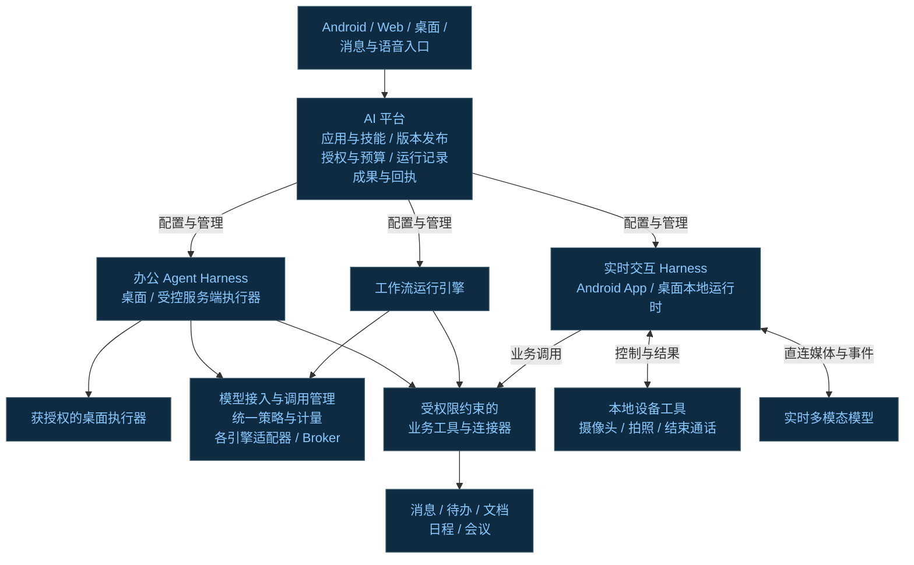

本图描述逻辑职责，具体部署和组件连接见第 7.2 节。办公 Agent Harness 在桌面或受控服务端执行器内运行，桌面工具执行沿用自身授权边界。实时交互 Harness 位于 Android App 或桌面本地运行时，分别调用本地设备工具及云端业务工具；摄像头、拍照和结束通话由客户端检查权限、执行并确认实际结果。桌面端优先基础候选及增量适配见第 7.5 节。

平台到运行引擎的箭头表示配置、授权与运行管理，客户端到实时模型的双向箭头表示 Android 直连或桌面本机 daemon 连接供应商，业务服务器不承载持续媒体。模型接入与调用管理统一策略、能力及计量规范，具体调用沿用各引擎适配器和 Broker。业务数据保留在原领域系统，工具和连接器每次执行均受调用主体权限约束。技能配方、成果回执、来源与上下文、调度及评估的详细设计见后续对应章节。

### 7.2 组件关系

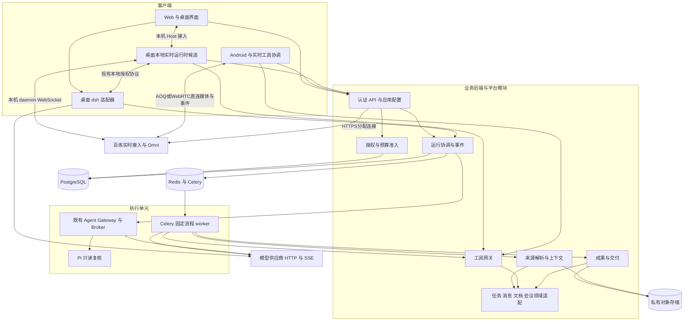

图中桌面 dsh 调用模型仍经自身 Broker；箭头省略该内部组件以保持主图清晰。`Web` 节点中的本机 Host 接入仅指聚视 Electron 宿主，普通 Web 页面不自动获得本地 daemon 或 dsh 访问权。桌面实时运行时候选持有自己的实时模型连接，不把 dsh 的 Broker 当作实时媒体代理。Pi Gateway 使用独立持久状态与版本协议，不接入业务 PostgreSQL。外部 IM／文档服务通过领域适配调用，不能因图中合并为 Domain 而直接读写其数据库。

### 7.3 运行引擎职责

先按目标选择执行方式，再决定是否需要模型及 Harness。统一平台不意味着所有操作都进入 Agent 循环，也不意味着所有模型请求和媒体流都经过同一个 Broker。

| 需求／触发方式 | 执行方式 | 选择依据 |
| --- | --- | --- |
| 表单新建任务 | 直接调用 Task 领域服务 | 字段与授权已明确，不需要模型推理 |
| 自然语言新建任务 | 受限字段提取、确定性校验与领域提交 | 意图需要理解，业务写入仍由固定契约约束 |
| 消息转任务 | 固定工作流 | 权威取数、上下文分析、候选去重与提交步骤可预定义 |
| 群总结、周报 | 固定工作流，后续可由调度触发 | 数据范围、统计、生成与核验步骤可预定义 |
| 开放式对话办公 | 技能路由；无法预定义步骤的目标进入办公 Harness | 需要多轮澄清、选择工具和依据反馈调整计划 |
| 实时语音／视频对话 | 实时 Harness，业务请求桥接到对应执行器 | 需要低延迟轮次、设备控制与媒体资源生命周期 |

明确请求优先直接工具或现有技能；只有固定步骤无法完成目标时，才启用受限动态 Agent。实时会话与后台长工作分别管理取消、超时和恢复，不能用挂断电话等同取消已经授权的全部办公任务。

| 引擎 | 生命周期 | 执行位置 | 适用场景 |
| --- | --- | --- | --- |
| 固定工作流 | 秒至分钟；持久步骤与业务幂等 | 独立 Celery 队列与后端服务 | 消息提取、群总结、周报 |
| 办公 Harness | 多轮工具、等待输入、预算与取消 | 桌面或受控独立执行器 | 开放办公目标、文件生成 |
| 实时 Harness | 连续音视频、轮次、设备权限、打断 | Android App／桌面本机 Host＋daemon，云端提供业务工具 | 电话、屏幕／视频助手与语音办公 |
| 调度协调 | 创建运行、去重、触发恢复 | 后端／Beat，执行在上述引擎 | 周报与订阅 |

平台统一外部运行索引和事件语义，内部权威状态由原引擎管理；适配器映射状态，不通过双写让两个组件同时拥有执行控制权。原 Work run 是权威执行记录，平台 Run 为聚合索引；新固定流程可直接使用平台 Run 作为权威记录。

### 7.4 代码组织建议

新增 `src/backend/ai_platform/`，包含 `applications`、`releases`、`runs`、`sources`、`tools`、`schedules`、`evaluations` 和 `api` 等职责模块。业务工具执行逻辑保留在 core／work 的领域服务，平台适配器调用这些服务，避免在网关复制任务校验。

Web 在现有 `features/work` 扩展入口，并新增 `features/ai-platform` 管理功能。Android 在现有 `feature-assistant` 添加发布配置与业务工具适配；SDK 抽取安排 P3。Work Agent 保留独立目录和契约，平台通过适配层接入。

首期不引入消息总线、服务网格或新通用 Agent 框架作为四项固定技能的前置依赖。针对云端长等待、恢复和受限对话循环，已完成隔离 LangGraph 验证，并增加默认关闭的正式办公图适配及真实队列故障验证，进展见第 18.16—18.17 节；生产依赖安装与运行入口尚未切换。框架只承载运行机制，权限、准入、预算、来源与业务回执继续由现有领域服务控制；隔离证据和生产准入缺口见第 18.5 节。

### 7.5 桌面端实时 Harness 基础候选

**桌面端优先以 Qwen-Live-Harness 为实时交互基础进行接入验证。** 它负责实时对话、轮次与工具协调、后台委派和结果播报；聚视平台继续负责企业配置、权限、预算与持久运行；dsh／Pi 保留执行与只读复核职责。该选择是 P3 的基础候选，不是生产采纳或跨平台交付已经完成。

调研基线为 Qwen-Live-Harness 1.0.0、提交 `b6ce544ebbcd7417e37e0314ec946466c49c615c`。官方完整体验目前支持 macOS 12+；Windows／Linux 支持正在推进，但官方说明未提供可作为本项目交付承诺的时间和验收范围。聚视现有 Windows Electron 客户端不因此自动获得该实时能力。组件与图解见[专项调研](../research/qwen-live-harness-components-2026-10-13.md)，官方依据见第 21.2 节。

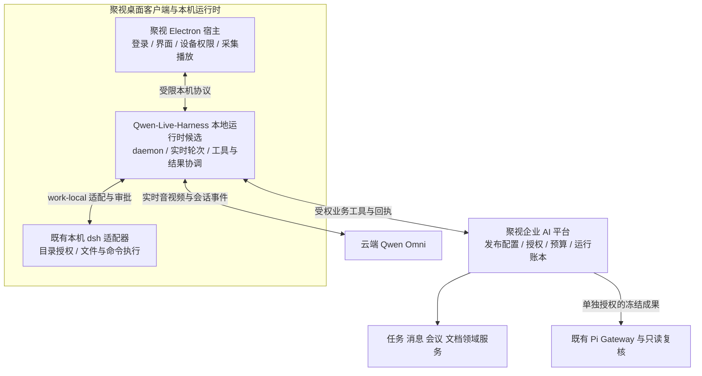

图为目标接入关系。本机 dsh 的模型调用继续走其原 Broker，Pi 继续通过独立 Gateway；两者均不复用实时模型会话作为权威执行账本。

| 范围 | 采用方式与责任 |
| --- | --- |
| 音视频、VAD、打断、工具续答与播放确认 | 优先复用上游机制，分别验证模型首包、实际播放和旧回调隔离 |
| 后台受理、进度、审批与结果播报 | 接入既有任务契约；区分 accepted、完成与用户已听到，不从播报推导业务成功 |
| Host 与 daemon | macOS PoC 可先使用上游配套 Host＋daemon；产品阶段将媒体与桥接能力融入聚视宿主，本机 daemon 作为受管独立进程 |
| 本地执行与复核 | 为现有 dsh／`work-local/v1` 增加适配；目录授权与命令审批保留，Pi 不增加写权限或自主派单 |
| 企业业务与治理 | 平台发布快照、登录主体、工具 action_id、权威回执、预算和成果继续由原领域服务管理 |
| Memory 与 Proactive | 按企业策略和明确范围启用；记忆按主体隔离，不自动吸收全部企业资料，通话监控不替代持久化 Schedule |
| 操作系统能力 | 截图、系统权限、设备路由、快捷键、打包与退出按平台适配；必要能力未通过则不开放相应平台入口 |

上游包不是现成的聚视插件或稳定 Android SDK。适配代码固定上游提交和配套协议版本，将企业工具、dsh 和系统能力放在边界明确的模块中，升级时回归两进程协议、任务身份、播放回执及恢复行为；不得通过自动拉取最新后台 CLI 扩大生产能力。

业务工具每次核验当前主体与资源范围。超时、断连和模型重连不能仅靠工具 call_id 或提示词防重：写操作使用稳定 action_id，未知结果查询原回执，不创建新请求重放。挂断停止本轮媒体和未授权请求；已明确受理的办公 Run 保持独立生命周期，在 Work 中提供状态、成果和单独取消入口。本机进程退出后的恢复仍需平台和原执行器账本验证，不把上游进程内重连当作跨设备恢复证明。

验收先覆盖三项闭环：实时语音＋屏幕理解；语音业务操作取得唯一回执；后台长任务在挂断后继续并交付成果。macOS 验证和 Windows／Linux 能力适配可以分别推进；后两者必须有实际构建、设备与业务链路证据，不能以未来支持计划替代验收。工作包见第 18.4 节。

## 8. 整体执行流程

### 8.1 从用户请求到成果

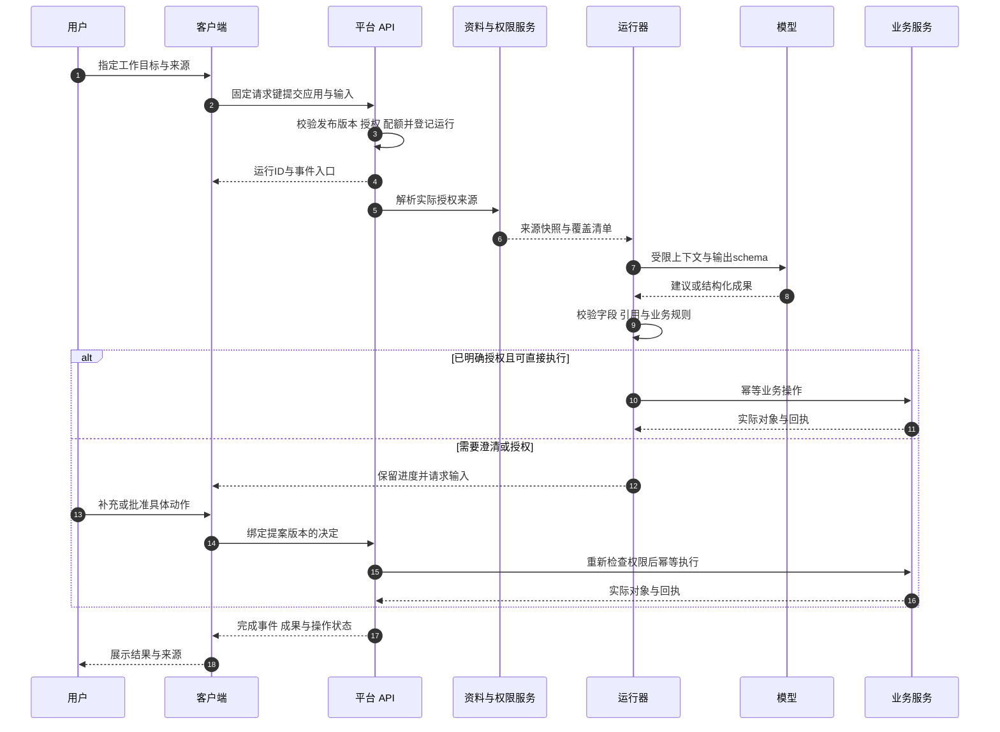

模型输出通过校验前只能作为候选。异步执行的 UI 不以收到 HTTP 202 判断工作成功；成功事件必须匹配成果或真实业务回执。源资料变化或授权失效时，已冻结内容只用于允许的处理和审计，不成为继续读取或发布的永久授权。

### 8.2 消息转任务流程

1. 用户选择消息，客户端发送权威定位和请求键。
2. 资料适配器核验消息访问、历史范围、版本和有效状态，形成快照。
3. 模型提取候选，确定性逻辑解析人员、日期和目标清单，展示歧义与来源。
4. 用户授权选定候选；普通重复检测提示已有事项，不自动改写。
5. 创建 ActionProposal，固定目标和 payload 哈希；无歧义且原请求已明确授权可直接进入提交。
6. 执行前重查群及清单权限、候选版本和分享范围；领域服务在同一事务内创建 Task、来源关联和业务幂等回执。
7. 通知使用持久交付记录异步发送；发送失败不使已经创建的 Task 被重建。

### 8.3 群总结流程

先锁定请求范围及消息上界，再完整分页获取可访问消息；每页记录游标、数量、版本摘要和取数状态。块级总结使用固定来源 ID，合并时保留索引。校验器只允许引用已处理来源，明确验证关键决策和行动项；发现覆盖缺口，返回部分结果与原因或要求缩小范围。

快照哈希用于发现输入变化和合法缓存复用，不用于证明权限。首次取数、运行继续、成果读取与分享分别检查当前权限。发布前源消息撤回时，对依赖内容失效或重生成；分布式来源无法与发布做统一事务时记录最终校验时间，提供撤回事件处理和失效机制。

### 8.4 周报与定时周报流程

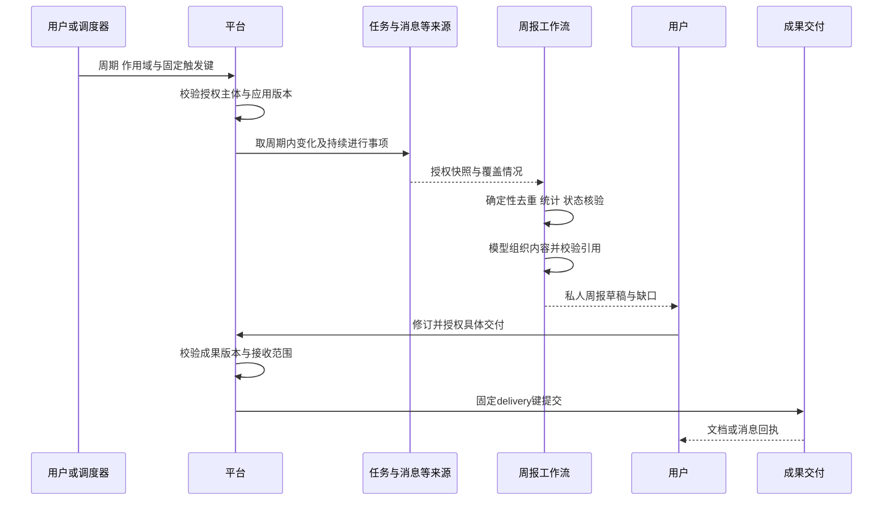

定时规则默认生成私人草稿并通知本人。用户可以提前授权固定接收范围的自动交付；每次运行仍验证范围和权限。时间范围默认本地周一 00:00 到下一周一 00:00 的半开区间，数据库转换为 UTC；允许企业选择周起始日。首次漏触发默认只补最近一期，历史补跑由用户发起。

### 8.5 语音办公流程

客户端在会话建立时按已实现能力注册业务工具。Android 由 App、本机桌面由受管 daemon 接收 Omni 的完整工具项并调用平台工具执行入口。平台从登录态和绑定会话推导主体，拒绝模型提供的任意用户／企业身份。

即时操作返回回执或澄清；长工作返回 `accepted` 与 run ID，模型只播报“已开始”，不播报“已完成”。确认绑定具体 action 哈希，通话挂断使未授权请求失效；已授权异步工作保持自己的生命周期。

Android 连续音视频在 App 与供应商之间传输；桌面连续媒体在宿主与本机 daemon 之间传递，由 daemon 连接供应商。两种路径的业务工具控制流均经平台，不把媒体放进 Celery，也不让普通 HTTP 连接池承担实时会话复用。

### 8.6 云端实时应用配置与客户端接入流程（P3）

以下是 Android 目标流程。云端应用配置、发布解析及办公工具桥接需要增量实现；已有 AOQ／WebRTC 媒体链路、会话分配与租约通过适配器复用。桌面目标分工见第 7.5 节，复用平台配置和工具契约，但其 WebSocket 凭据及会话生命周期按独立运行时适配，不能直接套用 AOQ／WebRTC 连接材料。

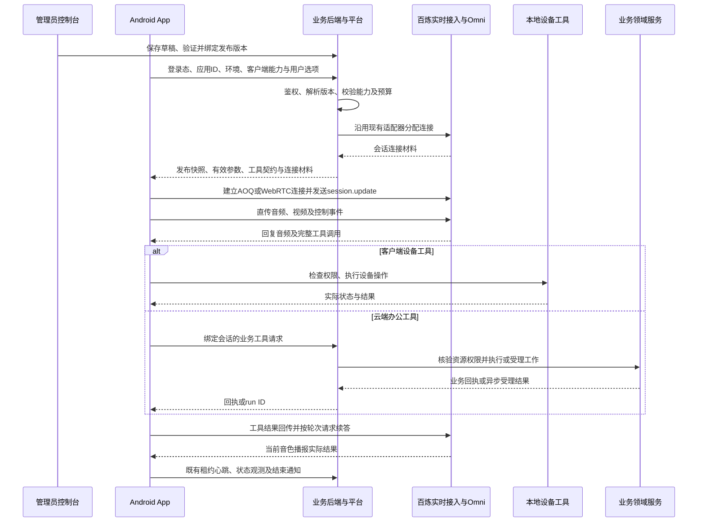

控制流分为 App 与平台的配置／授权／业务工具流，以及 App 与 Omni 的会话／工具事件流。连续媒体双向直连供应商；单次“帮我看”沿用独立静态图片推理路径，用户展示与模型输入保持同一最终图片。平台应用 ID 用于定位配置，不能代替登录认证；设备控制工具留在 App，云端办公工具只通过后端受权入口执行。

## 9. 技能契约与生命周期

### 9.1 技能包

技能版本包含说明、适用场景、输入／输出 JSON Schema、受信执行配方、提示词版本、所需工具与来源、运行限制、依赖版本、评估集及内容哈希。执行实现存于代码或受限流程定义中，不在提示词内藏入可直接运行的代码。

下面是设计契约示例，不是现有 API 或可以直接导入的生产配置：

```json
{
  "skill_id": "chat-to-todo",
  "version": "1.0.0",
  "runtime_type": "workflow",
  "implementation_ref": "builtin.chat_to_todo.v1",
  "input_schema_ref": "chat-to-todo.input.v1",
  "output_schema_ref": "chat-to-todo.output.v1",
  "required_sources": ["im.message"],
  "required_tools": ["im.read_messages@1", "task.create@1"],
  "effects": ["read_messages", "create_task", "optional_share_to_group"],
  "defaults": {"candidate_limit": 10, "auto_publish": false},
  "limits": {"max_model_calls": 4, "max_candidates": 10},
  "evaluation_suite_ref": "chat-to-todo.acceptance.v1"
}
```

`required_tools` 声明依赖，运行时只开放经过当前授权裁剪的工具。创建任务与分享是不同副作用；`optional_share_to_group` 必须匹配提交内容及分享授权，不能因 manifest 声明就自动执行。

技能安装页显示用途、读取哪些资料、可能创建或发送什么、费用构成和缺失依赖。允许管理员启用技能不代表管理员可以替用户读取私人聊天。用户入口显示“尚未连接资料”或“缺少权限”，避免“已安装即能用”的误解。

### 9.2 安装、升级与撤销

1. 管理员选择受信技能版本，核验企业允许的模型、工具和资料类型。
2. 建立 SkillInstallation，连接器绑定单独完成；授权主体和作用域明确记录。
3. 应用草稿引用固定 SkillVersion，配置参数并通过发布测试。
4. 发布生成依赖锁定清单，记录技能及全部子技能、工具、提示词版本。
5. 技能升级先产生新版本和兼容性报告，企业选择升级、测试后发布；不静默修改在途执行。
6. 停用禁止新运行；普通停用允许已授权运行结束，紧急撤销阻断后续敏感工具并请求取消。

同一企业可保留多个技能版本供不同应用使用。版本兼容至少检查输入输出字段、工具副作用、权限需求、预算与客户端能力；新增写入或扩大资料范围必须显式重新配置。凭据轮换和授权撤销实时生效，不受版本快照冻结。

### 9.3 技能选择与组合

首期快捷入口显式选择技能，办公助理后续只在已安装且当前可用的候选中路由。模型推荐技能，不负责决定权限。一个普通请求优先选择一个主技能，复杂请求拆分为带依赖的步骤；限制嵌套深度和累计调用数，拒绝循环依赖。

技能详情展示运行结果与业务回执，不能把“提示词执行完成”视为“任务已创建”。商业市场后续可区分官方、企业自建与第三方来源；不以安装量代替安全审核和本企业回归测试。

### 9.4 参考聊天消息提取待办的 SKILL.md

2026-10-11 已阅读用户提供的 `dingtalk-chat-to-todo` 主文件全文，内容包括目标、禁止事项、强制要求、能力与工具、四阶段工作流、上下文传递、任务判断、展示格式、候选群排序、意图路由、使用示例和错误处理。文件另引用 `references/workflow-detail.md` 与 `references/task-recognition-rules.md`，这两个文件未提供；没有验证真实 dws 命令、底层权限或实际执行效果。

这份主文件是一套以自然语言描述的业务执行规程，技能不只是名称和一段角色提示词，还包含执行步骤、输入范围、工具约束及业务判断规则。本平台建议保留可读的 `SKILL.md`，与第 9.1 节的机器契约及受信实现共同组成技能包：说明指导模型与用户理解，Schema 约束数据，运行器与领域服务强制执行边界。文件中的钉钉命令作为参考资料分析，不是此次文档工作获授权执行的操作。

| 主文件规则 | 设计价值 | 聚视适配 |
| --- | --- | --- |
| 指定群，未提供群名时询问，不自行搜索所有会话 | 控制取数范围，避免过度读取 | 聊天菜单沿用已选群；Work 入口要求选择明确群或核验唯一候选，不要求已知群上下文的用户重复输入名称 |
| 默认最近 24 小时；用户指定时间优先；工具使用绝对时间 | 固定输入边界，便于复现 | 仅对群范围提取提供可配置的 24 小时默认值并展示起止时间；单条／选中消息入口沿用明确消息集合，不额外拉全群 |
| 有后续页时继续分页 | 避免只看第一页而遗漏事项 | 固定上界、逐页取数；达到预算／范围限制或游标异常时明确不完整，不死循环、不冒充全部处理 |
| 不脱离上下文判断单条消息 | 减少误读、否定及撤销遗漏 | 按授权范围读取必要的引用、相邻讨论及后续更正；上下文不足时返回待澄清候选，不无边界扩大时间范围 |
| 不把即时招呼识别为待办 | 区分临时交流与可持续执行事项 | 当下招呼默认不提取；明确的未来会议安排、约定和交付仍可成为待办，不能机械排除所有“开会”表达 |
| 不能编造群、用户和任务 ID | 业务动作必须有真实对象 | 群来自已授权定位，人员来自目录解析，Task ID 来自创建回执；用户选择的 ID 仍由后端核验 |
| 使用 dws，并要求 JSON 结果和正确参数 | 固定工具面与结构化回执 | 使用聚视受信工具网关、领域服务及 Schema；不复制钉钉 CLI，不允许模型绕过工具自行拼 HTTP 请求 |
| 从群中识别与自己有关的内容 | 明确责任人和技能目的 | 区分“提取我的待办”和“提取选定范围行动项”；不默认把全群所有人的事项创建给当前用户 |

**四阶段流程及边界。** 原技能的 A 至 D 分别是定位群、拉取消息并找到个人锚点、结合上下文判断适合度、展示确认并创建。聚视保持这个分工，补充权威来源核验、固定范围、授权分享、逐项回执与幂等恢复：

| 阶段 | 输入与只读输出 | 进入下一阶段的条件 |
| --- | --- | --- |
| A 定位主体与群 | 当前登录主体、已选群或用户给出的名称 → 已核验群 ID 与明确时间范围 | 多个候选先让用户选群；不由模型推测 user ID 或企业归属 |
| B 取数与关联候选 | 固定范围、权威分页 → 来源快照、覆盖记录、与用户有关的候选及上下文 | 有限范围内分页完成；部分取数则显式进入部分结果，不声称完整 |
| C 识别与解释 | 候选及同话题上下文 → 建议／不建议／待澄清、字段、理由与来源 | 责任人、事项和时间有依据；不能通过词命中直接跳到创建 |
| D 选择与提交 | 用户选择的具体候选及修订 → 授权动作、Task 与逐项回执 | 按实际字段和分享范围授权，领域事务完成后才显示已创建 |

第 5.2 节的 P1 单条／选定多条入口保持原范围；按群和时间段扫描是同一技能的扩展入口，在权威分页、上下文和成本验收通过后开放。选定单条可以读取范围内必要上下文，但不能在用户不知情时变成全群扫描。

**个人关联与待办适合度。** 原技能用结构化 @ 当前用户、文本中的当前用户姓名作为锚点。聚视优先使用 IM 返回的结构化 mention、真实账号及回复关系；姓名匹配只召回候选，同名、引用、已完成或他人转述都可能误匹配。没有 @ 或姓名但明确指向用户的事项也可结合对话关系成为候选；无可靠证据时澄清，不强行指派。

判断依据是是否存在尚未完成的行动、责任、交付或后续跟踪价值，而不是只匹配“跟进”“明天”等词。结合前文补全任务对象和日期，同时检查后文的撤销、改派、延期或已完成回复。对话中的时间先按消息事件时间解释，例如周一发的“明天交”不能在周五提取时解释成周六；用户新指令中的时间按请求时间解释。过期日期显示原约定和当前状态，不自动顺延。

候选展示分为“建议创建”“不建议创建”和“待澄清”，提供标题、负责人、具体日期／原表达、优先级、判断理由和可访问来源；标题避免只写“处理一下”。用户可将低适合度项选择为“仍然创建”，这只是个人判断覆盖，不是权限、真实性或必填字段检查的豁免。未匹配到候选只表示在当前范围和规则内没有找到，不宣称用户没有任何任务。

原技能要求展示并确认后逐条创建，适合消息批量提取场景，聚视沿用候选选择作为授权；与第 5.1 节明确直接建任务的请求区分。优先级默认映射到现有业务枚举，不复制钉钉数值 `20`。模型建议的优先级展示依据并允许修订；不能确定截止时间时不填写，不能为提醒方便编造日期。

**候选排序、分页与降级。** 原技能按 @ 次数、姓名次数和本人活跃度对同名候选群排序，还会隐藏低分候选。聚视首期优先展示群名、组织、成员等已授权元数据，让用户选择后再取正文；不为排序先读取多个候选群的大量聊天。后续若加入相关度推荐，仅使用明确允许的数据、限制候选及成本，保留“查看全部匹配”，分数不能视为群选择授权。

原文件描述按最后一条消息的 `createTime` 推进分页，但不能据此证明实际命令支持稳定无遗漏分页。聚视采用 IM 权威游标，或服务明确支持的时间戳＋消息 ID 稳定排序，并按消息 ID／版本去重。记录范围上界、已处理页和游标，测试同毫秒消息、页边界、乱序、重复页与游标停滞。

主文件允许翻页超时后对部分消息继续识别并标注不完整。聚视可提供部分候选预览，但缺少前后文、后续撤销或责任依据的候选保持待澄清，不自动提交；用户只能授权证据足够的具体候选。恢复优先继续原范围的检查点取数，不能悄悄变更时间段或扩大群范围。

**路由与技能包组织。** 借鉴主文件区分直接建待办、群消息提取、消息查看、发消息、会议纪要转待办及文档生成。直接新建路由到 create-work-task；提取群消息路由到 chat-to-todo；只有查看意图不创建任务。会议转任务后续使用对应来源适配器及技能，不把会议文本伪装为 IM 来源。

建议每个包由 `SKILL.md`、机器 manifest、按需参考说明和评估样例组成：主文件保留用途、关键流程和边界；详细参数、例子和判断规则放入可版本化 references。发布版本锁定全部文件及依赖，校验说明中的工具名和字段与机器契约一致。当前参考文件缺失不会由模型凭空补成已存在的命令契约。

建议本平台的技能说明包含：用途与触发条件、输入和缺失项、来源范围、待办判断规则、逐步执行说明、工具与依赖、授权和分享影响、去重和重试、成功／部分完成／失败结果、正反例。说明与机器契约有同一版本及内容哈希，发布时核验一致性。

技能包中的自然语言“禁止事项”不是唯一防线。分页完成由来源适配器验证，ID 由后端解析，写入由领域服务控制，幂等由业务回执保证。群消息本身出现的操作指令依然是资料内容，不得借技能执行获得授权。

P1 采用“可读技能说明＋固定工作流”实施；P2 的办公助理可以阅读相同技能说明来选择和组织工作，但不能绕过固定提交协议。这样既能借鉴 SKILL.md 的可解释性，也能保证多个入口使用一致的业务规则。

新增评估用例覆盖：同名用户、没有显式 @ 的责任表达、前文任务对象、前文截止时间、消息时间与提取时间不同、后文撤销／改派／已完成、即时招呼与未来约定、低适合度手动选择、多个同名群、同时间戳跨页、部分取数后恢复，以及重复确认后的逐项回执。

## 10. 资料、上下文与成果技术方案

### 10.1 统一来源协议

| 字段 | 含义与约束 |
| --- | --- |
| tenant_id、source_type | 服务端推导租户，区分 IM、Task、会议、日程、文档 |
| resource_id、parent_id | 权威资源定位，如消息及所在群；不接受模型虚构定位 |
| version、updated_at | 来源版本／修改时间，支持撤回、编辑与缓存失效 |
| event_time、timezone | 业务事件时间与解释日期所用时区 |
| access_policy_ref | 当前权限核验入口；不是永久授权令牌 |
| content_ref、digest | 受控快照位置与哈希，避免在队列中复制大正文 |
| citation_id | 本次成果内稳定引用 ID，可解析回授权来源 |
| coverage | 时间边界、分页进度、数量、不可读取类型、缺口 |

来源适配器提供 `resolve`、`list_page`、`check_access`、`check_version` 与可选的撤回事件。完整群总结先按范围分页；回答具体问题才使用检索排序。附件、语音未转写或不支持消息类型明确列为未处理，不能将其统计为已经理解。

取数过程中保留固定消息上界，防止新消息无限延长执行。底层服务只能提供弱一致性时，标明快照时间及可能的编辑窗口。历史权限以来源系统为准，不自行把“现在加入群”解释为“可看全部历史”。

### 10.2 长文本处理

群总结以话题、时间和消息长度分块，重叠只为保持上下文；来源 ID 去重避免重复计数。先抽取带出处的事实、决策、行动项和争议，再合并为摘要；不只对块级自然语言反复压缩而丢失来源。

周报先通过程序计算任务状态、完成时间、延期与数量；模型只组织表达和给出有证据的归纳。不能把本周创建但未完成的任务算作本周交付，也不能把消息数量推断为员工绩效。

每个技能设条数、字符／token、最大时间范围及调用预算。超限时提示缩小范围或选择异步批量处理，不悄悄截断。具体阈值通过试点测量确定，控制台显示生效值；同一总预算覆盖分块、合并、校验和子技能调用。

### 10.3 RAG、记忆与缓存

复用已有检索适配器，P1 不要求先建设统一向量库。后续知识问答再评估 PostgreSQL 向量扩展或独立检索系统，依据数据量、权限过滤、检索质量和运维成本决定，不能将“采用向量库”当作总结完整性的证明。

缓存键至少包含租户、来源版本摘要、作用域、应用／技能／模型配置哈希。命中缓存仍重查当前访问权限；不能将某人的完整群材料缓存用于另一人的摘要。授权变化、删除和来源撤回触发失效。

P1 仅保留当前工作与明确关联会话上下文。P2 的长期偏好由用户查看、修改和删除；企业事实记忆保存来源及过期规则。摘要、模型判断、用户偏好与业务系统事实分开存放，不将模型推测写回权威事实。

### 10.4 成果访问与交付

成果保存正文版本、来源清单、覆盖情况、应用依赖快照、生成主体、修订记录和可见策略。默认私人草稿；共享到群或团队是独立交付动作。可见性需同时满足成果策略和当前来源访问规则；不能默认把含私聊材料的报告发布到大群。

团队报告需要从生成阶段选择面向该团队可使用的资料集合，或采用独立审核的脱敏摘要。首期不依赖未实现的自动脱密算法。复制或下载的文件无法由服务端完全收回，应在功能说明中准确描述平台内撤回的边界。

## 11. 工具执行、幂等与运行生命周期

### 11.1 工具注册

工具目录统一记录名称、版本、输入输出 Schema、执行位置、所需范围、副作用、超时、幂等能力、重试方式和执行实现。模型只看到当前可用的工具投影；后端每次执行仍进行鉴权，不因工具已经注册而信任调用。

内部名称可以采用 `task.create`；编译到供应商协议时映射到其允许的函数名并保存映射版本。MCP 可作为工具发现和调用适配协议，但不能替代平台的主体、权限、预算或业务幂等检查。[MCP 工具协议](https://modelcontextprotocol.io/specification/2025-11-25/server/tools)

| 工具类型 | 示例 | 执行要求 |
| --- | --- | --- |
| 只读 | 读取授权消息、查询任务、解析人员 | 当前权限与范围；限制返回量 |
| 可逆写入 | 创建任务、修改草稿 | 固定动作、业务幂等、并发版本核验 |
| 外部交付 | 发群消息、发布报告 | 接收范围、内容版本、交付回执与去重 |
| 本地设备 | 摄像头、拍照、结束通话 | App 权限及实际设备状态；不伪装为云端动作 |
| 桌面执行 | 文件处理、命令执行 | 沿用 dsh 的审批与执行边界；另评估真正隔离 |

已有明确、具体的用户指令可构成授权，不额外要求每次点击确认。自动化只能在事先授权的规则内执行；模糊负责人、目标、内容或分享范围先澄清。危险或扩大作用域的动作按企业策略要求具体确认。

### 11.2 ActionProposal 与执行回执

候选提交形成 ActionProposal：租户、主体、来源、目标、规范化 payload、payload 哈希、预期版本、授权来源、有效期和状态。用户修订生成新修订号，旧确认不能授权新的内容。模型返回的 `call_id` 仅是协议相关 ID，不是跨会话业务幂等键。

业务 `action_id` 在用户选择或触发实例建立时生成，重试沿用；相同键配不同 payload 返回冲突。Task 创建领域事务同时保存任务、来源、授权分享关系与 ActionReceipt，建立租户和 action_id 唯一约束。幂等回执再次读取时也核验调用者权限。

批量创建逐项有稳定 action_id，返回每项成功、失败或待澄清；重试只处理未完成项。相似任务检测只是提示，不能将两个不同授权动作强行合并。

通知使用事务 Outbox，消费者使用 Inbox／唯一交付键去重。外部系统若不支持幂等且请求超时，先查询回执或人工核对，不盲目重发。平台不承诺跨所有外部服务的“全局恰好一次”。

### 11.3 状态机

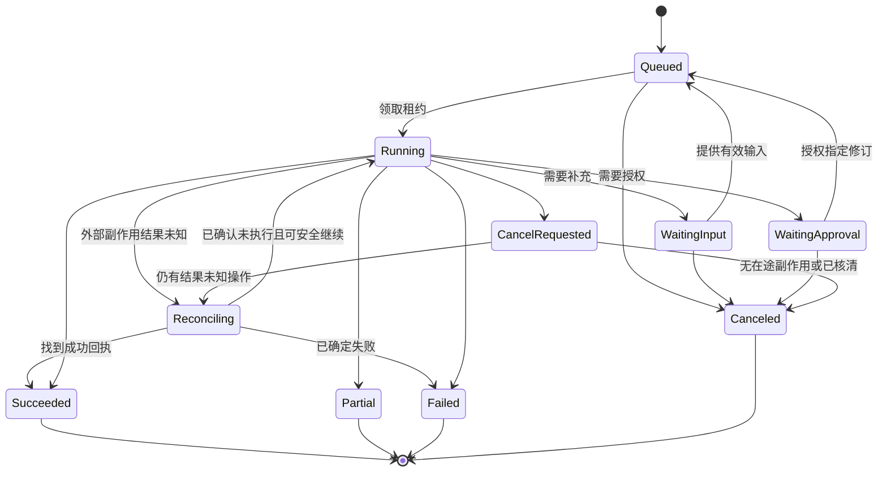

Run 状态与成果交付状态独立：草稿成功不代表群消息已发送。取消阻止未开始的动作，不撤销已成功创建的 Task；存在未知副作用时进入核对状态，界面显示“正在确认操作结果”，不能直接显示已取消。

工作流等待输入／审批时持久化检查点并释放 worker，不占用线程等待用户。恢复使用新的租约 generation 和 fencing 核验，过期 worker 不能提交新的结果；工具领域事务仍以 action_id 防止重复副作用。跨服务调用在外发前检查租约，失效后已经发出的操作必须核对回执，不能只依靠 fencing 解决外部副作用。

### 11.4 事件与恢复

事件有 run ID、单调序号、类型、时间和可见级别；客户端断线用序号补拉。流式文本不作为最终权威状态，客户端重新连接后以快照和回执为准。

只读步骤可按检查点重试；写入步骤通过回执恢复。原 Run 的继续与使用新资料重新执行分开操作，后者创建新 Run 和新授权动作。日志重放用于诊断，不执行真实业务工具。

工具执行失败、模型回答失败、成果生成失败、交付失败分别记录，避免用户因“语音确认失败”误以为任务创建失败并重新创建。

## 12. 模型接入、资源与成本治理

### 12.1 接入原则

模型目录统一管理能力与策略，执行路径保留适合场景的协议和生命周期。供应商名称、模型名称、协议、区域、工具能力、上下文及输出限制分别记录；不把“同属阿里云”解释为可共用全部参数。

| 场景 | 接入策略 | 池化与扩展边界 |
| --- | --- | --- |
| 字段抽取、总结、周报 | 云端既有模型接入及受控结构化输出；按评估选型 | 复用进程内 HTTP／SDK 客户端，按事件循环管理生命周期 |
| Filetrans、Embedding | 延续现有连接复用方案，增加租户预算和任务可观测性 | 异步任务和连接池分别限流；轮询不无限占用 worker |
| 桌面 dsh 与 Pi | 原 Broker 和运行授权适配为平台模型策略 | 保留任务隔离和凭据范围，不从公共模型目录下发全权限 Key |
| 桌面实时 Harness 候选 | 本机 daemon 使用 Omni WebSocket，平台适配配置、工具与准入 | 每个会话独立连接；上游本地用量按实际来源标记，不能视为供应商确认或覆盖原 dsh／Pi 用量 |
| Omni、实时翻译、实时 ASR | 已验证的客户端直连与服务端分配模式 | 每个实时会话有独立连接；普通 HTTP 池不能合并媒体会话 |
| 云端实时适配器 | 需要云端业务处理的会话保留原 WebSocket 生命周期 | 是否换 SDK 以维护收益和生命周期回归为依据 |

客户端模型直连不等于客户端直连所有企业资料；业务取数及写入仍通过经过鉴权的平台入口。即时模型与长时间 Agent 采用不同预算和超时策略，不强行统一为一个 SDK。

### 12.2 模型路由与故障

应用版本引用 model_policy，包括主模型、允许候选、必要能力和费用上限。首期固定主模型；P2 再依据质量、延迟和成本评估路由。记录每步实际模型及配置，不能把更换模型隐藏成同一版本的确定性行为。

网络、限流和暂时服务错误按退避重试，并计入总体期限。Schema 或权限错误不重试。工具调用发生前可换允许模型；发生后重放仅传入已完成操作及其回执，不重复执行工具。供应商能力不足时降级为明确的部分功能或失败，不静默删除权限、引用或确认步骤。

### 12.3 预算与计量

企业、应用、用户与 Run 设置配额，准入时原子预留预算；每次模型／工具调用前核验剩余额度。价格表有生效时间、币种和计量单位，以供应商实际计费产品为准，实时套件、模型直连和设备 License 不混算。

计量记录来源分为供应商回报、服务端观察、客户端回报和估算，保留原值、调整记录及置信级别。缺失 usage 不记为零成本，也不因客户端低报立即释放全额预留。Run 结束先按规则结算，后续与供应商账单核对差异；首期可人工对账，不宣称已经具备自动供应商账单 API。

内部成本看板先展示 token、音频／视频时长、请求次数、估算金额及账单差异。SaaS 商业计费后续单独设计，不直接把内部估算当作应收账单。

客户端直连主要减少业务服务器的媒体带宽与转发负担，不代表模型推理费用降低。平台租约用于业务准入和生命周期管理，能否强制终止供应商会话及计费必须分别验证；不能把本地租约过期当作上游已经停止计费的证据。

### 12.4 并发治理

限制包括企业活跃 Run、模型调用并行数、供应商 QPS、HTTP 池、worker 数、实时会话数与外部工具速率；这些数值不能互相替代。连接池总容量按进程数累加，监控等待连接时间，不能用扩大池无限增加上游压力。

采用企业公平队列及每类技能的并行上限。交互任务和批量总结分队列，周报集中触发增加抖动窗口。达到限制返回排队或明确拒绝，并提供预计状态；当前 Gateway 的活跃任务额度不视为同等数量的并行推理能力。

### 12.5 实时平台技术路线取舍

| 路线 | 可复用能力与收益 | 新增工作与约束 | 采用策略 |
| --- | --- | --- | --- |
| 自建应用控制层，保留 Android Omni 客户端直连 | 复用现有 AOQ／WebRTC、设备工具、拍照、分配和租约；自主管理应用与发布 | 建设配置发布、兼容、观测和业务工具桥接 | P3 Android 主路线 |
| 桌面复用 Qwen-Live-Harness 实时运行机制 | 复用本机 Host＋daemon、轮次与工具协调、后台结果播报 | 聚视宿主与企业工具、dsh 适配，模型凭据与预算验证，系统能力及配套版本治理 | P3 桌面优先基础候选；三项闭环与各平台验收后决定生产采纳 |
| 自建控制台，接入供应商多模态套件运行时 | 在目标套件能力验证后复用其交互与工具组合 | 独立协议／SDK 适配；核验项目管理 API、许可、费用及工具行为 | 单独概念验证，不作为办公 MVP 或 P3 主路线的前置依赖 |
| 自行组合 ASR、LLM、TTS | 可分别选型识别、推理和合成组件 | 承担流式编排、打断、取消、回声处理和容量治理 | 有明确能力或成本诉求后单独立项 |

应用配置需声明运行时及其能力边界：使用端到端实时模型时，不向管理员承诺可独立替换内部 ASR／TTS；需要独立选型时，选择组合式运行时并验证整条链路。套件项目配置与 Omni 的 `session.update` 不能互换，也不能将套件项目 ID 直接当作 Omni 直连会话参数。

控制台字段采用按运行时生成的能力 schema，发布时校验模型、音色、协议、视频、VAD、工具与搜索等组合；不能给不同运行时展示一组含义不明的通用开关。第三方产品的具体支持情况和商用条件在适配时验证，本文不承诺其全部能力可直接映射。

## 13. 定时、事件与自动化

### 13.1 定时模型

本节描述完整目标。已实现固定应用版本、用户预授权、每周私人周报及每日／每周私人群摘要、UTC／IANA 时区、最近一期补偿、重复／重叠保护及暂停恢复，见第 18.30—18.32 节；单次补跑见第 18.42 节。共同任务来源的团队定时报告及预授权内部发布／站内通知见第 18.45 节，生成、交付状态分开记录。周期群摘要与第 18.47 节新增的真人消息事件订阅是两个独立触发入口。节假日工作日历、通用输入模板、服务主体、外部连接器及预授权外发仍按 P2 后续范围实施。

Schedule 保存租户、所有者／明确的服务主体、应用版本、输入模板、时区、规则、启停、错过触发政策、预授权交付与下一次时间。TriggerInstance 保存应触发周期、规则版本、幂等键、Run 及实际结果；调度器重试不会生成重复周报。

唯一键按 Schedule、规则版本及逻辑周期建立；手动“重新生成”使用独立补跑 ID，明确标记新执行。改规则不自动重跑历史周期。夏令时及周起始日已有隔离测试，显示本地时间同时存 UTC；月底、节假日工作日历的完整验收随对应后续能力补齐。

调度器只创建持久触发实例和队列任务，业务执行交给工作流。单活 Beat／调度领导者或数据库领取机制避免重复触发；即使调度重复，数据库唯一键仍兜底。Celery 官方指出周期任务可能重叠，因此需自行控制执行重叠和锁，而不是假定 Beat 提供业务幂等。[Celery 周期任务](https://docs.celeryq.dev/en/stable/userguide/periodic-tasks.html)

默认相同 Schedule 不并行执行，前一期超时进入失败或核对，不无限积压。所有者离职、来源授权失效、预算耗尽时暂停并说明原因，不能自动借用管理员身份继续。

### 13.2 事件触发

P2 支持受控事件：任务到期、群总结订阅、会议纪要完成等。事件保存事件 ID、资源版本、来源与租户；Inbox 去重、短窗口合并及冷却防止一次群聊刷屏产生大量模型调用。自动生成私人结果先于自动外发。

2026-10-13 已实现按群显式启用的真人新消息事件源、持久 Outbox 投递及平台元数据 Inbox，见第 18.46 节。离线推送只在成员离线时触发，不能充当完整事件源；此次投递独立于在线状态。接入事件本身不受理模型运行。第 18.47 节进一步实现固定用户／应用／群授权、合并窗口、冷却、当前权限及消息版本核验后生成私人摘要的闭环；任务到期、会议及其他事件继续实施。默认关闭，不能以受控模型验证替代客户或生产验收。

事件与定时触发共用应用版本、权限、预算和回执；禁止从生成的机器人消息再次无限触发相同技能。外发自动化显示触发条件、接收范围、最近结果和一键暂停。

## 14. 数据模型与接口

### 14.1 权威数据与增量模型

业务 Task、IM 消息、组织与成员继续由各自系统持有。平台保存引用与执行快照，不复制建立另一套任务主表或成员权限主表。

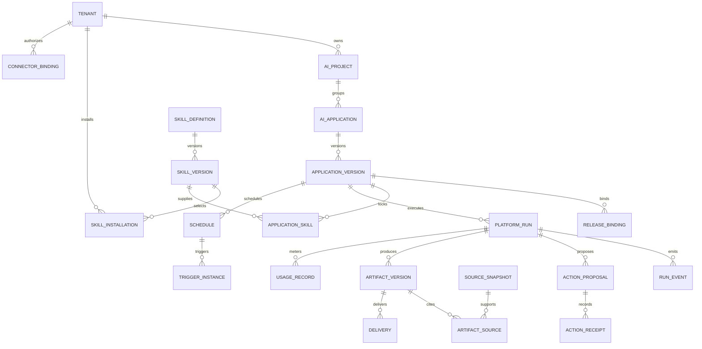

图中的 TENANT 是平台规范化租户标识；P0 需确认与现有组织、IM 企业归属的映射，不能仅通过给新表添加 tenant_id 就认定多租户隔离完成。

| 对象 | 关键字段／约束 |
| --- | --- |
| ApplicationVersion / SkillVersion | 不可变内容、依赖锁、Schema、哈希、发布人；版本号在定义内唯一 |
| SkillInstallation | 租户、技能版本、状态、参数限制；连接器授权独立引用 |
| PlatformRun | 租户、主体、应用版本、状态、预算、检查点、租约代次；关联权威 WorkRun 时不双写其状态 |
| RunEvent | Run 与 seq 唯一、事件类型、脱敏 payload、时间 |
| SourceSnapshot | 租户、来源定位与版本、访问策略、覆盖、内容引用、过期时间 |
| ActionProposal | action_id、修订、payload 哈希、授权、预期业务版本；不含模型提供的身份授权 |
| ActionReceipt | 租户与 action_id 唯一、业务资源 ID、结果、分享／交付范围 |
| ArtifactVersion | 成果、版本、来源清单、可见策略、草稿／发布状态 |
| Delivery | 接收范围、成果版本、固定键、回执、重试或待核对状态 |
| Schedule / TriggerInstance | 时区与规则版本、周期唯一键、Run、触发结果 |
| UsageRecord | 调用 ID、模型、单位、来源、原始量、估算及结算版本 |
| ConnectorBinding | 所有者、服务端凭据引用、范围、状态、检查时间；日志不含 Secret |

常用索引覆盖租户＋状态＋更新时间、租户＋主体＋时间、Run＋seq、来源定位＋版本。大正文与文件放受控对象存储，数据库保留元数据；队列只传 ID。幂等回执生命周期覆盖允许的重试窗口，删除回执前同时关闭该窗口，避免迟到重试再次执行。

### 14.2 建议 API 清单

下列 `/api/v1.0/ai-platform/` 是**目标接口规划**，该命名空间已开始实现，当前可用路径与契约见[首批实现说明](../features/enterprise-ai-platform.md)；本表不是全部接口已实现或部署的声明。已有 Work、任务、AI 分配与租约接口保留，平台通过服务适配器调用，避免客户端直接依赖多个引擎。

| API | 方法 | 用途 |
| --- | --- | --- |
| capabilities | GET | 当前主体、客户端与企业策略允许的能力 |
| applications / applications/{id} | GET、POST、PATCH | 目录与草稿配置；写入需应用管理权限 |
| applications/{id}/versions | GET、POST | 创建不可变版本；附评估与依赖锁 |
| applications/{id}/releases | GET、POST | 环境绑定、灰度与回退 |
| applications/{id}/resolve | POST | P3：按登录主体、环境、客户端能力与用户选项解析可用发布快照；不创建媒体连接 |
| skills / skills/{id}/versions | GET | 技能目录、契约和版本 |
| skill-installations | GET、POST、PATCH | 企业安装、参数限制与停用 |
| connector-bindings | GET、POST、PATCH | 授权绑定元数据；Secret 采用专用受控写入流程 |
| runs | POST、GET | 发起执行／按权限查询 |
| runs/{id} / runs/{id}/events | GET | 快照／按 seq 补拉事件 |
| runs/{id}/input | POST | 提交指定检查点所需输入 |
| runs/{id}/cancel | POST | 请求取消并返回真实状态 |
| action-proposals/{id} | GET、PATCH | 候选与修订，返回 revision 和哈希 |
| action-proposals/{id}/commit | POST | 授权并提交指定修订，支持业务幂等键 |
| action-receipts/{action_id} | GET | 查询副作用回执，不重复执行 |
| artifacts/{id}/versions | GET、POST | 成果读取、人工修订与来源摘要 |
| artifacts/{id}/deliveries | POST、GET | 对具体成果版本授权交付／核对回执 |
| schedules / schedules/{id} | GET、POST、PATCH | 规则与启停 |
| schedules/{id}/triggers | GET、POST | 历史触发与明确补跑 |
| realtime-sessions | POST | P3：对解析的版本再次鉴权与准入，适配已有会话分配，绑定版本、主体和原租约 |
| realtime-sessions/{id}/tools | POST | App 业务工具桥接，校验会话绑定与请求身份 |
| evaluations / usage | GET | 授权角色查看评估与脱敏用量 |

权限预检只帮助显示 UI，不替代执行时核验。所有详情、事件、文件与回执都按对象范围过滤；主体由服务端登录态推导。跨租户请求使用统一的不泄露资源存在性的错误策略。

实时配置解析不预留媒体额度；创建会话时再次核验发布绑定、配置哈希、策略和准入，防止解析后撤权仍能建连。平台会话索引引用既有分配／租约，心跳和结束沿用其权威接口，不建立另一套独立续租与额度释放状态机。

### 14.3 请求、事件与错误契约

发起执行示例：请求中的应用版本必须属于当前可用发布，输入范围重新核验。

```json
{
  "application_id": "app_group_summary",
  "application_version_id": "av_001",
  "client_request_id": "req_8b3f",
  "input": {
    "conversation_id": "conversation_123",
    "start_at": "2026-10-05T00:00:00+08:00",
    "end_at": "2026-10-12T00:00:00+08:00"
  }
}
```

异步受理返回 HTTP 202、Run ID 与 `queued`，不写“总结成功”。事件示例：

```json
{
  "run_id": "run_001",
  "seq": 12,
  "type": "artifact.ready",
  "occurred_at": "2026-10-11T04:00:00Z",
  "data": {
    "artifact_version_id": "artifact_v1",
    "coverage_status": "partial",
    "delivery_status": "not_requested"
  }
}
```

| 错误 | 处理 |
| --- | --- |
| 400 / invalid_input | 非法参数或 Schema；修正后提交 |
| 401 / unauthenticated | 恢复登录，不携带供应商 Key 替代业务身份 |
| 403 或统一 404 / inaccessible | 无权访问；不泄露跨租户详情 |
| 409 / payload_conflict、stale_revision | 同键不同内容或修订失效；重新查看候选 |
| 422 / capability_unavailable、scope_incomplete | 配置不兼容或范围无法完成；选择可用能力／缩小范围 |
| 429 / quota_exceeded | 排队或按 Retry-After 重试，沿用原请求键 |
| 503 / dependency_unavailable | 可安全重试的依赖失败；未知副作用另以 Run 核对状态展示 |

传输重试沿用 client_request_id；明确“再生成一次”产生新 ID。入参和结果使用 Schema 校验，模型输出非法时有限修复或返回失败；不将字符串布尔值、虚构人员 ID 或任意外部 URL 强行接受。

## 15. 企业权限、安全与 SaaS 预留

### 15.1 授权模型

RBAC 决定管理功能，资源规则决定具体数据访问与动作。有效权限为登录主体、租户、资源权限、应用允许动作、连接器范围、企业策略与有效授权的交集。

负责人、部门管理者和应用管理员不会自动取得全部群历史或私人周报。服务主体必须有明确归属、最小范围及审批记录，不使用万能账户。成员移除、离职、连接器失效后，在继续执行、取成果及外发时重新核验。

跨租户隔离覆盖 API、异步任务、模型上下文、缓存、对象存储、搜索索引、连接器、事件与运维入口。tenant_id 从受信上下文传递，不能从模型参数采信。私有化部署仍执行此规范，以免未来 SaaS 迁移时重写核心数据链路。

### 15.2 数据与指令隔离

聊天、文档、图片识别内容作为资料，不因出现“忽略限制”“发送给某群”等文字获得执行权。只有经过识别和绑定的当前用户请求或预授权规则可以形成 ActionProposal。工具网关重新检查规范化参数、范围和副作用。

外部连接器使用允许域名与网络出口规则，校验重定向、内网地址和文件类型，防止资料 URL 变成任意网络访问。第三方工具描述和返回也属于不可信输入；不能从工具返回内容自动追加授权。

桌面目录限制与审批只是已有控制，不能宣称为操作系统沙箱。若 P4 开放第三方代码或更广泛自主执行，先实现隔离进程／容器、网络策略、资源限制和独立评估；在具备这些能力前维持受信执行配方。

### 15.3 凭据与实时边界

云端 Secret、Broker 的运行令牌和客户端直连凭据分别管理。优先短期且供应商可限制的凭据；不能声称业务租约到期就一定撤销已经建立的供应商连接。当前直连链路的实际撤销能力需按供应商与 SDK 验证。

桌面 daemon 的模型鉴权材料由受管凭据适配提供，不把企业云端全权限 Key 写入上游个人配置或 renderer。供应商能否提供适合桌面 WebSocket 的短期／受限凭据、撤销与计量，必须专项验证；若不能提供，须验证专用受限凭据的托管与替代接入方案，不能因此默许下发企业主密钥。桌面实时额度、后台执行额度和平台业务 Run 预算分别记录，不从挂断或设备自报用量推断供应商已经停止计费。

平台停用实时应用首先禁止新分配，通知受管客户端关闭活跃会话；对已下发凭据是否能强制断开单独记录限制。企业办公工具即使媒体仍连通，也可由后端立即拒绝撤销后的业务调用。

### 15.4 审计、保留与运营

默认记录主体、版本、来源定位摘要、权限判定、动作哈希、回执、用量与错误；详细正文日志单独受控，不能默认把全部企业聊天存入排障日志。按用户、应用、Run、工具调用贯通关联 ID，日志中屏蔽凭据及敏感参数。

保留策略按企业配置、数据类型及业务要求确定：临时快照短期清理，成果按业务保存，幂等回执覆盖重试窗口，审计可仅保留必要元数据。上线前明确具体期限与删除 SLA；P1 不给所有数据套一个固定永久保存规则。

运维看板优先元数据；需要查正文时使用有理由、限时、可审计的授权流程。SaaS 预留租户级预算、密钥引用、存储隔离、区域与导出删除能力，商业套餐、计费和跨区域部署放在 P4。

## 16. 工程选型、部署与容量

### 16.1 架构决策记录

| 决策 | 首期选择 | 依据及重新评估条件 |
| --- | --- | --- |
| 控制层 | Django 有边界模块＋现有认证与领域服务 | 减少重复业务逻辑；独立扩展或团队边界明确后拆服务 |
| 工作流 | 显式步骤、数据库检查点、Celery 短任务 | 首期流程可预测；出现大量长等待、跨服务补偿后再评估专用工作流引擎 |
| 办公 Agent Harness | 对接现有 dsh／Pi，另建固定技能运行器 | 不同时引入多个通用办公 Agent 框架；动态规划不足时依据评估增补 |
| 桌面实时 Harness | Qwen-Live-Harness 为优先基础候选，尚待接入验证 | 固定上游与配套版本，完成第 7.5 节闭环；系统支持计划不等于生产验收 |
| 状态与幂等 | PostgreSQL 权威账本和业务唯一约束 | Redis 用于缓存、队列与短租约，不承担唯一业务回执 |
| 大内容 | 对象存储及授权文件入口 | 大正文不进入队列；租户路径和访问检查都必需 |
| 技能 | 审核后的版本化执行配方＋Schema＋依赖锁 | 先复用业务能力；市场与任意代码不是 P1 前提 |
| 模型接入 | 复用当前适配器、SDK 客户端和独立 Broker | 统一策略与观测，不强制协议统一 |
| 实时媒体 | Android 直连供应商，桌面由本机 daemon 连接供应商 | 业务后端承载控制与工具，不承载每路媒体流 |
| 工具开放 | 受信工具目录，按需 MCP 适配 | 协议可扩展，权限及回执由平台控制 |
| 前端 | 延续现有 Web／Android UI 与业务入口 | 首期不新建与业务脱节的独立聊天产品 |

云端运行候选采用 LangGraph **1.2.14** 与 `langgraph-checkpoint-postgres` **3.1.2** 进行隔离验证，尚非生产选型。检查点保存执行位置，不替代领域账本；已知结果和动作回执支持恢复，未知供应商效果需停止并核对。等待审批前的节点会重入，不能将非幂等写操作放在 `interrupt` 前。PoC 依赖固定 Pydantic **2.12.5** 以兼容当前后端；生产集成需验证完整依赖锁、调度、事件、容量与检查点治理。具体方案与证据见 [ADR 第 7 节](../adr/0005-enterprise-ai-platform-architecture.md#7-待决策agent-编排开源框架平台选型)。

Harness 的责任是连接模型循环、工具与运行资源，本平台在此之外增加业务配置、权限、成果和交付管理；不将整个企业平台称为单一 Harness。[Harness 架构参考](https://www.anthropic.com/engineering/managed-agents)

Celery 任务需要考虑幂等和重投；消息队列的确认不能代替业务执行回执。具体确认、重试与 worker 丢失策略按本项目实际版本配置，并用故障注入核验。[Celery 任务说明](https://docs.celeryq.dev/en/stable/userguide/tasks.html)

### 16.2 部署拓扑

首期复用现有部署环境，新增平台模块、workflow worker 队列和必要调度配置。API、交互提取、批量总结、交付可以独立设置进程数和资源上限；同一 PostgreSQL 保存对应业务账本。供应商连接池在各进程启动／关闭时初始化和释放。

现有 Work Agent Gateway、Broker 与桌面客户端保持独立发布，平台通过适配 API 关联原执行。不能在当前单实例 SQLite／Inbox 模式上直接增加多个共享存储副本；需要多实例时先解决任务领取、状态一致性、文件隔离和回执归属。

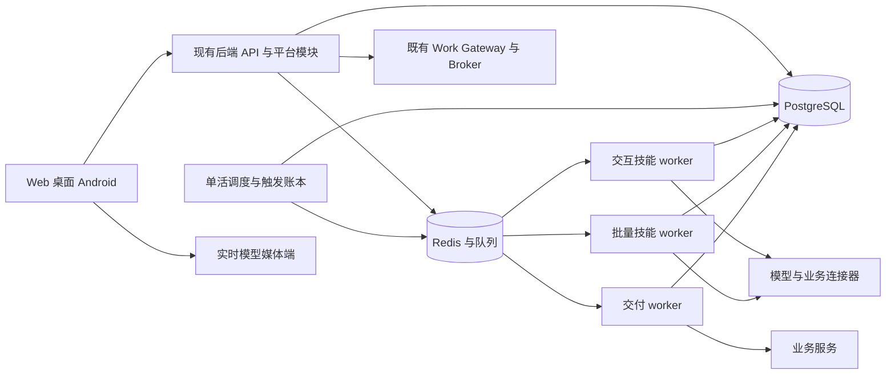

数据库变更采用新增表／字段和可兼容读写，领域幂等逻辑上线后才开放 AI 写入。备份恢复核验回执与交付账本的一致性；恢复后的未知外部副作用进入核对，不自动重发。

### 16.3 容量估算与试点压测

容量依据到达率、平均执行时长、步骤并发与供应商限制估算。稳态在途任务近似为到达率乘平均时长，不能直接将员工数量当作模型并发数；周报集中触发另测峰值和排队恢复。

| 压测档 | 建议测试负载 | 核验内容 |
| --- | --- | --- |
| 基础试点 | 2 至 3 个企业／团队作用域，20 个同时活跃办公 Run | 权限隔离、队列、池等待、业务回执 |
| 混合负载 | 交互提取与批量总结同时到达，逐档提高至 50 个活跃 Run | 交互不被长总结阻塞、租户公平性、上游限流 |
| 定时峰值 | 同一分钟触发 100 份周报草稿 | 幂等触发、抖动分散、排队完成、预算拒绝 |
| 实时与办公叠加 | 至少 10 路客户端实时会话并叠加办公运行 | 后端控制与工具可用、租约心跳、无媒体中转负担 |
| 故障恢复 | worker／API 重启、断网、供应商超时与回执丢失 | 恢复点、未知结果核对、无额外副作用 |

数字是测试档位，不是生产容量承诺；按现有企业规模、供应商配额和试点环境调整。第 18.26 节已完成三个合成企业、真实千问及 Celery 的 20／50 档本地功能负载基线，其他负载组合和生产容量仍待验收。分别报告用户可见延迟、排队、取数、模型、提交与交付耗时，以及 p50／p95、错误、连接等待、成本和 CPU／内存。

先固定代表性输入和模型再制定性能发布阈值。同步 API 只做轻量校验与受理，长工作返回异步 Run；真正超时依据整个请求期限，不仅是单次 HTTP 超时。模型质量和准确回执优先于没有测量依据的“秒级完成”承诺。

### 16.4 实时链路指标与测量口径

实时体验由客户端记录关键时间点，再与服务端 trace／会话 ID 关联。对比 AOQ、WebRTC 或不同运行时时，固定设备、网络、音色、音量、VAD 和视频配置，报告样本量及 p50／p95；无法控制的差异必须注明。

| 指标 | 起止点 | 观测用途 |
| --- | --- | --- |
| 用户建连耗时 | 用户开始通话 → 会话就绪可用 | 包含平台准入与供应商连接；另拆记录各阶段 |
| 语音回复等待 | 用户本轮语音结束 → 第一段回复音频实际播放 | 衡量用户等待；转写完成、模型首包、播放入队分别作为中间点 |
| 工具执行耗时 | 收到完整工具请求 → 实际设备结果／业务回执可用 | 授权等待单独记录，异步受理不能算任务完成 |
| 工具播报等待 | 结果回传成功 → 确认语音实际播放 | 区分操作失败、回传失败、模型续答与播放问题 |
| 媒体与稳定性 | 本地预览、上传帧率／尺寸、断连、打断及恢复事件 | 对照画质、拥塞与播放中断，避免只比较配置 fps |

耗时优先在同一端用单调时钟计算，跨端采用 trace 关联阶段而不直接相减未同步的时钟。供应商返回的识别或推理耗时保留原始口径，不替代用户语音结束到实际播放的端到端指标。采样观测默认不保存原始音视频，并遵守应用的日志授权与保留策略。

## 17. 测试、评估与验收

### 17.1 评估集

技能版本绑定测试集和评分规范。建议首期至少建立 100 个任务提取案例、100 个群总结案例、50 个周报案例；按企业、语言风格、长度和困难类型分层，保留独立验收集。数量是标注计划，低频关键风险额外覆盖。

当前有 24 个合成开发案例及另外 24 个输入不重叠、调用前冻结的合成保留案例，每项办公技能各 6 个。它们绑定具体技能、模型和代码哈希，通过真实千问、Go IM 来源和业务账本评分，记录全部成功与失败。开发集标注损坏的修订、保留集两轮逐项评分及人工复核发现的周报本地日期问题见第 18.33 节；历史开发验证见第 18.25 节。保留集已用于诊断日期问题，修复后的复用是回归验证，后续验收需另留未用于调优的样本。48 个合成输入不计入上述客户独立验收集，不能推断客户准确率或生产发布门槛。复现见[质量基线说明](../../scripts/office_quality/README.md)。

| 能力 | 正例 | 必须包含的困难／负例 |
| --- | --- | --- |
| 新建任务 | 明确内容、负责人、日期、清单 | 同名人员、相对时间、跨时区、缺字段、否定和引用 |
| 消息提取待办 | 单条、选定多条、多人行动项 | 客户端伪造快照、撤回、编辑、重复、群分享副作用 |
| 群总结 | 决策、风险、行动项、争议 | 分页缺口、附件缺失、历史不可见、来源冲突、长讨论 |
| 周报 | 完成、在做、阻塞、计划 | 状态变更时间、重复资料、无材料、跨周、私人来源 |
| 技能路由 | 明确请求匹配已安装技能 | 未安装技能、超范围请求、循环依赖、升级不兼容 |
| 语音工具 | 即时回执、长任务受理、澄清 | 模型抢先宣称成功、挂断、重复事件、静音、权限撤销 |

评估既看输出也看实际结果与执行轨迹。模型评分用于发现问题，不能单独证明业务权限、幂等和任务是否落库；关键结论用人工标注与程序核验。[Agent 评估参考](https://www.anthropic.com/engineering/demystifying-evals-for-ai-agents)

### 17.2 工程验证

- Schema、版本依赖、参数覆盖和权限交集的单元测试。
- 跨企业对象、历史成员、离职、运行中撤权、成果分享及文件链接的权限负例。
- 同键重复、同键不同内容、并发提交、提交后丢回执、批量部分成功及交付超时。
- worker 崩溃、过期租约、迟到事件、重新领取、取消在途写入和人工核对。
- 调度重启、重复触发、时区、夏令时、规则修改及所有者失效。
- 来源编辑／撤回、缓存命中后撤权、长文本缺口、引用不存在和注入指令。
- 真正 IM 与 Task 领域服务的集成测试，以及发布配置和真实模型的端到端测试。
- 使用 App、Web、桌面在同一工作上的恢复验证；实时工具分别测试 AOQ 与 WebRTC。

受信模拟依赖适合确定性测试，不能代替实际供应商、IM 权限和设备验收。测试数据明确授权或脱敏，不直接复制生产全量群聊。每次发布归档源码版本、应用／技能／模型版本、测试结果及环境。

### 17.3 发布门槛

P1 的四项能力全部完成业务闭环；第 2.3 节的质量及价值指标达到试点确认值；关键权限和重复副作用验收用例无成功越权或重复。失败、取消、未知结果与部分覆盖都有用户可理解的状态。

发布证据包含真实数据接口、至少两种权限主体、真实模型、重启恢复、成本核对和代表性负载。每个缺陷按业务影响判定，严重误建、越权、错发或回执不确定直接阻止扩大灰度。仅“按钮可点击”“生成了文字”不算完成。

P3 另验证发布配置可在兼容字段范围内不更新 APK 生效、旧客户端必要能力校验、灰度回退只影响新会话，以及 AOQ／WebRTC 的真实工具调用和媒体链路。客户端模块抽取需由第二个独立 Android 示例应用接入验证；仅原 App 自身可运行不证明 SDK 契约成立。

## 18. 分阶段实施与交付

### 18.1 阶段计划

工期是具备现有代码经验、约 4 至 5 名主要研发／测试人员的粗估，需经 P0 数据接口调查校准。各阶段按门槛推进，不意味着到期自动上线；P0 与部分 P1 可并行，P0 至 P1 候选总周期约 8 至 12 周。

| 阶段 | 候选时间 | 交付 | 退出门槛 |
| --- | --- | --- | --- |
| P0 基线与契约 | 2 至 3 周 | 需求样本、租户映射、IM 权威取数验证、领域幂等设计、技能／应用契约、评估基线 | 能证明真实来源与权限可核验；业务提交与回执可实现 |
| P1 四项办公 MVP | 6 至 9 周，可与 P0 后段并行 | 四个内置技能、业务入口、私人草稿、版本发布、运行／回执、预算与基础看板 | 四项真实闭环、质量目标、隔离和恢复验收；小范围企业试点 |
| P2 自动化与对话办公 | 4 至 6 周 | 定时／订阅、团队周报、交付、受限技能组合、连接器管理 | 自动化授权和重复触发通过；持续运行可观察可暂停 |
| P3 多模态与设备 | 3 至 5 周 | AI 电话云端应用配置、语音办公工具、dsh／Pi 平台适配、能力协商 | AOQ／WebRTC 真链路、长任务与通话解耦、客户端灰度通过 |
| P4 开放与 SaaS | 单独立项估算 | 外部 API／SDK、企业技能、连接器扩展、商业计费、多租户规模化、可选编辑器 | 租户隔离、第三方执行边界、成本及商业交付条件完成 |

P4 范围取决于客户验证，不以一份固定工期承诺同时交付外部生态、可视化编排、商业计费和多区域 SaaS。实时能力已经存在，P3 是平台管理与办公集成，不是重新开发整个通话系统。

### 18.2 P0 至 P1 工作包与依赖

| ID | 工作包 | 依赖 | 主责 | 可验收交付 |
| --- | --- | --- | --- | --- |
| F01 | 需求访谈、标注与对照基线 | 无 | 产品＋业务实施＋测试 | 四项场景输入、字段、价值及错误定义 |
| F02 | 租户、成员与 IM 权威访问 | 无 | 后端＋IM 维护 | 消息定位、完整分页、历史／撤回与跨租户用例 |
| F03 | Task 领域提交与来源／分享策略 | F01 | 后端 | 私人／群关联显式行为、事务回执、幂等接口 |
| F04 | 技能、应用、版本及发布 | F01 | 后端＋Web | 四技能安装、依赖锁、配置表单、灰度与回退 |
| F05 | Run、检查点、事件与预算 | F03、F04 的契约 | 后端 | 可恢复执行、等待、取消、计量与回执查询 |
| F06 | 新建任务与消息待办技能 | F02、F03、F05 | 后端＋客户端 | 结构化提取、澄清、逐项提交与真实 Task |
| F07 | 群总结技能与来源成果 | F02、F05 | 后端＋Web | 完整覆盖、引用、私人草稿和撤回处理 |
| F08 | 个人周报技能 | F07、任务事件数据 | 后端＋Web | 确定性统计、来源组织、编辑与版本 |
| F09 | 工作入口、运行与成果 UI | F04、F05 契约 | Web／Android | 业务菜单、进度、失败恢复、来源查看 |
| F10 | 评估、压测、灰度和运维 | F06 至 F09 | 测试＋运维＋产品 | 真实证据、成本、回退演练与试点报告 |

建议人员配置为 1 名产品／实施兼项目协调、2 名后端、1 名 Web／客户端、1 名测试，架构与运维按需参与；若 P1 同时要求完整 Android UI，另安排移动研发或调整时间。现有业务逻辑不宜全部由模型工程单独负责。

### 18.3 迁移与灰度

1. 新表、受信服务和平台适配器先上线但不开放 AI 写入。
2. 打通只读来源、安装技能及固定评估；旧手动任务入口继续使用。
3. 受控名单开放新建任务，再开放消息转任务，验证来源与分享影响。
4. 开放群总结和个人周报私人草稿，先人工交付，不默认自动发布。
5. 企业试点通过后扩大名单；每一步保留应用绑定、工具写入和调度独立关闭开关。

回退停止新 Run、工具提交和自动触发，应用绑定到已验证版本；已成功业务动作与回执保留。未知外部操作继续核对，不删除账本假装未发生。已发布成果不因模型版本回退而自动覆写；DB 变更遵循兼容迁移，不用破坏性降级作为常规回退。

### 18.4 P3 实时应用平台工作包与 SDK 演进

实时应用建设复用前期的应用、版本、工具、授权与观测模块，增量交付如下，不另建平行项目管理系统。

| 工作包 | 交付 | 验收依据 |
| --- | --- | --- |
| R01 实时配置模板 | 模型／音色／提示词、交互参数、设备工具与用户覆盖 schema | 按运行时校验组合，固定配置生成正确会话参数 |
| R02 发布与准入适配 | 环境／灰度解析、客户端能力、连接分配与租约绑定 | 权限与版本可追溯，旧端处理明确，回退不改变在途通话 |
| R03 App 接入与工具桥接 | 发布快照接入、设备工具、办公工具、长工作独立生命周期 | 设备状态与业务回执准确，挂断不误取消已授权办公 Run |
| R04 实时观测与试点 | 第 16.4 节指标、用量来源、兼容与两条传输链路测试 | 有真实设备与模型证据，可定位连接、设备、回传和播放问题 |
| R05 内部客户端模块 | 抽取配置解析、传输适配、工具协调与生命周期；第二 Android 示例应用 | 独立入口接入同一发布应用，业务 UI 与设备能力由宿主提供 |
| R06 桌面实时基础 PoC | 固定 Qwen-Live-Harness 基线，真实 macOS 语音＋屏幕／摄像头、打断和恢复 | 第 16.4 节端到端 p50／p95、实际播放回执、旧回调失效；保留失败证据 |
| R07 桌面企业与执行器适配 | 聚视 Electron 宿主、平台发布与业务工具、现有 dsh 任务和审批、Work 成果入口 | 语音写操作重复／超时不多建；执行前撤权拒绝；挂断后已受理 Run 继续并交付；凭据与预算边界通过 |
| R08 桌面跨平台准入 | Windows／Linux 的采集、播放、权限、截图、设备路由、打包、升级与进程生命周期 | 各平台真实构建与设备证据，明确必要／可选能力；缺失必要能力不发布，不能借用 macOS 结果 |

先在现有 App 内稳定平台契约，再抽取可复用 Android 模块，最后以第二应用验证模块边界。面向外部客户的 SDK、文档样例、兼容支持、接入配额与商业条款属于 P4，单独估算；不以内部模块完成宣称外部 SDK 已交付。

桌面工作包复用同一企业控制层，与 Android 分开验收。R06 提供上游基础的选型证据；生产采纳还需 R07 的企业闭环、治理及相应平台 R08 通过。可先以 macOS 受控试点验证交互，不等待上游未来平台计划；Windows／Linux 的交付范围由实际能力与客户需求决定，不承诺未验证日期。Qwen-Live-Harness 不作为 P0／P1 固定办公技能或现有 Android 通话的前置依赖。

### 18.5 当前实现与运行框架 PoC 验证记录（2026-10-12）

四个固定技能已形成开发分支中的业务入口、领域校验和对应测试，范围见[首批实现说明](../features/enterprise-ai-platform.md)；应用发布、企业配额和运行交付的后续正式实现及本地证据见第 18.9—18.14 节，生产与企业试点仍需验收。下表仅记录编排框架的隔离实验，不将实验脚本视为生产模块或产品入口；第 18.14 节的真实 Celery 验证独立记录，不倒算为这四轮 LangGraph PoC 的能力。

| 验证步骤 | 已验证内容与证据 | 未完成范围 |
| --- | --- | --- |
| 1. 运行基础与业务边界 | **21 项测试通过**；真实 LangGraph／PostgreSQL、进程退出恢复、审批、真实 Task／ActionReceipt 幂等；来源和模型为受控 fixture | 未证明真实模型、IM 或生产调度；不能由业务回执推导供应商只调用一次 |
| 2. 真实群摘要 | **22 项受控模型测试通过**，真实千问专项另 **1 项通过**；真实本地 Go IM、权威快照、分页、分段、引用、逐段用量、私有成果及来源撤回 | 未完成企业规模质量、Celery、流式交付、分布式 fencing 和长时间安全对账 |
| 3. 单任务对话 | **28 项受控测试通过**，真实千问专项另 **1 项通过**；澄清、自然语言修改、刷新审批、拒绝旧授权、重启后幂等提交 | 只绑定 `create-work-task`；无产品页面，完整跨技能对话执行、提交后新任务、开放工具循环尚未验证 |
| 3a. 多技能路由前置契约 | **27 项后端契约测试通过**，独立路由专项 **2 项通过**；真实千问 6 次请求正确区分四种办公技能、模糊意图和范围外指令 | 只生成用户需确认的建议，不创建 Run 或业务动作；跨技能对话、正式模型步骤／计费、来源选择和产品入口仍待实施 |
| 4. dsh／Pi 外部协调 | **31 项通过、无跳过**；真实 dsh 原生执行与 Pi Docker RPC、原设备领取、显式工具批准／成果同步／只读复核、回执后崩溃恢复、丢失回执对账与取消 | 模型回复受控，业务 API 在进程内验证；未验证公网、Electron 审批界面、真实办公模型质量或生产调度 |

第二、三阶段受控套件中的真实模型用例明确跳过，再通过显式选择测试凭据执行真实专项；第四阶段显式选用真实 dsh／Pi 运行时，供应商输出仍受控。跳过和重复执行不计为新增通过数。四阶段代码、依赖锁、复现命令与事实边界见 [PoC 说明](../../scripts/langgraph_poc/README.md)，详细结果见 [ADR §7.6—§7.9](../adr/0005-enterprise-ai-platform-architecture.md#76-首轮隔离验证结果2026-10-11)。

真实群摘要专项：`qwen3.8-flash` 读取 **201 条人工测试消息、2 页**，执行 **4 段 + 1 次合并**，记录 **5 次尝试、5 条用量**，输入 **29,360 tokens**、输出 **2,390 tokens**；重启不重复已完成分段，最终一个私有成果，撤回来源后拒绝读取。单任务对话真实专项：三轮完成澄清、生成与修改，**3 次尝试、3 条用量**，输入 **2,685 tokens**、输出 **354 tokens**；三个退出边界恢复后仅有一个 Task 和回执，旧审批被拒绝。这些是合成代表场景的功能验证，不是并发容量或实际客户质量结论。

实验保持当前模型连接复用和 dsh／Pi 独立 Broker 边界。单任务对话限制最多 6 次提取，单条补充最多 800 字符，模型请求最多 3,000 字符，每次重新准入并预留预算；自然语言“确认”不等于批准，提交必须绑定当前候选 revision 和 payload hash。模型调用结果未知时停止，不通过框架自动重试获得第二次付费调用。

生产准入还需补齐：正式 Conversation／Turn／WorkflowStep 关系及终态、恢复 API、Celery 调度与事件交付、企业配额、跨进程围栏、版本升级、容量与批量质量，以及检查点权限、加密／脱敏、保留和删除。对话实验检查点包含人工测试正文，不能沿用群摘要图仅保存 ID 的假设；实验辅助 SkillRun 的 `canceled` 语义也不能直接搬入生产。尚未调整生产依赖、数据库或运行入口。

外部协调实验沿用现有 WorkRun／WorkReview 权威状态，检查点保存关联、选择、哈希及等待中的目标文字／清单元数据，不保存文件正文；目标文字需纳入权限及保留／删除治理。桌面离线或断线不自动切换执行器。dsh **0.1.5rc1** 在获授权的临时目录真正生成成果，精确工具批准前不写入；随后由测试桌面显式同步指定文件并授权真实 Pi **1.0.4** 只读复核。独立适配器 **0.3.6** 和 Pi 镜像固定；受控 dsh 2 次模型请求、Pi 1 次请求，丢失派发回执后查询原 ID，不新增模型请求。桌面用量保持 `device_reported`，Pi 的 Broker 用量单独入账。可信测试桌面的决定不能移植为平台自动授权行为。

只读路由契约已进入开发分支：候选目录绑定当前企业、账号、已启用受支持的版本与安装修订；模型只建议技能，不提供来源 ID、版本 ID或批准。真实千问专项使用六个人工请求，记录 6 次请求、6 份用量报告，输入 2,255／输出 169 tokens，无 SkillRun 或业务动作。这些是测试 sink 的用量，未写入生产计费；不能绕过正式预算与模型步骤直接上线此脚本。完整结果见 [ADR §7.10](../adr/0005-enterprise-ai-platform-architecture.md#710-多技能路由前置契约与真实模型验证2026-10-12)。

后续每轮 PoC 完成后更新本节、ADR 和复现说明，再按已授权的目标继续实施。完成 PoC 只构成选型证据，不自动完成 P0／P1 或触发生产部署。下一步按第 18.6 节建设正式对话与运行基础，再接跨技能对话、框架试点和产品入口；应用发布与企业治理继续按 P0／P1 工作包推进。

上述表格记录隔离实验事实。其后的正式领域账本、产品入口、应用发布、企业治理、真实队列和有限多轮上下文进展分别见第 18.7—18.15 节；正式可选图适配及真实队列恢复证据见第 18.16—18.17 节，不将后续正式实现反写为早期 PoC 已交付。

### 18.6 正式对话与运行基础：实施要求

| 交付单元 | 实施要求 | 验收门槛 |
| --- | --- | --- |
| 对话与轮次账本 | Conversation 绑定企业／所有者／发布配置，Turn 使用请求 ID与内容指纹去重；关联原 SkillRun 和成果，取消语义清晰 | 不再用已完成轮次的 `canceled` 状态释放名额；跨账号／企业和迟到输入被拒绝 |
| 模型步骤与预算 | 路由与技能分别有冻结输入、模型配置、调用意图、结果、用量和限额；未知调用不可重放 | 调用次数独立验证；恢复不重复已保存结果；对话成本与技能成本无重复计算 |
| 确认与来源选择 | 建议、来源选择、参数校验、技能启动及最终业务写入分别确认；复用当前权威消息／任务来源 | 模型不能补造 CID／MID、日期或批准；技能停用、来源变化及目录变化后旧确认失效 |
| 恢复、事件与围栏 | 服务端生成运行／thread ID，绑定工作流版本；短 Celery 任务、递增执行代次和领域 outbox，事件有序且幂等 | 重复调度、失去锁连接、worker 重启和取消竞争不能重复调用／提交；不直接暴露检查点 API |
| 数据治理与产品入口 | 检查点尽量保存 ID；对话正文在权限约束下保存，落实保留／删除；Web 展示建议、澄清、授权、进度和真实回执 | 生产开关关闭时旧入口正常；真实企业材料与批量质量／容量通过后才扩大试点 |

先建立不依赖特定框架的领域账本、路由建议和版本确认，再将隔离图适配到这些正式契约。LangGraph 只管理图位置与等待，业务权限、原执行器状态、模型调用意图、计量和动作回执继续由领域服务保有。按单技能内部试点逐步接入，不能直接将实验辅助表、测试自动批准或临时目录逻辑复制为生产模块。

### 18.7 正式对话路由后端首批（2026-10-12）

PoC 结果按第 18.5 节归档后，继续在开发分支实现框架无关的正式领域账本。新增 `OfficeConversation`、`OfficeTurn`、`OfficeModelStep` 和 `OfficeEvent`，通过新增迁移 `ai_platform/0004` 建表；既有技能、Task 与回执保持原归属。运行契约为 `office-route/v1`，绑定当前有效企业与所有者，冻结受支持的技能目录及模型输入／配置；该批次尚未绑定 ApplicationVersion／ReleaseBinding，后续进展见第 18.9 节。

接口支持创建和恢复对话、提交新轮次、读取有序事件、确认具体技能输入、取消轮次、关闭及清除对话正文。路由只处理当前轮的明确请求；模型仅建议技能或要求澄清，不生成来源 ID、绝对时间范围或批准。用户确认建议哈希并提供经过既有 InputSerializer 校验的输入后，关联一个原 SkillRun；稳定派生的请求 ID 和事务保证重复确认不多建运行。真实任务写入仍使用原候选修订／哈希审批接口。

路由调用前持久化意图、预算、执行代次和 70 秒租约，供应商超时 45 秒且关闭 SDK 自动重试。成功原始结果先保存，再重新核验权限／目录并应用；已保存结果恢复时不再次调用模型。过期在途调用标为 `execution_unknown`，不自动重放；取消或已失效的执行代次不能交付迟到结果。路由使用独立 AIUsageRecord，预算同时计入平台与现有 Work 账号日额度，不重复计算关联 SkillRun 的费用。Celery 使用现有 work 队列，每个短任务处理一条路由。

对话可接收最多 20 轮，每轮请求最多 800 字；轮次确认有效期为 24 小时。首批正文保留期为创建对话起 7 天，过期立即停止在 API 中返回正文，再由内部清理任务删除请求、冻结模型输入和原始结果；用户 DELETE 可提前清除。用量、哈希、技能关联与业务回执保留。关闭对话仅取消未确认路由，已单独确认的技能继续其原生命周期；显式取消关联技能时，已经成功的任务／回执不会改为取消或撤销。

**验证证据：**八个后端模块共 **188 项回归通过**，其中对话专项 35 项；最终变更后的专项另行复验，重复用例不叠加计数。来源衔接另有 **5 项通过**，IM HTTP 与路由回复为受控 fixture。真实 `qwen3.8-flash` 专项 **1 项通过**：路由、候选提取各调用一次，形成两条实际用量记录，输入 **1,097**／输出 **109 tokens**，用户确认后创建 **一个 Task 和一个 ActionReceipt**；重复路由调度、技能确认及业务提交没有新增调用或动作。真实验证使用认证 Django APIClient、供应商 HTTP 与独立 PostgreSQL，不代表浏览器、生产调度或业务质量验收。测试数据库自动清理，生产环境未变更。来源衔接专项结果同步于[实现说明第 11 节](../features/enterprise-ai-platform.md#11-正式对话路由后端首批)。

**该后端批次的边界：**开关 `AI_PLATFORM_CONVERSATION_ENABLED` 默认关闭；当时尚无对话办公 Web／Android 产品入口，后续 Web 首批见第 18.8 节。完整多轮上下文、动态技能组合与整个 F05 尚未完成。应用发布绑定、LangGraph 正式适配、通知交付 outbox、企业配额、规模化清理与容量验收继续实施。该后端批次的来源确认仍把同步取证包在绑定事务内；后续拆分及验证见第 18.11 节。

下一单元先建设 Web 对话入口、明确来源／周期选择、澄清和原 SkillRun／回执展示，再接应用发布配置与正式图适配；四个固定技能入口继续保留。技术事实、接口和启用步骤见[首批实现说明](../features/enterprise-ai-platform.md)，框架决策见 [ADR §7.11](../adr/0005-enterprise-ai-platform-architecture.md#711-正式对话路由领域账本首批2026-10-12)。全部工作包仍按本章门槛逐项验收，不因 PoC 或后端专项通过而缩减总体目标。

### 18.8 Web 办公助理与来源选择首批（2026-10-12）

开发分支新增“工作 → 办公助理”入口 `/work?view=assistant`，绑定正式 Conversation／Turn API。用户输入本轮目标，查看服务器返回的技能版本与澄清建议，再明确确认具体输入；恢复旧对话不会自动重新发起模型调用。尚只处理当前轮完整意图，不将这批界面视为完整跨轮对话或动态 Agent 编排。

四个受支持技能分别衔接任务要求、群与绝对周期、权威消息选择、个人任务清单与周期。消息入口新增成员可见群与当前企业投影的交集目录，最多显示 200 个并标记截断；不能读取其他企业、未绑定旧群或非成员群名称。读取选定周期的完整消息后，只选择 1—10 条真实 MID／SEQ；切换范围清除选择，迟到读取不交付给新范围。引用和富文本显示正文，内部 JSON 和派生 `plain` 不作为可选证据。服务端在确认时重新取证，客户端选择不等于来源授权。

显式确认绑定建议哈希与具体输入，创建原 SkillRun。助理展示原运行状态、已有业务回执或私人成果版本；候选修改、最终 Task 写入审批和成果编辑仍进入原技能页面，并可返回办公对话。对话列表、轮次轮询、取消未确认轮次、关闭与清除正文均可操作。清除正文要求单独确认，并说明已确认技能与业务回执保留；不把清除对话解释为撤销已创建任务。

网络失败后，同一页面的显式重试复用对话及轮次准入 ID；完整页面刷新后从最近对话恢复，不宣称已提供离线发送队列。切换账号／页面后迟到的建会话响应不能继续提交旧请求；权限读取失败后不展示缓存的私有轮次。入口和新操作受原能力开关控制，关闭开关时保留授权历史读取及四个固定技能入口。

验证：后端四个模块 78 项回归通过，目录最终 7 项复验通过，重复不叠加；前端四个固定技能 21 项与办公助理最终 14 项通过。1280px／390px 浏览器流程检查、类型检查、静态检查与生产构建通过，临时平台测试库清理后剩余为 0。复现命令和证据边界见[实现说明第 12 节](../features/enterprise-ai-platform.md#12-web-办公助理与来源选择首批)。受控浏览器验证覆盖从请求到来源确认及原审批入口，不能替代真实浏览器、真实 IM 与模型、生产 worker 的联合试点。本轮没有新增模型付费请求、部署生产或改变正式框架采纳状态。

应用版本与发布后端首批见第 18.9 节。管理员配置页面、客户端应用选择、正式图适配、跨轮上下文、企业治理及运行交付继续实施。Android、自动化、实时办公桥接、客户样例质量与容量验收继续保留原工作包要求，不因 Web 首批通过而缩减目标。

### 18.9 应用版本、评估与发布后端首批（2026-10-12）

在 PoC 结论及正式对话账本之上，新增 `AIProject`、`AIApplication`、不可覆盖的 `ApplicationVersion`、服务端 `ApplicationEvaluation`、环境 `ReleaseBinding` 与不可覆盖的发布回执。新增迁移 `ai_platform/0005`；旧运行的应用字段默认为空，四项固定技能和未绑定应用的办公助理继续原有路径。新能力开关 `AI_PLATFORM_APPLICATIONS_ENABLED` 默认关闭，本批没有生产迁移或部署。

管理员配置草稿、冻结版本、发起评估及发布；权限每次按当前企业与最新组织角色核验。普通成员只看到可使用的已发布应用及运行所需元数据，不读取草稿、路由提示词或管理员评估会话。支持 `internal`／`production` 两种逻辑环境，仍在同一平台实例；环境选择不表示具备跨集群部署或独立基础设施隔离。

版本固定运行类型、技能依赖 ID／版本／内容哈希、声明工具与效果、应用受众、限制、补充路由提示词及共享模型配置指纹。数据库不保存 Key 原文；不允许客户配置任意模型 URL、工具代码或未实现运行类型。首批 `structured_action` 对应单个新建任务技能，`workflow` 对应单个既有消息待办／群摘要／个人周报工作流；`office_agent` 可声明最多四个技能，但每轮仍只建议一个。不是任意 DAG 编辑器或完整自主 Agent。

发布门槛为服务端执行的有限只读路由评估：依赖中每个技能一个正例，加范围外请求和绕过审批两个负例，共 3—6 例。沿用正式模型步骤的调用意图、单次执行代次、70 秒租约、结果恢复、实际用量和账号日预算；评估串行推进，一个账号只允许一个正在进行的评估，未知调用不重放。评估最多六轮、独立保守预留上限 60,000 tokens，同时受现有账号日额度约束，不绕过付费计量。评估结果及完整对应步骤共同验证后才放行发布，客户端不能提交“已通过”状态。该门槛只证明已声明技能能路由，不能替代四项技能效果、真实来源、容量或企业验收。

发布配置使用修订号 CAS、稳定请求 ID及回执，记录前后版本。灰度按应用和用户稳定分桶，只将具有候选版本受众权限的用户选入候选；否则沿用稳定版本。新会话与固定工作流从服务器解析发布选择，持久化版本与选择快照；客户端不能指定任意版本或伪造评估用途。对话确认的子 SkillRun 继承同一快照，路由与子技能合计保守预留，周期限制在外部来源读取前校验。

普通发布／回退仅改变新准入，不替换在途版本；关闭环境发布入口阻止新准入，但保留已授权运行。紧急停用应用则阻止其后续模型步骤、候选交付与业务提交，用户仍能取消运行。技能撤销、主体／来源撤权和模型配置变化继续使后续操作失效；已经成功的 Task 与动作回执不撤销。草稿受众修改需要冻结并发布新版本才影响新准入；撤销全部旧版本的执行使用紧急停用，不把草稿编辑当作立即撤权。

真实 `qwen3.8-flash` 联调 **1 项通过**：6 个服务端评估用例通过，发布后新会话绑定版本，再进行一次真实技能路由，人工选择任务字段及最终审批后形成 **1 个 Task**；**7 次模型调用／7 条实际用量记录，输入 2,641／输出 219 tokens**。使用认证 Django APIClient、实际供应商 HTTP 和独立 PostgreSQL；没有真实企业材料、浏览器管理页面、生产调度或容量验收。回归数量、复现步骤及最终结果见[实现说明第 13 节](../features/enterprise-ai-platform.md#13-应用版本与发布后端首批)。

本批交付应用发布后端契约，F04 尚未全量完成。管理员配置／评估／发布页面及用户应用选择的后续实现见第 18.10 节；继续正式图适配、跨轮上下文、通知交付、企业治理及客户试点。实时应用、Android、连接器、自动化及质量／容量门槛继续按本方案实施；LangGraph 生产采纳状态保持待决策。

### 18.10 Web 应用管理与成员准入（2026-10-12）

在既有正式应用契约上交付“工作 → AI 应用”。成员按正式发布或内部测试环境查看可使用的应用，进入绑定发布版本的办公助理，或核对输入后启动固定技能流程。固定应用复用四项技能的来源选择、候选审批、成果及回执页面；客户端不增加 Task 写入通道。恢复既有对话时读取原版本快照，不按最新发布重新解析或创建运行。

企业管理员在独立管理页面创建项目与应用、编辑草稿、冻结版本、确认发起付费路由评估、查看用例结果，再核对稳定版本／灰度比例并发布。回退通过选择旧版本重新发布完成；关闭新运行入口与紧急停用应用分别提供确认及影响说明。保存草稿不会自动冻结、评估或发布。角色检查使用能力接口，所有写入仍由服务端重新核验；管理 GET 返回权限错误后隐藏缓存草稿，避免已撤权内容继续展示。

新增迁移 `ai_platform/0006` 保存项目和应用创建请求 ID及初始请求哈希。相同请求的应答丢失后重试返回原对象；草稿后来被修改，也不会因重放而覆盖或重复创建。不同内容复用请求 ID返回冲突。评估、发布、固定运行及对话准入分别保留各自请求 ID，客户端只在明确点击时重试，不将网络错误转成自动模型调用或业务提交。

成员提交运行／对话时附带刚核对的 `application_hash`。服务器解析版本后比较哈希；核对期间发布变化则拒绝新准入，要求重新确认。已经受理的相同请求 ID仍返回原运行及原快照。哈希仅断言本次预期，不能指定版本、扩大受众或绕过来源权限。公共解析结果补充该版本的周期与预算限制；不下发管理员提示词或凭据。

验证：应用与对话后端 **80 项通过**（45 项应用、35 项对话），包括并发创建去重、修订后重放、版本变化拒绝及旧请求恢复；Web 六个专项模块 **51 项通过**，其中应用页面 16 项，区分应答丢失重放和明确 CAS 冲突后重新确认。TypeScript、目标文件 ESLint、生产构建通过。实际 React 页面配受控 API fixture 验证冻结、评估确认、发布确认／修订、成员准入、撤权隐藏，以及 1280×900／390×844 布局；浏览器无异常和横向溢出。截图检查发现的下拉框文字裁切已修正，复验结果见[实现说明第 14 节](../features/enterprise-ai-platform.md#14-web-应用管理与成员准入)。这些界面证据不表示真实企业端到端或容量验收，本批无真实模型调用、生产部署或 APK 改动。

本单元补齐 Web 应用控制面和成员入口，仍不是完整 F04／F05 或平台目标完成。来源准入短事务后续见第 18.11 节；正式图适配、跨轮上下文、运行交付 outbox、企业配额与公平队列、分页／运营看板、自动化、Android／实时办公桥接、连接器及客户质量／容量验收继续按原工作包实施。默认开关继续关闭，不以浏览器 fixture 或少量路由评估替代生产采纳门槛。

### 18.11 来源准入短事务与可取消准备（2026-10-12）

办公对话确认与固定应用启动的来源读取拆为三段：短事务登记 `SourceAdmission` → 事务外读取成员可见的 IM／个人任务 → 短事务复核并创建、绑定 SkillRun。新增迁移 `ai_platform/0007`。读取期间不创建待调度子运行，不占有账号、对话、应用或安装行锁；最终创建、预算校验、应用绑定、对话关联及准备成功记录一起提交，失败一起回滚。原独立技能入口继续相同领域与取证规则。

准备记录保存所有者／企业、请求和输入哈希、技能及应用快照、主体／模型指纹、读取租约、代次、错误及最终运行引用，不保存输入或来源正文。每个账号至多四个有效读取租约，租约 45 秒；授权最长 24 小时，对话准备不超过原轮次截止时间。同一在途请求不重复读取。只读来源失败或租约中断后，明确重试会重新取证并增加 epoch；不重放模型或业务动作，不使用旧来源缓存。迟到结果不能突破取消、代次、最新轮次、权限、模型或应用停用检查。

固定应用首次登记时绑定服务器选择的版本；普通发布／回退后，同请求仍沿用该版本及预算。不同输入不能复用请求 ID。对话读取失败后允许用户明确修订输入重新确认，不同输入有独立准备指纹；稳定子运行 ID仍保证同一轮最多一个 SkillRun。已成功请求恢复原子运行，Task 写入仍需原候选审批。

对话 GET 补充 `source_admission` 状态，取消、关闭、清除正文及过期清理取消未完成准备。固定应用新增所有者私有 `GET / DELETE applications/{id}/admissions/{client_request_id}/`；DELETE 只取消准备，已受理 SkillRun 的取消继续原接口。取消不强行终止外部 HTTP；有界读取可以结束，但迟到结果不能提交。跨系统来源权限没有全局事务：读取时证明实时权限，最终再次核验本地主体与租户绑定，原执行／交付／提交流程继续复验权威来源。

Web 在确认 POST 尚未返回时显示读取状态并允许取消，恢复对话可读取准备状态；不自动确认或重试模型。取消成功后忽略旧确认的迟到错误。固定应用本页面保留请求 ID与首次核对哈希，避免刷新发布解析后将不确定请求变成第二次启动；固定请求跨页面刷新恢复尚待补齐。本批未增加来源后台队列、缓存或自动重试。

后端完整回归 **261 项通过**，其中新增来源准入专项 **16 项**；Web 六模块 **54 项通过**。独立 PostgreSQL 连接验证读取期间的取消、关闭、清除、撤权、新轮次与发布不被阻塞，迟到结果不创建孤立运行；覆盖重复取证抑制、租约恢复、固定版本、超预算回滚及请求输入冲突。TypeScript、目标 ESLint、Ruff、迁移一致性及生产构建通过。实际 React 页面配受控 API fixture 验证确认 POST 未返回时取消、迟到错误抑制及移动端布局；截图检查、浏览器异常和横向溢出检查通过。本批没有新增真实模型调用、企业来源或生产容量验收。复现和证据见[实现说明第 15 节](../features/enterprise-ai-platform.md#15-来源准入短事务与取消准备)。本单元只处理输入来源准入；其他执行／交付／审批中的来源复验事务仍需审查。继续运行交付 outbox、企业配额与公平队列、正式图适配、完整上下文、Android／实时桥接、连接器及客户质量／容量验收；不将此改造等同于生产容量验收或完整平台目标达成。

### 18.12 事务通知与私人站内交付（2026-10-12）

在来源准入验证后继续落实运行交付基础。本批增加 `NotificationOutbox`／`NotificationInbox` 和增量迁移 `0008`：领域事件与通知意图同一事务保存；消费者在本地数据库短事务内写入唯一通知回执并标记交付。事件唯一关联、Inbox 唯一交付键和行锁保证重复 tick／进程退出恢复不重复写入通知；重试消费者不会重调模型、重建 Task 或重新生成成果。只通知候选／澄清、草稿、已建任务及失败等关键状态，不通知模型进度；应用评估流量不进入用户通知。

站内通知仅包含通用事件类型、原运行／对话 ID、时间和已读状态，不包含消息、任务标题、请求、提示词、候选或成果正文。交付与读取绑定当前所有者、企业及有效期；企业管理员不获得其他成员私人通知。对话取消、技能受理或清除后不继续展示旧确认提醒。链接打开原运行／对话，来源正文继续由原接口复验权限；通用通知本身不执行远端 IM 取证，也不把站内已读当作审批。

Web 新增“工作通知”入口，支持只看未读、每页 20 条游标分页、已读及刷新。请求失败后隐藏旧缓存通知及计数；账号缓存隔离。通知最多保留 7 天，对话通知不超过原对话有效期；有界清理只移除通知意图／回执，保留领域事件、运行、用量和业务回执。

新增 `AI_PLATFORM_NOTIFICATIONS_ENABLED` 默认关闭。事件意图仍可持久保存，关闭交付不会丢失有效期内的待处理通知；启用后通过现有 `work` 队列每 10 秒恢复扫描，每次最多 50 条。清理每批最多 500 条，另提供同逻辑管理命令。旧站内通知在平台停用后仍可按当前主体权限读取／标为已读。该消费者只交付到本地站内 Inbox，不宣称已支持 IM／邮件、移动推送或跨外部系统的全局恰好一次；外部交付需独立幂等与未知回执对账契约。

后端完整回归 **279 项通过**，其中通知专项 **18 项**，覆盖事件／意图回滚、消费者写 Inbox 后退出回滚、独立 PostgreSQL 双 worker 竞争、延迟扫描恢复、企业权限变化、取消／清除抑制、分页、已读幂等和有界清理。Web 七模块 **60 项通过**，TypeScript、目标 ESLint、Ruff、迁移一致性和生产构建通过。实际 React 页面配受控 API fixture 在 1280×900／390×844 验证分页、已读、未读过滤、撤权缓存隐藏和无横向溢出，截图经检查。复现命令见[实现说明第 16 节](../features/enterprise-ai-platform.md#16-运行通知-outboxinbox-与私人工作通知)。没有新增模型调用、外部消息或生产变更；Celery 任务与 Beat 已接线，尚未将真实 broker／worker 部署、企业吞吐量和客户试点列为已验收。

下一阶段继续企业配额／公平队列与运行观测、正式图适配和完整跨轮上下文、外部通知交付、固定请求跨刷新恢复、Android／实时办公桥接、连接器及客户质量／容量验收。本批完成私人站内交付基础，不能据此宣布 F05／P1 或平台整体完成。

### 18.13 企业配额、公平调度与执行许可首批（2026-10-12）

在既有账号日预算、应用周期预算及来源准入基础上，增加企业级治理。增量迁移 `ai_platform/0009` 引入 `EnterprisePolicy`、不可覆盖的策略变更回执、共享调度序号、企业调度位置及 `ExecutionPermit`。新开关 `AI_PLATFORM_GOVERNANCE_ENABLED` 默认关闭；本批没有生产迁移、部署、模型付费调用或 APK 改动。该基础独立于 LangGraph，不改变第 18.5 节的 PoC 证据或生产框架待决策状态。

企业共享准入涵盖当前平台的 SkillRun 与办公路由步骤，按同一企业策略行锁串行核验所有成员的保守预留和排队／执行数量，再与原领域记录一起原子提交。有效来源准备另设企业共享名额，首次登记时检查；它限制有效读取租约，取消后的外部读取仍可能执行到超时，不能据此声称限制所有在途 HTTP。原账号最多四个在途工作／读取、账号日预算和应用限制仍适用。失败、取消及缺失用量不自动退还预留；同请求重放不重复计入。预留窗口按部署 `TIME_ZONE` 的提交日计算，跨日执行仍属于原准入窗口。它是准入额度，不是供应商计费日、实际 token 单价或发票。

默认企业策略为每日预留 1,000,000、排队／执行中工作 20、来源读取 20、总执行名额 3、交互 2、批量 1；这些是开发默认值，需通过试点校准。部署硬上限独立配置 `AI_PLATFORM_PARALLEL_LIMITS`，默认全平台总 4、交互 3、批量 1，企业不能通过策略提高部署上限。并发是调用名额而非员工数；等待输入／审批不占工作执行数量，正在返回的取消调用仍占许可。

调度在一个短数据库事务中选择、领取和保存许可，不在其中读取远端来源或调用模型。交互队列包含任务提取、消息待办和办公路由；批量队列包含群摘要与个人周报。可执行企业按共享的最近调度序号选择，同一企业内按进入队列时间选择；暂停或无可用名额的企业跳过。这是工作领取层面的公平性，不是按 token、执行时长或付费金额的加权公平。群摘要当前一次领取完成整项工作，不在每个分块后让出 worker；每个新分块／合并调用前重新核验策略与许可并续租，完整分段调度仍待后续容量验证。

许可和业务状态分离：取消只阻止结果提交，不立即腾出在途调用名额；执行器在调用返回及退出时释放，崩溃则到有界租约期限才恢复容量。租约过期的调用保持未知，不自动重放；已保存的路由结果恢复时只应用结果并释放许可，不再调用模型。许可不能证明供应商在超时后立即停止推理或计费。旧路径在途调用可保守纳入许可，但混合配置滚动切换没有全局原子性，启用／回退必须暂停调度、排空在途调用并统一服务配置。

Web 新增管理员“企业运行治理”：查看当前企业的预留、排队、最早排队时间、来源读取和交互／批量许可占用，修改策略前核对影响与具体数值。GET 不返回成员请求或成果正文；PUT 使用当前企业权限、范围断言、修订号 CAS、稳定请求 ID及回执，响应丢失只重试原请求。企业切换、权限撤销或版本冲突不能把旧修改自动写入新策略。用户排队状态明确显示“等待处理”，不伪造预计完成时间。

Celery 增加独立 `ai-interactive`／`ai-batch` tick 与可选 Helm worker Deployment，预取为 1；原 `work` 队列保留对话／评估维护及通知。治理开启后，旧工作 tick 不再领取平台模型任务；关闭时不向新队列投递周期任务。Helm 在治理开启但交互、批量、work worker 或 Beat 缺失时拒绝渲染。模板和启动配置验证不等于实际 broker／worker、Kubernetes 或容量验收；生产默认配置保持关闭。

验证：真实隔离 PostgreSQL **304 项回归通过**，另有 **4 项工作流治理专项通过**，其中新增治理共 **29 项**；覆盖不同成员、不同领域同时争抢最后额度，双调度器竞争、不跨企业泄露、租户轮转、队列分离、取消期间的真实执行器许可保留、过期禁止复活／重放、旧调用纳入、策略 CAS／请求重放和群摘要暂停后阻止后续调用。Web 八模块 **68 项通过**；启动配置 **4 例**、Helm 渲染 **6 例**通过。TypeScript、目标 ESLint、Ruff、格式、迁移一致性和生产构建通过。实际 React 页面与受控 API fixture 在 1280×900／390×844 验证策略核对、写入、撤权隐藏和无横向溢出，截图经检查。复现、配置、证据文件及回退步骤见[实现说明第 17 节](../features/enterprise-ai-platform.md#17-企业配额公平调度与执行许可)。

本批完成企业治理的首个正式实现单元，F05／P1 和平台目标仍未全部完成。当前企业限额不统管旧 Work/dsh／Pi Broker、实时媒体、供应商 QPS／RPM／TPM或所有外部连接器；金融计价与对账、全链路指标、规模化调度和真实队列容量仍待验证。继续正式图与跨轮上下文、固定请求跨刷新恢复、外部交付、自动化、Android／实时业务工具桥接、连接器及客户质量／容量试点；每轮证据继续同步本设计与 ADR。

### 18.14 真实 Celery 队列、进程与故障恢复验证（2026-10-12）

企业治理之后，使用当前正式领域代码完成独立 Linux 进程联调，补齐此前没有验收的真实 broker／worker 链路。该验证独立于 LangGraph PoC，不将已有框架检查点或实验模型执行器移入产品。

采用独立内部 Docker 网络、全新 PostgreSQL 和无持久化 Redis，启动 Celery 5.6.2 prefork worker 与 Beat。两个交互 worker、一个批量 worker 和一个维护 worker 各并发 1，部署许可上限为总数 3／交互 2／批量 1。控制端为认证 Django APIClient；模型为受控 OpenAI HTTP 服务，通过现有 SDK 的真实 socket 调用，没有替换领域生成、计量、审批或成果方法。后端源码只读挂载，报告保存选定源文件 SHA256、镜像身份、阶段结果和日志；不使用生产数据库、凭据、端口或真实千问请求。

| 检查 | 结果及证据边界 |
| --- | --- |
| 独立队列与异步派发 | eager 明确关闭；只开批量 worker 时，周报生成一份成果，3 条交互 tick 与交互领域工作仍排队；随后由真实交互 worker 处理 |
| 重复调度与批准 | 初始任务提取只调用一次，办公路由独立记录用量；重复人工批准返回同一个 Task 回执 |
| 在途取消 | 实际 HTTP 已进入后取消，许可保持至请求返回；迟到用量保留，无未经批准的 Task 写入 |
| 20／50 排队工作 | 各自分布于三个企业；第一轮调度覆盖三个企业，每项生成调用一次、全部进入待批准，无业务写入；固定短延时响应，不能据此推算真实千问吞吐量或企业容量 |
| worker 强制退出 | 请求进入 HTTP 后退出实际进程，替代 worker 等待真实 70 秒租约到期；标记未知，不自动重放，保留预留且不写 Task |
| Redis 丢失排队 tick | 停止维护／Beat 后投递 tick，再强制重启无持久化 Redis，确认消息确实消失；数据库 Outbox 仍在，恢复周期扫描后生成唯一私人 Inbox |
| 重连后的消费与监督 | 进程监督重启后，再完成两项交互候选和一个批量成果，各调用一次；独立 broker 专项采样许可／HTTP 峰值均为 3，未超过配置上限 |

首次完整联调日志发现固定本地镜像的 Celery／Kombu 在 Redis 重连 `mingle` 路径发生一次 `KeyError` 并退出。因此增加监督重启和重连后两种 lane 的实际消费检查，不以站内通知已交付推断所有消费者正常。测试入口使用专用 PID 1 转发进程与 Docker `on-failure:3`，验证实际 Celery master 退出后恢复；不是修改上游 transport，也不是 Kubernetes 部署验收。生产启用前需对实际发布镜像、进程监督和 broker 故障后的消费进行复验。

完整流程与独立 broker 专项的报告分别为工作区 `work/platform-celery-2026-10-12.json` 和 `work/platform-celery-broker-recovery-2026-10-12.json`。可复现脚本、过滤的测试配置、未覆盖能力和清理范围见[进程验证说明](../../scripts/celery_validation/README.md)及[实现说明第 18 节](../features/enterprise-ai-platform.md#18-真实-celery-进程与故障恢复验证)。原 304 项回归、4 项批量专项和 LangGraph PoC 独立保留，不重复累计。

这一单元补齐本地真实队列与进程恢复证据，生产默认开关和框架选型状态保持不变。仍需正式图适配、完整跨轮上下文、固定请求跨刷新恢复、真实模型／IM／浏览器联合试点、Kubernetes 与客户容量验收，以及自动化、Android／实时办公桥接、连接器及 SaaS 工作包。继续按原目标实施，不将受控进程验证视为 P1／F05 或整个平台完成。

### 18.15 正式办公对话的有限多轮意图上下文（2026-10-12）

在真实队列验证后，先补齐图适配所需的版本化输入边界。新增可选 `office-route/v2`，沿用实际 `OfficeConversation → OfficeTurn → OfficeModelStep → SkillRun → 候选审批／成果` 领域链路。模型能够参考当前私人对话中有限的旧意图，理解澄清、目标修正和技能切换；没有将隔离 PoC 自动审批逻辑接入产品，也没有引入第二套业务状态或正式 LangGraph 调度入口。

每轮受理时在对话锁内冻结输入，最多携带最近 **8 轮、8,000 字符**的可用意图记录。记录包括用户请求、建议技能、澄清、整理后的请求和轮次状态，不追加业务来源正文、任务候选、成果或批准令牌。仅纳入当时有效的待补充、待确认和已启动技能轮次；取消、失败、超过轮次有效期的记录与其他对话不参与。本轮请求优先，达到上限按完整记录省略最早轮次，界面显示本轮参考／省略数量。完整提示词和本轮文字另计预算，8,000 字符不是整个模型上下文窗口。

v2 模型输出严格限定为 `skill_slug`、`clarification`、`resolved_request`。选定技能时，整理后的请求为最多 800 字的待核对草稿；未选定时必须为空。用户可修改任务要求或摘要／周报关注点；消息、群、周期和任务清单继续显式选择，既有候选审批仍是最终业务写入门槛。模型建议、历史中的“确认”与旧回执不会批准下一轮动作。重复准入使用同一冻结输入，已生成结果恢复不再调用模型；输入摘要变化在模型调用及结果应用前被拒绝，未知执行仍不自动重放。

新增迁移 `ai_platform/0010`：应用版本记录 `office_runtime_version`，模型步骤记录输入哈希。旧应用／会话保持 v1，迁移前没有输入哈希的 v1 步骤继续按原规则执行；开启开关不会重解释旧版本。新冻结的办公应用选择 v2 并改变内容指纹，需重新评估和发布；固定工作流／结构化动作保持原协议。发布评估中的各用例隔离历史，六项单轮路由评估不冒充多轮质量验收。独立开关 `AI_PLATFORM_OFFICE_CONTEXT_ENABLED` 默认关闭；关闭后停止 v2 新请求及确认，保留有权查看的历史，v1 仍可使用；回退发布旧 v1 版本仅影响新会话。

多轮专项 **22 项契约 + 1 项真实千问联调通过**。真实 `qwen3.8-flash` 完成澄清、任务目标修正、群摘要切换、回到新建任务及显式审核后的实际 Task／唯一回执；5 次路由、1 次技能调用、6 份正式用量记录，属于小样本验证。Web 办公助理和应用管理 **36 项通过**；真实 React 浏览器配 API fixture 验证可编辑请求、独立来源选择、撤权隐藏及 1280／390 宽度，无横向溢出。全域回归结果见[实现说明第 19 节](../features/enterprise-ai-platform.md#19-正式办公对话的有限多轮意图上下文)。迁移一致性、生产构建和静态检查按该节记录。

这批交付的是有边界的意图上下文，并非任意对话、成果问答或长期记忆。正式图适配、检查点与领域状态的恢复映射、固定请求跨刷新恢复、真实模型／IM／浏览器联合试点、生产容量以及原阶段工作包继续实施。默认生产行为未切换，没有生产迁移或部署，不将此单元视为完整办公 Harness 或平台目标完成。

### 18.16 正式办公图适配与领域恢复（2026-10-12）

在隔离验证和正式领域账本基础上，实现可选 `office-graph/v1`，绑定实际 OfficeTurn／OfficeModelStep。LangGraph 的 `route` 节点执行现有真实模型调用，`decision` 读取当前领域状态；澄清、技能确认、技能运行、补充输入及候选审批通过 `interrupt` 持久等待。用户仍调用原确认／审批接口，图的恢复值不能授权、填写来源或创建 Task。每个轮次独立存图位置，多轮意图仍由 `office-route/v1/v2` 管理；已确认的子技能可继续运行，旧未确认建议在新轮次到来后被观察为已替代。

新增迁移 `ai_platform/0011`：应用版本和对话冻结 `graph_version`，增加 OfficeGraphRun、OfficeGraphCheckpoint、OfficeGraphWrite。正式图使用 Django saver，沿用业务 PostgreSQL；不使用 PoC 临时表，也不直接沿用包含测试正文的实验检查点。检查点只接受服务端轮次 ID、输入哈希、版本、有限阶段和领域状态摘要，采用封闭 JSON 类型及大小／数量上限；不保存模型输入、用户正文、来源、候选、凭据或审批。关闭／到期清理同时围栏旧图租约并删除检查点及节点写入，框架线程显式关闭自己的数据库连接。

图租约 100 秒，每次读取／写入检查所有者、企业、会话、版本和 epoch；模型步骤继续原 70 秒租约、预算、用量及执行许可。仅原领域模型 claim 可以授权 HTTP，图维护任务不能自行重新调用模型。模型结果已保存而图尚未保存时，从领域结果恢复；模型意图已有但结果未知时，终止为 `route_unknown`，不自动重试供应商。业务提交仍由原领域事务和唯一回执完成。

增加原 Celery／Beat 下的 `tick_office_graphs`，每 5 秒观察一批至多 20 个等待位置，无变化记录轮转，避免挡住后续已完成任务。它只在领域状态变化时恢复图，不轮询模型。节点写入允许早于所属检查点到达，仍按图租约和唯一键保存；这是实际联调发现并修复的异步顺序竞争。首批适配已验证治理 dispatch 入口及许可释放，新增维护任务的后续真实 Celery 专项见第 18.17 节。

后端 `office-graph` 可选依赖固定 LangGraph **1.2.14**、checkpoint **4.2.0**、langchain-core **1.6.9**，完整 `uv.lock` 解析与当前环境依赖检查通过。`AI_PLATFORM_OFFICE_GRAPH_ENABLED` **默认关闭**。旧应用的空白图版本及内容指纹兼容；新办公版本冻结图契约并产生新指纹，需重新评估与内部发布，固定工作流／结构化动作不自动切换。关闭开关后保留有权查看的历史，停止图版本的新请求／确认；Web 同步禁用相关操作，不静默降级。回退旧版本仅影响新会话。

最终专项 **25 项契约 + 1 项真实千问联调通过**，包括真实独立进程退出后的已知／未知结果恢复、重复事件、提前节点写入、连续 12 轮实际图调用、关闭／撤权后到期清理、租约围栏、等待扫描轮转、应用版本兼容及治理许可。真实 `qwen3.8-flash` 完成 1 次图内路由和 1 次任务提取，2 份正式用量，人工审批后唯一 Task／回执，最终 `skill_succeeded`；这是小样本。原办公／多轮／应用／企业治理／来源准入回归 **143 项通过**，Web 办公／应用 **38 项通过**，生产构建、迁移一致性、Ruff 和目标 ESLint 通过。测试有重叠，不累计成平台覆盖率。复现、证据及回退见[实现说明第 20 节](../features/enterprise-ai-platform.md#20-正式可选办公图适配)。

本批没有生产迁移或部署，不等于生产框架已采纳、任意 Agent 工具循环或 P2 全量完成。图维护的真实队列验证随后完成，见下一节；固定请求跨刷新恢复、授权成果／来源上下文、真实浏览器／模型／IM 联合试点及客户质量／容量验收继续推进。定时自动化、团队周报、Android／实时办公桥接、连接器和 SaaS 原工作包继续实施。

### 18.17 正式办公图的真实队列与故障恢复（2026-10-12）

在正式图契约与真实千问功能验证之后，补齐 `office-graph/v1` 的独立 Linux 进程链路。沿用原 Celery 5.6.2、Redis、Beat、治理许可、领域 API 和 Django saver；明确关闭 eager，图维护周期仍为 5 秒。模型响应由隔离 HTTP 服务控制，经现有 OpenAI SDK 的真实 socket 调用；控制端使用认证 APIClient。当前专项为 `office-route/v1` 与正式图组合，不把它视为所有协议、来源和模型的联合验收。

| 边界 | 实际结果 |
| --- | --- |
| 路由与人工确认 | 路由调用一次，保存 4 个检查点并等待确认；确认前没有子技能 |
| 维护暂停期间完成确认 | 停止维护 worker／Beat，从原 API 重复确认只创建一个子技能；交互 worker 调用一次并进入待审批，图保持原确认位置 |
| 周期恢复与重复 tick | 恢复维护后由 Beat 追赶为待审批，检查点增至 6；八次重复图 tick 不增加检查点或模型调用 |
| 模型 HTTP 中 worker 退出 | 强制退出整个 worker，替代进程等待真实模型／图租约到期，不修改数据库时钟；步骤标记未知，图为 `route_unknown`，供应商请求一次，无自动重放或子技能，用量保持未知，预算预留保留 |
| 已审批回执与 Redis 消息丢失 | 维护暂停时重复审批返回同一 Task／回执；图 tick 排队后重启无持久化 Redis，确认消息确实丢失；恢复 Beat 后读取已保存回执，图为 `skill_succeeded`、8 个检查点，目标 Task／回执各一份，路由／提取不重做 |
| 原通知与消费能力 | 同时验证 Outbox 恢复为唯一 Inbox，监督重启后两项新交互候选和一项批量成果完成，各 HTTP 一次，无未经批准的业务写入 |

专项完整流程 **10 项检查通过，耗时 282.26 秒**；原 broker 场景另以不含图依赖的基础镜像复验，**5 项检查通过，耗时 138.17 秒**，确保关闭图开关的旧路径仍可消费。两份报告均确认选定源文件在运行期间不变，监督重启计数为 1；独立容器及网络已清理。检查数量是本地集成阶段，不与 pytest 数量累加。首次专项在验证脚本误读模型步骤的错误字段时失败，修正为读取轮次错误后重新完整通过；中间失败报告不作为通过证据。

本地专项镜像由固定基础镜像派生，使用完整 `uv.lock` 导出含哈希的生产依赖及 `office-graph` extra，安装校验和 `pip check` 通过，运行时恢复基础非 root 用户。记录基础／最终镜像 ID、锁文件和 requirements 指纹。模型与来源测试资源均在不暴露主机端口的内部网络；构建时可访问包索引，专项运行没有真实供应商、IM 或外部交付请求。复现与证据见[实现说明第 21 节](../features/enterprise-ai-platform.md#21-正式办公图的真实-celery-专项)。

这些结果补齐正式图的本地异步调度与故障恢复功能验证。`AI_PLATFORM_OFFICE_GRAPH_ENABLED` 继续默认关闭，生产框架选型仍待决策；实际发布镜像、Kubernetes、存储治理、客户内容质量、真实模型负载和端到端浏览器／IM 链路仍需验收。本轮没有生产迁移、部署、APK 或凭据调整。下一步优先补齐固定应用请求跨刷新恢复，再按原工作包推进授权成果／来源上下文、客户端与实时办公桥接、自动化、连接器及企业试点，平台总目标保持未完成。

### 18.18 固定应用请求跨刷新恢复（2026-10-12）

固定应用入口增加只读原请求查询：`GET /api/v1.0/ai-platform/applications/{application_id}/requests/{client_request_id}/?environment=production|internal`。服务端重新核对当前身份和企业，仅查本人原 SkillRun 或无对话轮次的 SourceAdmission，并校验原应用及环境。返回原运行引用、准备状态、冻结版本及技能引用，不返回输入、来源正文、提示词、候选或凭据；响应 `no-store`。GET 不解析新发布、不读取来源、不创建运行、不调用模型、不恢复图或提交审批。来源完成提交与两次查询交错时，可从原准入的运行引用找到已受理运行。

Web 在启动 POST 前，将随机请求 ID、原版本／技能引用和加盐输入摘要保存在按账号、应用、环境隔离的 `sessionStorage`。只支持当前标签页刷新恢复，不在浏览器持久保存输入正文；摘要用于核对输入，不是授权令牌或加密输入。存储不可用时先阻止 POST，损坏记录不会静默清除并换新 ID。客户端重新加载后先查询原请求，不自动调用模型。

| 恢复情况 | 当前处理 |
| --- | --- |
| 已受理 | 显示“查看原运行”，使用原领域记录；不重提请求或自动审批 |
| 来源读取中 | 显示准备状态，可沿用原取消接口；不新建模型运行 |
| 读取中断或失败 | 用户重新填写相同输入后，使用原 ID、原版本显式重试 |
| 暂未查到原请求 | 保留不确定性；404 不证明旧 POST 没有执行，仅允许相同输入、同 ID 重试 |
| 网络／授权复核失败 | 隐藏缓存恢复入口，阻止启动，允许刷新查询 |
| 已取消或过期 | 经用户点击“核对新的工作”清除引用，下一次启动才分配新 ID |
| 明确版本拒绝 | 清除未受理引用、重取最新发布，由用户重新核对；不自动重放 |

已有应用变更或停用不使历史私有引用变为新版本；查看运行正文、重试、来源读取与最终审批仍受各自当前权限和启用规则约束。客户端退出登录／换账号不会读取另一账号的存储作用域；关闭标签页后的找回沿用运行记录，不承诺跨设备恢复。

验证：新增后端请求契约 **12 项通过**；与应用发布、来源准入一起完整回归 **73 项通过**。客户端应用 **25 项**、请求存储 **9 项**、办公助理 **21 项**，合计 **55 项通过**；生产构建、项目 TypeScript 构建和目标静态检查通过。实际 Chromium 加 React 受控接口验证 **5 项检查**，覆盖丢失响应、真实页面刷新、原版本／ID 重试、输入改变不提交、已受理引用及复核失败；1280／390 像素界面无横向溢出，移动截图已检查。浏览器验证使用受控接口，不是新增真实模型／IM／生产联合验收；各批测试数有重叠，不累计为总覆盖率。

最终后端证据：仓库外 `../work/platform-application-recovery-regression-2026-10-12.json`；浏览器脚本及证据：[恢复验证入口](../../src/frontend/scripts/check-ai-application-recovery-ui.mjs)、`src/frontend/test-results/ai-application-recovery-verification.json`。生产构建曾发现测试字段不完整，修正后重跑通过；浏览器首次脚本的可编辑标签定位失败，修正定位后重跑通过，失败中间结果不作为最终证据。本批无数据库迁移、生产部署、真实供应商新增用量或 APK 修改。

这一单元补齐固定应用启动的刷新恢复；授权成果／来源上下文、客户试点、生产容量、自动化、客户端适配及原平台工作包继续推进。正式图与生产框架决策状态不因该恢复接口改变。具体接口与操作边界见[实现说明第 22 节](../features/enterprise-ai-platform.md#22-固定应用请求跨刷新恢复)。

### 18.19 成果上下文的授权读取基础（2026-10-12）

开始接入办公对话的成果引用，先补齐已有私人群摘要／周报的版本读取边界：[授权快照服务](../../src/backend/ai_platform/artifact_context.py) 复用原 WorkArtifactVersion 和来源复验，不创建第二套成果或自动调用模型。已有成果 GET 与运行详情改用该服务，在来源 IO 前选定版本，IO 后重新读取账号、当前企业、运行状态、来源快照及同一成果版本。账号停用、身份重绑、企业切换或运行归属变化时拒绝返回整份详情；成果正文／引用／来源或状态变化时拒绝旧内容。来源撤回、修改、成员权限变化仍须通过原权威复验。

不指定版本时，在读取开始选定当时的最新版本；复验期间追加新版本不会静默替换选中的正文，下一次显式读取才看到新版。只读 GET 和运行详情中的成果增加 `content_hash`，绑定该版本、正文、引用、所属运行和来源；哈希仅用于变化检测，不授予读取、模型执行或审批权限。读取不持有数据库事务或行锁，来源网络等待不能阻塞账号撤权。

新增内部 `office-artifact-context/v1` 引用冻结契约，客户端引用形状为 `{run_id, version, content_hash}`。只接受私人群摘要／周报的明确版本，每份仍须独立授权复验；最多 3 份、正文合计 12,000 字符、整个序列化包 50,000 字节。超限整体拒绝，不静默截断正文；不接受调用者附带正文、伪造 ID、字符串／布尔版本或重复运行。结果仅包含选中成果正文、原引用和版本信息，不追加原始消息范围或任务全集，不推进 OfficeTurn、模型、Task 或审批。完成所有来源读取后，再核对整批本地账号和版本状态，不重复远端读取。

这一批完成可复用的授权读取与有限引用冻结基础，**尚未在办公对话启用“选取成果作为本轮参考”**，也未将成果送入路由模型。后续继续实现引用选择、短事务准入与取消、模型调用前复验、引用正文与指令分离、生成结果交付复验和清除；跨系统复验不能当成整批资料的长期授权。直接消息／会议／桌面材料上下文及完整办公 Harness 仍待原工作包实施。

最终验证：新增授权专项 **28 项**，与群摘要和周报完整回归共 **62 项通过**；客户端摘要／周报 **9 项通过**，项目 TypeScript、目标 ESLint、Ruff、迁移一致性和 diff 检查通过。独立线程／数据库连接证明来源读取时没有事务或账号行锁阻塞，读取期间撤权的迟到结果被拒绝；另覆盖来源撤回、版本变化、整批本地复核、指纹不授予权限、非法参数和整包超限拒绝。证据位于仓库外 `../work/platform-artifact-reference-final-2026-10-12.json` 与 `../work/platform-artifact-reference-web-2026-10-12.json`；首轮 61 项报告保留但不替代最终代码验收。模型受控，没有新增真实 IM、模型或浏览器联合验收，未增加数据库迁移、生产部署、真实供应商用量或 APK 改动。此次只优化读取，既有编辑／执行／交付的来源复验事务仍需后续审查。详细行为及后续接入门槛见[实现说明第 23 节](../features/enterprise-ai-platform.md#23-成果上下文的授权读取基础)。

### 18.20 办公成果引用的可取消准备接口（2026-10-12）

在第 18.19 节授权读取基础上，增加私有办公对话的引用准备记录 `OfficeArtifactPreparation` 与 POST／GET／DELETE 接口。准备阶段仅确认用户明确选定的成果版本可以读取；不创建 OfficeTurn、不预留模型预算、不发送正文给模型，也不构成执行或发布授权。客户端选择和模型消费仍是下一单元。

记录绑定账号、企业、对话、原请求 ID、引用指纹、身份与模型配置指纹，最多 3 项群摘要／周报引用。正文只存在于事务外的授权读取结果中，数据库保留版本引用和包指纹；状态查询不返回正文、引用明细或内部指纹。相同输入／ID 的 ready 重试不重复读取，不确定请求可按原 ID 查询和取消；读取失败或 45 秒租约中断后，仅在原 15 分钟有效期内显式重试、增加 epoch。旧代次、取消、挂断、授权或配置变更后的迟到结果不能绑定为 ready。45 秒是结果准入租约，不承诺立即中断已发出的来源 HTTP 请求。

身份和对话锁仅包围短准入／结果绑定事务；权威来源 IO 在事务外。读取结束后再次校验当前账号、对话、应用版本、模型配置和每个成果版本。来源成员关系与内容仍由原授权服务复核；本地最终绑定不是远端来源权限的长期凭证。模型消费必须在调用前重新读取精确引用，并补齐调用后及派生结果交付复核。

成果准备与原 `SourceAdmission` 共用个人最多 4 个来源读取和企业 `source_reads` 配额；企业看板统计两类读取。15 分钟到期后由现有办公维护入口分批清除引用和包指纹，对话关闭后也清理；清除内容时立即清除对应引用。新开关 `AI_PLATFORM_OFFICE_ARTIFACT_CONTEXT_ENABLED` 默认关闭，同时要求已启用 `office-route/v2` 和普通办公用途。现有冻结应用提示词和路由协议没有增加成果正文。

新增迁移 `0012_officeartifactpreparation`。统一来源计数和维护入口在开关关闭时也访问新表，正式上线必须先迁移，再部署所有 API／Worker；不能把关闭开关当成免迁移措施。本次只在隔离测试数据库应用迁移，未修改生产。

新增准备用例 21 项、与成果读取／来源准入／企业治理／办公对话的相关回归共 **125 项通过**；之后的最终绑定补强 **3 项通过**。两批没有跳过，测试数不累计为平台总覆盖率。独立数据库连接证明读取不持有准入锁，取消、关闭、停用和模型配置变更阻止迟到绑定；最终补强校验准备记录的账号／企业／对话仍与输入指纹一致。Ruff、迁移一致性、diff、文档编号／围栏／本地链接检查通过。最终证据为仓库外 `../work/platform-office-artifact-preparation-final-2026-10-12.json` 与 `../work/platform-office-artifact-binding-final-2026-10-12.json`；来源／模型受控，没有新增真实供应商、IM、浏览器或生产联合验收。首轮重复引用错误码和新增夹具导入问题修正后复验，失败中间报告不作为最终证据。详见[实现说明第 24 节](../features/enterprise-ai-platform.md#24-办公成果引用的可取消准备接口)。后续依次接入客户端显式选择、版本化模型上下文和使用说明、模型前后授权及派生成果来源绑定，再进行真实千问和浏览器验收；当前准备接口不代表成果对话功能已完整交付，原平台目标继续推进。

### 18.21 办公对话显式引用成果与真实模型问答（2026-10-12）

第 18.19—18.20 节的授权读取与可取消准备已接入 Web 办公助理和模型运行。用户选择最多 3 份私人群摘要／周报的明确版本，预览正文后发送问题；服务端复验真实来源、冻结有限上下文，由千问返回只读回答与版本引用。读取预览时禁止提前发送，来源错误清除所选项；正文不写入浏览器持久存储。下一轮需要继续参考时重新选择，成果轮次不自动进入普通技能路由的意图历史。

普通办公、多轮意图及成果开关同时启用时，新会话选择 `office-route/v3`，成果回答契约为 `office-artifact-answer/v1`。普通请求继续有限技能路由，已有 v1/v2 会话与冻结应用不静默升级。成果问答不推断或执行技能、不创建任务。模型只返回 `answer` 和引用索引，服务端严格校验后映射成原 `{run_id, version, content_hash}`。正文、原引用是资料，与系统规则分离，不授予工具或审批权限。回答最长 4,000 字符、输出预算 2,400 token；引用仍限 3 份、正文合计 12,000 字符、序列化包 50,000 字节。

轮次 POST 增加可选 `artifact_preparation_id`，消费使用与准备相同的 `client_request_id`，绑定本轮文字、身份、企业、对话、配置及精确引用。来源 IO 在事务外；短事务原子创建 OfficeTurn、预留预算，将准备标为 `consumed` 并关联唯一轮次。相同请求显式重试返回原轮次，不同文字不能复用已消费请求。不确定准入按原 ID 取消准备；服务端确认已消费时取消关联轮次，客户端代次阻止迟到响应继续发送。请求 ID 当前保留在页面内存，本批没有增加成果请求跨刷新持久恢复。

模型调用前、调用后保存前、恢复已生成结果以及读取已回答轮次时，重新复核精确引用与权威来源。撤权、身份重绑、版本变化、取消、关闭和超时阻止迟到结果发布；已产生的模型用量仍记账，恢复不重复调用。可选 LangGraph 图以 `artifact_answer` 结束，封闭检查点阶段列表增加该值，仍只保存服务器 ID、指纹和阶段，不保存正文或回答。生产框架决策保持原状态。

准备记录仍只保存短期引用与包指纹。被模型消费的正文保存在 OfficeModelStep 冻结输入中，沿用轮次正文 24 小时保留、清除及到期维护；准备 15 分钟过期不等于模型输入同时清除。来源撤回阻止生成／展示，不承诺立即删除所有历史账本正文；清除对话内容会清除轮次引用、冻结输入和结果。回答中的版本引用尚未成为新任务的来源凭证，通用文档、会议及桌面材料问答仍待实施。

新增 0013 迁移，增加消费指纹、准备与轮次关系、轮次引用及身份绑定，并允许 `consumed` 状态。上线先迁移，再更新所有 API／Worker；`AI_PLATFORM_OFFICE_ARTIFACT_CONTEXT_ENABLED` 继续默认关闭。固定应用须重新冻结、评估和发布 v3 版本。关闭成果开关会停止新成果问答及既有 v3 执行，保留原 v1/v2 能力与数据库记录。本批没有部署生产。

后端相关回归 **133 项通过**（成果轮次专项 17 项），Web 办公助理 **26 项通过**；另对成果问答真实可选图路径及普通图完整回归 **26 项通过**。实际 `qwen3.8-flash` 专项通过 7 个检查，模型调用 1 次、输入 962／输出 177 token、新增 Task 为 0。React／Chromium 对选择、预览、请求绑定、撤回隐藏、迟到取消及 1280／390 宽度布局完成 7 个检查。浏览器 API 受控，真实模型另行验证，不代表真实 IM／浏览器／模型联合验收。新图补测发现检查点终态遗漏，修正后以最终报告为准。TypeScript、目标 ESLint／Ruff、迁移一致性及生产 Web 构建通过；既有静态资源与体积警告保留。

证据位于仓库外：`../work/platform-office-artifact-context-regression-2026-10-12.json`、`../work/platform-office-artifact-context-real-2026-10-12.json`、`../work/platform-office-artifact-web-final-2026-10-12.json`、`../work/office-artifacts-ui/verification.json` 和 `../work/platform-office-artifact-graph-final-2026-10-12.json`。详细接口、补充图验收与复现命令见[实现说明第 25 节](../features/enterprise-ai-platform.md#25-办公对话显式引用成果与只读问答)。下一步补齐成果派生操作的明确选择、来源链及审批交付，再推进客户试点、生产容量和原 P0—P4 工作包，平台实施目标保持进行中。

### 18.22 成果片段派生任务的来源链与独立审批（2026-10-12）

接通“只读成果答案 → 用户选择原成果片段并填写字段 → 私人任务草稿 → 独立核对与提交 → 真实 Task／唯一回执”。复用 `create-work-task@1.0.0` 的结构化字段模式，不新增技能版本或模型调用。模型答案仍只读，不被当作原始证据，也不能批准动作；每次明确选择一份原成果的固定版本和连续片段，最多 1,000 字符，服务端验证其精确匹配。当前是人工选择与填字段，不承诺自动提取多条待办。

来源契约 `artifact-task-source/v1` 私下绑定账号、企业、身份指纹、原对话／轮次、成果运行 ID／版本／内容指纹、片段及字符位置。原成果全文和原消息／任务全集不复制到派生运行。准备只建立待审批 SkillRun，没有 Task、动作回执或新模型预算；后续复用原修订／候选哈希审批和任务领域服务。回执关联运行，运行保留固定版本与片段，构成 Task → ActionReceipt → SkillRun → 原成果版本的来源链。原 OfficeTurn 保持只读答案状态，不被改写为模型自动执行。

准备、修改、提交和草稿详情均重新读取权威来源；来源 IO 在事务外。动作提交在 IO 后按账号 → 对话 → 轮次 → 运行顺序加锁，复核身份、对话状态、精确来源和冻结应用的技能权限。关闭、清除、原轮次到期、应用停用、技能撤销或功能关闭会阻止未完成动作。审批有效期同时受原轮次 24 小时保留限制。撤回或版本失配后页面隐藏草稿及片段；已完成任务的重复提交只返回原回执，不重新创建任务，也不因原来源后来失效而撤销业务事实。

片段只存私人运行依据，不自动写入任务描述，不附带群消息地址，不触发群分享；任务标题、描述、负责人和清单均来自用户核对的字段。任务自身按原业务权限可见。清除原办公对话不会连带擦除独立派生运行的片段或已创建 Task，运行保留与对话清除应分别管理；来源撤回是展示和操作限制，不能描述为历史账本即时删除。

来源准入复用统一配额、45 秒租约及 epoch。未知网络结果重试保持原请求 ID 和冻结输入；可取消来源读取，已绑定运行通过原取消接口处理，迟到响应不再导航或创建新动作。当前派生入口的未确认请求只保留于页面内存，跨刷新自动恢复及批量提取尚未交付。固定应用必须在冻结版本中包含新建任务技能，不临时扩大应用权限。

后端派生专项 **13 项**及任务／应用／办公回归合计 **137 项通过**，冻结应用和撤权补测 **5 项通过**；Web 相关 **40 项通过**。实际 React／Chromium 的 **10 个检查**验证显式准备、独立审批、撤回隐藏及 1280／390 视口，已人工检查窄屏草稿和审批截图。真实数据库创建 Task、回执幂等与来源撤回在后端测试中验证；浏览器使用受控 API，不冒充真实 IM／模型／浏览器联合验收。原成果问答的真实千问证据沿用第 18.21 节，本批结构化字段派生不调用模型。

最终报告位于仓库外：`../work/platform-artifact-task-regression-2026-10-12.json`、`../work/platform-artifact-task-application-boundaries-2026-10-12.json`、`../work/platform-artifact-task-web-final-2026-10-12.json`、`../work/office-artifact-tasks-ui/verification.json` 和 `../work/platform-artifact-task-build-2026-10-12.json`。目标 Ruff／ESLint、格式检查、TypeScript 和生产 Web 构建通过，构建保留既有大包及资产路径警告。

本批没有新增迁移，仍依赖第 18.21 节的 0013 结构；成果相关开关默认关闭，没有生产部署或 APK 改动。接口、复现命令与操作边界见[实现说明第 26 节](../features/enterprise-ai-platform.md#26-成果片段派生任务与独立审批)。继续推进未知请求跨刷新恢复、试点质量／容量验证及原 P0—P4 工作包；生产框架决策与整个平台实施目标保持原状态。

### 18.23 成果派生任务的同页签刷新恢复与取消屏障（2026-10-12）

补齐第 18.22 节的派生任务请求恢复。发送前以账号和对话为作用域，将请求 UUID 与轮次 ID 写入 `sessionStorage`，不保存片段、任务字段、模型回答、凭据或来源正文。存储写入失败时不发起新请求；损坏或包含额外字段的恢复记录拒绝使用。一个对话存在待核对请求时，其他轮次的派生入口暂停，避免刷新或切换轮次静默换 key。

办公对话页面独立显示恢复面板，不依赖原答案仍可展示、对话仍开启或成果开关仍允许新操作。刷新先查询服务端元数据账本，不重新发送原片段或任务字段，不调用模型，不创建 Task。已接受请求由用户明确打开原 SkillRun，沿用来源复核和既有独立审批；未知、来源失效或网络失败均保留原引用，允许重新核对或明确取消。账号／企业身份不符时服务端拒绝读取；恢复引用和运行 ID 不替代业务授权。

取消可早于原 HTTP 请求到达。`DELETE` 对不存在的准入在同一账号锁下写入仅含元数据的取消记录，保留原 key；迟到的原请求无法占用该 key 建立草稿。原 key 已绑定其他对话／运行时拒绝冲突，不覆盖旧记录。已绑定草稿仍通过原运行取消接口处理；若 Task 已成功，显示原回执而不声称已删除。取消结果未知保留引用，迟到客户端响应不能自动导航。关闭或清除原对话后仍可核对／取消已有请求；无正文恢复不会绕过原来源失效、到期或停用后的审批限制。

本次没有新迁移或模型调用，沿用既有来源／运行账本与默认关闭开关，没有生产部署或 APK 改动。恢复仅针对同一浏览器页签的持久引用；关闭页签、浏览器清除存储、跨设备及成果问答自身未确认请求的恢复不是本批交付。已受理 SkillRun 的服务端运行记录继续保留，不因清除浏览器指针删除。

恢复专项 **7 项**及前一批派生／应用边界合计 **25 项后端测试通过**，Web 相关 **57 项通过**。实际 React／Chromium **14 个检查通过**，覆盖响应丢失后的完整页面重载、不重复写入、原对话关闭后的恢复、显式取消未知请求及存储只有两个 ID；旧浏览器流程 **10 个检查**单独回归通过，窄屏恢复页面已人工检查。服务端权威账本、取消屏障和真实 Task 边界由数据库测试验证；浏览器使用受控 API，不冒充真实 IM／模型联合试点。

最终证据：仓库外 `../work/platform-artifact-task-recovery-backend-2026-10-12.json`、`../work/platform-artifact-task-recovery-web-2026-10-12.json`、`../work/office-artifact-task-recovery-ui/verification.json` 与截图、`../work/office-artifact-task-recovery-regression-ui/verification.json`、`../work/platform-artifact-task-recovery-build-2026-10-12.json`。目标 Ruff／ESLint 零警告、格式检查、TypeScript 和生产 Web 构建通过，保留既有构建资产路径及大包警告。详见[实现说明第 27 节](../features/enterprise-ai-platform.md#27-成果派生请求的刷新恢复与取消屏障)。下一步继续真实浏览器／模型／IM 联合试点、客户内容质量与容量基线，以及原 P0—P4 工作包；原完整平台目标保持进行中。

### 18.24 浏览器／真实业务 HTTP／IM／千问的联合验证（2026-10-12）

完成一条隔离的跨组件流程：真实 Chromium 中的产品 React 页面 → 已认证 Django HTTP → 真实 Go IM 群消息 → 千问群摘要 → 选定成果的只读问答 → 明确准备任务草稿及独立审批 → 真实 Task 与回执 → 个人周报 → 撤销群权限后重新读取。

本次在独立数据库中建立两个合成用户、一个企业和三条群消息，模型为 `qwen3.8-flash`。最终 **1 项完整联合测试通过**，包含 **12 个浏览器检查**、**52 次已认证 HTTP 请求**及服务端数据库断言。真实模型调用 **3 次**，用量账本记录输入 **4,138 tokens**、输出 **651 tokens**；群摘要的小范围单块路径不另执行合并调用。真实 Task 和动作回执各 **1 条**，摘要、任务及周报运行共 **3 条**。这是一条功能样例，不能据此计算吞吐量或宣称完成批量质量评测。

验证了以下边界：摘要读取三条完整的当前可见消息并保留引用；成果问答只读，不创建 Task；明确准备后仍须独立审批，原片段保存在私人依据中，不自动填入共享任务描述；审批前 Task 为零，重复提交同一候选后仍为一条；周报引用该真实任务并显示确定性统计。撤销群成员资格后，办公答案和派生任务的原依据不再展示，已经合法创建的任务及回执继续保留，不重复创建或删除业务对象。

同时修正范围表单的时间精度：群摘要、周报及办公助理的同类入口接受秒级绝对时间，默认结束时刻保留秒数，避免将当前分钟内的消息意外排除。浏览器原生表单验证通过，结束时刻仍为不包含的边界。相关 Web **67 项测试通过**，包含近期消息范围回归；目标 Ruff／ESLint、格式检查、TypeScript 和生产 Web 构建通过，构建保留既有大包及资产路径警告。已人工检查 390 像素的摘要、独立审批和周报页面。

事实范围：浏览器加载真实产品组件，HTML 入口为测试壳，API 仅转发至隔离 Django 服务，不替换业务、来源、成员权限或模型返回。使用预置的真实 Django 测试登录会话和 CSRF，并验证匿名访问被拒绝；未验证外部 OIDC 登录或完整应用导航。执行器在同一测试进程中消费正式账本，不冒充 Celery／Kubernetes 联合验收；真实队列与可选图的既有专项证据仍分别见第 18.14、18.17 节。当前联合流程采用正式非图路径，生产框架决策不变。

最终证据在仓库外：`../work/platform-joint-e2e-2026-10-12.json`、`../work/platform-joint-e2e-ui/verification.json` 与截图、`../work/platform-joint-main-web-2026-10-12.json`、`../work/platform-joint-extra-web-2026-10-12.json` 和 `../work/platform-joint-build-2026-10-12.log`。失败中间轮次不计入通过证据。本次没有新迁移、生产部署、凭据调整或 APK 改动；既有平台开关保持默认关闭。复现入口及限制见[实现说明第 28 节](../features/enterprise-ai-platform.md#28-真实浏览器业务-httpim千问联合验证)。

下一步按原 P0／P1 门槛推进：准备新建任务／消息提取／群摘要／周报的固定质量样例和评分口径，扩展完整登录、真实队列及多企业权限的联合流程，建立供应商限额与峰值排队的容量基线，再开展现有企业客户试点。P2 自动化与完整办公工具循环、P3 Android／实时应用桥接、P4 连接器与 SaaS 工作包继续保留；不以本次功能样例代替整个平台完成。

### 18.25 四项办公技能的内容质量基线与缺陷修复（2026-10-12）

新增 24 个人工编写的合成案例，新建任务、消息待办、群摘要和个人周报各 6 个。与应用发布中的技能路由评估分开：本批实际运行千问、隔离 Go IM、正式来源快照、Task 周期历史、领域校验和用量账本。APIClient 预认证，不包含外部 OIDC、浏览器、Celery 或客户质量验收；未提交审批，所有生成路径不新增 Task 或群分享。周报的合成 Task、重新打开历史和同事私人任务由夹具事先建立。

评分检查任务对象、负责人、日期、推荐消息锚点、必要事实与指定引用、Task 分类及确定性统计；非法标注、作用域越界、取消／未知终态和未经审批写入不能被内容匹配覆盖。关键词只是局部探针，仍需人工核对语义、事实扩写和遗漏；不能据此计算总体准确率。报告保留数据集／评分器／执行代码／夹具／技能内容哈希、逐例输出、终态、令牌用量、耗时及失败检查，不记录认证凭据。

真实联调发现并修复两个业务契约问题：未解析的具名负责人经序列化默认成当前用户，现保持未解析并等待澄清；`not_recommended` 与 `clarify` 可以没有任务标题／描述，现保留空草稿及原因，仍须补齐合法字段并显式审核才能提交，推荐动作保留严格字段校验。没有将缺失标题自动补成任务，也没有放宽来源证据或提交权限。

人工核对后修订四条评分标注：歧义请求允许待澄清的两种 actionability 表达，但必须保留正确任务及未解析负责人；尚无决定、条件未成立和未完成测试的有引用事实允许进入相应概览或问题／风险栏目。修订输入不变，保留原报告。随后真实发现风险摘要添加“延期或取消”后果，增加对应禁止项并新增不可变群摘要 1.2.0，保留原文风险粒度；又发现关键状态仅在引用中、正文过度泛化，新增 1.3.0 明确正文保留否定与条件状态。旧版提示词不改写，新版本沿用同一固定工作流，既有安装和已发布应用不自动升级。

| 数据集／群摘要版本 | 真实全量结果 | 主要结论 |
| --- | --- | --- |
| `.1`／1.1.0 | 19/24，通过账本计量 23 次模型调用 | 负责人、空草稿契约及评分栏目问题 |
| `.2`／1.1.0 | 22/24，23 次计量调用 | 待澄清空字段及条件事实栏目问题 |
| `.3`／1.1.0 | 23/24，23 次计量调用 | 风险词面差异并伴随真实后果扩写 |
| `.4`／1.2.0 | 20/24，20 次计量调用 | 一条关键事实省略；三个周报未取得模型结果 |
| `.4`／1.3.0，配额恢复 | 24/24，23 次计量调用；输入 30,284／输出 3,803 tokens | 当前完整开发基线通过；人工复核继续检查程序探针之外的语义 |
| `.4`／1.3.0，周报周期修正 | 24/24，23 次计量调用；输入 30,767／输出 3,810 tokens | 明确日期范围，纠正将滚动周期误称为日历下周的表述 |

第四轮供应商诊断返回 HTTP 403，错误码指向免费配额限制；用户续费后调用恢复，两次完整运行分别通过，不从不同轮次拼成 24/24。历史三个不可用案例仍计失败。模型异常观察仅记录类别和 HTTP 状态，不保存供应商错误正文。

版本并存时，普通办公路由不会隐式选择同一技能的第一个启用版本；该技能须由应用明确绑定版本，或由管理员保留一个启用版本。已冻结应用保持原绑定。周报的 `next_week` 是内部字段名，实际按报告结束日期所在本地日期起算七天，右端不含；服务端向模型传递明确起止日期，要求使用具体到期日期，页面显示“下一周期内到期事项（待确认计划）”。到期不等于已安排或承诺完成。人工复核还发现“历史完成记录被重新打开覆盖”的不准确表述，补充约束：当前状态改变不覆盖、删除或撤销历史完成事件。上述运行事实约束不改写已发布周报技能内容，另以真实周报专项复验，不拼接为第三轮全量通过。

最终历史事实约束后的真实周报专项 **6/6 通过**，5 次计量调用，输入 **8,574**／输出 **851 tokens**；人工核对当前状态及历史事件分别保留，到期表述使用实际日期。业务与评分专项 **89 项**、办公／应用／路由／来源回归 **135 项**、周报专项 **21 项**后端测试通过；包含版本并存、旧安装保留、未解析负责人、空草稿、审批边界、评分负例、时区及周期右端边界。目标 Ruff／格式检查、迁移一致性和后端 wheel 构建通过，新增技能及执行代码纳入包。开发基线通过，独立客户质量与生产准入门槛仍待验收；平台开关保持默认关闭。

四轮失败／部分通过证据保存在仓库外 `../work/platform-quality-{first,second,third,fourth}-2026-10-12.json`；续费及周期修正后的完整报告分别为 `../work/platform-quality-final-2026-10-12.json`、`../work/platform-quality-period-final-2026-10-12.json`。供应商诊断、三批回归及打包核对见[基线说明](../../scripts/office_quality/README.md)和[实现说明第 29 节](../features/enterprise-ai-platform.md#29-四项办公技能的内容质量基线)。继续独立质量样本与重复运行分析、完整登录／队列／多企业联合验收、容量和企业试点，以及原 P0—P4 工作包；本轮基线不代表整个平台完成。

### 18.26 真实千问、多企业与混合 Celery 队列联合验证（2026-10-12）

在内容基线与受控进程故障验证之后，新增显式选择测试凭据的真实模型进程入口。使用正式 Django 领域 API、PostgreSQL、Redis、Celery 5.6.2 prefork worker 和 Beat，直接调用 `qwen3.8-flash`；不替换模型响应、不在控制进程执行生成器，eager 关闭。当前是新建任务与个人任务周报的混合负载，不将它当作群聊长总结或全部技能的容量验证。

每轮创建三个合成企业及独立账号，预置六项任务来源；两次热身后停止 worker，准备整批 Run 再恢复进程。两个交互 worker 和一个批量 worker 各并发 1，部署许可上限为总数 3、交互 2、批量 1。仅模型 worker 另接出口网络，数据库及 Redis 保留在随机内部网络，无宿主端口；测试凭据原文件只读挂载，不写入镜像、环境变量清单、命令参数或报告。出口只固定代码中的模型目标，没有实施生产网络白名单。

已完成 **20 个混合 Run**：17 个任务候选、3 份个人周报；另有一个热身候选和一份热身周报。22 次实际计量调用，输入 **19,164**／输出 **2,084 tokens**。跨企业读取 43 次、审批 17 次均被拒绝；候选生成不新增 Task，同企业其他成员的私人任务不进入周报。重复受理返回原 Run；热身及每个企业的一个候选经明确审批后共 4 个 Task／唯一回执，重复审批不多建，无群分享。许可区间峰值为 **3／2／1**，未超过配置。

随后 **50 个混合 Run** 独立通过：47 个任务候选、3 份周报，另有 2 次热身；**52 次计量调用，输入 40,378／输出 4,832 tokens**。103 次跨企业读取、47 次跨企业审批均被拒绝；候选生成不写 Task，最终明确审批及重放后仍只有 4 个 Task／唯一回执、无群分享，许可峰值仍为 3／2／1。三个企业分别完成 17／17／16 个 Run，服务端就绪 p95 分别为 47.873／47.613／44.229 秒。分企业统计只是这批合成请求的观测，不代表所有租户流量模式均公平。

| 档位 | 指标，秒 | 交互 p50／p95 | 批量 p50／p95 |
| --- | --- | --- | --- |
| 20 | 领域排队 | 15.153／21.127 | 11.353／13.323 |
| 20 | 执行许可持有 | 1.490／1.988 | 2.163／2.664 |
| 20 | 服务端成果就绪 | 16.690／22.613 | 13.132／15.982 |
| 50 | 领域排队 | 28.703／44.414 | 12.933／14.865 |
| 50 | 执行许可持有 | 1.563／2.007 | 1.999／2.443 |
| 50 | 服务端成果就绪 | 30.446／45.940 | 14.656／16.859 |

排队包含测试停止／重新启动 worker 和预置整批请求的等待，不是稳态吞吐或生产 SLA；许可持有包含 HTTP、领域处理及结果保存，不是供应商纯推理耗时或连接池等待。服务端就绪不是用户界面显示延迟。资源记录是结束时 CPU／内存点采样，不是峰值。20／50 档独立报告，两个档位不混算吞吐或 p95，也不替代长总结、真实周期触发或实时会话叠加的验收。

证据为仓库外 `../work/platform-celery-qwen-mixed-2026-10-12.json` 和 `../work/platform-celery-qwen-mixed-50-2026-10-12.json`；源文件、镜像身份、技能文件、计量与逐 Run 时长均保存，50 档另保存许可起止区间和分企业统计。入口、清理范围和指标口径见[真实模型进程说明](../../scripts/celery_validation/README.md#真实千问与多企业混合队列)。本轮控制端仍为预认证 APIClient、来源为合成 Task；外部 OIDC、浏览器、Go IM、图运行、供应商限流注入、客户质量、Kubernetes 和生产容量不在本次联合范围。第 18.14、18.17 的受控故障证据独立保留。目标 Ruff、格式及文档／证据核对通过，测试容器及网络按精确标签清理；平台开关默认关闭，无生产部署或迁移。

继续完整登录／发布应用／来源组合的真实队列联合验收、独立质量样本、稳定负载与供应商限流／连接等待观测、企业试点，以及原 P0—P4 工作包。当前进展不代表 P1、生产框架采纳或整个平台完成。

### 18.27 OIDC 登录、冻结应用与真实队列的 HTTP 联合验收（2026-10-12）

在前述预认证实验之外，新增 [HTTP 联合入口](../../scripts/celery_validation/auth_run.py)及[业务控制与断言](../../scripts/celery_validation/auth_controller.py)。实际调用既有 OIDC 登录视图，后端向隔离身份服务交换授权码、获取 JWKS、校验 RS256 签名和 nonce、读取用户信息后建立会话；不使用 `force_login`、`force_authenticate` 或测试客户端认证绕过。身份服务是[本地协议夹具](../../scripts/celery_validation/oidc_provider.py)，故意允许无密码选择三个合成身份，不能部署为身份服务，也不代表客户 IdP、密码／MFA、issuer／audience 全部安全策略或真实企业登录验收。

正式后端 API、PostgreSQL、Redis、Celery prefork worker 和 Beat 位于随机隔离环境；eager 关闭，控制进程只做 HTTP 业务操作与数据库不变量断言，不执行生成器或直接推进运行状态。缓存会话沿用 `django_redis`，Redis DB 12 保存会话／限流，DB 0 保存 broker。API 的 `production` 发布值仅指隔离测试数据库中的绑定，不是生产环境发布。

成功轮 **11 项 HTTP 联合断言通过**：

| 环节 | 本轮实际证据 |
| --- | --- |
| 登录与访问边界 | 错误 nonce、错误签名、伪造 state 均不能建立认证；管理员、同企业成员、外企业成员通过实际授权码流程登录 |
| 管理与 CSRF | 普通成员不能创建项目；已有会话但缺少 CSRF Header 的写请求被拒绝；草稿不进入成员目录，未评测版本不能发布 |
| 评测与发布 | 管理员通过 HTTP 创建、冻结应用；真实千问执行一个任务技能路由及两个越界负例，三个评测通过后才允许绑定版本 |
| 成员执行 | 按冻结应用哈希发起自然语言任务，在真实独立交互 worker 中生成；返回实际版本快照，等待明确审批，不提前写 Task |
| 企业隔离 | 外企业成员不能解析应用，不能读取 Run／事件或审批任务；计量归属正确，三个路由评测归管理员、一次生成归申请成员 |
| API 重启与幂等 | 控制进程仅在内存中保留 Cookie；重启 API 后原 Redis 会话仍可读取请求结果，重复受理返回原 Run，不增加模型计量 |
| 领域提交与退出 | 明确批准与重复批准仅产生一个私人 Task、一个回执，群分享为零；退出后原会话不能读结果，重新登录可恢复同一回执 |

成功轮有 **4 次真实千问计量，输入 1,456／输出 189 tokens**；不是模拟响应或通过修改评测状态绕过发布门槛。保留正式 HTTP 限流，降低轮询频率并处理 `Retry-After`，成功轮没有触发等待；前一轮过密轮询的 429 不作为供应商限流或容量证据。端到端脚本耗时 138.17 秒包括迁移、容器启动、登录、模型评测、API 停启及清理，不能当作请求响应时间或 SLA。

成功报告为仓库外 `../work/platform-oidc-qwen-applications-redis-final-2026-10-12.json`；文档、当前代码／技能哈希、计量、凭据未进入证据及精确标签清理的交付核对为 `../work/platform-oidc-qwen-delivery-2026-10-12.json`。失败轮日志和报告分别保留，不覆盖或混算；失败后的重跑另产生真实模型费用。新认证脚本／测试配置的快照与第 18.26 节当时版本分别核对，不把旧轮报告说成当前源码重验。目标脚本 Ruff 和格式通过；扩大全目录扫描发现旧验证脚本 14 项静态规范问题，未纳入本轮认证功能改动。

身份服务、API、数据库与 Redis 仅在内部网络，模型 worker 使用独立出口网络，无宿主端口。授权码、JWT、访问令牌及会话 Cookie 不导出到证据，测试凭据仅按显式配置读取；本轮临时资源已按精确标签清理。不覆盖完整浏览器导航、客户身份系统、IM 来源与同一队列的组合、发布镜像、Kubernetes、生产高可用、客户质量或容量。继续补齐这些联合门槛及原 P0—P4 工作包，不改变平台默认开关、生产框架决策或生产部署。

### 18.28 完整 Web App、OIDC、IM 与真实队列联合验收（2026-10-12）

新增[完整浏览器联合入口](../../scripts/celery_validation/browser_run.py)、[领域断言](../../scripts/celery_validation/browser_controller.py)、[浏览器场景](../../src/frontend/scripts/check-ai-platform-full-e2e.mjs)及[本机代理配置](../../src/frontend/scripts/platform-full-vite.config.mjs)。Chromium 加载正式 `index.html`、`App`、根路由、认证门禁和工作模块，点击实际登录按钮，经本地 OIDC 夹具建立会话后，从消息入口进入工作模块。没有替换 HTML 壳或挂载测试组件，没有注入 App 登录 Cookie、替换 API／模型响应，执行器也没有在控制进程中消费运行账本。

同一轮使用独立 PostgreSQL、Redis、真实 Go IM、既有 Django OIDC 视图、正式 Celery／Beat、交互及批量 worker 与 `qwen3.8-flash`，完成 **12 项浏览器检查**及领域断言：

| 链路 | 本轮结果 |
| --- | --- |
| 管理员发布 | 在实际页面新建项目、创建任务及群摘要两类应用、冻结、明确启动真实模型评估并发布；两类各三个路由用例通过 |
| 成员任务 | 从发布目录运行任务应用，候选生成后仍无 Task；重启 API，原 Redis 会话与候选恢复，明确批准后产生回执，刷新仍指向同一 Task |
| 群聊摘要 | 发布应用读取真实 Go IM 中三条消息及当前成员权限，独立批量 worker 生成有引用的私人草稿；三条消息完整覆盖 |
| 消息转任务 | 使用真实消息定位信息进入正式消息待办页面，服务端读取上下文；成员选择真实负责人、勾选核对、保存核对后明确创建；本轮未验证 ChatPane 的右键／多选手势 |
| 周报 | 按已提交的两个真实 Task 及周期生成私人周报，确定性未完成统计为 2，引用非空 |
| 企业隔离与界面 | 外企业经同一 OIDC 入口登录，无法读取四个 Run／私人成果；桌面与 390px 窄屏检查无横向溢出，浏览器无页面异常 |
| 领域与计量 | 两个私人 Task、一个普通动作回执及一个消息动作回执，群分享为零；执行许可已释放，用量企业／账号归属正确 |

本轮固定技能版本为任务 **1.0.0**，消息待办、群摘要及周报 **1.1.0**，验证既有安装及冻结发布版本的组合；不等于群摘要 1.3.0 的新安装联合验收。此前更高版本的开发质量证据保持各自范围。本轮成功有 **10 次真实模型计量，输入 7,066／输出 1,446 tokens**：管理员六次发布评估、成员四次技能执行。群消息只有一个分块，无额外合并调用。脚本总耗时 245.84 秒包含初始化、登录、模型、API 重启及清理，不作为响应时间或 SLA。

联合验证发现并修复[应用管理限流](../../src/backend/ai_platform/application_api.py)：只读列表、版本读取及评估轮询使用独立的 `120/min` 读取额度，写操作继续使用 `30/min` 动作额度。权限与发布门槛保留；[应用回归](../../src/backend/ai_platform/tests/test_applications.py) **47 项通过**，包括读取不耗尽写额度及两类额度仍会分别返回 429。本轮成功的企业平台请求没有 429 或 5xx。目标 Ruff／格式、脚本语法及差异检查通过。

成功报告为仓库外 `../work/platform-full-browser-qwen-metered-2026-10-12.json`，交付核对为 `../work/platform-full-browser-delivery-2026-10-12.json`。报告记录前后源码／技能／客户端／Go 源文件及二进制指纹、实际请求的路径／方法／状态、视口和计量；失败轮单独保留，不覆盖、混算或反写为通过。初期入口网络、DNS 别名、DOM 定位、重启后的端口复用和计量预期问题已修正；端口在本轮启动时选定并固定，避免 API 重启后代理失效。

数据库与 Redis 只在内部网络；API、测试 IdP 和 IM 的代理入口仅绑定 `127.0.0.1`，它们同时连接测试入口网络，模型 worker 另有出口网络。临时进程、容器及网络按本轮句柄和精确标签清理，证据不包含真实模型凭据、授权码、JWT 或会话 Cookie。`production` 只是隔离库内的发布值。测试身份选择不包含客户密码／MFA、完整身份策略或账号同步验收；用户已明确先完成隔离验证，客户环境稍后提供。客户质量／生产容量、发布镜像／Kubernetes、高可用、正式图的生产准入及原 P0—P4 工作包继续推进；没有生产迁移、部署或 APK 改动。

### 18.29 最新技能安装与实际聊天操作联合验收（2026-10-13）

在第 18.28 节的完整产品链路上增加 `--current-entrypoints` 场景，补齐默认新安装版本及 ChatPane 操作入口。隔离库仅预置合成身份和权威 IM 消息；四个技能的启用由管理员在实际技能页面点击完成，不再预置安装结果。服务端断言安装者、企业、安装数和四个运行的冻结技能版本：新建任务 1.0.0、聊天消息提取待办 1.1.0、群聊内容摘要 1.3.0、工作周报 1.1.0。

本轮 **16 项浏览器检查及领域断言通过**。保留应用冻结、真实评估、发布、成员执行、API 重启恢复、明确审批、周报、外企业拒绝和桌面／窄屏检查；新增以下实际产品行为：

| 新增入口 | 实际验证 |
| --- | --- |
| 技能管理 | 从工作导航进入技能页面，管理员启用四个最新内置版本；真实 API 及数据库确认安装归属，成员运行沿用这些版本 |
| 群摘要按钮 | 从真实聊天窗口点击“群聊内容摘要”，进入正式页面；当前群 ID 保持一致，生成入口可用；同轮发布应用已执行群摘要 1.3.0 |
| 单条右键提取 | 在真实消息气泡上打开菜单并选择“AI 提取待办”；来源是该消息真实 mid／seq，而非测试脚本拼装工作页面来源 URL |
| 多选提取与提交 | 通过右键“多选”选中两条消息，点击底部提取按钮；顺序、群及消息定位保持一致，再通过真实千问生成候选、选择负责人、核对和批准 |

多选包含一条决策通报和一条未完成的明确任务，浏览器只核对并批准建议创建的任务，不把同页其他候选当作同一个编辑器。结束时仍是两个私人 Task、两个回执、零群分享；无提前写入、重复审批副作用或残留执行许可。成功轮 **10 次真实模型计量，输入 7,349／输出 1,342 tokens**；耗时 232.07 秒包含初始化、登录、真实模型、重启及清理，不能作为响应 SLA。

本轮失败证据保留：前三轮为测试数据库临时初始化服务的就绪判断或浏览器导航定位问题；随后一轮多选提取返回 `invalid_model_output`，未进入审批或创建消息任务。该轮未保留原始供应商响应，不能倒推具体结构错误。一轮独立合成输入诊断通过结构校验，最后完整复跑通过，均不能消除先前失败或证明模型输出稳定。客户质量、重复运行波动和失败率门槛继续验收，不以重跑成功宣称该风险已修复。

测试入口改用 PostgreSQL 最终 TCP 服务的就绪判断；新增[被动模型观察器](../../scripts/celery_validation/model_observer.py)，只在显式隔离配置下记录异常类型、校验器及字段位置，原始返回值和异常继续原样交给正式执行器，不放宽 Schema、不补造字段、不自动重试。还保留失败轮的领域状态及计量诊断。独立诊断有一次真实调用，输入 1,324／输出 343 tokens，未混入成功轮十次计量。

成功报告为仓库外 `../work/platform-current-entrypoints-qwen-observed-2026-10-13.json`，交付核对为 `../work/platform-current-entrypoints-delivery-2026-10-13.json`；更早文件沿用启动日期 2026-10-12。源码／技能／客户端／Go 二进制指纹及凭据未进入证据分别检查，五轮临时资源按精确标签清理。未修改生产开关、镜像、部署或 APK。真实客户身份联调仍按用户安排后续提供环境；定时自动化、正式图生产准入、客户质量／容量、Android／实时办公桥接及 P0—P4 其余范围继续实施。

### 18.30 定时私人周报的持久触发与隔离联合验收（2026-10-13）

增加 [AutomationSchedule／AutomationTrigger](../../src/backend/ai_platform/models.py)、[调度与权限复核](../../src/backend/ai_platform/schedules.py)、[规则 API](../../src/backend/ai_platform/schedule_api.py) 和 [Web 定时任务页面](../../src/frontend/src/features/work/routes/Schedules.tsx)。这是 P2 自动化的首条产品链路，沿用现有应用发布、来源准入、运行账本、个人／企业预算、执行许可、批量队列及私人 Outbox／Inbox；没有新建第二个调度基础设施，也不要求引入图运行时。

用户选择已发布的周报工作流，明确授权周期取数及模型用量。规则固定当次应用版本、企业和身份摘要，显示时区、运行日、时间、周起始日、关注点及下次运行。取数限定当前企业、本人当前负责且可读的 Task，沿用个人周报的来源限制；每次触发及最终建 Run 都重查身份、安装、发布应用、模型配置、来源与预算。报告采用规则时区，统计上一个完整周的半开区间；不会因用户随后修改个人时区而改变该规则的周期。

| 控制环节 | 首批实际行为 |
| --- | --- |
| 规则与保存 | 创建请求有 owner／request key 唯一约束；前端仅在本页签保存用户配置的规则及请求编号，响应未知时刷新仍沿用原请求；无源消息正文缓存。修改及启停使用 revision CAS |
| 周期与重叠 | 周期唯一键为规则、修订和逻辑日期；数据库锁与唯一约束防重复。相同规则有未完成触发时不并行，漏期只补最近一期，不遍历历史周期 |
| 时区 | UTC 持久化，IANA 本地时间显示；夏令时不存在的时间推到首个有效分钟，重复时间取第一次，本轮覆盖春季跳时和秋季回拨 |
| 准备与恢复 | 来源读取在事务外进行，最终建 Run 使用 SourceAdmission 租约／epoch 和规则修订复核。暂停或改规则撤销未完成来源准入；迟到读取不能建 Run |
| 中断与额度 | 读取租约过期进入 needs_review 并暂停，显式核查确认后仅从下一期恢复，不重放中断周期；权限／预算／应用失效暂停。临时名额不足保留 pending，并轮转重试避免堵住其他规则 |
| 执行与结果 | Beat 每 10 秒向 work 队列发送有界 tick；调度器建 Run，不执行模型。真实生成由既有工作流／批量 worker 完成；草稿及通知仅本人可见，不创建 Task、不外发群消息 |
| 暂停语义 | 暂停阻止新周期及尚未建 Run 的读取；已经排队或正在执行的 Run 保持原状态，用户在运行页面单独取消 |

迁移 [0014](../../src/backend/ai_platform/migrations/0014_automationschedule_automationtrigger_and_more.py) 只新增自动化表。`AI_PLATFORM_SCHEDULES_ENABLED` 默认关闭，依赖平台／应用开关、已发布周报版本、已启用技能和可用模型；运行还需要 work worker／Beat，启用企业治理时沿用交互／批量 worker。Helm 对缺少 work worker／Beat 的开启配置拒绝渲染。首次每人最多 25 条规则，列表和触发记录按 20 条分页；触发记录按创建时间与 UUID 稳定倒序。

[后端测试](../../src/backend/ai_platform/tests/test_schedules.py) 与既有个人周报回归共 48 项通过，另补一项临时准入公平重试测试通过；覆盖真实 PostgreSQL 并发领取、权限／身份／模型／预算变化、源读取后暂停及改规则、迟到结果、严格参数、夏令时、私人可见性和游标分页。相关 Web 35 项测试、生产构建、目标 Ruff／ESLint／格式检查、迁移一致性和 Helm 验证通过。构建保留既有大分块及静态资源提示，不作为容量结论。

新增 `browser_run.py --schedules` 场景，Chromium 使用正式 App、既有登录视图和隔离 OIDC 夹具；管理员在页面冻结、真实评估并发布周报应用，成员在实际页面创建并授权规则。测试在后端真实保存后故意丢弃第一次 POST 响应，刷新重试后仍只有一条规则。之后只在隔离库把 next_fire_at 调成漏期，由真实 Beat／Redis／prefork worker 完成周期领取、取数、预算准入、千问生成和私人通知；没有直接推进执行状态、消费账本或替换模型返回。

成功为 10 项浏览器检查及领域断言、4 次 `qwen3.8-flash` 调用（三次发布评估、一次周报），一个触发实例和一份 Run；既有合成 Task 仍为 1，新增 Task／动作回执及群分享均为零。页面暂停、修改、恢复达到 revision 4，未重放历史周期；同企业管理员不能读取规则，外企业不能读规则／触发／Run／成果，桌面及 390px 窄屏无横向溢出。初轮输入 2,336／输出 224 tokens，报告为仓库外 `../work/platform-schedules-qwen-browser-2026-10-13.json`；调整授权框布局及补齐公平重试后，最终复验记录在 `../work/platform-schedules-qwen-browser-final-2026-10-13.json`，输入 2,332／输出 220 tokens，两轮费用分别记录，不混算。最终总耗时 164.79 秒包含初始化、登录、评估、周期触发、检查及清理，不是模型延迟或生产 SLA。交付核对为 `../work/platform-schedules-delivery-2026-10-13.json`。

复现、独立测试时钟与精确资源清理见[进程说明](../../scripts/celery_validation/README.md#定时私人周报的完整浏览器与真实队列)。客户身份环境按用户安排稍后联调；测试 `production` 仅为隔离库发布值。没有生产迁移、部署、凭据或 APK 修改。手动补跑、节假日日历、服务主体、团队周报、事件驱动及自动外发仍待实施；订阅式群摘要后续验收见第 18.31 节。读取失败、尚未建 Run 的规则暂停当前通过定时页面展示，本节验收时独立暂停提醒尚未接入通知，后续见第 18.32 节。正式图生产准入、客户质量／容量、Android／实时桥接和原 P0—P4 其余工作包继续推进。

### 18.31 订阅式私人群摘要（2026-10-13）

在既有自动化账本中增加 `group_summary` 规则类型，复用 [调度器](../../src/backend/ai_platform/schedules.py)、[来源准入](../../src/backend/ai_platform/source_admissions.py)、[群摘要工作流](../../src/backend/ai_platform/group_summary.py)及 [Web 设置](../../src/frontend/src/features/work/routes/Schedules.tsx)。不新增调度服务、数据库迁移或模型 Broker；旧周报定义省略 `kind` 时继续兼容，原请求指纹不因补默认字段而变化。规则类型不可修改；更换应用类型需要新建规则并明确授权。

用户选择已发布的群摘要工作流、当前有权限的群聊、每日或每周周期、时区、时间及关注点，明确授权读取该群及模型用量。每日区间是上次计划时刻至本次计划时刻，而非自然日或固定 24 小时；如每天 09:00，总结昨日 09:00 至今日 09:00。每周对应两个计划时刻之间的完整区间。首次触发也采用这一范围，可能包含授权创建前的消息；页面事先说明取数范围。区间均含开始、不含结束，夏令时对应 23／25 小时，相邻周期边界一致。

| 环节 | 实际行为 |
| --- | --- |
| 选群与创建 | 页面只展示来源接口返回的有权群，不猜测群 ID；创建检查当前主体和群的企业绑定，不在数据库事务中访问 IM |
| 逐次权限 | 每期以规则所有者身份读取真实 IM，完整分页；来源准备、模型执行及成果读取沿用当前群成员权限复核，定时授权不延续已经撤销的权限 |
| 补偿与限额 | 同规则不并行；漏期仅生成最近一个日／周周期，不补全部停机期间消息；分块上限、应用周期限制和个人／企业预算继续生效 |
| 配置变化 | 修改周期或群使用 revision CAS，撤销旧的未完成来源准入；迟到读取不能建 Run。前端修改订阅后须重新授权，下一期开始生效 |
| 私人结果 | 固定应用及技能版本；沿用私人摘要、引用、修订与 Outbox／Inbox，不自动创建 Task、群分享或群消息 |
| 恢复与历史 | 丢失创建应答后刷新仍使用原 key、原群及原周期；恢复表单也展示原配置。触发 API 返回冻结 definition，历史时区、范围及成果链接不随当前规则变化 |
| 失败 | 无可见消息直接完成，不调用模型；权限／来源／应用／预算失效按既有规则暂停，未建 Run 的原因在定时页面显示 |

规则接口仍为 `schedules/`、`schedules/{id}/` 及只读 `triggers/`。群摘要 definition 必填 `kind=group_summary`、`frequency=daily|weekly`、`cid`、`timezone`、`hour`、`minute`、`focus`；仅每周还须 `weekday`，每日不接受该字段。未知类型、非整数、伪布尔值及额外字段均拒绝。启用除原定时／应用条件外，还须 `AI_PLATFORM_IM_SOURCES_ENABLED`、已绑定企业的群及已启用、已发布的群摘要技能。

[群订阅测试](../../src/backend/ai_platform/tests/test_group_schedules.py)覆盖周期边界、每日夏令时、严格参数、跨企业群、创建不读取消息、事务外取数、重复准备、权限在取数前／模型前撤销、空周期、关闭来源开关、类型不可变和改群后的旧租约围栏。最终后端 46 项（原调度 28 项、新群订阅 18 项）、相关 Web 45 项、生产构建、目标 Ruff／ESLint／格式检查及迁移一致性通过；独立 JUnit 记录保存在仓库外 `../work/platform-group-subscriptions-backend-2026-10-13.xml` 和 `../work/platform-group-subscriptions-frontend-2026-10-13.xml`。既有静态资源、大分块、测试库未应用迁移及静态目录警告不构成生产容量验收，真实容器场景完成全量迁移。

新增 `browser_run.py --group-subscriptions`，使用实际 App、隔离 OIDC、Go IM、Beat、Redis、prefork worker 和真实 `qwen3.8-flash`。管理员在页面冻结、评估并发布群摘要 1.3.0 应用；成员选择实际群并授权每日规则。真实保存后故意丢应答、刷新恢复，再仅将隔离 `next_fire_at` 置为漏期，让正式链路执行。测试等待真实分钟边界，使种子消息属于完整周期，不改 IM 时间、不伪造来源或模型返回。

初轮十项浏览器检查和领域断言通过：发布评估三次、摘要一次，共四次真实调用，输入 2,607／输出 500 tokens；三个真实 IM 合成消息进入来源，一个 Trigger、一个 Run，Task／动作回执／群分享均为零。暂停、修改、恢复到 revision 4，未补跑旧周期，私人 Inbox、同企业非所有者拒绝、外企业拒绝及 390px 页面通过。报告为仓库外 `../work/platform-group-subscriptions-qwen-browser-2026-10-13.json`。恢复表单优化后的完整复验同样通过，报告为 `../work/platform-group-subscriptions-qwen-browser-final-2026-10-13.json`，四次真实调用输入 2,616／输出 493 tokens；两轮分别计费，不混算。最终全链路 182.12 秒包含初始化、登录、发布评估、周期准备、检查及清理，不是生产 SLA。源码及 Go 二进制指纹前后一致，临时资源按精确标签清理，合成桌面及窄屏截图已检查。

交付核对记录为仓库外 `../work/platform-group-subscriptions-delivery-2026-10-13.json`：46／45 项 JUnit 结果、最终源码指纹、185 个本地文档链接／锚点、两轮精确标签资源清理、凭据未进入证据以及 Helm 定时依赖的正反例均通过。

该能力不是消息新增事件的即时摘要订阅。本节验收时独立暂停提醒尚未实现，后续见第 18.32 节；手动补跑、节假日日历、服务主体、团队报告、自动外发及消息事件触发仍待实施；客户身份按用户安排后续提供。正式图生产准入、质量／容量、Android／实时桥接及 P0—P4 其余范围继续推进。默认开关、生产迁移、部署、密钥和 APK 未变化。

### 18.32 定时规则自动暂停的私人通知（2026-10-13）

新增 [ScheduleEvent 及迁移 0015](../../src/backend/ai_platform/migrations/0015_schedule_pause_notifications.py)，让尚未创建 Run 的来源／权限／应用／预算失败和准备租约中断也能通知所有者。规则暂停、不可变事件及通知 Outbox 在同一数据库事务提交；事件一对一绑定 Trigger，并保留当时的 rule revision、原因码及主体指纹。既有 Run／办公对话通知保持兼容，Outbox 的三种事件关联必须且只能有一种。

自动暂停是有效规则从启用到暂停的状态转换，不是所有失败都通知。手动暂停和临时执行名额不足不生成暂停通知；已手动暂停的规则不会被迟到失败覆盖原因。已建 Run 的受控失败在调度核对时也可自动暂停规则，Run 的失败与规则的暂停仍是不同事件。读取中断维持“需要核查”语义，不重试未知来源读取。

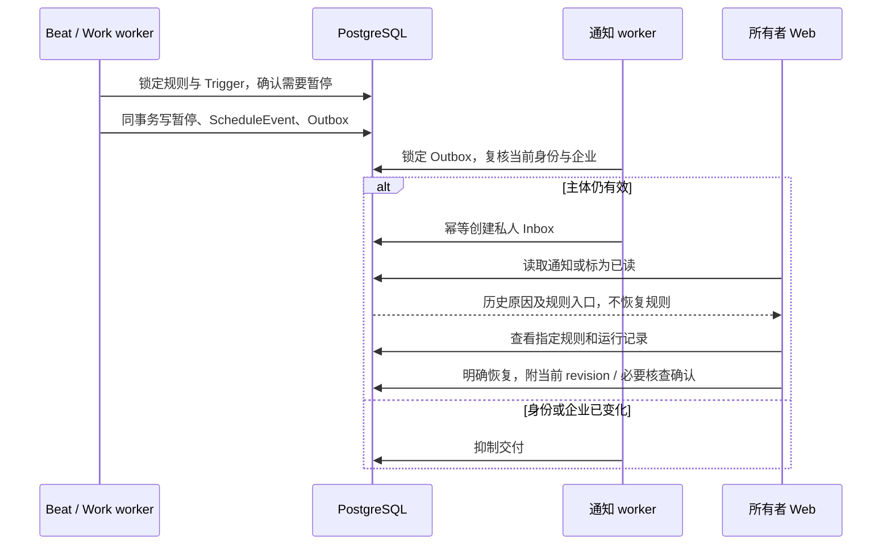

继续使用现有私人通知 API。新增 `event_type=schedule_paused`，target 为 `kind=schedule`、规则 id、trigger_id、rule_revision 和 reason_code；不复制规则名称、群 ID、消息、提示词或成果正文。Web 将已知原因码映射为说明，未知码仅显示通用提示；通知是历史记录，当前状态以规则页面为准。`/work?view=schedules&schedule=<id>` 使用既有所有者专属 detail API 打开准确规则及历史，不依赖列表第一页，也不自动恢复或补跑。

交付和读取均复核所有者、当前企业、账号状态及主体指纹。账号停用、设备主体、企业／身份变化后抑制或隐藏通知；同企业管理员及其他企业不能读取或标为已读。七天过期清理仅移除通知与 Inbox，保留事件／Trigger。通知开关关闭时保留原待投递 Outbox，恢复开关仍复核权限和有效期。

完整验证采用实际 App、本地 OIDC、Go IM、真实千问、Beat、Redis 与 prefork worker。先生成一份私人摘要，再由实际管理员页面暂停企业新调用；仅修改隔离规则 next_fire_at 使下期到期。正式执行在第二个 Run 创建前停止并送达通知。查看／已读不恢复，管理员解除企业暂停也不恢复；最后由所有者明确恢复到 revision 5，不补跑失败周期。预期两个 Trigger、一个 Run、一个暂停事件，无新增 Task／动作回执／群分享。

后端事务回滚、并发去重、投递崩溃、身份变化、手动暂停、准备中断、历史通知和事件约束的自动测试见 [test_schedule_notifications.py](../../src/backend/ai_platform/tests/test_schedule_notifications.py)。新增暂停 19 项、原通知 17 项、原调度／群订阅 46 项，共 82 项最终回归通过；Web 通知／定时 20 项覆盖通知含义、未知原因不泄露、直接打开私有规则及撤权后隐藏缓存。JUnit 分别为仓库外 `../work/platform-schedule-alerts-backend-final-2026-10-13.xml` 和 `../work/platform-schedule-alerts-frontend-2026-10-13.xml`。生产构建、目标 Ruff／ESLint、迁移一致性及 Helm 检查通过；原静态资源、分块和测试静态目录警告仍存在，不构成生产性能验收。

两轮真实链路均通过十二项浏览器检查及领域断言。初轮四次调用输入 2,613／输出 507 tokens，报告在仓库外 `../work/platform-schedule-alerts-qwen-browser-2026-10-13.json`。第二轮加强已读验证：等待按钮消失并查询真实 read_at，确保回执已落库后截图；该轮仍为四次调用，输入 2,604／输出 515 tokens，报告 `../work/platform-schedule-alerts-qwen-browser-final-2026-10-13.json`。两轮费用独立保留；209.23／195.32 秒为整个隔离验证及清理耗时，不能视为生产延迟指标。源码及 Go 二进制指纹一致，合成桌面／窄屏截图已检查，临时资源按本轮精确标签清理。

交付核对为仓库外 `../work/platform-schedule-alerts-delivery-2026-10-13.json`，验证测试结果、最终源码、文档链接／锚点、证据不含凭据、两轮资源清理及 Helm 定时依赖正反例，不替代客户身份／质量／容量验收。

复现见[进程说明](../../scripts/celery_validation/README.md#自动暂停通知的完整浏览器验证)。本节补齐第 18.30—18.31 节当时未实现的无 Run 暂停通知。客户身份环境依照用户安排稍后提供，质量／生产容量、正式图生产准入、Android／实时桥接及 P0—P4 其他工作包继续推进。新增迁移只在隔离库验证，生产部署、默认业务开关、凭据和 APK 均未修改。

### 18.33 冻结质量保留集、逐项评分与本地日期修复（2026-10-13）

质量验证从单次开发样例成功扩展为完整报告复评分。保留历史 `.4` 文件和每轮报告；核查发现 `summary-risk` 的取消／延期禁止词实际损坏为两个 `??`，因此历史通过不能证明这两个后果已被排除。修正版开发集 `.5` 仅修正两个词及版本，输入不变。评分器在调用前拒绝损坏字符、纯问号和重复探针，避免缺陷继续进入标注。

新增 [24 个合成保留案例](../../scripts/office_quality/holdout-2026-10-13.1.json)，四项技能各六个，输入与开发集不重叠。涵盖最终负责人／日期纠正、无效日历日期、任务撤销替换、条件已满足、已完成任务、两项义务、未选消息、未决方案、条件授权、提示词注入，以及周报重开、完成后不计逾期和日期窗口边界。[冻结清单](../../scripts/office_quality/freeze-2026-10-13.json)在首次调用前固定文件 SHA-256 和技能版本；数据没有来自客户，也没有独立业务标注人员背书。

[评分器](../../src/backend/ai_platform/quality_benchmark.py)增加消息候选落库后的标题、负责人和日期检查，不能只凭模型返回正确消息锚点判定成功。[分析器](../../scripts/office_quality/analyze.py)要求每个固定案例恰好一次，重新计算检查结果，保留失败，拒绝混合不同数据、代码、夹具、技能或模型的轮次，也拒绝重复使用同一报告充当两次执行。没有适用样本时比率为 `null`，不得写成 100%。

| 执行批次 | 完整案例／调用数 | 输入／输出 tokens | 含义 |
| --- | --- | --- | --- |
| 修正版开发集 `.5` | 24/24；23 次 | 30,952／3,856 | 验证真实禁止词；开发回归 |
| 保留集第一轮 | 24/24；24 次 | 33,943／4,840 | 调用前冻结输入；局部程序探针 |
| 保留集第二轮，同代码／技能／模型 | 24/24；24 次 | 33,913／4,851 | 与首轮共 48 次案例观察，探针结果无波动 |
| 本地日期修复后保留集回归 | 24/24；24 次 | 35,345／4,855 | 新代码／夹具 cohort，不能与前两轮混算稳定性 |

前两轮分别有 3 个明确可执行任务 TP、1 个明确否定 TN、0 FP／FN；另 2 个允许待澄清的标注不计二分类分母。消息推荐锚点分别 TP=4、FP=0、FN=0；已标注日期／负责人／优先级 21/21、摘要必要事实及指定引用 6/6、指定负面探针 8/8、周报栏目归属 24/24、确定性计数 16/16。比率只描述这些有限探针，不测量所有漏项或所有事实支持度。两轮生成耗时中位数为 3.046／3.401 秒，P95 为 5.330／5.703 秒，均不包含来源取数和夹具准备，不能视为生产 SLA。

人工复核仍发现周报把 UTC 完成／重开时间戳的日期直接用于上海时区描述，分别提前一天；原自动探针没有检查这类文字日期，因此两轮 24/24 不等于语义全正确。现由 [weekly_report](../../src/backend/ai_platform/weekly_report.py)提供 `local_date_facts`，按来源的 IANA 时区转换创建、更新、历史完成和重开日期；到期日作为日历日期保持原值，模型不得截取 UTC 日期。原始来源及内容哈希不被改写，历史完成与当前状态仍分别保留，不改变不可变技能版本。真实测试证据增加合成周报来源，便于对照实际时间戳。

修复后整批程序检查 24/24；人工核对六份周报，完成于 10 月 12 日的事项不再写为 10 月 11 日，重开案例分别保留 10 月 10 日完成和 10 月 11 日重开，窗口右界仍排除。保留集已经参与诊断，后续不能继续称作未用于调优的独立验收集。评分／周报 47 项及最终分析器 13 项，共 60 个不同测试通过，覆盖失败不被绿标覆盖、完整分母、cohort 混算、重复报告、缺失输出不能计为正确否定，以及上海、洛杉矶跨日和纽约夏令时日期换算。

仓库外证据：`../work/platform-quality-oracle-repair-2026-10-13.json`、`platform-quality-holdout-{first,second}-2026-10-13.json`、`platform-quality-holdout-analysis-2026-10-13.json`、`platform-quality-local-dates{-analysis,-review}-2026-10-13.json`、`platform-quality-holdout-backend-2026-10-13.xml` 及 `platform-quality-analysis-final-2026-10-13.xml`。交付核对为 `../work/platform-quality-holdout-delivery-2026-10-13.json`。不同 cohort 的源码指纹分别保存，不用历史浏览器报告证明修改后的源码已做浏览器验收。

此次使用 APIClient 预认证、真实 Go IM／千问及领域账本，不覆盖浏览器、客户 IdP、Celery、生产容量或端到端 SLA。没有生产部署、迁移、默认开关、凭据和 APK 修改。客户身份环境按用户安排后续提供；客户独立样本和人工修改率、生产容量及其余 P0—P4 工作包继续推进。

### 18.34 持续受理、队列唤醒与受控供应商故障（2026-10-13）

真实队列验证进一步覆盖持续 HTTP 受理，而非先停止 worker、集中入队后再启动。新 [容量入口](../../scripts/celery_validation/capacity_run.py)和[控制器](../../scripts/celery_validation/capacity_controller.py)通过实际 OIDC 登录建立 21 个合成用户会话，跨三个企业提交 72 次请求，计划每秒六次，企业分布 48／12／12。每个企业七个用户、每用户一个私人 Task 来源；请求包含自然语言任务和私人周报，固定技能版本分别为 1.0.0／1.1.0。本轮批量请求均在第一企业，不代表全 lane 的跨企业公平性。使用真实 Django HTTP、PostgreSQL、Redis、Celery Beat 和四个 Linux prefork worker：交互两个、批量一个、work 一个。只有正常 Beat 发起扫描，不直接调用 tick、不停启 worker 塑造积压。

模型端为内网受控 OpenAI 兼容 HTTP 夹具，每次正常调用延时一秒；原执行器和 OpenAI SDK 仍发出真实 socket 请求，但响应不是千问推理结果，不验证语义质量。任务候选停在等待审批，周报产生私人草稿，不批准或外发。数据库、身份服务、API、worker 及模型夹具均在无外部出口的内部网络，不映射宿主端口、不读取模型测试凭据、没有真实模型费用。身份夹具仅验证既有 OIDC 登录接线，不能替代客户 IdP、密码／MFA 或身份安全验收。

原 [lane tick](../../src/backend/ai_platform/tasks.py)每次最多处理一个请求，交互／批量分别每 2／5 秒触发。受控一秒调用结束后，空闲 worker 仍可能等待下一次扫描。调整为实际处理一个工作项后向同 lane 发送一条后继唤醒，交互／批量消息分别 15／30 秒过期；没有工作、没有许可或治理开关关闭时不继续链式发送。定期 Beat 保留为新请求发现与异常恢复入口，不增加第二套调度器。

后继消息只是唤醒，不携带用户内容，不指定某个 Run，也不绕过数据库 claim、权限复核、租约、预算或并发上限。全局／交互／批量许可仍为 3／2／1，取消中的实际模型请求继续占用许可直到返回。向 broker 发送后继失败仅记录异常类型；已完成候选和用量保留，下一次 Beat 扫描可以处理其他排队请求，不重放已调用的模型。

追加复跑分别暴露受理 HTTP 500 和受理后领域状态未达预期，失败报告独立保留；当时记录不足，不能为这些历史失败逐个归因。随后新增无响应改写的隔离异常观察，仅记录异常类别、SQLSTATE 与栈位置，不保存 SQL／参数、正文、Cookie 或授权码。另用真实 PostgreSQL 并发测试稳定复现共享技能版本的死锁：修改候选先通过联表 `FOR UPDATE` 锁住不可变 SkillVersion，再等安装记录；并发受理持有安装记录，提交时外键检查又等待 SkillVersion。修复前测试明确出现 `DeadlockDetected`，不是仅凭代码推测。

现将 11 处联表运行查询改为 `select_for_update(of=("self",))`，覆盖治理／旧执行 claim、候选生成／修改／提交、摘要步骤／发布、消息操作及成果编辑／周报发布。只锁需要修改的 SkillRun，仍锁定安装记录复核权限，不独占不可变且共享的 SkillVersion；原 skip_locked、状态／revision 检查、来源验证、业务审批和许可约束保留。修复不采用重试未知模型请求或跳过权限检查。该确定性测试证明所复现的锁环已定位，不能倒推为缺少现场的每个旧 HTTP 500 的确定根因。

历史基线受理 48／拒绝 24，交互排队 P95 为 74.926 秒、批量为 18.205 秒，主负载从提交开始至全部就绪为 86.325 秒。调整后的诊断轮受理 51／拒绝 21，相应排队 P95 为 19.391／3.631 秒，主负载 28.011 秒。两轮的受理样本不同，不能直接写成等样本百分比提速，也不是生产 SLA。排队时间取 Run 创建至许可创建；许可持有时间包括 HTTP、领域处理及保存；服务端就绪不是浏览器呈现延迟。首轮调整后实验未通过，因当时日志入口只保存 stdout，缺少 stderr，原因无法确认；失败报告保留。日志入口随后同时保存两者，诊断通过不覆盖失败，也不构成对该失败根因的证明。

固定最终 Python 源码后的两轮独立复跑均通过；报告为 `../work/platform-capacity-lock-final-{2,3}-2026-10-13.json`，运行前后源码一致，两轮源码指纹相同。每轮 51 次受理、21 次超限拒绝，45 个交互候选及六份周报全部到达预期领域状态，没有受理 HTTP 500。两轮完整许可区间重算均为全局／交互／批量 3／2／1；采样队列峰值均为 28。

| 观察批次 | 受理／拒绝 | 交互／批量排队 P95（秒） | 主负载排空（秒） | 证据边界 |
| --- | --- | --- | --- | --- |
| 原扫描基线 | 48／24 | 74.926／18.205 | 86.325 | 改造前源码，历史观察 |
| 最终源码第一轮（lock-final-2） | 51／21 | 19.435／3.633 | 27.991 | 持续受理、受控一秒响应 |
| 最终源码第二轮（lock-final-3） | 51／21 | 19.272／3.626 | 27.882 | 同最终源码，独立环境复跑 |

受理数量相同也不等于同样本，不能将各轮拼成生产提速百分比。每轮追加受控 HTTP 429／503，各只尝试一次，以 `model_unavailable` 终止并释放许可，不写虚构模型用量、不盲目重试。另以两个八秒调用占满交互 lane，验证排队取消不调用模型，运行中取消不会提前释放许可，迟到用量仍计一次且不会把取消结果恢复为候选。超限 HTTP 429 不创建 Run、不调用模型，已受理请求各调用一次；无新增 Task、动作回执或群分享。每轮合计 55 次夹具 HTTP、53 条夹具用量，分别包含 51 次主负载、两个供应商故障和两个慢调用；没有真实模型调用或费用。它只验证确定性故障终止，不代表供应商限流桶、熔断、跨凭据治理或重试退避已经实现。

最初 31 项治理与工作流回归通过，新增两项覆盖后继发送失败时成果不丢失／模型不重复，以及关闭治理后不触发排队模型。收窄锁后扩大为 127 项任务／消息待办／群摘要／周报／治理回归，全部通过，包括新增并发死锁测试、原并发批准唯一回执、撤权、取消和用量保留。修复前死锁基线的预期失败保留为 `../work/platform-capacity-lock-baseline-2026-10-13.xml`，完整修复回归为 `platform-capacity-lock-regression-2026-10-13.xml`；127 已包含最初 31 项的对应场景，不能相加为 158 项。原静态资源目录及 Django 配置弃用警告仍存在。

相关静态检查通过；扩大至整个历史脚本目录的 Ruff 检查仍有 14 个既存问题，未以本次局部通过代替全目录通过。仓库外保留 `../work/platform-capacity-beat-baseline-2026-10-13.json`、`platform-capacity-drain-first-2026-10-13.json`、`platform-capacity-drain-diagnostic-2026-10-13.json`、`platform-capacity-governance-2026-10-13.xml`。后续通过、HTTP 500／终态失败、被动观察及锁修复各轮列表和最终交付核对见[进程验证说明](../../scripts/celery_validation/README.md#持续-http-受理与-beat-队列唤醒)。各轮源码和日志独立保存，不混算历史源码的通过率。

本轮不覆盖浏览器、Go IM 长群摘要、真实供应商速率配额、生产入口／镜像／Kubernetes 高可用、CPU／内存峰值或客户容量。此前真实千问 20／50 档证据继续按第 18.26 节的 worker 停启边界保留，不能倒算成本轮持续流量验收。客户身份环境按用户安排稍后联调；后续推进真实模型持续负载、长摘要与配额治理，再校准试点容量。没有迁移、生产部署、默认开关、凭据、前端或 APK 修改，P0—P4 总目标继续。

交付核对为仓库外 `../work/platform-capacity-delivery-2026-10-13.json`：复核完整请求分母与拒绝、HTTP／计量次数、分位数、完整许可区间、127 项回归、当前源码、历史失败保留、文档链接／锚点及本轮资源清理。它不把两次有限复跑转为无死锁证明、客户身份验收或生产容量达标。

### 18.35 真实模型持续受理与跨页长摘要（2026-10-13）

用户明确先完成隔离验证、客户身份环境稍后提供。新增 [sustained_run.py](../../scripts/celery_validation/sustained_run.py)，通过真实 HTTP／CSRF、本地 OIDC、三企业 21 个合成身份、真实 Go IM、PostgreSQL、Redis、Beat 及四个独立 prefork worker 联合验证；两个交互 worker、一个批量 worker、一个维护 worker。模型为测试凭据调用的 `qwen3.8-flash`，测试库和身份服务仅内部网络，无宿主端口，只有模型 worker 具有供应商出口。不停止 worker、不手动推进 tick、不注入领域执行结果。

每轮以每秒一次节奏有限提交 12 或 24 次请求，三企业均衡，交替新建任务、私人周报和私人群摘要。每家企业实际写入 205 条 Go IM 消息，合计 615 条，跨至少两页及多个分块。重要事实分别放在早期、中段和末尾，包含方案撤销、负责人变更、最新期限及审批未通过。仅测试数据预算显式扩大至每用户每日一百万 tokens；生产预算、凭据及默认开关不变。

最初 12 次试跑在模型执行后因验证脚本混用 Run UUID／步骤数字 ID 汇总失败，未保留完整付费用量，不能将其算作零费用或通过。报告保留为仓库外 `../work/platform-sustained-qwen-pilot-2026-10-13.json`。修复按 `ref_type` 配对，并在聚合前保存终态、步骤、成果及用量检查点。另增加仅隔离模型 worker 加载的调用元数据观察器，记录开始／返回、运行 ID、异常类和安全 HTTP 状态，不改变模型参数或增加重试；SDK 尝试与供应商账单不是同一口径。

随后群摘要 1.3.0 的 24 次完整请求全部受理，但六份长摘要失败：五份 `invalid_source_evidence`、一份 `invalid_model_output`（输出达到 2,000 tokens 后截断）。12 个任务候选及六份私人周报达到预期状态。34 次模型调用均保留用量，输入 125,095／输出 8,491 tokens；失败也付费，不以成功数倒算总调用。独立 12 次诊断中，两份摘要引用错误、一份完成；共 19 次调用，输入 73,048／输出 4,545 tokens。失败轮不进入通过率分子，不自动重做模型或保存不可靠成果。

诊断捕获的合成原文表明，模型把正文“记录编号”推算成引用编号，例如 `m100` 的正文编号为 099，模型却引用正文 098。只在合成诊断中保存非法输出和对应源行，不允许将此观察器用于客户数据。新增不可变 [群摘要 1.4.0](../../src/backend/ai_platform/skills/group-chat-summary/SKILL-1.4.0.md)，要求从同一输入对象复制引用编号和连续原文片段、不按正文编号推导、合并时原样沿用引用对，并压缩没有新增事实的重复例行内容。旧版本、企业安装、应用发布和历史质量基线不被覆盖；原引用逐字匹配与合并引用白名单保持严格。

1.4.0 的 24 次复验仍只有三份摘要完成：两份合并引用改写、一份引用数量超过 Schema 约束；其余 18 个任务／周报正常。报告 `../work/platform-sustained-qwen-final-2-2026-10-13.json` 保存全部 52 次调用，输入 228,417／输出 15,816 tokens。提示词改善不足以保证契约，不将某次成功或三份成功推定为修复完成。

进一步新增 [1.5.0](../../src/backend/ai_platform/skills/group-chat-summary/SKILL-1.5.0.md) 与独立 `builtin.group-chat-summary.v1.2` 执行引用：使用供应商原生 `response_format=json_schema`，分块引用编号枚举自当前源行，合并引用以 `anyOf` 枚举已经校验的编号／原文完整配对，避免两字段各自枚举却产生交叉错配。`$defs` 共享引用规则，空来源引用只能输出空栏目；Schema 深复制，不能污染旧版或别的运行。仍在模型返回后执行原文逐字校验、合并白名单、当前来源／权限复核及完成状态检查；旧版本继续使用原 `json_object`。

2026-10-13 核验[阿里云结构化输出说明](https://help.aliyun.com/zh/model-studio/qwen-structured-output)，列出 Qwen3.8-Flash 的 JSON Schema 支持及相关组合约束。官方建议避免输出 token 上限导致截断；本平台为保持明确预算仍保留分块 2,000／合并 4,000 上限，截断即失败并保留用量，不自动提高费用或退回弱约束格式。新版本要求所配置供应商实际支持该协议，不推断其他模型或兼容网关支持，也不以官方支持代替真实调用验收。

1.5.0 的 24 次实际复验仍有两份分块引用失败，四份摘要完成，合并改写未再出现；49 次调用输入 213,011／输出 12,040 tokens，报告 `../work/platform-sustained-qwen-final-3-2026-10-13.json` 保留。分块只限制编号不能阻止 evidence 改写或与相邻原文错配，因此不能将其作为最终修复。

最终新增 [1.6.0](../../src/backend/ai_platform/skills/group-chat-summary/SKILL-1.6.0.md) 与 `builtin.group-chat-summary.v1.3`：分块和合并都枚举完整编号／原文配对，由模型选择，不生成引文。短消息引用完整正文；超过一千字符的正文按连续不重写片段提供选项，全部源行仍完整送入模型，不因选项分段丢弃正文。合并继续只允许之前已校验的引用。结构化请求返回后也按实际请求 Schema 校验，防止兼容网关忽略约束；再执行原来源检查，失败仍单次终止、保留用量。合法引用仅证明原文存在，不能证明摘要推断正确，仍需事实核对与客户质量验收。

最终实际轮次 `../work/platform-sustained-qwen-final-4-2026-10-13.json` 通过：24 次受理、零拒绝，12 个待批准候选、六份私人周报和六份私人长摘要；每份摘要完整处理 205 条消息、两页、五个分块及一次合并。54 次模型尝试均返回，54 条计量输入 242,665／输出 16,657 tokens，主体及步骤逐条对账；无新增 Task、动作回执、分享或供应商错误，所有许可释放。源码、技能内容及 Go 二进制指纹前后一致，精确标签资源清理完成。

| 最终有限负载 | 数量 | 排队 P95（秒） | 领域就绪 P95（秒） |
| --- | --- | --- | --- |
| 新建任务候选 | 12 | 1.190 | 2.940 |
| 私人周报 | 6 | 137.740 | 139.721 |
| 长群摘要 | 6 | 170.753 | 207.095 |

主负载 230.028 秒排空，包含串行批量工作流，不是平均模型延时。完整许可峰值全局／交互／批量为 2／1／1，未越过 3／2／1 上限，也没有充分占满交互并发。长摘要单次持有批量许可约 35 秒，短周报的执行本身 P95 仅 2.649 秒，却明显受同 lane 等待影响；因此不能宣布容量达标。下一步评估长短批量工作隔离、企业公平性及预算约束，不能直接提高并发绕过供应商配额。

逐份核对实际六份草稿与合成源事实，最终绿色方案、撤销红蓝方案、负责人小陈、下周一初稿及预算未通过／延后仍为风险均保留正确，没有写成已完成。部分例行消息仍带冗余引用，记为后续可读性改进；这里是用于诊断的合成材料，不能称为独立保留集或客户准确率。复核记录在 `../work/platform-sustained-qwen-semantic-review-2026-10-13.json`，绑定原报告及草稿哈希。

最终 101 项目录／任务／群摘要／应用回归通过，覆盖不可变版本、旧格式兼容、引用配对、空引用、长原文片段、兼容网关忽略 Schema 的拒绝和无重试。JUnit 为 `../work/platform-sustained-qwen-regression-final-paired-2026-10-13.xml`；已有 Django 配置弃用及静态目录警告保留。局部 Ruff／格式与差异检查通过。仓库外交付核对 `../work/platform-sustained-qwen-delivery-2026-10-13.json` 离线重算完整分母、用量、许可区间、分位数、原引用、草稿复核哈希、源码与清理；历史失败及已知／未知费用单列，不拼成总体通过率。没有迁移、生产部署、默认开关、凭据、前端或 APK 修改，P0—P4 总目标继续。

复现命令、实际结果、检查点和证据口径见[进程验证说明](../../scripts/celery_validation/README.md#真实模型持续受理与长群摘要)，功能与决策分别见[第 39 节](../features/enterprise-ai-platform.md#39-真实模型持续受理与长摘要技能版本)和 [ADR 第 7.39 节](../adr/0005-enterprise-ai-platform-architecture.md#739-真实负载证据与技能修复分别验收2026-10-13)。这条链路不包含完整浏览器页面、应用发布流程、客户 IdP、生产高可用或 SLA；此前完整浏览器验证按第 18.28—18.32 节独立保留。有限到达与排空实验不代表持续稳态容量，合成事实核对不替代客户独立质量集。

### 18.36 长摘要检查点交还许可与公平续调（2026-10-13）

第 18.35 节识别的短周报等待，来自长摘要在多次模型调用期间独占批量许可。保留 `ai-batch` 队列和全局／交互／批量 3／2／1 上限，改为治理开启时每次领取最多执行一个尚未完成的摘要模型步骤；不是增加一个不受总配额约束的队列。单块摘要仍一次完成；多块摘要在各分块完成后交还许可，合并步骤完成后生成最终私人成果。

模型 socket 返回、引用校验、来源复核及 `WorkflowStep` 成功检查点全部完成后，才同事务释放本次许可并将原 Run 返回 `queued`。保留 Run ID、来源快照、输入哈希、保守 token 预留及实际用量；`dispatch_ready_at` 记录续调时刻。企业间沿用轮转序号，企业内按本次就绪时间 FIFO；续调排在已等待工作后面，也不会被之后所有新请求无限插队。模型调用期间不抢占许可，取消仍等 socket 返回才能释放；不能承诺短工作完全不受当前慢调用影响。

恢复时重新检查当前主体、安装、模型配置、预算与来源。已成功步骤按原输入哈希复用，不重新调用或计费；仍为 `running` 或哈希不符的步骤按 `execution_unknown` 终止，不能凭检查点机制自动重试未知调用。来源整体每次续调复核一次，新增模型步骤后再复核；不为每个复用旧步骤重复读取全量来源。没有局部成果提前发布、自动任务批准或群分享。

[迁移 0016](../../src/backend/ai_platform/migrations/0016_summary_dispatch_quanta.py) 将 Run 与 `ExecutionPermit` 改为一对多，保存每次获取／释放区间；数据库条件唯一约束保证每个 Run 至多一条尚未释放许可。OfficeModelStep 仍一对一。调度返回本次 permit ID，模型调用前校验，失败处理及 finally 清理只作用于该 ID，防止旧 executor 在新进程领取后释放新许可或将新执行改成失败。许可历史不能被覆盖成“整个 Run 只有一次领取”。运行事件新增 `summary_yielded`，最终领域状态和现有 API 保持原契约。

该行为由已有治理开关控制；关闭治理保留原完整执行路径。生产部署前需统一升级 API／worker、应用迁移、排空旧 worker 后启用，不能混用新旧许可模型。回退可先停止新受理并排空，再关闭治理；保留 0016 数据和许可历史，不在已有多段历史时直接反向迁移为一对一。当前仅隔离数据库应用新迁移，未修改生产开关、生产数据库、企业安装、应用发布、凭据或 APK。

验证结果、实际指标与失败记录在本节后续段落及[进程说明](../../scripts/celery_validation/README.md#长摘要检查点公平续调)中列出；客户身份环境按用户安排稍后联调，仍须继续完成客户质量、生产容量与原 P0—P4 范围。

PostgreSQL 回归最终 88 项通过，包含新调度 12 项、原治理 28 项及摘要／周报 48 项。覆盖分步落库与用量、FIFO 续调、企业轮转、旧 executor 清理与迟到执行、未释放许可唯一约束、恢复前来源／权限／安装／模型／预算变化、取消和未知步骤禁止重放。随后去除复用步骤的重复来源读取，并对最新核心实现复验 36 项通过；这 36 项是同一集合的子集，不将其相加称为 124 项。JUnit 为仓库外 `../work/platform-summary-quanta-regression-2026-10-13.xml`、`../work/platform-summary-quanta-final-core-2026-10-13.xml`。目标 Ruff、格式和迁移一致性通过，已有 Django 配置及静态目录警告保留。

初轮测试误并行使用同一复用测试库，产生 teardown 的 AccessExclusiveLock 冲突、数据互扰，另有新测试未准备另一企业授权及重复创建已存在策略的夹具问题。原报告 `platform-quantum-governance-2026-10-13.xml`、`platform-summary-quanta-2026-10-13.xml` 和无用例的错误路径初轮保留；改为单进程串行并补齐夹具后重验。不能将该轮测试清理冲突当作业务调度死锁，也不以最终通过覆盖失败记录。

随后同一负载的完整隔离进程夹具通过：24 次全部受理，12 个待批准候选、六份私人周报、六份五块加合并的群摘要；54 次实际 SDK socket 请求、54 条计量与 54 段许可，摘要各有六段、其余各一段。全局／交互／批量实际峰值 3／2／1，未放大上限。主负载 101.656 秒排空，短周报首次排队 P95 15.744 秒；输入 5,400／输出 1,080 是夹具返回的合成计量，无千问费用。实际 OIDC、Go IM、HTTP、Redis、Beat、prefork 不被替换；模型是内网两秒响应 peer，不作千问质量证据。报告 `../work/platform-summary-quanta-fixture-2026-10-13.json` 保存完整区间、source 指纹及检查点，临时资源已按精确标签清理。

真实千问复验 `../work/platform-summary-quanta-qwen-2026-10-13.json` 也通过：相同 24 次每秒一次有限受理，全部达到预期领域状态，54 次调用全部返回、54 条计量，输入 242,178／输出 15,715 tokens；摘要各五块加合并、六段许可及五次续调，未重做成功步骤。全局／交互／批量实际峰值 2／1／1，所有许可释放、源码与 Go 二进制指纹前后一致，无 API／数据库异常、新 Task、动作回执或分享。主负载 217.318 秒排空；模型响应有自然波动，不能据两轮有限测试宣称稳态吞吐提升或生产 SLA。

| 真实复验 | 数量 | 首次排队 P95（秒） | 含续调的累计等待 P95（秒） | 领域就绪 P95（秒） |
| --- | --- | --- | --- | --- |
| 新建任务候选 | 12 | 1.203 | 1.203 | 2.565 |
| 私人周报 | 6 | 21.131 | 21.131 | 23.119 |
| 长群摘要 | 6 | 32.056 | 166.758 | 198.479 |

周报首次等待由历史轮的 137.740 秒降为本轮 21.131 秒，执行许可持有 P95 为 2.253 秒；改进体现为可在长摘要步骤间穿插。摘要首次领取变快，但仍有累计续调等待，不将 32.056 秒当作整个摘要等待。`permit_seconds` 汇总全部持有区间，`queue_total_seconds` 汇总首次及各次等待；领域状态保存早于 finally 的最后许可释放，不能误将两者相加判定领域就绪时间应晚于释放。当前仍不能强制抢占慢模型调用，短工作仍受同 lane 当前调用及前序企业影响。

六份实际摘要逐份人工核对，最终绿色方案、负责人小陈／小林不再负责、下周一初稿和预算未通过／延后风险保留正确，未虚构已完成。复核报告 `../work/platform-summary-quanta-semantic-review-2026-10-13.json` 绑定原报告及草稿哈希；部分例行消息仍有冗余引用，继续记为可读性问题。材料沿用诊断源，不是独立保留集或客户质量证明。

仓库外只读核对 `../work/check_platform_summary_quanta.py` 重算两个完整报告的请求分母、逐 Run 54 段许可、总／企业上限、模型开始／结束、54 条用量、各次等待与持有、全部 IM 消息定位／原文引用、草稿复核、源指纹、测试和临时资源清理；交付结果为 `../work/platform-summary-quanta-delivery-2026-10-13.json`。旧整 Run 许可报告作为历史比较，不要求它的指纹等于新源码；失败测试记录不删改。不包含完整浏览器、客户 IdP、生产调度高可用、稳态容量或后续阶段完成。

### 18.37 worker 崩溃后的许可账本闭合（2026-10-13）

本轮审查发现旧恢复路径的证据缺口：`active_permits()` 排除过期许可，所以 worker 死亡后并发计数可以归零；但技能 Run 被标为 `execution_unknown` 后，执行入口提前返回，绕过 finally，历史许可可能一直 `released_at=null`。已取消运行的 executor 死亡也不会再进入普通运行恢复。原“容量已释放”断言不能证明许可账本已闭合，按所有未释放记录排空时会永久等待。新增断言在修复前真实 PostgreSQL 测试中失败，报告 `../work/platform-permit-recovery-baseline-2026-10-13.xml` 保留。

治理开启的每次 claim 先单独短事务扫描本 lane 的过期未释放许可，每次最多 100 条；按到期时间排序，`skip_locked` 跳过正在刷新／退出的许可。不读写业务状态、来源或用量，不提前释放仍有效的许可，取消仍不能立即释放正在进行的调用。扫描只锁许可，正常调用提交后才进入调度时钟和领域 claim 事务，避免与 executor 的“领域 → 许可”顺序形成倒置。运行恢复的联表锁另收窄为 `of=("self",)`，不锁共享不可变技能版本。

兼容的 `execution.claim()` 原本外包原子事务，会让上述独立提交变成嵌套 savepoint。新定向测试在修复前失败，`../work/platform-permit-compatibility-baseline-2026-10-13.xml` 保留；现在治理入口直接调用独立调度事务，仅原关闭治理路径的 `claim_legacy()` 保持原子领取。测试用另一真实 PostgreSQL 连接确认许可闭合已提交，再进入领域 claim；不能只凭函数上有两个 `atomic` 推断锁已释放。

[迁移 0017](../../src/backend/ai_platform/migrations/0017_permit_release_reason.py) 增加 `release_reason`：`executor_finished` 表示执行器 finally 退出，`checkpoint_yield` 表示已成功保存步骤后交还，`lease_expired` 表示扫描关闭已过期容量账本。`released_at` 是平台记录闭合的时间；租约过期的有效容量区间止于 `expires_at`，不能将扫描延迟算成仍占配额，更不能推断供应商 socket 已停止。旧已释放记录回填 `legacy_unknown`，不猜测历史原因；旧未释放记录由后续到期扫描处理。

普通运行租约过期继续终止为 `execution_unknown`，不自动重放模型；已取消状态不复活。真实用量未收到时保持未知及保守预留，不能按零收费或退款。实际 executor 晚到的 usage 仍可只记录一次，不能发布取消后的候选；迟到 finally 不能覆盖 `lease_expired`。同一 Run 多段许可和清理的 permit ID 隔离继续保留。

当前实施和验证均在隔离环境；生产启用前先停止新受理、排空／核查旧执行，再统一升级 API／worker 并应用 0017，避免旧 worker 继续写没有原因的释放记录。回退可保留迁移和历史后关闭治理，不通过改写记录伪造已完成。全局 Beat 仍为单实例、`Recreate`；此次恢复修复不等于调度高可用，不把全局其他任务未经去重就改为多 Beat。客户身份由用户后续提供，生产准入及 P0—P4 总目标继续。

首次 82 项治理／办公／续调回归通过。扩展的 73 项摘要／周报／办公图回归有 71 项通过、两项失败：办公图子进程只允许特定 UUID 命名的独立临时库，本轮错误使用复用库入口，被保护规则拒绝，未进入业务执行。报告 `../work/platform-permit-recovery-workflows-2026-10-13.xml` 保留；不修改保护规则，改用项目 `scripts/validate_ai_platform_tests.py --test test_office_graph.py` 复验 25 项全部通过，独立临时库已清理。JUnit 为 `platform-permit-recovery-graph-final-2026-10-13.xml`。错误路径的零用例报告 `platform-permit-recovery-initial-path-2026-10-13.xml` 也保留，不计入通过数。

仓库外 `../work/test_platform_permit_migration.py` 用真实 PostgreSQL 历史模型执行 0016 → 0017：已释放行原因回填未知，未释放过期行不伪造释放；原到期时间、释放时间和预算保持。`platform-permit-migration-2026-10-13.xml` 一项升级验证通过。配置检查另有四项设置启动及六项 Helm 本地渲染通过，不执行 install／upgrade；现有 Django 配置／静态目录及 pytest 插件警告保留。

首轮进程报告 `../work/platform-permit-recovery-process-2026-10-13.json` 的八组断言通过，329.97 秒，包括两种真实请求进行中的执行容器死亡、自然租约到期、不重放／不复活、下一请求、broker 丢 tick 与 Outbox 及监督重启后两类 lane。普通及取消运行各一次模型 HTTP，没有模型 usage 到达则保持未知。整个入口包含基础阶段的手动重复 tick，但两次崩溃及后继阶段没有手动模型调度或缩短租约。来源只读挂载、前后指纹一致，内网无宿主端口、真实 Key 或千问调用；三个测试用户同一企业、Django APIClient 提交，不作为客户 OIDC／完整浏览器／多企业容量验证。

首轮 broker 断连后，两条 worker 日志出现 Celery 内部 `KeyError(24)`，监督重启后恢复就绪且后继任务通过。保存原日志并列为依赖重连风险，不能以最终恢复声称“无异常”或生产高可用已通过。修复兼容入口外层事务后，另用最终源码重新运行完整进程验证，保留首轮而不把指纹套用于新代码；最终结果另列。

最终核心 131 项回归通过，覆盖原 82 项及新增兼容入口提交隔离、摘要／周报执行；`../work/platform-permit-recovery-final-core-2026-10-13.xml` 保留。加上独立办公图 25 项及迁移升级一项，共 157 个不同用例通过，不重复累加首轮 82、扩展 71 或已复验办公图用例。目标八个 Python 文件 Ruff／格式、迁移一致性及差异检查通过。

最终进程报告 `../work/platform-permit-recovery-process-final-2026-10-13.json` 同样八组断言通过，328.4 秒；两次真实死亡的过期账本分别在到期后约 1.968／1.967 秒被自然扫描闭合，不将两个样本当作恢复 SLA。批量 worker 在 broker 重连时又出现一次 `KeyError(24)`，监督恢复及后继任务通过，依赖问题仍未解决。没有真实千问调用；夹具输出和内部计量不证明供应商费用为零，两个丢失 executor 的实际 usage 按未知保留。

仓库外 `../work/check_platform_permit_delivery.py` 只读核对 157 个不同通过用例、两个修复前失败、错误入口的两个失败与最终覆盖、两份进程报告、最终当前源码指纹、许可到期／闭合时间、原重连异常日志、248 个文档文件链接及各轮精确标签资源清理；结果 `../work/platform-permit-recovery-delivery-2026-10-13.json` 通过。首轮指纹只作历史记录，不要求与最终代码相同。后续优先处理已复现的 worker 重连依赖风险，继续生产运行准入及原阶段目标，客户身份联调按用户安排延期。

### 18.38 Redis 重连传输修复与原进程恢复（2026-10-13）

本节最终版本已完成隔离验收：28 项传输专项与 48 项领域回归，十次真实 Redis 中断下四个 worker master 和 Beat 原进程恢复，八组执行器死亡／未知用量／取消恢复检查，以及 wheel 和精确资源清理核对通过。最终交付证据为 `../work/platform-redis-operational-delivery-2026-10-13.json`；下文保留前两版的功能结果及日志风险，不能混用源码指纹。

第 18.37 节保留的 `KeyError(24)` 来自 Kombu Redis poller 对已移除文件描述符的直接映射读取。上游 [PR #2561](https://github.com/celery/kombu/pull/2561) 已修复这一行为；核验当日 [PyPI 稳定版](https://pypi.org/project/kombu/) 仍为 5.6.2，5.7.0 为预发布版本。选择在现有稳定依赖上做范围明确的传输适配，暂不为该修复采用预发布依赖。

[Redis 传输适配](../../src/backend/meet/redis_transport.py) 使用独立子类，在直接可读回调和 poll 事件入口忽略已移除 FD。事件入口在返回原有 READ 结果之前检查，避免空回调生成真值 tuple、提前结束 drain。有效 FD 仍走原处理器，QoS 与处理器异常保持原语义；不把所有 `KeyError` 当成可重试错误，不修改安装包、关闭 mingle／gossip／heartbeat 或增加模型重试。

启用 `AI_PLATFORM_GOVERNANCE_ENABLED`、broker 为 `redis://`／`rediss://` 且没有显式 `CELERY_BROKER_TRANSPORT` 时，Django 自动选择 `meet.redis_transport:Transport`。这是该部署的 Celery transport，覆盖 API 发布、Beat 及包括维护队列在内的 worker，不能只升级 AI lane。broker／缓存 URL 保留；治理默认关闭和其他 broker 类型沿用原传输。显式设置优先，可选 `redis` 恢复原传输，但同时恢复已知依赖风险。版本护栏只允许 Kombu 5.6.2；今后稳定升级需核查上游修复、移除或调整适配并重复真实重连验收，不能仅改版本常量。

未连接 broker 的原生 poller 三个定向探针均复现 `KeyError`，证据 `../work/platform-redis-stale-fd-baseline-2026-10-13.json`。新增 [20 项传输测试](../../src/backend/ai_platform/tests/test_redis_transport.py) 通过，覆盖陈旧 READ／ERR、真值返回、正常消费、QoS、活跃处理器错误传播、版本和配置边界；治理／摘要续调 48 项回归通过。本轮 68 个不同用例，不累加上轮 157 的重叠用例。另有七项设置启动、六项 Helm 本地渲染通过，未部署 chart。真实 TLS 连接不在本轮范围。

首轮重连实验在完成四轮后，第五轮周报受理因测试用户累计预留预算触发 `budget_exceeded`，未完成十轮；报告 `platform-redis-reconnect-process-2026-10-13.json` 与原日志保留。仅 `reconnect` 隔离场景将两项测试日预算从 100,000 调整为 500,000，保留正式受理与预留规则；生产默认和企业策略不变。

最终 `../work/platform-redis-reconnect-process-final-2026-10-13.json` 完成十次真实 Redis 中断，每次停机两秒，再由自然 Beat 分派一个任务候选及一个私人周报。四个 worker 每轮均通过真实 `inspect ping`；四个 Celery master 和 Beat 身份前后相同。该场景 worker restart policy 为 `no`，没有监督重启掩盖异常；prefork 子进程按原 `max-tasks-per-child` 回收，不承诺其 PID 不变。十轮共 20 次受控模型 HTTP、零重复调用、零未经批准 Task 写入、零完成后未闭合许可。额外保留 broker 丢 tick、Outbox 和两条 lane 后继消费检查；原失效 FD 忽略分支在真实日志中被触发，worker 无 `Unrecoverable error`／`KeyError`。详细复现见[重连实验说明](../../scripts/celery_validation/README.md#redis-原进程重连专项)。

上述仅保护映射的版本完成了十轮，275.17 秒，八组死亡恢复复验也通过，322.23 秒；但交付核对发现 1,344,326 条陈旧 FD 相关调试日志记录，不能由原进程存活推断没有事件空转。`platform-redis-reconnect-delivery-2026-10-13.json` 保存该发现、日志、源码和原 wheel，不覆盖。记录数是日志匹配数，多个 handler 可能重复记录，不能解释为独立 broker 故障或请求次数。

因此继续补齐异步 reader 清理：只在 FD 已不属于当前 poller，且 event loop 中的 callback／参数仍与本 transport 完全相同时，调用原 `Hub.remove_reader`；已替换为其他组件的监听不移除。原 event-loop 注册、有效可读处理和错误传播保持；不直接清空 hub 映射或全部 poller。六项新增测试覆盖只移除一次、迟到回调不破坏替代监听、未注册 loop、有效调用及错误、原生注册；最终专项 26 项通过，与已有 48 项领域回归共 74 个不同用例，不重复累计初次 20 或前一版 26。

清理版 wheel 用项目构建器生成至仓库外 `platform-redis-watchers-wheel-2026-10-13`，两份当轮报告为 `platform-redis-reconnect-watchers-2026-10-13.json` 和 `platform-redis-permit-watchers-2026-10-13.json`。最终打包核对采用后述 `operational` wheel，不能把旧 wheel 当作最新源码。进程实验使用固定镜像依赖加只读当前源码，不等于最终生产镜像／Kubernetes 验收。

清理版十轮及八组死亡恢复均通过，285.4／322.07 秒，但日志交付检查仍失败：直接可读的陈旧日志已为零，同步 poll 路径还有 67,960 条未映射 FD 日志，风险保留于 `platform-redis-watchers-log-risk-2026-10-13.json`。共享 poller 可能含其他组件的就绪 FD，因此不能将所有未映射 FD 全局注销；这与确认归本 transport 的旧 reader 清理分别处理，也不能仅凭日志计数推断 CPU 空转次数或时长。

最终为同步未映射 FD 的诊断记录增加最多 64 个近期 FD 的去重缓存，不改变事件处理、请求、超时或其他组件监听；不同 FD／缓存淘汰后仍可再次记录，不能称为全局日志速率上限。两项新增测试核对重复记录、外部 FD 不注销、缓存有界和有效事件未被遮蔽。最终专项 28 项，与领域 48 项共 76 个不同用例。最后源码、wheel 和真实进程实验分别保存为 `platform-redis-transport-operational-2026-10-13.xml`、`platform-redis-operational-wheel-2026-10-13`、`platform-redis-reconnect-operational-2026-10-13.json` 和 `platform-redis-permit-operational-2026-10-13.json`；不覆盖前两版结果。

最终十轮实验 300.4 秒，仍通过全部 15 组过程检查，四个 master 与 Beat 无监督重启；20 次新增模型 HTTP 各一次。最终记录 52 条未映射 FD 诊断、14 条自有 reader 移除日志，零 `Unrecoverable error`／`KeyError`；日志数是匹配记录，不代表独立回调次数或 CPU 指标。最后死亡恢复实验八组通过、321.11 秒，普通及取消请求各一次 HTTP，未收到 usage 时保留未知和预留，取消不复活；原 70 秒租约自然到期，两份账本到期后约 1.963／1.969 秒闭合，不作为 SLA。该入口另有一次明确注入的 master 死亡，由监督重启验证，不能与十轮重连的零重启混淆。

`../work/check_platform_redis_operational_delivery.py` 核对 76 个不同测试、原生三项失败探针、预算拒绝的未完成报告、历史日志风险、最终源码／两份进程报告、精确标签清理、打包字节及从 wheel 解析 transport、256 个文档文件链接；交付报告通过。所有本轮临时容器和网络已清理，其他既有服务保留。没有真实千问调用；内部夹具和缺失 usage 均不支持推断供应商费用为零。Ruff／格式及差异检查通过。

第 18.37 节指纹和报告对应该轮历史代码，本轮报告独立记录新源码。当前没有生产迁移、部署、模型凭据或默认业务开关调整；客户身份联调按用户安排延期。下一步仍是发布镜像与运行准入、供应商限额治理及原阶段工作，不由十次故障实验推断生产高可用或稳态容量。

### 18.39 实际发布镜像与只读运行验证（2026-10-13）

前述只读源码挂载与 wheel 验证不能代替生产 Docker 镜像验收。本轮使用仓库根 [Dockerfile](../../Dockerfile) 的真实 `backend-production` 目标，分别构建基础镜像与 `office-graph` 扩展镜像；均保留在本机，没有推送 registry 或部署生产。最终两条隔离进程场景、镜像／构建参数和交付核对通过；不代表客户身份、质量、生产容量或 Kubernetes 已验收。

新增构建参数 `MEET_BACKEND_EXTRA`，只接受空值或 `office-graph`。两个 `uv sync --locked --no-dev` 阶段使用同一选择，扩展安装 LangGraph 1.2.14／checkpoint 4.2.0／LangChain Core 1.6.9；空值保持原有生产依赖。该参数与运行时 `AI_PLATFORM_OFFICE_GRAPH_ENABLED` 独立：安装依赖不开放功能，基础镜像启用办公图时由正式依赖准入返回 `office_graph_unavailable`。不引入 `--all-extras`、开发依赖或预发布包。

生产目标默认 `DOCKER_USER=1000:1000`，发布构建脚本传递企业指定 UID/GID 和依赖选择，默认非 root。修正后端 CI 将 `1001:127` 拼成 `1001:127:-1000` 的构建参数；本轮核对 YAML 和脚本参数，不声称 GitHub Actions 或 arm64 已执行。现有 `.dockerignore` 的实际 Docker 上下文探针确认 12 个 `SKILL*.md` 都存在，无需放开全部文档或修改忽略规则。

首次实际只读启动暴露 Gunicorn 25.1.0 控制 socket 默认写入工作目录的错误。正式 [Gunicorn 配置](../../docker/files/usr/local/etc/gunicorn/meet.py) 改为 `/tmp/gunicorn.ctl`，可通过 `GUNICORN_CONTROL_SOCKET` 指定部署提供的可写目录；保留默认 `0600`。依据为 [Gunicorn 25.1.0 设置源码](https://github.com/benoitc/gunicorn/blob/25.1.0/gunicorn/config.py#L2889)。验证 `/tmp` 临时卷、真实 socket 类型／所有者／权限以及健康 HTTP，不以日志出现代替就绪。

[发布镜像验证入口](../../scripts/celery_validation/release_image.py) 继承既有受控故障测试，但只挂载 `/repo/scripts` 测试驱动与独立证据目录，不挂载 `/app`，不从 checkout 的 `src/backend` 覆盖 Python 导入。应用及迁移从镜像 `/app` 加载；比对全部后端 Python／技能文件和 Gunicorn 配置字节。API 使用镜像默认 entrypoint／Gunicorn 命令，测试设置继承 `Production`，只抑制无关定时任务，保留安全 cookie、HTTPS 重定向和生产缓存。容器 UID 1000、只读根、可写 `/tmp`、drop ALL 与 no-new-privileges；数据库、Redis 和模型 HTTP peer 仅在本轮内部网络可达，无 host port。

执行器采用真实 Celery prefork、Redis、Beat 与正式领域代码；测试 PID 1 观察器只转发信号和退出码，便于注入 master 死亡，不称为 Helm 原样命令。领域受理使用 `APIClient.force_authenticate`，真实 HTTP 另核验 Gunicorn 健康与未认证拒绝；不是 OIDC、完整浏览器或客户身份验收。模型是内网夹具，没有新增真实千问请求。

证据分别保存在仓库外：

| 检查 | 最终证据 |
| --- | --- |
| 两种镜像、12 个技能版本、依赖和默认关闭 | `../work/platform-release-artifacts-final-2026-10-13.json` |
| 构建脚本默认／扩展／指定 UID/GID／非法值及后端 CI 参数 | `../work/platform-release-build-script-final-2026-10-13.json` |
| 真实 Docker 拒绝非法 extra | `../work/platform-release-invalid-extra-2026-10-13.json` |
| 扩展镜像办公图生命周期与真实租约故障恢复 | `../work/platform-release-graph-operational-2026-10-13.json` |
| 基础镜像十轮 Redis 原进程恢复 | `../work/platform-release-base-operational-2026-10-13.json` |
| 当前镜像／源码／日志／文档／精确清理交付核对 | `../work/platform-release-operational-delivery-2026-10-13.json` |

早期通用源码校验误包含不随镜像交付的 README、夹具用户缺少密码、隔离 `DJANGO_ALLOWED_HOSTS` 参数遗漏，以及仅读取 stdout 的 Gunicorn 日志就绪判定均单独保留失败报告；不得覆盖或纳入通过统计。发布代码的控制 socket 错误与这些测试入口错误分开记录，修复后重新构建镜像并完整复验。构建基于当前工作树，使用不可变 image ID 和文件指纹，不冒充已提交 commit 的生产发布。

最终扩展镜像场景 267.37 秒、10 组断言，基础镜像场景 309.85 秒、15 组断言；两者包含共享基础检查，不累计成 25 个独立用例。十轮 broker 中断的四个 worker master／Beat 身份不变、监督重启零次，各继续处理两个请求、共 20 次 HTTP 无重复；扩展场景另外注入 master 死亡，监督重启一次。办公图在途死亡等待真实 100 秒租约，恢复为未知、保留预算预留且不自动重放。两条场景的真实 API 健康 200、未认证请求 401，控制 socket 为 UID 1000／0600；日志没有控制 socket 错误、弱测试 Secret 警告、`KeyError` 或不可恢复异常。

只读交付核对两种镜像各 12 个技能版本、1,020 个后端 Python／技能文件及 Gunicorn 配置、四组构建脚本参数与真实非法 Docker 参数拒绝、264 个文档文件链接；五份早期失败报告保留。全部七轮临时容器／网络按精确 run label 清理，未触碰其他运行资源。验证进程源指纹、构建输入指纹和 image ID 相匹配，正式依赖和运行开关仍默认关闭。治理设置启动七项／Helm 渲染六项、目标 Ruff 和 diff 检查通过；历史 76 个 Redis／领域用例不作为本轮重新执行或重复累计。

生产准入仍需客户身份、独立客户质量、稳态容量／供应商 RPM/TPM、Kubernetes 就绪／滚动／故障恢复，以及迁移和统一 cohort 交付。启用治理的 API、Beat、维护及两类 AI worker 必须使用一致镜像；不能仅给单个 worker 安装 graph extra。回退应先停止新受理并核对在途／未知运行，再统一切换镜像与开关，保留领域检查点及用量预留，不自动重放未知模型调用。客户 IdP 按用户安排后续提供，完整 P0—P4 工作包继续推进。

### 18.40 原生 Helm Kubernetes 生命周期隔离验证（2026-10-13）

新增[原生 Kubernetes 验证入口](../../scripts/celery_validation/kubernetes.py)和[领域断言驱动](../../scripts/celery_validation/kube_controller.py)，完成已有本地 `kind-suite` 单节点集群中的独立命名空间验证。使用上一节实际 `backend-production` 扩展镜像，应用及迁移来自 `/app`，没有应用源码挂载；全部 1,020 个 Python／技能文件与当前 checkout 一致，运行 UID 1000、只读根及可写临时卷。设置继承 `Production`，只抑制无关定时任务；领域受理仍使用 `force_authenticate`，真实模型由集群内 HTTP 夹具替代，不属于客户 OIDC 或真实供应商验收。

只应用实际 Helm 的后端、交互／批处理／维护 worker 和 Beat 模板，没有安装整套 Chart。worker 原样使用 Celery prefork 命令、broker ping readiness 和退出宽限，PID 1 为实际 Celery，不使用先前 Docker 实验的观察器。交互及维护退出宽限为 100 秒，批处理为 630 秒；三个 worker Deployment 明确使用 `maxUnavailable=0`／`maxSurge=1`。Beat 保持单副本 Recreate，补齐只读根、drop ALL、可写 `/tmp` 和配置文件挂载。默认平台功能开关未改变。

最终 `../work/platform-kubernetes-native-2026-10-13-attempt4.json` 通过，670.85 秒，包含 7 组顶层证据，其中领域证据有 14 组复用／新增断言；不将分组数解释为独立测试用例数。

| 验证 | 实际结果与范围 |
| --- | --- |
| 队列与业务闭环 | 批处理不消费交互任务；重复确认只建一个技能运行；维护暂停后技能执行可推进，恢复后检查点续调 |
| 在途正常退出 | 单旧副本保证替换顺序，实际记录 `Warm shutdown` 后释放模型请求；一次 HTTP、候选成功，无未经批准 Task 写入，宽限期内完成 |
| 原生 worker 死亡 | 从 kind 节点核验 CRI 容器所属 Namespace／Pod UID／进程后发 SIGKILL；同一 Pod 由 Kubelet 重启一次，没有测试监督器 |
| 真实租约恢复 | 租约为 100 秒，注入后的等待为 94.27 秒；结果未知、保留预算预留、不修改数据库时钟、不重放模型 HTTP |
| broker 暂停与恢复 | 使用模板原有探针时间，86.57 秒观察到四个 worker 全部未就绪；恢复后 Pod UID、master PID／启动时刻及重启计数一致，新增请求由自然 Beat 完成 |
| broker tick 丢失 | Redis 原生重启，关闭夹具持久化以明确丢失排队 tick；图回执及 Outbox／Inbox 由数据库扫描恢复，Task／站内通知各只交付一次 |
| 失败更新与镜像恢复 | 双副本下错误镜像产生 `ErrImageNeverPull`，两个旧副本仍可用；失败期间及恢复后各一个自然调度请求完成，最终命令、环境和安全配置与模板一致 |
| API 与资源清理 | 真实健康 HTTP 200、未认证能力请求 401；本轮 Namespace UID／标签核验后删除，前后既有 Deployment spec 相同 |

正常退出只替换同一镜像的 Pod，不能据此证明跨版本 schema 兼容性。Kubernetes `deletionTimestamp` 是退出宽限期截止时刻，按 `deletionGracePeriodSeconds` 计算开始时刻，并结合 SIGTERM 日志检查请求完成窗口。容器内发信号可能被 PID namespace init 忽略，故从父 namespace 注入，停止／继续时要求 CRI 容器 ID 与 PID 一致；不向其他工作负载发信号。

三次早期失败报告分别保留：夹具多架构镜像缓存缺失、两个旧副本替换顺序超过夹具等待窗口、将删除截止时刻误作为退出开始时刻。前者改用独有标签的 amd64 镜像归档，后两者修正测试入口后完整复验；不是三次产品故障，也不纳入通过统计。四轮测试命名空间均清理。外部只读交付核对入口为 `../work/check_platform_kubernetes_delivery.py`，结果保存到 `../work/platform-kubernetes-delivery-2026-10-13.json`；复现和信号守卫详见[进程说明](../../scripts/celery_validation/README.md#原生-helm-kubernetes-生命周期验证)。

当前仅通过本地单节点的原生生命周期门槛。没有生产部署、registry 推送或客户凭据调用；kind 网络不等于强制网络隔离。冻结 master 的 liveness、Beat 高可用、节点故障、PDB 驱逐、多节点调度、滚动 schema 兼容、真实 TLS 和稳态容量均未由此验收。客户身份环境按用户安排后续提供，继续推进独立质量／人工修改率、供应商限额、生产交付与原 P0—P4 工作包。

### 18.41 未确认成果问题的服务端恢复（2026-10-13）

补齐第 18.20—18.23 节留存的成果问答请求恢复缺口：复用 `OfficeArtifactPreparation`，新增 `request`、`request_hash` 和增量迁移 `0018`。新客户端在准备成果引用时一并提交原问题，绑定原请求 UUID、当前主体、对话、模型配置和至多三份明确版本的成果引用；不保存成果正文。旧客户端不带问题的准备接口仍兼容，但不会产生可恢复问题。

对话详情 GET 增加 `artifact_drafts`，仅返回当前所有者、当前企业、未消费且未过期的记录。读取页面只检查本地主体、配置和成果版本，不重新读取来源、不受理模型轮次；该检查不代表外部 IM 来源权限仍有效。已知本地绑定失效时隐藏问题和引用，保留取消入口。外部来源授权仍在用户明确点击继续后的原准备／消费流程中重查。

办公助理展示“未确认成果问题”及“继续原成果问题／取消原成果问题”。刷新、重新登录或另一客户端从最近对话进入后，可恢复已落到服务端的原问题；继续沿用原请求 UUID 和原成果版本，不能用当前新输入替换旧问题，也不自动升级成果版本。读取进行中只可等待或取消；45 秒租约过期后才允许重新读取。继续期间可以取消，迟到响应受页面动作代次及服务端 epoch 阻断；多客户端并发受理仍沿用原轮次唯一键和消费账本。

未确认记录有效期沿用准备账本的 900 秒；取消、消费、关闭、清除或到期清理时移除问题正文，保留必要哈希与回执关联。模型受理后原问题仅保存在 OfficeTurn，继续沿用对话正文的保留／清除机制。浏览器不另存明文，不把恢复页面当作新的模型授权。未到达服务端的输入、关闭页面前尚未发送的文字、派生任务的跨设备草稿及通用对话输入恢复不属于本次交付。

隔离 OIDC／HTTP／自然 Beat／真实 Redis 与四个 Celery worker 联调通过：两个独立登录恢复同一问题，详情 GET 后无新增模型调用；两个客户端同时消费返回 202／409，只生成一个轮次和一次问答模型 HTTP；随后重放无新增调用，取消清除正文，没有 Task 写入。132.29 秒，报告为 `../work/platform-question-draft-queue-2026-10-13-attempt1.json`。模型是受控 OpenAI 兼容 HTTP 夹具，应用源码只读挂载；这是领域联调，不能替代真实千问质量、发布镜像或客户 IdP 验收。

实际 React／Chromium 的刷新与新页签恢复、明确续传、取消迟到响应和 1280／390 像素布局检查通过，证据在 `../work/office-question-recovery-ui-2026-10-13/`；31 项办公助理组件测试、TypeScript 构建检查和定向 ESLint 通过。浏览器使用受控 API，和上述真实 HTTP／队列是独立验证。最终 51 项 PostgreSQL 领域回归通过，覆盖身份变化、并发、取消、清理及旧客户端兼容，报告为 `../work/platform-question-draft-backend-final-2026-10-13.json`；早期错误身份夹具的失败报告保留，详见首批实现说明。本次只在隔离数据库应用迁移，不变更生产默认开关、数据库、客户身份系统或 Android。

### 18.42 定时私人周报与群摘要的单次补跑（2026-10-13）

补齐第 13.1 节明确规划的手动历史补跑。工作／自动化页面可选择规则时区下的历史运行日期，生成该日期对应的已结束周期；也可从终态运行记录选择“重新生成此周期”。两种操作均需明确勾选授权，产生新的私人草稿，保留原成果和原执行记录，不改变自动规则的下次时间。

`POST /api/v1.0/ai-platform/schedules/{id}/backfills/` 接收原规则 `revision`、新执行 UUID `client_request_id`，以及互斥的 `period_date`／`trigger_id`。每日群摘要按相邻本地运行边界取数；每周群摘要按相邻周运行边界取数，个人周报按原规则周起始日取完整上周。规则须启用，当前来源须有权限，同一规则已有活跃执行时拒绝；缺失原记录、错误星期、未来运行日期和非法参数均拒绝。

重新生成原记录保留原 `input`、侧重点、群／任务范围、时区、原规则版本及应用版本，单独记录本次 `authorization_revision` 和 `regenerated_from`。它重新读取当前有权访问的资料，不重放旧快照，也不宣称能还原历史人员归属。当前规则编辑／暂停使未进入 Run 的补跑失效；已有 Run 不因暂停规则而自动撤销，仍通过原运行接口查看或取消。实际执行继续使用现有来源受理、配额、预算、队列、工作流和私人通知，不另建模型调用体系。

每个补跑 UUID 固定绑定原参数；重试返回同一触发记录，不重新读取来源或调用模型。自动触发的逻辑周期唯一键不变；手动触发使用独立 `manual:<UUID>` 周期键及数据库唯一约束。`GET /api/v1.0/ai-platform/schedules/{id}/backfills/{key}/` 只读取本人本企业的原回执，重新核对本地主体绑定，不消费请求，不执行来源网络 IO；在规则暂停或调度开关关闭后仍可核对，平台总开关和身份权限仍生效。

Web 在发送前保存本人／规则范围内的 UUID、原授权版本及日期／原记录 ID，不保存消息或成果正文。响应丢失后刷新不自动发送新请求，提供核对和原键重试；存储损坏或无法写入时阻止发送。放弃未知受理请求必须明确执行“暂停规则并核对原请求”，先通过同一规则锁递增授权版本，再查询原键；只有找到原记录或明确确认不存在后才能清除恢复指针，避免迟到 POST 被当作新授权。暂停请求本身丢响应时保留原指针。

验证证据：新增补跑首批 12 项 PostgreSQL 测试通过，64 项既有调度／群摘要／私人通知回归通过；另外 3 项暂停只读恢复／数据库 NULL 约束／每日和每周群摘要回归通过，极早日期运算越界的 1 项新增回归通过，合计 16 项新增与 64 项既有分轮验证。页面 8 项新增和 12 项既有测试、TypeScript、ESLint 通过。真实 React／Chromium 的明确授权、响应丢失后刷新、原键核对／重试、原周期新 ID、暂停屏障及 1280／390 像素布局通过，截图已检查；受控 API 报告为 `../work/schedule-backfill-ui/verification.json`，不算完整 SPA 与真实后端同链路浏览器验收。详细复现与最终结果见功能说明第 46 节。

实际 OIDC 登录、HTTP、PostgreSQL、Redis、四个 Celery worker、自然 Beat 隔离验证通过，159.59 秒；三项受控模型路由评估后通过实际发布接口冻结应用，两客户端同键提交为 200／202、仅一个触发；两次明确新执行生成两个独立私人周报 Run，报告模型 HTTP 两次，总共五次，无业务 Task 写入。原规则版本 1 的周期在当前授权版本 2 下重生成成功，暂停屏障拒绝未落账的迟到请求，暂停后重放旧回执不重新执行。报告 `../work/platform-schedule-backfill-queue-2026-10-13-final.json`；最终验证期间源码未变，源文件指纹与交付实现一致。模型是内部 OpenAI 兼容 HTTP 对端，无客户 IdP、真实千问质量或生产容量验收；本轮资源按 UID 清理。

迁移 `0019` 仅在隔离数据库执行；默认开关及生产服务未变，没有提交推送、部署或 APK 改动。早期组合测试有 12 个测试夹具错误，修正缺失的本地 `client` 夹具导入后单独复验通过；初次失败报告 `../work/platform-schedule-backfill-initial-2026-10-13.json` 保留，其 64 个既有通过案例与最终新增案例分别计数。当前源码不能沿用旧镜像指纹作为本版本发布证明。企业团队周报、事件触发、外发授权、通用 Agent 工具循环、Android 平台入口及后续 P3／P4 仍未完成。

### 18.43 团队周报的共同来源与私人草稿（2026-10-13）

新增审计内置技能 `team-weekly-work-report@1.0.0`，运行模式 `team_weekly_report`。用户在固定 AI 应用或办公助理的技能确认表单中指定一个共享任务清单、带时区的过去绝对周期（不超过 31 天）、关注重点及 2—20 名成员；生成者必须包含在范围内。表单显示资料发送与模型用量说明，明确勾选后启动；变更清单、成员、周期或重点会清除确认，变更清单同时清除其他成员选择。

团队来源采用业务域现有的企业成员解析、清单角色和任务层级可见性规则。企业管理员身份不会扩大取数范围。平台逐个核对成员为当前有效主体、归属同一当前企业且有该清单权限，再对清单任务求可读交集；不会合并私聊、个人周报、个人材料或成员私有任务。当前共同可读任务与历史周期事件分别统计；当前状态不是周期结束状态，也不表示个人绩效或团队全部工作。最多 200 项任务、2000 条状态事件、250 KB 来源，超界拒绝而不生成貌似完整的报告。

来源快照固定所有者、企业、清单、周期、成员主体和任务／事件哈希。最终受理、模型执行前后、草稿读取和编辑重新核对当前权限与来源；成员失效、撤权、主体变更及证据变化均阻止继续使用旧正文。生成流程复用 `SourceAdmission → SkillRun → WorkflowStep → WorkArtifactVersion`、实际 OpenAI SDK 调用、批处理队列、预算和用量账本；不新增并行引擎或数据库迁移。选定成员不能访问生成者的私人 Run 或草稿。

生成与编辑分别记录，编辑产生新版本。应用入口继续使用现有持久请求引用和只读回执恢复，刷新不自动发起 POST。同键并发可能返回 202／409（来源仍在准备）或 202／200（已受理），等待后原键重放返回同一个 Run，不应把 `admission_in_progress` 当成新授权或新 UUID。取消已受理工作仍通过现有 Run 生命周期。此阶段没有团队采纳、共享发布或向成员通知，私人编辑内容也没有被授权公开；这些独立动作仍属于下一工作包。

验证记录：真实 PostgreSQL 72 项通过（团队专项 19 项、个人周报 24 项、路由 29 项，路由包含新增团队案例），报告总耗时 73.46 秒，报告 `work/platform-team-report-backend-2026-10-13-delivery.json`。Web 66 项通过（新增表单和恢复存储 6 项，相关既有 60 项），定向 ESLint、TypeScript、生产构建通过；最终 Vite 构建 22.68 秒。React／Chromium 的 7 组交互检查通过，1280／390 像素无横向溢出，截图已查看，报告 `work/team-report-ui/verification.json`。浏览器使用受控 API，未声称完整 SPA 与身份／后端同链路通过。

真实 OIDC、HTTP、PostgreSQL、Redis、四个 worker 和自然 Beat 隔离验证通过，136.12 秒，12 组边界检查。发布应用所需三次路由评估、成功团队草稿、撤权中的失败草稿共五次实际 SDK HTTP。并发为 [202, 409]，原键重试 200、只生成一个 Run；选定成员和其他企业均不能查看私人草稿。模型 IO 期间撤权不保存成果，但保留实际用量；旧草稿正文隐藏且编辑被拒绝，无业务 Task 或共享写入。报告 `work/platform-team-report-queue-2026-10-13-delivery.json`，复现见[进程说明](../../scripts/celery_validation/README.md#团队周报共同来源与私人草稿)。最终 Python 源码和驱动在验证期间未变，容器和网络按 UID 清理。

本阶段默认 `AI_PLATFORM_TEAM_REPORTS_ENABLED=false`。仅在隔离测试环境启用，并通过 `sync_ai_platform_skills` 同步目录、由企业管理员安装技能、绑定固定应用版本及评估后内测。关闭开关不再提供团队范围选择、新受理或执行；私人运行元数据仍按当前身份查看，正文继续经过来源核验。没有生产部署、迁移、提交推送、凭据或 APK 调整。模型端是受控 HTTP 夹具，客户 IdP 按用户安排后续提供，真实千问团队周报质量和新生产镜像准入仍待验收。前期失败的并发断言及汇总文件约定记录保留，不计为通过；完整目标的团队交付、事件订阅、外发授权、通用 Agent 循环、Android 入口与 P3／P4 继续实施。

### 18.44 团队周报的采纳、发布与成员通知（2026-10-13）

在第 18.43 节共同来源私人草稿之上，实现独立的 `adopt → publish → notify` 和 `withdraw`，复用既有领域权限、成果版本及事务 Outbox／Inbox，不增加模型调用或独立引擎。生成和编辑不共享；采纳不发布；发布不通知。Web 展示完整待发布正文和固定成员范围，用户逐项确认后才执行。未保存编辑、版本变化和权限失败阻止新采纳／发布。人工修改正文需要明确核对其可共享性，引用仍是生成时依据，不能宣称人工修改已自动逐条验证。

新增 `TeamReportAction` 独立动作回执和 `TeamReportPublication` 冻结副本；每个发布版本对应一份副本，绑定生成者、企业、原先共同来源成员、具体采纳记录、成果版本和正文／引用／来源身份哈希。接收人不能因此读取生成者的私人 Run、草稿或来源快照。发布后编辑只产生新的私人版本，新版本需要重新采纳和确认发布；撤回后的旧版本不重新发布，可使用新版本走独立确认。

采纳和发布重新核对安装、成果最新版本、成员身份、源任务权限及来源内容哈希。发布后的历史正文保持冻结，业务任务进展或标题变化不重写它；正文读取和通知送达重新检查所有原选定成员的主体／企业／清单／任务层级权限和每个冻结任务仍存在且位于原清单，任何原成员撤权均暂停整份共同来源报告的正文访问。该保守规则尚不是可重新授权部分成员的发布系统。列表和通知仅保留通用版本／时间／数量元数据，不含正文、任务标题或私人 Run 链接；来源撤权后这些通用元数据可仍存在，打开正文必重新鉴权。手工复制或已读出内容无法由服务端撤回。

通知仅进入选定成员的内部工作通知，不发送 IM 群消息、邮件或外部通知，生成者不重复收到自己的发布提醒。一次发布最多 19 个接收人，重复原键和新键的通知请求都不重复扇出；真实 worker／自然 Beat 执行既有 Outbox，当前权限失效时抑制送达，通知保留 7 天。撤回停止正文访问、递增发布 revision、隐藏相关待送及已送达通知，保留不可变副本和审计回执；即使交付开关关闭或来源 ACL 失效，原身份所有者仍能撤回。开关暂停期间未送通知保持 pending，恢复后重新检查权限送达，不把暂停当成撤权。

动作参数严格限定为原 UUID、动作、明确 Boolean `confirmed=true`、正文哈希，以及版本或发布 ID／revision，拒绝字符串布尔值、整数类型混淆和额外字段。原请求键按所有者／主体／Run／完整参数绑定，读取回执没有模型／来源重执行。同键变参或跨 Run 冲突拒绝；未知请求取消在同一所有者和 Run 锁下落取消屏障，迟到 POST 返回 canceled；若操作已完成，取消只返回已完成回执，不反向撤回。单 Run 最多 200 条动作回执。浏览器 sessionStorage 只保存标识和精确参数，按所有者／Run 隔离，不保存正文；刷新不自动 POST，404 不丢弃未知请求，用户可查原回执、原请求重试或服务端取消后放弃。

接口（统一前缀 `/api/v1.0/ai-platform/`，沿用登录、CSRF、限流和 no-store）：

| 方法及路径 | 作用与可见范围 |
| --- | --- |
| `GET runs/{run}/team-delivery/` | 原身份生成者查看最新版本采纳状态、固定成员及发布元数据，不返回正文 |
| `POST runs/{run}/team-actions/` | 独立采纳／发布／通知／撤回，精确请求键和明确确认 |
| `GET runs/{run}/team-actions/{key}/` | 原身份生成者只读恢复动作回执 |
| `POST runs/{run}/team-actions/{key}/cancel/` | 提交同一完整参数建立取消屏障或返回已完成回执 |
| `GET team-publications/` | 当前企业接收人通用元数据，最近 30 份并标明截断 |
| `GET team-publications/{id}/` | 当前共同来源权限通过后返回冻结正文和引用，不开放私人运行 |

启用新增迁移 `ai_platform/0020_teamreportaction_teamreportpublication_and_more.py`，以及默认关闭的 `AI_PLATFORM_TEAM_DELIVERY_ENABLED=true`；另需已有平台／团队周报开关，通知另需 `AI_PLATFORM_NOTIFICATIONS_ENABLED=true`。API 与 worker 使用相同配置，迁移先在非生产副本验收。关闭交付开关暂停新采纳／发布／通知、正文读取与通知送达，但保留已登记请求的恢复／取消、原身份所有者撤回和审计记录。此轮只在隔离库迁移，无生产变更、提交推送或凭据调整。

验证：真实 PostgreSQL **84 项通过**（交付专项 23、团队草稿 19、通知 18、个人周报 24），报告总耗时 214.42 秒，`work/platform-team-delivery-backend-2026-10-13-verified.json`；Web **26 项通过**，`work/platform-team-delivery-frontend-2026-10-13-verified.json`。Ruff、定向 ESLint、TypeScript和生产构建通过；构建日志 `work/platform-team-delivery-build-2026-10-13.log`。独立 React／Chromium 9 组检查通过，1280／390 像素无横向溢出，截图已查看，`work/team-delivery-ui/verification.json`；浏览器 HTTP 受控，不能称完整 SPA 同链路验收。

真实隔离 OIDC／CSRF、HTTP、PostgreSQL、Redis、四个 worker、自然 Beat 验证 **25 组检查通过**（既有团队来源 12 + 独立交付 13），149.72 秒，`work/platform-team-delivery-queue-2026-10-13-verified.json`。并发发布同 UUID 只产生一个副本／回执；原键和新键通知请求只产生一个成员 Outbox／Inbox，原身份恢复、取消屏障、私人编辑不改变发布正文、撤回正文与通知均通过。发布／通知不增加模型调用；连同路由评估、团队生成和撤权生成验证，受控 SDK HTTP 共 5 次，源码与驱动执行期间未变，UID 所有资源已清理。首轮驱动错误拼接已是绝对路径的 URL，失败记录保留，不计通过。

本阶段完成共同任务来源团队报告的人工交付；团队定时与预授权内部交付后续进展见第 18.45 节。成员私有提交稿授权、多来源汇总、外部通知、通用 Agent 循环、真实千问团队报告质量、客户 IdP、生产镜像与容量、Android 入口及其他 P2—P4 工作包继续独立推进；客户身份环境按用户安排后续提供。

### 18.45 团队定时报告与预授权内部交付（2026-10-13）

复用既有应用发布、来源受理、周期账本、Celery Beat、报告执行器和团队交付领域服务。每周规则固定团队技能应用版本、单个共享清单、包含发起者的 2—20 名成员及交付方式：`private` 仅生成私人草稿；`team_publish` 自动采纳并发布给固定成员；`team_publish_notify` 在发布后另记录站内通知动作。后两者必须输入严格 Boolean 的 `delivery_authorized=true`，与调用模型的授权分开。没有新的模型循环、管理员代运行、私人材料合并或外部消息发送。

**授权与周期。** 服务端保存当前成员主体哈希到规则 `team_authorization`，触发记录冻结副本；客户端不能提交或取得主体哈希。当前身份／企业、应用与安装、模型配置、成员身份和共同来源权限在受理、完成来源准备、模型执行与自动交付时复核。规则使用 IANA 时区划定周期，来源统计／正文沿用该报告时区，不回退为所有者当前时区。每次身份重绑都需要重新明确审核规则范围，单纯恢复不默许新主体。手动补跑仍单独确认；原周期与当前成员／清单／交付方式不一致时拒绝重放，可核对当前规则后按历史日期补跑。

**生成与交付分离。** 新增 `TeamScheduledDelivery`，每个成功的自动交付触发至多一条记录，区分 `pending/completed/canceled/needs_review`；生成成功不会被表示为发布完成。后台仅对原始生成版本 1 交付，人工修改、人工采纳／发布或同键冲突会暂停规则并要求核查，不能把人工动作重新标成自动授权。自动 `adopt/publish/notify` 分别记录 `automation_trigger`，UUID 从冻结触发确定性派生。三个局部动作与发布副本、Outbox 和交付终态共用本地事务，不调用模型或外部接口；失败全部回滚交付写入，生成记录及实际用量保留。

**迟到与失败。** 固定锁顺序绑定当前规则授权版本；用户暂停／修改后，迟到生成可以留下私人结果和用量，但旧交付会取消。交付前来源变化、成员撤权、企业停用或成果版本变化导致 `needs_review`，规则暂停并写审计／内部通知；用户核查后恢复仅作用于未来周期，不重放失败交付。同规则有运行中触发或待交付记录时不启动下一期。已发布副本不因暂停规则消失，所有者仍可通过人工交付面板撤回。

**界面与接口。** 定时任务页面增加“团队周报”，使用真实授权选项选择清单与固定成员；字段变化清除未来交付及模型调用确认，选项请求失败不使用缓存继续授权。保存响应不明时保持原 UUID 与完整规则，跨刷新不自动提交，明确重试沿用原请求。既有 `POST/PATCH /ai-platform/schedules/` 和历史／补跑接口复用；规则结果返回实际 `delivery`，触发结果额外返回 `delivery_status/delivery_error/publication_id`。这些字段不含正文或主体哈希。报告页面显示“由 AI 自动生成并按规则预授权发布，尚未经逐次人工核对”，成员仍只能读取发布副本。

新增迁移 `0021_automationschedule_team_authorization_and_more`，仅在隔离环境应用。`AI_PLATFORM_TEAM_SCHEDULES_ENABLED=false` 默认关闭；启用还需既有平台、应用、定时及团队报告能力，自动发布需团队交付开关，自动通知另需通知开关。关闭团队定时／交付开关暂停自动交付扫描，待处理记录保留；恢复时仍检查规则是否启用、授权版本和当前权限。欲取消旧授权应显式暂停规则。运行／交付记录和已发布副本继续按原权限与既有交付开关控制，不新增生产配置、数据库部署或凭据调整。

最终 PostgreSQL 100 项通过：团队定时 26、团队交付 23、共同来源 19、补跑 14、调度通知 18。报告 `work/platform-team-schedules-backend-2026-10-13-delivery.json`，pytest 559.95 秒。Web 36 项通过（新增范围／授权／请求恢复 9、相关既有 27），报告 `work/platform-team-schedules-frontend-2026-10-13-final.json`；定向 Ruff／ESLint、TypeScript、生产构建通过，Vite 23.44 秒，保留既有静态资源和包体警告。独立真实 React／Chromium 7 组检查通过，1280／390 像素无横向溢出，截图已查看，证据 `work/team-schedules-ui/verification.json`。

真实队列最终报告 `work/platform-team-schedules-queue-2026-10-13-delivery.json` 通过 35 组检查（共同来源 12、人工交付 13、定时交付 10），199.99 秒，实际受控 SDK HTTP 7 次。时间测试仅让隔离库中的规则到期，不调用调度领域方法或 eager 任务；实际 Beat／worker 执行生成、交付和通知。297 个 Python 源文件／驱动指纹在验证期间未变并与交付源码一致，容器与网络按 UID 清理。早期测试夹具的角色名称、自动提交事务与回执缓存／方法名错误记录保留，不计为通过；最终源码重跑全部 100 项及队列。客户 IdP 按用户安排后续提供；模型为受控 HTTP、浏览器 API 独立受控，这不是客户联调、真实供应商质量或生产验收。

本阶段完成固定共同任务来源的团队周期报告和内部交付，未代替完整团队协作自动化：成员私有提交稿／多来源汇总、消息事件订阅、日历与服务主体、外部通知授权、通用 Agent 工具循环、Android／实时办公桥接及其他 P2—P4 能力继续推进。生产镜像、部署迁移、容量及实际客户身份仍需独立验收，完整平台目标保持进行中。

### 18.46 受控 IM 事件源与平台收件箱（2026-10-13）

为第 13.2 节补齐真实事件来源。在相邻 `jusi-light-im` 仓库已有来源分页分支上增量实现原生消息事务 Outbox、按群启停及签名投递，保留既有分页改动。平台接收资源元数据通知；下一工作包接入用户订阅和运行。两端默认关闭，仅本地隔离数据库和进程启用，没有生产迁移、部署或凭据调整。

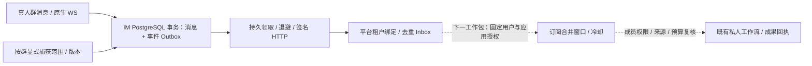

**按群来源范围。** IM 迁移 `012_platform_event_outbox.sql` 增加来源范围及 Outbox。配置回调地址不会启用所有群；受信业务后端通过既有 Admin HMAC 的 `POST /admin/conversations/{cid}/platform-events` 明确提交 Boolean `enabled`，仅支持实际群。相同目标幂等，启停变更增加捕获版本，关闭／重新开启会取消旧版本待投递事件。原生 WS 真人文本新消息才进入 Outbox，角色须为 owner/admin/member；管理员注入即使署名真人也不触发，机器人、私聊及控制消息均排除。捕获版本不等于用户应用运行或正文读取授权。

**事务与恢复。** 消息及事件在同一 PostgreSQL 事务入库；事件写失败则消息不部分提交。原消息 ID 重试返回原消息而不增加事件。后台按未处理记录领取，用租约 UUID 围住回执，不依赖 Redis fanout、离线推送或最大 ID 游标；早分配但迟到提交的事件不会被跳过。HTTP 位于事务外，每次至多 20 项；超时及非 2xx 保持同一事件／资源版本重试，退避上限 1024 秒，禁止重定向携带签名。旧租约不能标为送达。未送七天到期记 expired，旧捕获版本记 canceled；终态元数据保留十四天，有限批量清理，保留期不是无限重试承诺。

**接口与租户。** 新内部 `POST /api/v1.0/ai-platform/events/im/` 要求平台及 `AI_PLATFORM_EVENT_INGEST_ENABLED=true`、足够长度的专用 `AI_PLATFORM_IM_EVENT_SECRET`；否则 404。HMAC-SHA256 覆盖 METHOD、PATH、当前秒级时间戳及原始 BODY，差值至多 300 秒、BODY 至多 4096 字节。字段只含 `event_id/source/type/cid/mid/seq/resource_version/occurred_at/origin/source_revision`：资源数字为正的 signed-int64 十进制字符串，时间明确带时区，哈希为 64 位十六进制。来源固定 `jusi-light-im`、类型固定 `im.message.created`、origin 固定 human；拒绝正文、用户、企业、运行指令及额外字段。

平台由当前 `ImConversation.organization` 绑定确定租户，不接受事件自报企业，不通过 create-or-get 探测群。迁移 `0022_platformsourceevent` 保存不可变 `PlatformSourceEvent`，事件 UUID 和逻辑资源分别唯一。精确重试 200、新受理 201、内容或租户冲突 409，过期七天的事件 410，显著未来时间拒绝；原回执的企业不能被重试改写。收件箱元数据保留十四天并复用维护 tick 限量清理，过期重放不能重建。回执仅含事件 ID 与已受理，不下发企业或人员信息。

**运行边界与回退。** 接收不创建 SkillRun、读取正文、调用模型、创建任务、发布成果或通知。后续须绑定固定用户、应用及群范围，复用真实成员令牌、完整分页、当前企业／主体、安装、应用版本和预算校验；捕获许可不能代替业务授权。IM `PLATFORM_EVENT_URL` 默认空，`PLATFORM_EVENT_SECRET` 使用专用签名配置；平台开关默认 false。关闭平台接入会让来源待投递记录继续退避；要停止捕获应关闭具体群范围或清空 IM 目的地。重开不能将旧用户授权当成仍有效。

隔离平台测试 77 项通过（事件 29、来源及受理相关 48），pytest 204.33 秒，证据 `work/platform-event-ingress-backend-2026-10-13-final.json`。Go 定向五个包 199 个测试节点通过，含事件新增 15 个节点，覆盖真实 PG 原子事务、按群捕获版本、迟到提交、去重、租约／重试、机器人／控制过滤、签名及禁止重定向；`go vet` 和真实服务构建通过。Go 子测试按实际 JSON 节点统计，不另算模型验收。

真实跨服务最终证据 `work/platform-live-im-events-2026-10-13-verified.json`，103.83 秒，pytest 101.03 秒；4 项通过、3 项模型专项跳过（不计通过），事件 `EVIDENCE` 记录 8 组检查。真实 Go WS、IM PostgreSQL／Redis、签名 HTTP、Django WSGI 及平台 PostgreSQL 验证平台提交后向来源返回一次 503，再重启 IM；领域响应 201／200、来源实际 HTTP 应答 503／200，两次尝试、一个平台回执、一个源记录，恢复时未重发客户端消息。管理员输出及原消息重试无新事件，事件接收零模型 Run。同一二进制另外通过分页／撤权、私人任务来源、消息候选提交／撤回三项相关测试。115 个 Go／SQL／模块文件、125 个 Python 文件及二进制指纹在最终联调期间未变，与交付源码一致；本次原生进程、临时数据库和 Go 测试容器已清理。初次驱动用了错误 WS 帧名的失败记录保留，不计通过。

本阶段是事件自动化的必要基础，尚未完成订阅设置、短窗口合并／冷却、事件到模型和成果的闭环、任务到期／会议事件、外部通知或生产接入。客户 IdP 按用户安排后续提供；完整平台目标继续推进。

### 18.47 真人群消息订阅、短窗口私人摘要与来源控制顺序（2026-10-13）

承接第 18.46 节事件来源基础，实现第一类事件自动化：用户明确选择一个有权访问的群及已发布群摘要应用，授权自动读取该范围的新消息并产生模型用量。默认仅生成私人摘要，不自动发群、不创建待办、不替用户改变群权限。本节是新的实施范围；前节“尚未完成订阅”是当轮历史状态。

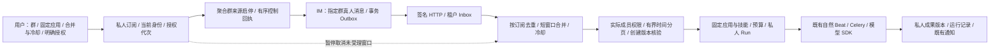

**授权与页面。** Web 工作模块增加“消息事件订阅”。只能选择当前可访问群和已发布、单个 `group-chat-summary` 工作流应用；名称、侧重点、合并窗口 30–300 秒、冷却 60–3600 秒（不得小于合并窗口）及模型用量授权一起提交。应用发布内容哈希和环境固定在订阅中，后续发布不静默改变已有授权。订阅归固定用户、企业及主体哈希，列表和窗口仅本人可见。每用户最多 25 条记录；首版页面支持新建、暂停、明确恢复和查看窗口，参数更新接口已经提供，页面内编辑已有规则及归档删除后续补齐。

**保存与接口。** 普通用户使用现有登录、CSRF 和独立读写限流，不直接调用 IM 管理接口。新建先保存原请求 UUID 与完整授权参数，未知网络结果保留原请求；刷新不自动 POST，只读 404 不证明未受理，也不换请求键。明确重试沿原参数，服务端相同请求返回原回执、不同参数冲突。明确的参数校验拒绝允许修改后重新授权。异常本地记录阻止新建，避免丢失未知结果。请求记录不是正文缓存或永久权限凭据。

| 用户 API | 行为 |
| --- | --- |
| `GET/POST /api/v1.0/ai-platform/event-subscriptions/` | 本人列表／确认新建；201 新受理、200 精确重试 |
| `GET /api/v1.0/ai-platform/event-subscriptions/requests/{request_uuid}/` | 只读原新建回执，跨主体／租户 404 |
| `GET/PATCH /api/v1.0/ai-platform/event-subscriptions/{id}/` | 本人详情／版本前提下更新、暂停或明确恢复 |
| `GET /api/v1.0/ai-platform/event-subscriptions/{id}/windows/` | 最近 30 个私人窗口及是否截断；不暴露源事件正文或内部控制凭据 |

**有序来源控制。** `EventSourceBinding` 是每群共享的受信控制记录，聚合仍启用订阅决定来源是否应捕获。平台事务只写目标和单调 `control_revision`，独立任务在事务外发请求；租约 UUID、命令版本和来源配置哈希共同围住 ACK。IM `013_platform_event_controller.sql` 扩展原 Admin 接口：`enabled` 搭配 `controller_id`（绑定 UUID）、`control_revision`（正 int64 十进制字符串）。同版本同目标幂等；较旧命令、同版本不同目标、其他控制器和已托管群的旧式无版本请求返回 409。控制命令版本与消息捕获版本分开，旧启用不能覆盖新暂停，其他平台克隆也不能冒领控制器。发生冲突自动暂停并等待核查，不自动接管。

**消费、读取与成果。** 迁移 `0023` 增加来源绑定、订阅、窗口和订阅事件消费记录。每个订阅／事件只消费一次，不使用最大自增 ID 作水位；迟到提交仍可被扫描。只接纳本次授权后发生、来源捕获版本匹配且未过期的事件。第一条消息确定合并截止，窗口结束冻结消息定位与时间范围；同一订阅至多一个未结束窗口，冷却期间暂不建立下一窗口。冷却结束接续仍在保留期的新授权消息，不承诺无限补齐历史。

正文通过订阅人的临时 IM 凭据读取。新增 `GET /v1/messages/time-range?cid=...&start_ts=...&end_ts=...&before_seq=...&limit=...` 和 IM 迁移 `014_message_time_range_index.sql`，按毫秒半开区间、反向序号及 `(cid,created_at,seq)` 索引定位，保留成员校验、清屏、个人删除和撤回规则。仅事件工作流显式使用此接口；旧 IM 不支持时拒绝，不退化成扫描全部历史。时间边界按消息毫秒精度冻结，不把首末消息误排除。

至少一条触发消息必须当前可读，并匹配原消息 ID／序号及创建内容哈希；全部撤回、删除或不可读时忽略窗口，零模型 Run。窗口区间内其他可见消息作为上下文，机器人输出本身不能触发窗口，也不能授予工具执行权。读取和最终受理分别核验当前主体、企业、群成员、来源配置、应用版本和预算；创建原有私人群摘要 Run，执行及成果落库继续复核身份与来源，复用已有引用、模型用量、检查点和成果显示机制。

**中断与调度。** 默认每次 10 秒维护 tick 至多处理一个来源控制请求、一个激活成员读取、一个窗口来源读取以及五条订阅扫描；HTTP 不持有授权事务。等候来源、无消息扫描及临时受理失败会轮转，不让旧条目阻塞其他订阅。每窗口最多 1000 个触发事件，超过范围暂停，不默默截断。激活及正文准备分别有租约；准备租约中断变 `needs_review` 并暂停，不自动重复读取或模型调用。暂停取消尚未受理窗口，已受理 Run 沿原回执单独取消或正常收尾；功能开关关闭后仍处理停源回执和已受理运行终态。恢复须新确认、新授权代次，不重放旧窗口；旧主体不继承已排队模型运行或成果。

**验证与交付边界。** 后端 PostgreSQL 回归、原生 IM Go／真实 PG、React 交互及 Chromium 桌面／390px 均在隔离环境验证。真实跨服务采用合成 OIDC 登录、CSRF、原生 Go IM WS／签名 HTTP、PostgreSQL／Redis、四个 worker、自然 Beat 与实际 OpenAI SDK HTTP；模型对端受控，不能算供应商质量验收。完整检查、最终数量与稳定源指纹记录在本节末的验收记录。初次缺测试依赖、测试专用密钥名称配置错误及测试夹具错误的失败报告保留，不计通过。

新增 `AI_PLATFORM_EVENT_SUBSCRIPTIONS_ENABLED=false`，须与平台、应用、IM 来源和事件入口开关一起显式启用。来源回调和专用签名密钥沿用第 18.46 节；不是客户端配置。只在隔离数据库运行 Django `0023` 与 IM `013/014`，没有生产迁移、部署、Key 调整或提交推送。回退先暂停订阅并等待来源停用 ACK，再关闭订阅功能；记录仍可读取，已受理 Run 单独处理。清空来源 URL 可阻止新投递，但不能撤销在途 HTTP 或已受理模型请求。

验收记录：`work/platform-event-subscriptions-backend-2026-10-13-final-80.json` 为最终 80 项 PostgreSQL 回归，pytest 288.70 秒，总驱动 291.77 秒；覆盖订阅 27 项、群摘要 24 项和入口 29 项。`work/event-subscriptions-im-verified.jsonl` 为原生 IM 四包 201 个实际通过节点、无失败或跳过，包含托管启停顺序与 250 条同毫秒消息的时间分页／清屏／撤回／个人删除；`go vet` 和 Linux 实际服务构建通过。Web 四项测试、TypeScript、定向 ESLint 和生产构建通过；Chromium 五组检查及桌面／390px 证据在 `work/event-subscriptions-ui/verification.json`，无页面异常或横向溢出。模型对端和浏览器 API 都是受控夹具。

跨服务权威报告为 `work/platform-event-subscriptions-process-2026-10-13-final-stable.json`：15 组检查，4 个实际来源事件；最初 3 条合并为 1 个私人摘要 Run，固定应用评估 3 次 SDK HTTP、摘要 1 次，零业务任务写入。管理员输出和暂停后消息不触发；旧启用命令被来源拒绝；明确恢复后原生成员撤权，新增事件在正文读取时拒绝，订阅暂停，没有第二次摘要模型请求，旧成果不再交付。310 个 Python 文件、119 个 Go／SQL／模块文件及原生二进制指纹在运行前后稳定，最终只读对账 `work/platform-event-subscriptions-verification-2026-10-13.json` 通过；本次容器与网络按唯一标签清理。开发期 `verified`／`complete` 两个非稳定运行虽然业务检查通过，但检测到期间修改源码，整体标为失败，不能作为最终验收；保留失败报告，不混用证据。

本工作包不完成任务到期／会议事件、任意事件技能与动态自主 Agent、外部通知、多实例大规模吞吐、客户 IdP、生产镜像或容量验收。订阅与窗口长期归档清理、消费元数据保留策略及未知新建请求的主动撤销屏障仍需后续完善；现有恢复提供原请求核对和精确重试。平台完整目标继续推进。

### 18.48 消息订阅的撤回屏障、编辑归档及元数据保留（2026-10-13）

补齐第 18.47 节列出的日常管理与未知请求恢复缺口。新增 Django `0024_eventrequestcancellation_and_more`；仅在隔离数据库验证，原生 IM 无新改动，生产开关保持关闭。

**撤回未知新建。** 页面保留原保存请求，用户勾选撤回范围后，`POST event-subscriptions/requests/{request_uuid}/cancel/` 携原新建参数。服务端在同一用户锁下核对规范化请求哈希、企业和实际主体，与新建操作串行：若新建尚未受理，保存 `EventRequestCancellation` 屏障且不建立群来源绑定；若已受理，归档原订阅并停止未来触发。返回 `status=canceled/client_request_id`，精确重复幂等，改变参数 409。相同请求 UUID 的迟到新建返回 410，不能重新启用；主体重新绑定后不能读取或复用原回执。

撤回只关闭本人授权，不需要当前应用仍发布或当前群仍可访问。恢复确认仍使用当前成员及应用权限，二者不能混用。取消按钮的网络结果未知时继续保留原请求；刷新不自动发送撤回或重试，也不因只读 404 丢弃原授权。只有确认的取消回执或只读核对到 `status=canceled` 才解除本地等待。已受理 Run 不自动取消，沿原运行记录单独处理。

**暂停编辑与归档。** 活跃订阅先暂停再进入设置编辑。可改名称、合并窗口、冷却和侧重点；保存显式 `enabled=false`，不自动恢复、不构成新的模型用量授权。既有群和发布应用保持绑定，修改它们需新建订阅并另行授权。PATCH 仍以 `revision` 为前提，迟到旧设置不能覆盖新版本；结果未知时核对最新记录，不重新计算反向开关。

明确归档通过 `POST event-subscriptions/{id}/archive/` 携版本前提。归档取消未受理窗口、撤销未来启用并记录 `archived_at`，重复归档保持幂等；归档后 PATCH／恢复返回 410。新建原请求重放仍指向已关闭历史回执，不创建替代授权。归档只释放当前 25 条订阅名额，不删除历史回执或已受理成果。默认列表显示未归档记录；`GET event-subscriptions/?archived=1` 显示最近 25 条归档及截断标记，原详情、窗口、请求核对按本人身份继续可读。归档不是成果或原业务消息删除。

共享群捕获由仍有效的所有用户订阅聚合；一位用户归档不能关闭另一位用户仍需要的来源。最终联调使用两个实际 OIDC 用户、原生成员凭据和同一真实 IM 群验证这一点；跨用户不能读取对方订阅。

**保留与清理。** 订阅维护 tick 即使订阅功能关闭仍执行有限元数据维护。每次最多删除 100 条已终态窗口／无窗口的 14 天以上消费定位，再以只锁窗口自身、`SKIP LOCKED` 的方式清理最多 100 个 30 天以上终态窗口的 `resource_refs/input/definition`；只处理未关联 Run 或 Run 已明确结束的窗口。保留原计数、状态、错误、规则／主体绑定、Run 引用及 `metadata_purged_at`，页面明确显示来源定位已清理。处理中和 `needs_review` 窗口保留核查证据，不被当作正常终态清除；这类长期核查的独立处置继续完善。

取消屏障和原请求幂等标记不随上述周期删除，否则旧新建请求可能在清理后重新成为有效授权。屏障只保存所有者、企业、主体哈希、请求 UUID、参数哈希和时间，不保存原授权正文、模型 Key 或消息内容。窗口元数据清理不改变业务 IM、Run 来源快照或成果的既有保留政策，也不声称完成全平台数据删除／生命周期管理。

**验证。** `work/platform-event-management-backend-2026-10-13-final.json`：90 项 PostgreSQL 回归通过，订阅及管理 37 项、群摘要 24 项、入口 29 项，pytest 369.75 秒，驱动 372.71 秒；初次 4 项失败暴露 PostgreSQL 外连接锁范围和旧身份缓存问题，已修正并完整复验，失败报告保留。Web 9 项测试、TypeScript、定向 ESLint 和生产构建通过，构建 27.98 秒。

`work/platform-event-management-process-2026-10-13-verified.json` 是稳定通过的 `initial` 联调报告副本，同一执行、同一证据目录，不计两次测试；22 组检查、283.46 秒。真实 OIDC／CSRF HTTP、Go IM、PG／Redis、四 worker／自然 Beat、实际受控 SDK HTTP 验证已有闭环及共享来源、撤回提交前／后的原请求、归档及迟到重放、暂停编辑、自然终态清理和 400 天取消屏障不失效。仍为 4 个实际来源事件、1 个私人摘要 Run、3 次固定应用评估及 1 次摘要调用，零任务写入，没有手动调用维护 tick。312 个 Python 文件、119 个原生来源文件及实际二进制指纹在联调前后未变，隔离容器和网络已清理。

独立 Chromium 9 组交互检查验证编辑、归档历史、撤回结果丢失和原参数重试，证据 `work/event-management-ui/verification.json`；桌面、390px 编辑及撤回页面无横向溢出，截图已查看。浏览器 API、模型都受控，不是完整同链路浏览器登录、真实供应商质量、客户 IdP 或生产验收。失败的浏览器夹具编码与模糊选择器报告保留，不计通过。

后续继续任务／会议等来源事件、通用 Agent 工具循环、协作多来源、Android／实时平台接入及 P2—P4 其余范围。客户身份联调按用户安排待提供环境；生产迁移、部署和镜像发布未进行，完整平台目标保持进行中。

### 18.49 云端受限任务分析 Agent 的工具反馈循环（2026-10-13）

对话式办公不再只有“模型选择一个技能 → 用户确认 → 工作流”。新增内置 `office-planning-agent@1.0.0`，运行类型为 `agent`：模型根据上一步真实工具观察选择下一步，最多四次规划调用，产生私人分析与待批准建议。本轮工具范围是明确授权的个人任务；完整办公工具、消息与会议组合、外部写入及多智能体仍继续建设。

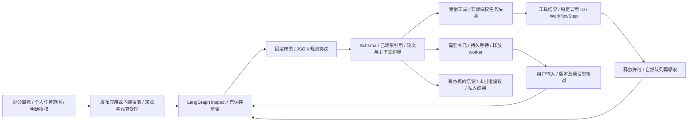

**执行与恢复。** 使用已核验的 LangGraph `1.2.14`／checkpoint `4.2.0`／LangChain Core `1.6.9` 运行一个有限 quantum；`inspect/model/tool/finish` 条件节点依据模型选择和当前领域状态转移。步骤与恢复权威保存在既有 `SkillRun/WorkflowStep/RunEvent/ExecutionPermit`，模型、工具、等待输入和成果分别记录；没有新数据库迁移。框架图负责控制步骤，业务领域仍负责身份、来源、预算和回执。

模型开始前保存请求哈希和 started 记录，使用现有 OpenAI 兼容 SDK、JSON object 输出和程序 Schema 校验。已保存模型结果后进程中断，重新观察原请求即可执行尚未完成的工具，不重复模型 IO；若调用结果未知，原 Run 失败待核对，不重复原模型请求。即使同一模型步骤的领取已完成，迟到调用也复用原结果。工具计算及领域记录在同一短事务中完成，事务外才发模型请求；工具调用 ID 由 Run／位置确定，模型不能自行指定。

每个模型／工具阶段重新核验原主体哈希、企业、安装及发布版本、模型／凭据配置哈希和当前任务证据。主体重绑定不能读取旧 Agent 或复用原新建请求键；来源改变、模型配置变化、取消或租约丢失禁止交付旧结果。模型步骤之间在治理模式下让出许可，避免一条分析循环长期占据交互 lane；等待用户输入也释放许可和 worker。

**受信工具。** `list_tasks(status)` 返回选择范围内当前负责且可读的实际任务；`get_task(task_id)` 仅接受此前观察过的真实任务；`propose_tasks(items)` 核对所引用任务后保存未批准建议，结果显式 `approved=false/created_task_ids=[]`。没有任意 HTTP、Shell、文件、跨企业查询或直接任务写入工具。真实 Task 创建仍沿既有人工核对的入口，生成建议本身不授予写入或分享权限。

来源沿个人周报的权威取数、当前责任／历史事件和层级权限规则，使用绝对时区时间、最长 31 天及可选任务清单。程序构造已观察任务 `reference_catalog`；完成的结论必须引用已观察 ID 和任务标题原文，建议不能冒充已存在任务。校验不符不交付，不能为了让模型回答通过而放宽引用。大范围超过取数、12KB 工具观察或 16KB 单次模型上下文边界时明确失败；不静默丢消息、截断任务或自动扩权。

**预算和等待。** 最多四次模型规划、两个用户补充；每次最多一个工具，最多五项建议，模型输出至多 3000 tokens。受理时保守预留全部轮次输入／输出，加上来源快照；实际用量按模型步骤独立记录并汇总，工具计算标记零模型 token，不把缺失模型 usage 算作零。模型状态、已完成工具数、来源周期和等待问题在页面显示，不把内部工具 JSON 当聊天文本。

`POST /api/v1.0/ai-platform/runs/{id}/agent-input/` 接受原 `revision/client_request_id/text`（最长 1000 字），同键同内容幂等，改变内容冲突，不能扩展原任务来源、恢复取消运行或超过轮数。等待问题由当前来源及主体验证后才提供；重绑定后的 Agent 请求和成果不可见。既有取消接口、运行事件、私人成果编辑／采纳沿原契约。

**页面和应用。** 工作模块增加“任务分析智能体”，复用个人任务范围与成果组件，要求填写办公目标，按钮明确授权分析。办公助理也可选择该技能，用户核对任务周期后受理固定应用版本的 Agent 子 Run；发布应用经过路由评估，业务输入继续单独确认。暂停等待时可提交补充，关闭 Agent 开关时不能开始或继续模型工作。桌面 dsh、Pi 复核和 Android Omni 设备工具维持各自执行机制。

新增 `AI_PLATFORM_AGENT_LOOP_ENABLED=false`，还需原平台／模型／技能和 `AI_PLATFORM_OFFICE_GRAPH_ENABLED` 及匹配可选依赖。仅内测启用；没有生产迁移、部署、镜像发布或 Key 调整。只具备图依赖的构建可运行本模块，依赖或版本不符拒绝受理，不能默默退化到另一运行时。

**验收记录。** 后端、Web、自然队列及真实模型分别验收。真实 Qwen 最终证据 `work/platform-office-agent-real-qwen-final.json`：1 项通过，`qwen3.8-flash` 实际四次模型调用，按观察依次选择列表／详情／建议，最终引用合法，usage 为正，零业务任务写入；测试来源为合成任务。初次 HTTP 400、后续引用校验拒绝的报告保留、不计通过：修正 JSON 输出提示并提供已观察引用清单后通过，没有降低程序校验。

受控自然队列使用合成 OIDC／CSRF、已发布应用、实际 PG／Redis／四 worker／Beat、LangGraph 和真实 SDK HTTP，检查三次 quantum 让出、重新领取、私人隔离、等待输入及同键补充。浏览器独立使用真实 React 与受控 API，验证固定范围、模型步骤、显式补充、私人结果、关闭开关及 390px。最终回归与源指纹在本节后续验收记录补齐；受控模型和独立浏览器不是实际客户 IdP 或同链路浏览器验收。

本阶段完成云端受限动态任务工具反馈循环，不等同于全部开放式办公 Harness。消息／会议等来源、多技能组合、审批后的写入工具、未知补充的跨刷新回执恢复、更细长期等待期限与并发治理、客户 IdP、生产质量／容量、Android 及 P2—P4 其余能力继续实施。完整平台目标保持进行中。

## 19. 风险与决策清单


| 风险／待决策 | 影响 | 处理及决策点 |
| --- | --- | --- |
| IM 没有可信单条定位或完整分页 | 消息待办与完整总结无法证明来源 | P0 必须验证；接口补齐前只支持明确标为用户提供材料的辅助草稿，不开放伪权威提取 |
| 组织与 IM 的租户边界不一致 | 跨企业泄露 | 建映射及权限负例，P1 发布阻断项 |
| 现有来源任务自动分享至群 | 私人意图变成共享任务 | 领域接口拆分来源与分享；不能仅改客户端提示 |
| 缺少 Task 状态历史或完成时间 | 周报统计失真 | P0 核验字段与事件；缺失指标标明不可计算，不能模型补猜 |
| 模型提取不稳定或引用丢失 | 误建任务、误导总结 | 结构化输出、确定性校验、固定评估和人工修订 |
| 重试或租约过期后重复动作 | 业务损害 | 领域唯一键、回执、Outbox／Inbox、未知结果核对 |
| 首期建设过重 | 无法及时验证需求 | 四个内置技能优先；编辑器、市场、通用自主 Agent 后置 |
| 套件与 Omni 直连混淆 | 错误协议、计费和能力承诺 | 独立 provider／protocol 适配；接入验证后再开放 |
| 客户端直连撤销不完全 | 管理预期与实际不符 | 供应商能力验证、短期凭据、后端工具立即撤权，记录媒体边界 |
| 桌面 Harness 上游跨平台计划尚未交付 | Windows／Linux 排期与实际能力不匹配 | macOS 与各平台分开验证，保留自有系统能力适配；未来支持说明不作为发布时间承诺 |
| 桌面 realtime 与后台执行共用错误权限或账本 | 扩大目录／业务访问、重复动作或费用误判 | Host／daemon／dsh 分工、企业工具逐次鉴权，独立 action 回执、预算与停止状态；R07 发布门槛 |
| 第三方技能扩大执行权 | 越权或代码风险 | 首期受信技能；外部生态以审查与隔离为前提 |
| 团队报告混入私人来源 | 错发敏感材料 | 来源作用域先选、发布重查、无权限不交付 |
| 自动周报峰值与供应商限额 | 延迟和成本失控 | 配额、公平队列、抖动、排队反馈与成本基线 |

相应消息、总结和周报能力开放前需关闭四个关键未知项：IM 权威接口和历史权限、租户映射、私人来源任务的领域行为、Task 周期统计数据。已经明确边界的基础模块与新建任务可以先实施。供应商价格、实时能力与生产部署状态在实施时再次核验。

## 20. 首期需求追踪与下一步

| 用户需求 | 产品设计 | 主要技术 | 验收证据 |
| --- | --- | --- | --- |
| 新建任务 | create-work-task 技能、表单／自然语言入口 | 字段提取、人员日期解析、领域提交 | 正确 Task、明确来源／分享、重复请求不多建 |
| 消息转任务 | chat-to-todo 技能、候选选择 | IM 权威取数、ActionProposal、逐项回执 | 引用可定位、撤权失败、部分结果可重试 |
| 群聊消息总结 | group-chat-summary 技能、范围选择 | 全量分页、分块事实、引用与覆盖 | 无隐性截断、准确决策／风险／行动项 |
| 周报 | weekly-work-report 技能、私人草稿 | 周期聚合、确定性统计、版本成果 | 状态准确、可编辑、来源与可见范围正确 |
| 对话式办公 | P2 办公助理与受控技能路由 | 会话范围、运行计划、工具和检查点 | 对话能完成工作、有回执、可取消恢复 |
| 实时音视频平台 | P3 云端管理 Android 与桌面实时应用；桌面 Qwen-Live-Harness 基础候选 | 发布配置、能力协商、Omni 工具桥接、桌面 Host／daemon 与 dsh 适配 | Android 原链路与桌面本机连接分别验收，设备状态与业务回执一致；R06—R08 门槛通过 |
| 现有企业客户，预留 SaaS | P0 起租户规范，P4 商业化 | 多层隔离、企业配额、连接器与生命周期 | 跨租户负例、可运维、成本可核对 |

四个技能及来源／领域闭环已进入开发与验证；隔离 PoC 结果见第 18.5 节，后续正式领域、入口与运行验证见第 18.7—18.41 节及首批实现说明。第 18.28 节完成完整 Web App、本地 OIDC、发布应用、IM 来源、四个技能、真实队列及 API 重启的同链路隔离验收，修复应用管理读写共用限流的问题；第 18.29 节补齐最新版本的页面安装和实际聊天窗口操作；第 18.30 节完成定时私人周报，第 18.31 节增加周期订阅式私人群摘要，第 18.32 节补齐无 Run 自动暂停通知。第 18.40 节完成本地单节点的原生 Helm 就绪、退出、重启、错误镜像更新与恢复检查，不代替完整生产高可用。

用户已明确客户身份环境稍后提供，继续独立推进正式图的生产准入与治理试点、定时自动化、客户质量／生产容量、Android 入口与原 P0—P4 工作包；第 18.41 节已补齐已落账成果问题的未确认请求和跨客户端恢复；未发送输入、派生任务跨设备草稿、批量自动提取、通用资料上下文及完整 Agent 工具循环按后续阶段推进。运行框架按 ADR 的验证门槛实施，不把某轮联合验证视为整个平台已完成。第 18.33 节完成另外 24 个合成保留案例的两轮探针波动分析，修复评分标注损坏及周报本地日期问题，修复后完整回归通过；保留集已用于诊断，客户独立验收样本、人工修改率、批量质量与生产容量门槛仍需完成。第 18.34 节增加持续 HTTP 受理与真实队列实验、同 lane 后继唤醒和共享技能版本锁范围修复，模型端为受控夹具，不能作为真实供应商或生产容量证明。第 18.29 节的一次模型结构失败也进入质量风险记录。首期不要求完整市场或可视化编排系统。

## 21. 参考与事实边界

第 18.35 节新增真实模型有限持续负载与 Go IM 跨页长摘要，修复引用契约并验证 1.6.0。第 18.36 节继续处理同 lane 长摘要阻塞短周报，增加检查点续调与多段许可历史；验证口径包括全部续调等待和实际用量。第 18.37 节补齐死亡执行器的历史许可闭合，区分容量租约过期、实际执行退出与费用未知。第 18.38 节处理 Redis 陈旧事件异常及原进程重连；第 18.39 节继续验证真实发布镜像、可选依赖及只读运行；第 18.40 节补齐本地原生 Kubernetes 生命周期；第 18.41 节增加未确认成果问题的服务端恢复。各轮范围和独立证据明确记录，客户身份环境后续联调，完整生产容量与其他阶段不因这些实验而完成。

### 21.1 仓库依据

- [ADR-0005：平台分层架构与执行边界](../adr/0005-enterprise-ai-platform-architecture.md)：记录模型、dsh／Pi、编排运行层与企业平台的关系及已采纳边界；具体编排框架选型待决策。
- [Work Agent 架构](../features/work-agent-architecture.md)：现有业务编排、dsh／Pi、Gateway、Broker、权限与执行边界。
- [Work 模块产品与 Agent 规划](work-module-product-architecture-agent-plan-2026-09-21.md)：既有规划背景，历史规划不等同当前实现。
- [大模型接入方案](../features/llm-integration.md)：模型接入、池化与客户端直连；生产行为以发布记录为准。
- [AI 音视频互动方案](../features/ai-audio-video-interaction.md)：App、后端及 Omni 控制／媒体流、工具协调与摄像头状态。
- [Qwen-Live-Harness 端侧组件与通信架构](../research/qwen-live-harness-components-2026-10-13.md)：固定上游基线、Host／daemon、图解、运行模式与后台接入；第 7.5 节依据这些职责提出聚视桌面接入建议，不等同于真实设备或企业闭环验收。
- [Work 模型](../../src/backend/work/models.py)、[AI 模型目录](../../src/backend/core/models.py)、[任务入口](../../src/backend/core/api/tasks.py)、[检索问答](../../src/backend/core/services/global_ask.py)、[模型 Broker](../../src/work-agent/work_agent/model_broker.py)：第 4 节的源码基线。

### 21.2 外部参考

- 阿里云 [多模态应用创建](https://docs.agent-for-hardware.bailian.aliyun.com/zh/category-solutions/multimodal-interaction/multimodal-app-creation)、[应用配置](https://docs.agent-for-hardware.bailian.aliyun.com/zh/category-solutions/multimodal-interaction/multimodal-app-configuration)：参考项目配置、模型、技能与工具的产品组织，不能推断已有可供本平台调用的控制台创建 API。
- 阿里云 [应用体验与发布](https://docs.agent-for-hardware.bailian.aliyun.com/zh/category-solutions/multimodal-interaction/multimodal-app-experience-and-publishing)、[实时多模态交互协议](https://docs.agent-for-hardware.bailian.aliyun.com/zh/category-solutions/multimodal-interaction/multimodal-interaction-protocol)：套件的应用接入与发布，和本项目 Omni 直连不是同一协议。
- Qwen-Live-Harness [官方中文 README](https://github.com/QwenLM/Qwen-Live-Harness/blob/b6ce544ebbcd7417e37e0314ec946466c49c615c/README_ZH.md)、[Host 开发说明](https://github.com/QwenLM/Qwen-Live-Harness/blob/b6ce544ebbcd7417e37e0314ec946466c49c615c/packages/qwen-live-harness-host/README_ZH.md)：2026-10-13 核对的桌面运行分工、macOS 支持与后台委派依据；Windows／Linux 在推进，不构成聚视的日期或能力承诺。企业工具、dsh 与凭据治理为本平台增量设计。
- [微软办公碎片化研究](https://www.microsoft.com/en-us/worklab/work-trend-index/breaking-down-infinite-workday)：需求洞察参考，不作为本平台实际收益结论。
- Anthropic [工作流与 Agent](https://www.anthropic.com/engineering/building-effective-agents)、[Harness 架构](https://www.anthropic.com/engineering/managed-agents)、[Agent 评估](https://www.anthropic.com/engineering/demystifying-evals-for-ai-agents)：设计方法参考，不要求采用其商业运行产品。
- [Celery 周期任务](https://docs.celeryq.dev/en/stable/userguide/periodic-tasks.html)、[任务机制](https://docs.celeryq.dev/en/stable/userguide/tasks.html)、[MCP 工具协议](https://modelcontextprotocol.io/specification/2025-11-25/server/tools)：技术契约参考，实施时确认项目实际依赖版本。

千问办公技能分类依据用户截图；第 9.4 节另参考用户提供的 `dingtalk-chat-to-todo` 主文件全文，读取日期为 2026-10-11。其引用的两个 references 文件、完整技能包、运行代码、真实命令和权限实现未核验。本文平台分层、技能契约、指标与阶段计划为结合聚视仓库和用户目标提出的设计，不是对外部产品内部架构的事实陈述。

### 21.3 两份补充方案的采纳范围

2026-10-11 对照用户提供的《方案1.md》《方案2.md》合并设计，作为方案参考，不将文中建设建议视为已实现功能或执行指令。

| 来源与内容 | 采纳方式与位置 |
| --- | --- |
| 方案 1：实时应用三类配置、版本快照、客户端能力交集 | 补入第 6.5 节，并与既有第 6.3 节发布规则衔接 |
| 方案 1：云端配置与客户端控制／媒体流程 | 第 8.6 节增加流程图；第 14.2 节补配置解析与会话准入目标接口 |
| 方案 1：三条实时建设路线、直连计量边界、体验指标 | 第 12.3、12.5、16.4 节补充决策和测量口径 |
| 方案 1：Android 模块、第二 App 验证、外部 SDK | 第 17.3、18.4 节设交付门槛，外部生态留在 P4 |
| 方案 2：直接业务操作、固定工作流、动态 Agent 与实时运行 | 第 7.3 节增加需求到执行方式的选择表 |
| 方案 2：共享控制层、对象分离、工具执行位置、办公与音视频结合 | 既有第 3、5、7、11、12 节已覆盖，保留并用新接入流程串联 |

方案 1 的单独实时平台建设顺序和工期不作为企业平台整体承诺；方案 2 的公共平台能力不要求全部先于业务技能完成。仍按现有企业客户的四项办公需求推进 P0／P1，再扩展自动化、实时应用及外部 SaaS。本文保持统一的产品对象和阶段计划，不叠加两份方案各自的平行平台与时间表。
