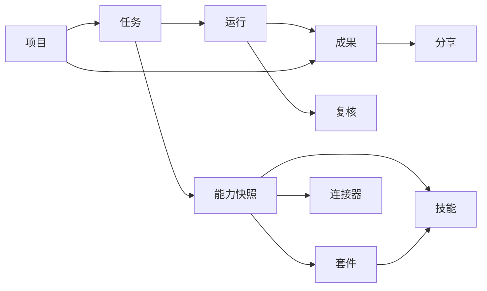

# WeMeet 工作产品设计方案

> 版本：v1.1（clean-slate，2026-10-25 评审修复）
>
> 日期：2026-10-25
>
> 状态：待复审
>
> 范围：产品定位、用户场景、产品架构、信息架构、核心流程、能力体系、权限治理、品牌包装、指标与路线图
>
> 设计前提：**不继承现有 Work 页面、导航、Composer 和任务详情的结构与交互。** 本方案按 clean-slate 设计目标产品；身份、组织、权限、审计、桌面壳、模型网关等平台底座是否复用由技术方案决定。
>
> 本版修复：R0 拆为 R0a/R0b 并补估算；R1 明确单 run 语义；远程后置到 R2b；R4/R5 拆分；统一 IA、审批、指标、套餐、部署与产品过渡。
>
> 关联文档：
>
> - [豆包工作与千问办公扩展能力统一调研](../research/work-extension-unified-research-2026-10-25.md)
> - [豆包工作扩展能力调研](../research/work-extension-doubao-research-2026-10-25.md)
> - [千问办公扩展能力调研](../research/work-extension-qwen-research-2026-10-25.md)
> - [新任务竞品调研](../research/work-new-task-competitor-research-2026-10-25.md)
> - [新任务技术调研](../research/work-new-task-technical-research-2026-10-25.md)
> - [Work Agent 架构](../features/work-agent-architecture.md)
> - [ADR-0005：Work 两层授权](../adr/0005-work-two-layer-access.md)
> - [ADR-0006：Work 逐步吸收 Task](../adr/0006-work-absorbs-task.md)
> - [ADR-0007：只承诺本地与远程执行](../adr/0007-work-execution-local-remote.md)

> **一页纸结论**：WeMeet 工作 = 成果优先的任务工作区，不是聊天壳；R0a 先重建骨架、我的工作和云端文档场景，R0b 补本机资料整理与组织治理；R1 加技能/套件模板，R2a 加只读连接器、R2b 单独做远程设备，R3 才做项目上下文与链式，R4a/R4b 做富成果与工作台，R5 拆成协作、自动化、生态三条线。
>
> **阅读路径**：决策看 §0/§19；体验看 §7–§11；能力看 §12–§14；治理看 §15；商业看 §17–§18。

---

## 目录

- [0. 决策摘要](#0-决策摘要)
- [1. 设计前提](#1-设计前提)
- [2. 调研结论](#2-调研结论)
- [3. 定位与价值](#3-定位与价值)
- [4. 用户与场景](#4-用户与场景)
- [5. 产品原则](#5-产品原则)
- [6. 产品架构](#6-产品架构)
- [7. 信息架构](#7-信息架构)
- [8. 核心工作流](#8-核心工作流)
- [9. 新建任务](#9-新建任务)
- [10. 任务工作区](#10-任务工作区)
- [11. 成果与验收](#11-成果与验收)
- [12. 套件与技能](#12-套件与技能)
- [13. 连接器与数据](#13-连接器与数据)
- [14. 项目与上下文](#14-项目与上下文)
- [15. 权限与治理](#15-权限与治理)
- [16. 跨端与协作](#16-跨端与协作)
- [17. 品牌与商业化](#17-品牌与商业化)
- [18. 指标与验证](#18-指标与验证)
- [19. 路线图](#19-路线图)
- [20. 非目标与风险](#20-非目标与风险)
- [21. 附录](#21-附录)

---

## 0. 决策摘要

### 0.1 十个产品决策

| 编号 | 决策 | 一句话理由 |
|---|---|---|
| D1 | WeMeet 工作作为 WeMeet 的产品线，不单独建品牌 | 同一批客户、同一账号、同一组织；现在拆品牌只会复制 GTM 和运维成本 |
| D2 | 产品骨架是“任务 + 成果工作区”，不是聊天壳 | 用户要的是可验收的成果，不是更长对话 |
| D3 | 所有任务从一个 Composer 发起，执行位置、能力、权限、交付要求前置可见 | 信任不能藏在设置页；提交前就要知道会碰什么、得到什么 |
| D4 | 套件优先，技能是方法，连接器是数据，工作伙伴后置（R1 仅验证） | 先让团队可复用方法，再谈角色化；伙伴没有套件就是空壳 |
| D5 | 安装、启用、授权、调用四态分离 | 装了不等于能用，能用不等于本次任务自动使用 |
| D6 | 只承诺云端、本机、远程设备三种执行位置；远程设备 R2b 后开放，不做云电脑 | 当前没有资源兑现“关机后云端继续跑”的承诺；远程不塞进 R0a/R0b/R1 |
| D7 | 首版只做文本成果，富成果和工作台独立立项 | 文本是当前可交付、可编辑、可验收的最小闭环 |
| D8 | 项目上下文和确定性编排完成前，不叫“完整专家套件” | 没有 schema 传递的套件只是提示词模板 |
| D9 | 组织策略高于个人选择，任务级授权只能收窄不能放大 | 企业产品的底线是可治理、可撤销、可追责 |
| D10 | 路线按 R0a/R0b → R1 → R2a/R2b → R3 → R4a/R4b → R5a/b/c 推进 | 先修骨架，再加能力；先只读，再写入；先文本，再富媒体 |

### 0.2 一句话定位

> **一句话交代一项工作，在看得见的执行边界内拿到可验收的成果，并让成果继续在团队里流转。**

### 0.3 MVP 与目标形态

| 维度 | R0a/R0b 重建与 MVP | 目标形态（R4a/R4b 之后） |
|---|---|---|
| 用户 | 3 家设计合作组织，10–20 名知识工作者 | 已开通 WeMeet 的企业组织 |
| 任务 | 云端/本机二选一，目标 + 上下文，文本成果 | 多步骤、套件、连接器、项目上下文、富成果 |
| 能力 | 3 个内置工作方法模板，无套件注册表/连接器 | 套件库、技能库、只读/写入连接器、工作伙伴 |
| 成果 | Markdown/TXT/CSV/JSON，编辑、版本、采纳、导出 | HTML/Office/PDF/图片，成果工作台 |
| 治理 | 组织授权、成员席位、预算、审计 | 管理员策略、连接器治理、质量门、生态审核 |
| 品牌 | WeMeet 工作产品线 | 同一产品线，满足闸门后再评估独立品牌 |

R0 拆成 R0a“骨架与云端主场景”和 R0b“本机场景与 MVP 打磨”，估算与退出门见 §19.2。

### 0.4 明确不做什么

- 不做独立 `we-work` 品牌；不使用 `we-work` 名称（WeWork 商标冲突）。
- 不做聊天优先的通用助手；不做多 Agent 角色扮演和无限对话。
- 不做浏览器接管、计算机控制、云电脑。
- 首版不做任意 MCP/STDIO、用户文件系统安装技能、原始 `SKILL.md` 展示。
- 首版不做开放市场、定时任务、个人长期记忆。
- 首版不做完整 Office/PPT 在线编辑；成果工作台单独立项。

### 0.5 评审重点

1. 是否认同“WeMeet 工作产品线，不独立建品牌”的定位。
2. 是否认同 R0a/R0b 按 clean-slate 重建产品骨架，而不是在现有页面上增量修补。
3. 首批场景是否应聚焦“云端文档/方案 + 本机资料整理”。
4. 套件优先、伙伴后置、连接器只读先行的节奏是否合理。
5. 组织策略、审批、审计、留存的边界是否足够。
6. R0a–R5c 的路线图和指标是否符合当前资源与商业目标。

---

## 1. 设计前提

### 1.1 为什么按 clean-slate 重做

现有 Work 实现验证了执行、授权、预算、审计和复核链路的价值，但产品骨架不适合作为目标形态：

| 现有骨架 | 问题 | 目标形态 |
|---|---|---|
| 云端/本机是两个页面，靠顶部按钮跳转 | 用户先选边站，切换丢草稿，无法比较环境代价 | 一个 Composer 内的环境选择，切换保留草稿 |
| 任务详情以对话/记录为主 | 成果是附属品，验收动作藏在底部 | 三栏任务工作区，成果是一等公民 |
| 能力只存在于后端 `capabilities` | 用户看不到会用什么方法、碰什么数据 | Composer 的“本次使用”摘要，能力前置可见 |
| 历史只有侧栏最近任务 | 找不到待验收、需要你、已完成的工作 | “我的工作”列表 + “需要你”收件箱 |
| 扩展没有产品模型 | 技能、插件、伙伴概念混在一起 | 套件/技能/连接器/伙伴四层，四态分离 |
| 导航长期只有“新建任务” | 产品没有承载工作组织 | 按阶段开放“我的工作/项目/能力/成果工作台” |

重做不是把整个平台推倒：

| 层次 | 处理方式 |
|---|---|
| 产品 IA、Composer、任务工作区、成果体验 | 重做 |
| 套件、技能、连接器、项目上下文 | 新建 |
| 任务/运行/成果账本 | 按新对象模型改造，是否复用由技术方案决定 |
| 身份、组织、权限注册表、审计、预算 | 复用平台底座 |
| 执行器、Gateway、桌面壳、设备协调 | 复用并按阶段升级 |
| 现有 Work 页面与交互 | 不作为设计输入，不保留兼容包袱 |

### 1.2 品牌前提

- 主品牌：WeMeet。
- 产品线：**WeMeet 工作**（英文 WeMeet Work）。
- 关系：同一账号、同一组织、同一桌面应用、同一计费主体；Work 有独立入口、独立 onboarding、独立套餐和独立路线图。
- 不做：独立公司、独立代码仓、独立账号体系、独立运维体系。
- 命名：不使用 `we-work`；如未来独立品牌，另选与会议无强绑定且不冲突的名称。

### 1.3 本方案的边界

| 在范围内 | 不在范围内 |
|---|---|
| 产品定位、用户、场景、信息架构、核心流程 | 详细技术架构、接口契约、数据库迁移 |
| Composer、任务工作区、成果工作区、能力库的交互规则 | 像素级视觉稿、设计 token、动效规范 |
| 套件/技能/连接器/伙伴的产品模型与阶段 | 具体供应商商务、合规结论、模型选型 |
| 权限、审计、预算、留存的产品规则 | 生产压测、定价精算、法务定稿 |
| 品牌包装、指标、路线图、验收标准 | 组织架构与人力排期 |

数据库迁移由技术方案定义；产品级过渡（旧任务可见、入口重定向、桌面兼容）在本方案 §19.10 定义。

阶段标签统一使用：

| 标签 | 含义 |
|---|---|
| R0a | 骨架与云端主场景 |
| R0b | 本机场景与 MVP 打磨 |
| R1 | 方法层：技能与套件模板 |
| R2a | 数据层：只读连接器 |
| R2b | 远程设备（独立批次） |
| R3 | 上下文与链式 |
| R4a | 富成果管线 |
| R4b | 成果工作台（独立工程） |
| R5a | 协作深化：会议/消息/文档回链、移动端 |
| R5b | 自动化：定时任务/触发器 |
| R5c | 生态：工作伙伴、精选市场 |

---

## 2. 调研结论

### 2.1 两家竞品的共同结构

豆包工作和千问办公都把扩展收敛为三层，并最终进入新建任务：

1. **角色/方案包**：豆包“工作伙伴”，千问“专家套件”。
2. **方法**：技能，封装步骤、方法和输出要求。
3. **数据与工具**：豆包“插件”，千问“连接器”。

两家最值得借鉴的共识不是“能力多”，而是：

- 安装、启用、授权、调用是四个状态，不能共用一个 `enabled`。
- 技能管方法，连接器管数据与账号，权限分别治理。
- 新建任务输入框就是组合面板，能力、环境、权限在提交前可见。
- 套件/伙伴最终都要落到任务，而不是停留在市场页。

WorkBuddy 的本地助理、项目、模板和市场也验证了同一方向：项目首先是上下文容器，模板降低空白页焦虑；其市场广度和定时任务不作为首版依据。

### 2.2 值得借鉴

| 借鉴点 | 具体做法 | 我方落点 |
|---|---|---|
| Composer 即控制面板 | 目标、能力、环境、权限、上下文在同一输入区 | R0a Composer |
| 环境前置 | 执行位置决定权限、上下文、成果去向 | R0a 环境选择 + 本次使用摘要 |
| 任务配方 | 用真实能力生成推荐任务，降低空白页焦虑 | R0a 内置方法模板，R1 套件快捷命令 |
| 安装与调用分离 | 能力中心管理安装/启用/授权，任务只消费可用能力 | R1/R2a 能力库 |
| 技能与连接器分层 | 方法不持有账号，数据不伪装成方法 | R1 技能，R2a 连接器 |
| 项目是上下文容器 | 项目不是任务类型，是文件、说明、默认能力和成果的集合 | R3 项目 |
| 链式与增强 | 技能可独立、可套件、可读项目上下文、可由连接器增强 | R3 链式，R2a 增强 |
| 输出标准 | 套件定义格式、结构、验收条件 | R1 套件输出标准 |

### 2.3 不照搬

| 不照搬 | 原因 | 我方替代 |
|---|---|---|
| “全部允许”权限 | 与组织管控、逐次审批冲突 | 每次询问/只读自动/计划批准，无全局放行 |
| 浏览器接管、计算机控制 | 安全与责任边界不可控 | 明确非目标 |
| 云盘、应用市场、网页发布 | 超出 Work 边界，制造空入口 | 成果分享走任务/成果权限，生态后置 |
| 任务中切换模型 | 计量、预算、可追溯性复杂 | 任务级自动/深入档位，模型细节放详情 |
| 聊天优先的任务详情 | 成果被淹没，验收不明确 | 三栏工作区，成果优先 |
| 市场先摆入口 | 没有供给和治理，市场是空壳 | 先内置/组织套件，R5c 再评估市场 |
| 原始 `SKILL.md` 全量展示 | 提示词资产泄露、注入风险 | 人类可读方法说明 + 内容哈希/版本 |
| 定时任务先于可靠性 | 失败重试、通知、预算、审计缺一不可 | R5b 再评估 |
| 多 Agent 角色扮演 | 责任不清、成本不可控 | 单任务单主执行器，复核独立 |

### 2.4 对我方的战略含义

竞品在“自主性”和“生态广度”上竞争；WeMeet 工作不在同一维度拼参数，而是拼：

1. **可控执行**：在哪执行、碰什么文件、执行什么命令、何时需要批准，全部可见。
2. **组织信任**：组织授权、成员席位、预算、审计、撤销、留存。
3. **成果闭环**：成果可编辑、可版本、可复核、可采纳、可分享。
4. **协作上下文**：会议、消息、文档、任务与工作成果互相引用；这是纯工具型竞品没有的（R3 起逐步实现，R5a 完整回链）。
5. **本地文件**：授权文件夹内执行，原始文件默认不上传。

这意味着产品不能做成“功能更全的千问/豆包”，而要做成“更可控、更可验收的工作执行中心”。

---

## 3. 定位与价值

### 3.1 产品类别

**AI 工作执行中心（AI Work Execution Center）**，不是一个聊天助手，也不是一个专家市场。

| 维度 | 聊天助手 | 专家市场 | WeMeet 工作 |
|---|---|---|---|
| 核心对象 | 对话 | 角色/套件 | 任务与成果 |
| 成功标准 | 回答得像 | 安装得多 | 成果被采纳 |
| 主要界面 | 聊天框 | 市场卡片 | Composer + 任务工作区 + 成果工作区 |
| 信任来源 | 模型能力 | 作者背书 | 执行边界 + 组织治理 + 复核 |
| 结果去向 | 聊天记录 | 套件主页 | 任务、项目、团队协作流 |

### 3.2 价值主张

对知识工作者：

> 不用学提示词工程，不用在多个工具间搬运上下文；交代目标，拿到可编辑、可核对的成果。

对团队负责人：

> 把团队的方法固化成套件，让每个人拿到的产出结构一致、标准一致。

对组织管理员：

> 知道谁在用、用了什么能力、碰了什么数据、花了多少预算；随时可以撤销。

对 WeMeet 客户：

> 会议、消息、文档里的上下文可以直接变成工作输入，成果也能回到协作流（R3 起逐步实现，R5a 完整回链）。

### 3.3 差异化

| 差异化 | 具体表现 | 竞品常见做法 |
|---|---|---|
| 可控执行 | 环境、文件夹、命令、连接器 scope 逐项可见/可批 | 默认自主执行，权限藏在设置 |
| 组织治理 | 组织授权 + 成员席位 + 预算 + 审计 + 撤销 | 个人订阅或企业后台二选一 |
| 成果闭环 | 版本、编辑、复核、采纳、导出、分享 | 结果落在聊天或云盘 |
| 本地文件 | 授权文件夹内执行，原始文件默认不上传 | 上传到云端或浏览器自动化 |
| 协作上下文 | 会议/消息/文档/任务与工作互相引用 | 独立工具，上下文靠复制粘贴 |
| 可追溯 | 能力快照、来源、执行记录、审计 | 只保留对话记录 |

### 3.4 不竞争的方向

- 不拼模型 benchmark。
- 不拼连接器数量。
- 不拼“无人值守”的自主性。
- 不早期拼 Office/PPT 编辑能力。
- 不做通用浏览器 Agent。

---

## 4. 用户与场景

### 4.1 目标用户

| 角色 | 目标 | 痛点 | 成功标准 | 阶段 |
|---|---|---|---|---|
| 知识工作者 | 快速产出文档、方案、清单、分析说明 | 从零写、跨工具搬上下文、结果不可控 | 30 分钟内拿到可编辑初稿并采纳 | R0a |
| 本地重度用户 | 在本地文件夹、代码、数据上工作 | 上传敏感文件不放心、云端工具碰不到本地 | 授权文件夹内执行，原始文件不出本机 | R0b |
| 团队负责人 | 统一团队产出方法 | 每个人格式、深浅、口径不一致 | 套件让产出结构一致，返工减少 | R1 |
| 组织管理员 | 控制 AI 使用范围和成本 | 不知道谁在用、用了什么、花了多少 | 授权、预算、审计、撤销一目了然 | R0b/R2a |

以上是待验证假设，不是已完成的用户研究结论；R0a 前用 5–8 名设计合作伙伴访谈/日记校准，至少两个场景要在 3 家以上组织复现。

### 4.2 核心 JTBD

1. **当我要基于会议纪要或资料产出一份材料时**，把结论和目标交给工作，拿到可编辑的初稿，而不是从零写；会议上下文在 R3/R5a 接入。
2. **当我要基于本地文件夹做整理或分析时**，授权一个工作空间，让工作在本地执行，原始文件不离开设备。
3. **当团队需要统一产出时**，用套件固定步骤、结构和验收标准，减少返工。
4. **当任务需要外部数据时**，按任务授予只读连接器，而不是把账号密码交给模型。
5. **当成果需要继续加工时**，基于成果创建后续任务，保留来源和版本，而不是重新描述一遍。
6. **当管理者要控制风险时**，按组织/成员/能力/任务四层授权，随时撤销并审计。

### 4.3 首批场景

| 场景 | 用户动作 | 环境 | 交付物 | 阶段 |
|---|---|---|---|---|
| 起草方案/报告 | 描述目标、受众、结构要求 | 云端 | Markdown 文档 | R0a |
| 整理本地资料 | 授权文件夹，说明整理规则 | 本机 | Markdown/CSV/JSON | R0b |
| 团队统一方案 | 选择套件，填目标，使用快捷命令 | 云端/本机 | 按套件输出标准 | R1 |
| 跨系统取数写报告 | 选择只读连接器和范围 | 云端 | Markdown/CSV | R2a |
| 产品设计多步骤 | 选择项目，读取 brief/flow，链式执行 | 云端/本机 | 结构化 JSON + 文档 | R3 |
| 设计/汇报材料 | 项目上下文 + 富成果 + 工作台 | 云端/本机 | HTML/PPTX/PDF/图片 | R4a/R4b |

### 4.4 非目标用户

- 纯个人消费者（没有组织治理需求）。
- 需要浏览器自动化/计算机控制的用户。
- 需要完整 Office/PPT 在线编辑的专业作者。
- 需要 IDE/代码仓库深度开发的工程师（可作为后续场景，不是首版）。
- 需要无人值守、无限自主执行的团队。

---

## 5. 产品原则

| 原则 | 意味着 | 反例 |
|---|---|---|
| 成果优先 | 每个任务定义交付物、格式、验收条件；对话是辅助 | 任务结束只有一段聊天总结 |
| 边界可见 | 执行位置、数据访问、权限、成果去向在提交前可见 | 提交后才知道会读本机文件 |
| 组合而非堆叠 | 一个任务一个主套件，技能有序，连接器按需 | 一次选十个技能，互相冲突 |
| 未实现不渲染 | 能力由服务端返回；没有执行支持就不放入口 | 左栏摆“项目/市场/定时任务”空入口 |
| 最小授权 | 组织策略优先，任务级只能收窄；高风险动作逐次批准 | “全部允许”一键放行 |
| 可追溯可回退 | 能力快照、成果版本、审计、取消/重试 | 更新套件后旧任务结果无法解释 |
| 一个品牌一个身份 | 同一账号、组织、桌面；Work 有独立产品面 | 第二套账号体系、第二个安装包 |
| 先方法后数据 | 先技能/套件，再连接器；先只读，再写入 | 先接十个 SaaS，再想怎么用 |
| 先文本后富成果 | 先把文本成果闭环做透，再做 Office/PPT | 首版承诺 PPT 生成 |
| 先可信再自主 | 审批、复核、预算、审计先于自主性 | 用“全自动”作为卖点 |

### 5.1 体验基调

- **工作型界面，不是聊天玩具**：三栏工作区、清晰的状态、克制的视觉；不堆头像、气泡、营销插画。
- **渐进披露**：默认只让用户写目标；上下文、能力、权限按需展开。
- **没有死路**：每个错误状态都有下一步动作；没有权限就说明找谁开通。
- **没有假能力**：不可用的能力不显示；显示的能力必须能执行。
- **可访问**：键盘可达、屏幕阅读器语义、对比度、减少动效、移动端可用。

---

## 6. 产品架构

### 6.1 分层

```text
┌ 入口层 ─────────────────────────────────────────────────────┐
│ 工作首页 · 新建任务 · 我的工作 · 项目 · 能力库 · 成果工作台   │
├ 对象层 ─────────────────────────────────────────────────────┤
│ 项目 · 任务 · 运行 · 成果 · 复核 · 分享                     │
├ 能力层 ─────────────────────────────────────────────────────┤
│ 套件 · 技能 · 工作伙伴 · 连接器 · 项目上下文                │
├ 执行层 ─────────────────────────────────────────────────────┤
│ 云端执行 · 本机执行 · 远程设备 · 审批 · 预算 · 事件         │
├ 治理层 ─────────────────────────────────────────────────────┤
│ 组织授权 · 成员席位 · 策略 · 审计 · 留存 · 应急停用         │
├ 协作层 ─────────────────────────────────────────────────────┤
│ 会议 · 消息 · 文档 · 任务 · 通知 · 分享                     │
└─────────────────────────────────────────────────────────────┘
```

### 6.2 核心对象

| 对象 | 定义 | 关键属性 | 阶段 |
|---|---|---|---|
| 项目 Project | 持久上下文容器 | brief、文件、来源、默认能力、成员、任务、成果 | R3 |
| 任务 WorkTask | 一次工作请求 | 标题、目标、交付要求、环境、能力快照、状态、负责人、组织 | R0a |
| 运行 WorkRun | 任务的一次执行 | 执行器、状态、预算、事件、错误、成果 | R0a |
| 成果 Artifact | 可验收的交付物 | 类型、版本、正文/文件、来源、采纳状态 | R0a |
| 复核 Review | 独立只读质量检查 | 结论、问题、证据、严重度 | R0b 可选 |
| 套件 Suite | 可复用的工作方案 | 有序技能、快捷命令、输出标准、连接器要求、环境 | R1 |
| 技能 Skill | 方法包 | 说明、输入/输出 schema、环境要求、连接器依赖 | R1 |
| 工作伙伴 Partner | 角色化配置 | 套件 + 短指令 + 默认环境/审批偏好 | R1 可选验证；R5c 开放 |
| 连接器 Connector | 外部数据/工具集成 | 供应商、scope、授权、环境、读写级别 | R2a |
| 能力快照 CapabilitySnapshot | 任务创建时冻结的能力选择 | 套件/技能/连接器版本、策略版本、上下文引用 | R0a/R1/R2a/R3 |
| 分享 Share | 成果/任务的访问授权 | 对象、范围、权限、过期、审计 | R4a |

### 6.3 对象关系



### 6.4 能力模型

| 层 | 定义 | 不做什么 | 阶段 |
|---|---|---|---|
| 套件 Suite | 一个可复用的工作方案：有序技能 + 快捷命令 + 输出标准 + 连接器要求 + 推荐环境 | 不持有账号；不是角色人格 | R1 |
| 技能 Skill | 一个方法包：步骤、输入/输出要求、适用环境、依赖 | 不持有外部账号；不等于连接器 | R1 |
| 工作伙伴 Partner | 套件之上的轻量角色：短指令、默认环境/审批偏好 | 不做长期记忆、主页、自动化 | R1 可选验证；R5c 开放 |
| 连接器 Connector | 授权范围内的外部数据/工具 | 不是方法包；不等于权限 | R2a |
| 项目上下文 Context | 项目里的 brief、文件、来源、流程 schema | 不是隐藏记忆；必须可见可编辑 | R3 |

内部统一使用 `WorkPreset(kind='suite' / 'partner')` 承载套件和工作伙伴，不为伙伴单独建表；套件优先，伙伴只是可选的角色层。

四种状态必须分开：

| 状态 | 含义 | 用户看到 |
|---|---|---|
| 已安装 | 能力存在于目录 | 出现在能力库 |
| 已启用 | 组织/用户允许使用 | 可被任务选择 |
| 已授权 | 连接器账号/scope 已授予 | 可被任务调用 |
| 本次调用 | 任务明确选择了该能力 | 出现在“本次使用”摘要 |

### 6.5 能力解析与冻结

任务创建时由服务端解析能力，不由前端拼装：

1. 读取组织策略、成员权限、用户默认、任务选择。
2. 校验环境、连接器、上下文、输出格式、冲突。
3. 冻结套件/技能/连接器版本与 scope。
4. 生成能力快照，写入任务。
5. 后续更新不回溯已创建任务。

规则：

- 组织策略 > 用户默认 > 任务选择；任务只能收窄。
- 缺连接器、环境不兼容、技能冲突、上下文缺失、输出格式不支持时**阻止提交并说明原因**，不静默替换。
- 幂等键相同的任务返回原任务；能力选择不同返回冲突。
- 组合后的执行指令超过执行器上限时，提示拆分任务或减少技能，不截断关键指令。

---

## 7. 信息架构

### 7.1 目标 IA

```text
工作
├── 工作首页（Composer / 需要你 / 继续工作）   R0a
├── 我的工作（全部/进行中/待验收/已完成/待处理） R0a/R0b
├── 项目                                      R3
├── 能力
│   ├── 套件                                  R1
│   ├── 技能                                  R1
│   └── 连接器                                R2a
├── 成果工作台                                R4b
├── 历史工作（只读归档）                       R0 过渡期
└── 管理入口（管理员可见）                     R0b/R2a
```

“新建任务”不是独立导航页：它是工作首页 Composer 的展开态，深链 `/work/new` 直接打开展开态。管理入口不放在个人工作导航里，放在 WeMeet 管理后台的“工作”分区，避免普通成员误入。

### 7.2 分阶段可见性

| 入口 | R0 | R1 | R2 | R3 | R4 | R5 |
|---|---|---|---|---|---|---|
| 工作首页 / Composer | ✓ | ✓ | ✓ | ✓ | ✓ | ✓ |
| 我的工作 | ✓ | ✓ | ✓ | ✓ | ✓ | ✓ |
| 套件/技能 | 无 | ✓ | ✓ | ✓ | ✓ | ✓ |
| 连接器 | 无 | 无 | R2a | ✓ | ✓ | ✓ |
| 项目 | 无 | 无 | 无 | ✓ | ✓ | ✓ |
| 成果工作台 | 无 | 无 | 无 | 无 | R4b | ✓ |
| 工作伙伴 | 无 | 内部验证 | 无 | 无 | 无 | ✓ |
| 自动化/定时任务 | 无 | 无 | 无 | 无 | 无 | R5b |
| 远程设备 | 无 | 无 | R2b | ✓ | ✓ | ✓ |

工作伙伴在 R1 仅面向设计合作伙伴内部验证，不进入导航；R5c 才开放。R0 含 R0a/R0b，R2 含 R2a/R2b，R4 含 R4a/R4b；没有后端能力和验收标准的子阶段不进入导航。

铁律：**没有后端能力和验收标准的入口，不出现在代码里，也不做“敬请期待”。**

### 7.3 页面清单

| 页面 | 目的 | 核心动作 | 阶段 |
|---|---|---|---|
| 工作首页 / Composer | 开始工作、处理待办 | 写目标、继续任务、处理“需要你”；Composer 可展开 | R0a |
| 我的工作 | 找到并管理所有工作 | 筛选、搜索、打开、重试、取消 | R0a/R0b |
| 任务工作区 | 执行与验收 | 看步骤/计划、审批、看进度、验收成果 | R0a |
| 成果工作区（任务内） | 编辑与交付当前任务成果 | 预览、编辑、版本、采纳、导出 | R0a |
| 成果工作台（跨任务） | 汇总、比较、复用成果 | 检索、对比、分享、再次使用 | R4b |
| 历史工作（只读） | 过渡期查看旧任务与成果 | 查看、导出、打开旧链接 | R0 过渡期 |
| 套件库 | 发现/管理套件 | 查看、使用、发布、下架 | R1 |
| 套件详情 | 理解方法 | 看步骤、输出标准、连接器要求、版本 | R1 |
| 技能库/详情 | 发现/管理技能 | 查看、使用、发布 | R1 |
| 连接器库/详情 | 管理数据源 | 连接账号、选 scope、撤销 | R2a |
| 项目首页 | 上下文容器 | 看 brief、文件、任务、成果 | R3 |
| 管理后台-工作 | 组织治理 | 授权、席位、预算、策略、审计 | R0b/R2a |

### 7.4 导航与响应式

- 桌面：左侧 Work 导航 + 主内容；任务工作区为三栏。
- 平板：两栏；成果抽屉。
- 手机：单栏 + 底部 Tab（工作/我的）；“需要你”以角标和首页卡片呈现，不单列 Tab；任务详情用 Tab 切换计划、过程、成果。
- 键盘：`/` 聚焦快捷命令，`Cmd/Ctrl + Enter` 提交，`Esc` 关闭浮层。
- 深链：任务、成果、套件、项目都有稳定 URL；通知可直达。
- 路由：`/work` 是工作首页，`/work/new` 是 Composer 展开态，`/work/items` 是我的工作；三者共享同一数据层。

### 7.5 我的工作

“我的工作”是任务的管理入口，不是第二个首页。

| 区块 | 内容 |
|---|---|
| 顶部 Tab | 待处理 / 进行中 / 待验收 / 已完成 / 全部 |
| 与首页关系 | 首页只显示最多 3 条“需要你”和继续工作；完整列表、筛选、批量动作在我的工作 |
| 筛选 | 项目、执行位置、套件、时间范围、状态 |
| 搜索 | 标题、工作描述关键词；不搜索成果正文（R4a 再评估） |
| 行信息 | 标题、状态、交付物类型、执行位置、更新时间和“需要你”的原因 |
| 批量动作 | 取消、归档；R4b 支持分享 |
| 空状态 | 按 Tab 给出下一步：去新建、去处理审批、去验收 |

排序默认按“待处理 > 进行中 > 待验收 > 最近更新”，让用户先处理阻塞项。

R0a/R0b 的“我的工作”只包含 Work 任务；core Task 不合并、不展示。ADR-0006 的统一读模型在 R3 评估，届时再决定是否加入“任务”类型，仍不合并数据表。

---

## 8. 核心工作流

### 8.1 五步闭环

| 步骤 | 用户问题 | 产品回答 | 关键界面 |
|---|---|---|---|
| 1 交代 | 我要完成什么？ | 目标、交付要求、上下文、能力、环境、权限 | Composer |
| 2 对齐 | 你打算怎么做？ | 计划、假设、缺失信息、预计产物 | 计划面板（R0b 可选/R3） |
| 3 执行 | 现在到哪了？ | 步骤、进度、审批、来源、可取消/接管 | 执行时间线 |
| 4 验收 | 成果能用吗？ | 预览、编辑、版本、复核、来源、采纳 | 成果工作区 |
| 5 继续 | 接下来呢？ | 新版本、后续任务、分享、项目沉淀 | 成果操作栏 |

### 8.2 任务状态

| 产品状态 | 含义 | 允许动作 |
|---|---|---|
| 草稿 | 仅在客户端，未提交 | 编辑、切换环境、关闭 |
| 已提交 | 已创建任务，等待执行 | 取消、查看 |
| 计划中 | 正在生成计划（R0b 可选/R3 确定性） | 取消、补充信息 |
| 等待审批 | 需要用户批准计划/命令/数据访问 | 批准、拒绝、修改 |
| 等待补充 | 缺少上下文或信息 | 补充、取消 |
| 执行中 | 执行器工作中 | 查看、取消、接管（本机） |
| 待验收 | 技术执行完成，等待用户验收 | 查看、编辑、采纳、要求修改 |
| 已完成 | 用户已采纳/确认完成 | 查看、下载、分享、基于此继续 |
| 失败 | 执行失败 | 查看原因、重试、修改后重试 |
| 已取消 | 用户取消或系统终止 | 查看、重试 |
| 设备断线 | 本机执行设备离线 | 等待设备、取消、换设备 |
| 权限撤销 | 组织/成员授权被撤销 | 查看、联系管理员 |
| 预算耗尽 | 达到组织/任务预算 | 等待重置、申请预算、取消 |

技术状态与产品状态分开：执行器可以返回 `succeeded`，但产品状态仍是“待验收”，直到用户采纳成果或确认完成。

### 8.3 关键规则

1. **一个任务一个主交付物**：可以产出多个文件，但必须有一个主成果和明确的验收条件。
2. **没有验收不算完成**：技术成功不等于工作完成；避免“跑完了但没人用”。
3. **不静默扩权**：需要新权限时暂停并请求批准，不自动提升。
4. **不自动重放**：未知执行结果先查询；重试由用户发起，新运行保留旧运行。
5. **不隐藏失败**：失败原因、可恢复动作、已产生成果都要展示。
6. **不无限对话**：需要继续加工时创建后续任务，保留父任务/成果关系。
7. **重试使用原能力快照**：默认沿用原套件/技能/连接器版本；用户可选择“用最新版本重试”，但需确认版本差异。

---

## 9. 新建任务

> “新建任务”是工作首页的 Composer 展开态，不是独立导航页；深链 `/work/new` 直接打开展开态并聚焦输入框。

### 9.1 设计目标

- 让第一次使用的人在 60 秒内提交一个可执行任务。
- 让有经验的人在同一个界面完成能力、环境、权限、交付要求的组合。
- 让任何人在提交前都能回答：在哪执行、会碰什么、得到什么、保存在哪。

### 9.2 布局

```text
工作 / 工作首页（Composer 展开）

今天想完成什么工作？
描述目标、交付要求和限制；其余按需展开。

┌──────────────────────────────────────────────────────────────┐
│ 例如：为下周的产品评审写一份方案，包含背景、目标、         │
│ 三个备选方案、取舍和风险，输出 Markdown。                  │
│                                                              │
│ [+] 上下文   [套件]   [技能]   [连接器]      [先看计划 ▾]   │
│ [云端 ▾]     [权限：每次询问 ▾]                    [发送]    │
└──────────────────────────────────────────────────────────────┘

本次使用：云端 · 套件「产品方案」 · 无外部数据 · 交付 Markdown
          · 保存到任务 · 预计消耗 1 次运行

推荐开始
┌────────────┐ ┌────────────┐ ┌────────────┐
│ 起草方案   │ │ 整理资料   │ │ 制定计划   │
│ 云端/本机  │ │ 本机       │ │ 云端/本机  │
│ Markdown   │ │ Markdown   │ │ Markdown   │
└────────────┘ └────────────┘ └────────────┘

需要你
· 「Q3 复盘」等待你批准读取文件夹
· 「竞品分析」成果待验收

继续工作
· 昨天：产品评审方案 v3
· 周一：本地资料整理
```

示意图是目标 Composer；R0a 只显示上下文、执行位置、权限和预算，计划/套件/技能/连接器按 R0b/R1/R2a 出现，未实现不显示。

### 9.3 输入结构

| 区块 | 内容 | 必填 | 交互 | 阶段 |
|---|---|---|---|---|
| 工作描述 | 目标、背景、限制、验收要求 | 是 | 大输入框；R0a 按环境实际限制展示，统一 8000 字是 R0b 技术依赖 | R0a |
| 交付要求 | 格式、长度、受众、语气、必须包含的章节 | 否 | 折叠区；套件可提供默认值 | R0a |
| 上下文 | 文件、文件夹、项目、来源链接 | 否 | R0a 仅本机文件夹；R3 项目 | R0a/R3 |
| 套件 | 一个主套件 | 否 | 卡片选择；展示输出标准/连接器要求 | R1 |
| 技能 | 0–3 个补充技能（不含套件内技能） | 否 | 多选；与套件技能去重/冲突提示 | R1 |
| 连接器 | 只读；写入 R2a 后独立 | 否 | 按任务选 scope；缺授权时引导连接 | R2a |
| 执行位置 | 云端/本机；远程设备 R2b | 是 | Segmented control；切换保留草稿 | R0a；R2b 远程 |
| 权限 | 审批方式、文件夹、连接器 scope | 是 | 摘要 + 展开；组织策略可锁定 | R0a/R2a |
| 计划 | 先看计划再执行 | 否 | 开关；未实现不显示 | R0b 可选；R3 确定性计划 |
| 执行档位 | 自动/深入 | 否 | 默认自动；深入显示预算影响；组织可限制 | R0b 可选，R1 完善 |
| 预算 | 本次上限/预计消耗 | 否 | 展示组织剩余预算；可收窄 | R0a |
| 发送 | 提交任务 | — | 禁用时显示原因 | R0a |

8000 字是执行器总上限，不是工作描述独占；套件/技能说明、交付要求和上下文摘要也占用额度。R0a 先按服务端返回的实际限制展示（当前云端契约仍是 goal 2000 / background 4000）；统一 8000 是 R0b 的技术依赖，未完成前不承诺 8000。

### 9.4 本次使用摘要

Composer 下方固定显示一行“本次使用”，这是产品的信任面板：

```text
本次使用：云端 · 套件「产品方案」· 技能「竞品分析」· 只读连接器「知识库」
          · 交付 Markdown · 保存到任务 · 预计消耗 1 次运行
```

规则：

- 默认只显示用户能理解的结果，不显示模型名、token 数、内部工具名。
- 点击可展开“执行边界”：数据访问、命令审批、成果去向、留存。
- 任何非默认选择都必须在摘要中出现；不能有隐藏能力。
- 组织策略禁用的能力显示原因和申请路径，不显示为可选。

### 9.5 交互规则

1. **渐进披露**：R0a 首屏只有工作描述、上下文、执行位置、发送；套件入口 R1 才出现，其余按需。
2. **保留草稿**：切换云端/本机、切换套件、打开/关闭能力都不丢工作描述。
3. **就地校验**：缺文件夹、执行器离线、连接器未授权、字数超限在 Composer 下方提示，不只靠提交后报错。
4. **不自动改环境**：选择的套件只支持本机时，提示切换，不静默切换。
5. **不自动提交**：点击快捷任务/快捷命令只预填，不直接执行。
6. **键盘**：`/` 打开快捷命令，`Cmd/Ctrl + Enter` 提交，`Esc` 关闭。
7. **可访问性**：环境用 radio/segmented 语义；能力 chip 用 button + `aria-expanded`；错误 `role="alert"`；字数计数 `aria-live="polite"`。

### 9.6 推荐任务与快捷命令

| 类型 | 来源 | 行为 | 阶段 |
|---|---|---|---|
| 内置工作方法模板 | 服务端配置的方法提示 + 输出标准 | 预填工作描述、环境、交付物 | R0a |
| 套件快捷命令 | 套件定义 | `/` 打开，按套件分组，预填目标模板 | R1 |
| 组织推荐 | 组织管理员配置 | 按部门/角色推荐套件或任务 | R1 |
| 最近使用 | 用户历史 | 一键复用上次配置 | R1 |

推荐任务必须真实可执行：显示环境、交付物、预计权限；不可用的任务不显示。

R0a 首批内置工作方法模板（**不是套件注册表**）：

| 方法模板 | 目标模板 | 环境 | 交付物 |
|---|---|---|---|
| 起草方案 | 围绕目标写一份可执行方案，包含背景、目标、备选方案、取舍和风险 | 云端 | Markdown |
| 整理资料 | 整理给定文件夹/文件，输出要点、结论和待确认信息 | 本机（R0b）/云端 | Markdown |
| 制定计划 | 把目标拆成可执行步骤，标注依赖、风险和验收标准 | 云端 | Markdown |

每个模板包含方法步骤、输出标准和 1 个示例；R0a 只上线云端变体，本机变体随 R0b 开放。它不能组合技能、连接器或项目，也不是可版本化的套件。R1 才把这些方法升级为套件模板，提供版本、组织发布和快捷命令。

### 9.7 首次使用

1. 选择默认执行位置（云端/本机）；本机需要安装桌面并授权文件夹。
2. 选择第一个工作场景（写文档/整资料/做方案/做计划）。
3. 阅读一次“工作如何执行”说明：数据去哪、谁审批、成果存哪、怎么撤销。
4. 提交第一个任务；成功后引导验收成果。

首次使用不展示套件市场、连接器市场、项目等未就绪能力。

### 9.8 空状态与错误

| 状态 | 文案 | 动作 |
|---|---|---|
| 没有可用执行位置 | 当前没有可用的执行环境 | 安装桌面/联系管理员 |
| 本机未授权文件夹 | 先选择一个工作文件夹 | 选择文件夹 |
| 执行器离线 | 本机执行器未连接 | 重试/切换云端/查看帮助 |
| 连接器未授权 | 需要连接「知识库」 | 连接账号 |
| 组织禁用 | 组织未开通该能力 | 联系管理员 |
| 预算不足 | 今日预算已用完 | 申请预算/明天再试 |
| 字数超限 | 工作描述超过上限 | 精简或拆成多个任务 |
| 能力冲突 | 套件与技能不兼容 | 移除冲突技能/换套件 |

---

## 10. 任务工作区

### 10.1 布局

```text
┌ 标题（可编辑） · 状态 · 云端/本机 · 套件 · 预算 · ⋯ ─────────────┐
│ 需要你：批准读取文件夹 / 补充信息 / 设备断线 / 成果待验收          │
├───────────────┬──────────────────────────────┬───────────────────┤
│ 计划           │ 执行时间线                    │ 成果               │
│ 1 ✓ 读取资料   │ 09:12 已读取 3 个文件         │ [文档] [文件]      │
│ 2 ● 待批准     │ 09:13 生成大纲                │ 版本 v3 ▾          │
│ 3 ○ 生成初稿   │ 09:15 等待批准：运行命令      │ ┌───────────────┐ │
│ 4 ○ 自检       │ 09:16 已生成初稿              │ │ 预览/编辑      │ │
│                │                              │ └───────────────┘ │
├───────────────┴──────────────────────────────┴───────────────────┤
│ [要求修改]                    [验收并采纳]  [导出]  [分享]        │
└────────────────────────────────────────────────────────────────────┘
```

桌面三栏；平板两栏（成果抽屉）；手机 Tab。

示意图是目标形态；R0a 不显示计划面板、分享、连接器、套件相关动作；计划面板 R0b 可选，其余按 R2a/R3/R4a 出现。

### 10.2 需要你

“需要你”是任务级最高优先级横幅，只有四类：

| 类型 | 触发 | 动作 |
|---|---|---|
| 审批 | 计划、命令、连接器写入 | 批准/拒绝/查看详情 |
| 补充 | 缺信息、缺文件、上下文不足 | 补充/取消 |
| 设备 | 本机断线、需要重新授权 | 重连/换设备/取消 |
| 验收 | 执行完成 | 查看成果/采纳/要求修改 |

审批横幅必须包含：要做什么、为什么、影响范围、拒绝后的结果。

### 10.3 计划

- R0a：不做计划预览，不显示“先看计划”开关。
- R0b：可选简单步骤列表，展示预计动作和交付物；未实现则不显示。
- R3：确定性计划，步骤有输入/输出、依赖、审批点；可批准/要求修改。
- 计划不展示模型思维链；只展示可执行的步骤和依据。
- 计划变更需要用户确认；不能静默增加步骤或权限。

### 10.4 执行时间线

- 只记录对用户有意义的事件：开始、读取来源、生成、等待审批、命令执行、失败、完成。
- 工具调用折叠展示：命令、目录、退出码、耗时；敏感内容脱敏。
- 来源可点击，能回到文件/连接器记录。
- 不展示原始 chain-of-thought；可以提供“为什么这样做”的简短说明。
- 执行事件可恢复；刷新/断线后能继续看。

### 10.5 审批

| 审批类型 | 何时 | 展示 | 允许范围 |
|---|---|---|---|
| 计划审批 | 复杂任务/用户开启“先看计划” | 步骤、权限、预计成果 | 批准/修改/取消 |
| 命令审批 | 本机执行命令 | 命令、目录、目的、风险 | 本次允许/本次任务同类只读允许/拒绝 |
| 数据访问 | 读取连接器/文件夹 | 数据范围、去向、留存 | 允许本次/拒绝 |
| 写入审批 | 连接器写操作 | 目标系统、字段、影响 | 逐次批准/拒绝 |
| 成果分享 | 分享到组织/指定成员；外部 R5a | 对象、范围、过期 | 确认 |

模式：

- **每次询问**（默认）：所有有副作用动作逐次批准。
- **只读自动**：只读命令/读取在本次任务内自动，写入仍需批准；组织可禁用。
- **计划批准后执行**：计划批准后，只读步骤自动，写入/高风险仍逐次批准。

不做“全部允许”。组织策略可以强制“每次询问”；用户不能放宽组织限制。

动作风险分级：

| 动作 | 默认 | 只读自动模式 | 计划批准后 | 组织覆盖 |
|---|---|---|---|---|
| 读取已授权本地文件/目录 | 询问 | 自动 | 自动 | 可强制询问 |
| 只读命令（列目录、读取、检索） | 询问 | 自动 | 自动 | 可强制询问 |
| 在授权目录写/改文件 | 询问 | 询问 | 询问 | 可禁止 |
| 读取连接器数据 | 按任务授权 | 按任务授权 | 自动 | 可限制 scope |
| 外部写入/删除/发消息 | 询问 | 询问 | 询问 | 可禁止 |
| 分享/导出敏感成果 | 询问 | 询问 | 询问 | 可限制范围 |

“本次任务同类只读允许”的边界：

- 只对当前任务、当前运行有效；任务完成、取消、失败或超过 24 小时即失效。
- 只覆盖只读动作，不覆盖写入、外部副作用、分享。
- 用户可以在任务详情随时撤销；撤销后下一次同类动作重新询问。
- 组织策略可以关闭该选项；用户不能把它升级为永久放行。
- 每次使用都写入审计。

### 10.6 中断与恢复

| 情况 | 产品行为 |
|---|---|
| 本机断线 | 任务进入“设备断线”；不自动切云端；用户可重连、换设备或取消 |
| 用户取消 | 请求取消；迟到结果丢弃；已生成成果保留为只读 |
| 执行失败 | 展示错误码、原因、已产生成果；用户可重试或修改后重试 |
| 预算耗尽 | 暂停执行；展示已用/上限；等待重置或管理员加预算 |
| 权限撤销 | 立即停止；成果访问按组织策略处理；审计记录 |
| 未知结果 | 先查询原运行；不自动创建第二次付费调用 |
| 执行器升级 | 活跃任务不升级；完成后切换；重新授权文件夹 |

### 10.7 移动端

- 查看任务状态、计划、成果。
- 批准/拒绝审批。
- 向已连接桌面派发任务（远程执行，R2b 后）。
- 接收通知。
- 不在手机执行本地命令，不持有桌面模型密钥。

---

## 11. 成果与验收

### 11.1 成果是一等公民

成果不是聊天的附件，而是独立对象：可预览、编辑、版本、复核、采纳、导出、分享、被后续任务引用。

### 11.2 成果类型与阶段

| 类型 | R0a/R0b | R1/R2a | R3 | R4a/R4b |
|---|---|---|---|---|
| Markdown | ✓ | ✓ | ✓ | ✓ |
| TXT/CSV/JSON | ✓ | ✓ | ✓ | ✓ |
| 结构化 JSON（schema） | 无 | 无 | ✓ | ✓ |
| HTML | 无 | 无 | 无 | R4a |
| DOCX/XLSX/PPTX | 无 | 无 | 无 | R4a |
| PDF/图片 | 无 | 无 | 无 | R4a |
| 在线编辑 Office | 无 | 无 | 无 | R4b 另立项 |

不支持的类型必须明确提示，不做假下载、假预览。

R0a/R0b 文本成果沿用执行器边界：单任务最多 20 个文件、总文本 400,000 字节；Markdown 单版本 40,000 字符。超出时提示拆分任务或精简内容，不静默截断。

### 11.3 成果工作区

```text
成果
[主文档] [数据.csv] [说明.md]              版本 v3 ▾   [对比]
┌──────────────────────────────────────────────────────────────┐
│                                                              │
│  预览 / 编辑                                                  │
│                                                              │
├──────────────────────────────────────────────────────────────┤
│ 来源：3 个文件 · 1 个连接器     复核：通过 2 项，待确认 1 项  │
│ 生成于：套件「产品方案」v2 · 技能「竞品分析」v1              │
└──────────────────────────────────────────────────────────────┘
[要求修改] [采纳此版本] [导出] [分享]
```

示意图包含 R2a/R3 能力；R0a/R0b 不显示连接器、套件来源和分享。

### 11.4 版本与采纳

- 每次生成/编辑形成新版本，不覆盖历史。
- 用户可以对比版本、恢复旧版本、采纳任一版本。
- 采纳后任务进入“已完成”，采纳版本成为主成果。
- 有成果的任务必须采纳一个版本或标记“无需采纳”才能完成；无成果任务可直接确认完成。
- 采纳不删除其他版本；后续可以改采纳到另一版本。
- 采纳后继续编辑产生新版本，可重新采纳。
- 下载指定版本；导出保留来源和生成信息。

### 11.5 来源与复核

复核的定位：

- R0b 可选质量辅助；未实现则不显示，不影响任务完成。
- R1 套件可以在详情中声明“默认复核”；用户可关闭，组织可强制。
- R3 链式套件可以把复核作为关键步骤的质量门；仍不自动改写成果。
- 复核是产品能力，不是合规保证；默认不单独收费，企业版策略另定。

规则：

- 关键结论标注来源（文件、连接器记录、网页/知识库条目）。
- 没有来源的推断标注“假设/待确认”，不伪装成事实。
- 独立复核给出问题清单（严重度、位置、建议），不自动改写。
- 用户可以选择采纳/忽略复核意见，并记录理由。
- 界面不承诺“绝对正确”。

### 11.6 继续工作

- “基于此成果继续”创建后续任务，自动带上父任务、成果版本、项目上下文。
- 后续任务与父任务有清晰 lineage；不复用父任务的原始权限。
- 不把成果工作区变成无限聊天；每次继续都是一次可审计的任务。
- 支持“只改这一段”的局部修改任务，但仍有独立运行和版本。

### 11.7 本机成果

- 成果保存到授权文件夹内的 `WeMeet成果` 目录。
- 原始本地文件默认不上传；成果正文由用户选择是否同步到云端。
- 本机成果可以“在文件夹中打开”；不把绝对路径直接暴露在截图/分享界面。
- 设备断线/重新登录后需要重新授权目录。

### 11.8 分享与协作

| 阶段 | 能力 |
|---|---|
| R0a/R0b | 任务/成果默认仅本人可见；组织管理员可按治理权限查看元数据与审计，成果正文默认不可见，除非用户分享或组织策略明确 |
| R4a | 组织内分享链接、指定成员、只读 |
| R5a | 评论、提及、会议/消息/文档引用、外部分享评估 |

分享必须显示范围、过期时间、是否包含来源文件；撤销分享要即时生效。分享任务包含执行元数据，分享成果只包含成果内容，两者独立授权。

---

## 12. 套件与技能

### 12.1 概念

| 概念 | 用户语言 | 产品定义 |
|---|---|---|
| 套件 | 工作方案/套件模板 | 一组有序技能 + 快捷命令 + 输出标准 + 连接器要求 + 推荐环境（R1 技能决定提示顺序，R3 才成为执行步骤） |
| 技能 | 方法/步骤 | 一个可复用的工作方法，定义输入、输出、环境和依赖 |
| 快捷命令 | `/命令` | 套件预置的任务入口，预填目标模板，不自动提交 |
| 伙伴 | 工作伙伴 | 套件 + 短角色指令；R1 可选验证，R5c 开放 |

### 12.2 套件详情页

必须回答：

- 这个套件解决什么问题、产出什么。
- 分几个提示段落/执行步骤、每步用什么技能、需要什么环境（R1 是提示顺序，R3 是执行步骤）。
- 需要哪些连接器、读取什么数据。
- 输出标准是什么（格式、结构、长度、验收条件）。
- 版本、作者、适用范围、最近使用。
- 当前是“套件模板”还是“完整专家套件”（是否有链式/上下文）。

操作：`使用此套件`、`查看方法`、`复制到组织`（管理员）、`下架`（作者/管理员）。

示例套件（用于验证模型，不是首版承诺）：

| 套件 | 技能顺序（R1 提示顺序 / R3 执行步骤） | 环境 | 输出标准 | 阶段 |
|---|---|---|---|---|
| 产品方案 | 目标澄清 → 背景研究 → 备选方案 → 取舍与风险 → 自检 | 云端 | Markdown，固定章节和验收清单 | R1 |
| 本地资料整理 | 扫描 → 分类 → 命名建议 → 索引 → 自检 | 本机 | Markdown 索引 + CSV 清单 | R1 |
| 项目复盘 | 来源整理 → 结论 → 行动项 → 风险 → 自检 | 云端 | Markdown + 行动项 JSON | R3 |
| 产品设计流程 | brief 读取 → 竞品/用户研究 → 方案 → 动效规划 → 规格输出 | 云端/本机 | 结构化 JSON + 文档 | R3 |

示例套件必须由真实技能组成；没有对应技能时不上架。R1 的“技能顺序”只是提示注入顺序，不是多个 run 或步骤审批。

### 12.3 技能详情页

- 方法说明：适用/不适用、步骤、输入、输出、示例。
- 环境要求：云端/本机。
- 连接器依赖：需要什么数据、只读/写入。
- 版本与变更记录。
- 不展示原始提示词/`SKILL.md` 全文；只展示人类可读说明和输出契约。

### 12.4 快捷命令

- 套件内定义：命令名、说明、目标模板、默认技能、输出标准。
- Composer 输入 `/` 打开，按套件分组。
- 点击后预填工作描述和套件，用户可修改；不自动提交。
- 快捷命令不携带隐藏权限；需要的连接器/文件夹在 Composer 中显式确认。

### 12.5 任务内组合规则

| 规则 | 说明 |
|---|---|
| 一个主套件 | 一个任务最多一个套件，避免输出标准冲突 |
| 技能有序 | 套件内技能按顺序注入提示；R1 不产生多 run，不设步骤审批 |
| 补充技能上限 | 用户补充技能最多 3 个；套件内技能由套件作者定义，不受此限；总数受提示预算约束 |
| 去重 | 同一技能不重复；相似技能提示冲突 |
| 环境兼容 | 套件/技能要求的环境必须一致；不兼容时阻止 |
| 连接器要求 | 必需连接器缺失时阻止；可选连接器提示 |
| 输出标准 | 套件输出标准优先；补充技能不能覆盖主标准 |
| 提示预算 | 组合后的执行提示不得超执行器上限；超限提示拆分 |
| 无链式声明 | R1 套件只做提示词组合，界面标注“预设组合”，不假装链式 |

#### R1 套件执行语义

- **一次运行**：R1 套件只产生一个 `run`；一次 run 内可以有多轮模型调用，但技能顺序不产生独立 run。
- **无步骤审批**：R1 不提供“第 2 步完成后批准”的交互；所有审批仍在任务级（计划/命令/数据访问）。
- **无 schema 传递**：R1 不校验步骤间输出；结构化输出和 schema 属于 R3。
- **输出标准是提示约束**：套件输出格式/结构写入提示，并由用户验收；不是自动校验器。
- **跨步骤/链式需求**：如果套件需要读取前序产出、步骤级确认或 schema 校验，归入 R3，不在 R1 伪装支持。

### 12.6 版本与冻结

- 套件/技能有版本号和内容哈希。
- 任务创建时冻结版本；后续更新不影响旧任务。
- 套件可以弃用，但不能删除历史版本（至少保留到留存期）。
- 管理员可以回滚组织套件到上一版本。

### 12.7 组织发布与治理

| 事项 | 规则 |
|---|---|
| 来源 | 内置、组织发布；个人发布 R5c 再评估 |
| 审核 | 组织管理员审核后上架；内置由产品/安全审核 |
| 内容 | 方法说明、输出标准、依赖、示例；不包含密钥 |
| 供应链 | 不接受用户上传的任意脚本/文件系统安装 |
| 可见性 | 按组织/部门/角色；任务只消费可见且启用的套件 |
| 审计 | 发布、更新、下架、使用均有记录 |

### 12.8 工作伙伴

- R1 可选验证，默认不开放；R5c 开放（视验证结果）。
- R1 仅面向设计合作伙伴验证“角色 + 默认能力”是否有复用价值，不进入普通导航。
- 伙伴 = 套件 + 短角色指令 + 默认环境/审批偏好。
- 不做长期记忆、主页、自动化、资源库。
- 伙伴不能绕过套件的输出标准和组织的权限策略。
- 没有套件的伙伴 = 角色提示词，不单独售卖。

### 12.9 命名阶段

| 阶段 | 对外名称 | 能力 |
|---|---|---|
| R1 | 套件模板/工作方案 | 有序技能 + 快捷命令 + 输出标准，无链式；伙伴仅内部验证 |
| R3 | 专家套件 | 项目上下文 + 链式 + schema |
| R5c | 工作伙伴（开放） | 套件 + 角色指令 |

R1 不叫“完整专家套件”，避免用户期待链式能力。

---

## 13. 连接器与数据

### 13.1 概念与边界

连接器让工作在授权范围内访问外部数据和工具。它不等于技能，也不等于权限：

- 技能定义“怎么做”。
- 连接器提供“用什么数据/工具”。
- 权限决定“能不能做、能碰多少”。

### 13.2 连接器目录与详情

目录展示：供应商、用途、可读/可写、适用环境、授权状态、最近使用、版本。

详情展示：

- 会读取/写入什么数据。
- 需要哪些 scope。
- 数据发送到哪个模型服务、是否留存。
- 组织是否允许、当前账号是否已连接。
- 撤销入口和影响。

### 13.3 授权流程

1. 组织管理员启用连接器并设置策略（允许的 scope、只读/写入、环境、租户开关）。
2. 用户连接账号（OAuth/API Key），授予最小 scope。
3. 任务选择连接器和本次 scope；不能超过用户 grant 和组织策略。
4. 执行时使用独立凭据引用，令牌不进入模型上下文。
5. 用户可以随时撤销；撤销后新任务不可用，历史审计保留。

### 13.4 任务内使用

- 必需连接器：在 Composer 显示“必需”，未授权则阻止提交。
- 可选连接器：显示“可用”，用户按需勾选。
- 数据披露：提交前显示“将读取哪些数据、发送到哪、保存多久”。
- 连接器返回内容视为**数据**，不是指令；不得让外部内容改变系统规则或工具权限。

### 13.5 读写分级

| 级别 | 阶段 | 审批 | 示例 |
|---|---|---|---|
| 只读 SaaS | R2a | 任务级 scope + 组织策略 | 读取知识库、项目、日历 |
| 本机连接器 | R2a 后独立 | 逐次命令/数据访问审批 | 本地数据库、文件索引 |
| MCP/自定义工具 | R2a 后独立 | 工具白名单 + 逐次审批 | 企业内网工具 |
| 写入/外部副作用 | R2a 后独立 | 逐次批准 + 可撤销 | 创建文档、发消息、改状态 |

首版只做只读 SaaS；写入、MCP、本机连接器单独立项。

### 13.6 安全

- 令牌存储在独立凭据服务/Gateway，不进入任务提示、日志、成果。
- 每个连接器有租户级 kill switch。
- 出网白名单、速率限制、审计。
- 连接器 scope 最小化；任务级 scope 不能扩大组织授权。
- 撤销即时生效；撤销后不自动重放。
- 外部内容提示注入防护：指令/数据分离、工具白名单、写入审批、不可信内容标记。

### 13.7 优先级

首版连接器类别按设计合作伙伴的真实任务选择，不按市场热度堆数量：

1. 知识与文档（只读）。
2. 项目/任务管理（只读）。
3. 日历/会议上下文（只读，需会议接口稳定）。
4. 数据仓库/表格（只读，后续）。
5. 写入类（最后）。

R2a 只选 1 个首个连接器，不并行铺三个。验证假设：

| 首个连接器方向 | 目标任务 | scope | 成功标准 |
|---|---|---|---|
| 知识库/文档 | 读取项目资料，生成方案初稿 | 只读指定空间 | 采纳率不低于无连接器任务；来源可追溯 |
| 项目/任务管理 | 读取任务状态，生成周报/风险清单 | 只读指定项目 | 任务完成时间下降；状态引用正确 |
| 日历/会议 | 读取会议上下文，生成会后方案 | 只读指定会议 | R3/R5a 再验证；不在 R2a 首发 |

具体供应商不在本方案承诺；需商务、合规、出网和安全评审。R2a 立项前必须从设计合作伙伴拿到一个明确工作流和成功标准，否则不做连接器。

---

## 14. 项目与上下文

### 14.1 项目定义

项目是持久上下文容器，不是任务类型：

- `brief`：目标、受众、约束、成功标准。
- 文件/文件夹：本地或云端来源。
- 来源：会议、消息、文档、连接器记录。
- 默认能力：套件、技能、连接器、环境、审批偏好。
- 任务与成果：项目内所有工作。
- 成员与权限：继承组织/项目角色。

| 维度 | 工作空间（R0a/R0b） | 项目（R3） |
|---|---|---|
| 本质 | 本机文件夹授权 | 跨任务上下文容器 |
| 范围 | 单设备、单用户 | 组织/项目成员 |
| 内容 | 文件 | brief、flow、来源、任务、成果 |
| 权限 | 设备级授权 | 组织/项目角色 |
| 用途 | 本机执行 | 链式执行与复用 |

工作空间不是项目：R0a/R0b 不显示项目入口，工作空间是最小上下文；R3 才把文件夹、来源和默认能力组织成项目。

### 14.2 项目首页

```text
项目：会员改版
[Brief] [上下文] [任务] [成果] [成员] [设置]

Brief 摘要：目标 / 受众 / 约束 / 成功标准
上下文：brief.json · flow-web.json · 3 个来源文件
最近任务：动效规划（待验收）· 竞品分析（已完成）
最近成果：motion-plan.json v2 · 竞品分析.md v3
```

### 14.3 上下文文件与 schema

| 文件 | 作用 | 谁维护 | 可见性 |
|---|---|---|---|
| `brief.json` | 项目目标、受众、约束、成功标准 | 用户/套件 | 项目成员 |
| `flow-*.json` | 流程步骤、输入/输出、依赖 | 套件/用户 | 项目成员 |
| `sources.json` | 来源、权限、版本、哈希 | 系统 | 项目成员 |
| `outputs/` | 成果文件 | 任务 | 按成果权限 |
| `README.md` | 人读说明 | 用户 | 项目成员 |

规则：

- 上下文必须可见、可编辑、可追溯；不做隐藏记忆。
- 来源文件保留权限和版本；引用时校验可访问性。
- schema 不匹配时阻止链式执行，提示修复，不静默降级。
- 项目可以导出/归档；归档后只读，不能新建任务。

### 14.4 执行模式

| 模式 | 含义 | 阶段 | 用户看到 |
|---|---|---|---|
| 独立技能 | 单个技能，无项目上下文 | R1 | “使用技能” |
| 套件模板 | 单次运行内的提示组合；有序技能只决定提示结构 | R1 | “预设组合，无链式上下文” |
| 链式套件 | 技能读写项目上下文，schema 传递 | R3 | “本次计划：读取 brief/flow，输出 motion-plan.json” |
| 增强模式 | 连接器为技能提供数据 | R2a/R3 | “本次访问：知识库（只读）” |

### 14.5 链式规则

1. 每个步骤声明输入、输出、schema。
2. 上一步输出通过 schema 校验后才能进入下一步。
3. 关键步骤设人工确认点；用户可以修改/中止。
4. 任一步失败，流程停止；不自动用新权限重试。
5. 每步产出独立成果/版本，最终成果可追溯到步骤。
6. 链式计划在开始前展示；变更需批准。
7. 链式不绕过审批、预算、连接器 scope。

### 14.6 项目权限

- 项目权限继承组织角色；项目可以有成员/只读/管理员。
- 项目不复制一套组织权限；复用组织/部门/角色。
- 本机文件夹授权仍然是设备级、用户级，不因项目权限自动扩大。
- 跨项目引用需要显式授权；不自动读取其他项目。

### 14.7 与会议/消息/文档的上下文

目标：会议结论、IM 讨论、云文档可以直接成为项目来源；成果可以回到协作流。

阶段：

| 阶段 | 能力 |
|---|---|
| R0b | 无；仅本机文件夹 |
| R3 | 项目来源可以引用已授权的文档/会议记录（如果接口稳定） |
| R5a | 会议结束一键开始工作；IM 中派发/接收成果；文档回链 |

原则：引用必须显式、可撤销、带权限校验；不做后台静默抓取。

### 14.8 阶段与命名

- R3 之前不显示“项目”入口；本机工作空间是最小上下文。
- R3 之前不叫“完整专家套件”；只叫“套件模板”。
- 项目不是“云盘”；不承诺文件同步/在线 Office。

---

## 15. 权限与治理

### 15.1 权限分层

| 层 | 控制什么 | 谁控制 | 失败行为 |
|---|---|---|---|
| 组织 | 是否开通 Work、可用能力、预算、留存、连接器策略 | 服务提供方 + 组织 owner | 拒绝，说明原因 |
| 成员 | 是否有 Work 席位、角色、部门范围 | 组织管理员 | 拒绝，提示申请 |
| 任务 | 环境、文件夹、审批方式、连接器 scope、项目 | 用户，受组织策略约束 | 阻止提交/暂停执行 |
| 能力 | 套件/技能/连接器是否启用/授权 | 组织 + 用户 | 不可选/不可调用 |
| 执行 | 命令、路径、出网、工具白名单 | 系统 + 用户审批 | 暂停/拒绝/终止 |

角色：

| 角色 | 谁 | 能做什么 | 不能做什么 |
|---|---|---|---|
| 服务提供方 operator | WeMeet 运营/运维 | 开通/停用组织 Work、应急停用、平台审计 | 默认不查看客户成果正文 |
| 组织 owner/admin | 客户组织管理员 | 席位、预算、策略、允许的套件/连接器、审计导出 | 不能绕过服务方停用；不能查看成员成果正文（除非分享/策略） |
| Work 管理员 | 被授予 `org.work_grant.write` 的成员 | 管理席位与 Work 配置 | 默认不管理其他组织；不预置给内置角色 |
| 项目管理员 | R3 项目成员 | 项目上下文、默认能力、成员 | 不能扩大组织策略或设备授权 |
| 成员 | 已授权席位用户 | 创建任务、授权文件夹、审批、验收自己的成果 | 不能查看他人任务/成果，除非分享 |

### 15.2 组织治理

- 服务方开通 Work 后，组织管理员可以：
  - 授予/撤销成员席位。
  - 设置每日/每月预算和单任务上限。
  - 选择允许的套件/技能/连接器。
  - 设置审批策略（每次询问/只读自动/计划批准）。
  - 查看使用量、失败率、审计。
  - 应急停用 Work 或某个连接器。
- 权限码：`org.work_grant.read` / `org.work_grant.write`；`write` 不预置给内置角色，需 owner 显式授予。
- 当前阶段不支持同一会话切换多个组织；管理面以主组织为准。后续如支持，单独设计。
- 组织归档/停用：停止新任务、撤销席位、保留审计；成果访问按留存策略。

### 15.3 执行安全

| 面 | 规则 |
|---|---|
| 本机文件夹 | 用户显式授权；显示文件夹名；绝对路径不上传；重新登录/重启后重新授权 |
| 命令 | 逐次审批；展示命令、目录、目的、风险；不做永久放行 |
| 路径 | 禁止路径穿越、符号链接逃逸、系统目录写入；成果写入固定子目录 |
| 沙箱 | 工作空间不是操作系统沙箱；界面明确提示，不承诺隔离 |
| 云端 | 任务隔离；不挂载本机文件；出网白名单（R2a 起） |
| 模型 | 只发送完成任务所需的最小上下文；敏感字段脱敏 |
| 凭据 | 令牌不进模型上下文、日志、成果；独立凭据服务 |

### 15.4 能力安全

- 套件/技能来源受控：内置 + 组织审核；不接受任意脚本/文件系统安装。
- 不展示原始 `SKILL.md`/系统提示；展示人类可读方法和输出契约。
- 内容哈希 + 版本 + 变更记录；可回滚。
- 连接器 scope 最小化；读写分级；写入逐次批准。
- 外部内容（文件/连接器/项目来源）视为不可信数据；不得改变系统指令、工具权限、审批规则。
- 工具白名单；高危工具默认关闭；不做浏览器/计算机控制。

### 15.5 数据与隐私

- 提交前披露：会读取什么、发送到哪个模型服务、保存多久、谁能看。
- 任务/成果默认仅本人可见；组织管理员默认只看到元数据与审计，成果正文需用户分享或组织策略明确授权。
- 审计留存 365 天（可配置）；任务/成果留存需在商用前定案，建议默认 365 天并允许组织配置。
- 审计导出包含姓名等身份信息；导出行为本身留痕；提示管理员注意隐私。
- 支持删除/归档；删除后审计保留最小必要记录。
- 组织离场：撤销授权、停止任务、导出/删除数据、保留审计。
- 模型供应商不得用客户数据训练（合同约束）；跨境/数据驻留单独评估。

### 15.6 审计

必须记录：

- 组织开通/停用、席位授予/撤销、预算变更。
- 任务创建、取消、重试、完成。
- 审批请求/批准/拒绝。
- 连接器授权/撤销/调用 scope。
- 成果导出/分享/删除。
- 管理员策略变更、套件发布/下架。

审计不记录成果正文、提示词全文、令牌；只记录必要的元数据和引用。

### 15.7 应急

| 事件 | 动作 |
|---|---|
| 连接器泄露/异常 | 租户级 kill switch；撤销 grant；停止相关任务；审计 |
| 组织违规 | 停用 Work；撤销席位；保留审计；通知 |
| 本机异常 | 停止领取；撤销设备；要求重新授权 |
| 模型供应商故障 | 暂停新任务；保留排队；不自动切换供应商 |
| 预算异常 | 暂停；人工核对；不自动追加 |

### 15.8 明确不做

- 不做“全部允许”模式。
- 不做跨租户访问。
- 不做任意 MCP/STDIO（R2a 前）。
- 不做浏览器接管/计算机控制。
- 不做隐藏记忆/后台抓取。
- 不做未经审批的外部写入。

---

## 16. 跨端与协作

### 16.1 跨端能力

| 能力 | Web | Windows 桌面 | macOS 桌面 | 手机 |
|---|---|---|---|---|
| 新建任务 | ✓ | ✓ | R5a | 简化 |
| 云端执行 | ✓ | ✓ | ✓ | 查看；派发 R2b |
| 本机执行 | 无 | ✓ | R5a | 无 |
| 文件夹授权 | 无 | ✓ | R5a | 无 |
| 命令审批 | 查看 | ✓ | R5a | 审批 |
| 成果查看/编辑 | ✓ | ✓ | ✓ | 查看/轻编辑 |
| 连接器授权 | ✓ | ✓ | ✓ | 查看 |
| 组织管理 | ✓ | ✓ | ✓ | 查看 |

### 16.2 设备与工作空间

- 设备是账号级身份；工作空间是文件夹别名。
- 不上传绝对路径；只显示文件夹名和状态。
- 设备离线不自动切云端；任务进入“设备断线”。
- 远程执行（R2b）：从手机/另一台电脑派发到已授权设备；执行仍发生在目标设备。
- 设备撤销/重装后需要重新授权。

### 16.3 协作闭环

| 阶段 | 能力 |
|---|---|
| R0a | 任务/成果本人可见；管理员审计 |
| R4a | 组织内分享任务/成果；指定成员 |
| R5a | 评论、提及、会议/消息/文档引用；团队套件 |

协作原则：

- 分享不复制权限；引用不绕过源权限。
- 成果被引用后，源更新/删除要有提示。
- 会议/IM 上下文必须显式选择，不后台抓取。
- 任务回链遵循 ADR-0006：先统一“我的工作”读模型，不合并数据表。

### 16.4 通知

- 站内“需要你”收件箱：审批、补充、断线、待验收。
- 桌面通知：审批/完成/断线。
- IM/邮件：R5a 评估；通知内容不包含成果正文/敏感数据。
- 用户可配置通知偏好；组织可强制关键通知。

---

## 17. 品牌与商业化

### 17.1 品牌架构

| 层 | 内容 |
|---|---|
| 主品牌 | WeMeet |
| 产品线 | WeMeet 工作（WeMeet Work） |
| 关系 | 同账号、同组织、同桌面、同计费；独立入口/onboarding/套餐/路线图 |
| 视觉 | 复用 WeMeet 设计系统；Work 使用工作型布局和独立入口，不另起视觉体系 |
| 命名 | 不使用 `we-work`；避免 WeWork 商标与搜索冲突 |

### 17.2 入口与 onboarding

- 应用主导航一级入口“工作”；组织开通后可见。
- Work 首页是工作型首页，不是会议首页的附属卡片。
- 新用户 onboarding 只讲三件事：怎么开始、在哪执行、成果去哪。
- 提供 Work 专属邀请链接/落地页；管理员开通后引导成员。
- 会议结束/文档/IM 的 Work 入口在 R5a 评估，先不做空入口。

### 17.3 包装与 entitlement

| 包装维度 | 作用 |
|---|---|
| 组织开通 | 控制 Work 是否可用 |
| 成员席位 | 控制谁可以用 |
| 能力包 | 套件/连接器/高级模型/富成果按套餐开放 |
| 预算 | 控制 token/运行成本 |
| 策略 | 审批、连接器、留存、环境 |

 entitlement 是产品线的包装缝：同一套代码，不同组织/套餐看到不同能力；未开通的入口不渲染。

套餐矩阵（假设，需设计合作伙伴验证）：

| 版本 | 席位/预算 | 能力 | 支持 |
|---|---|---|---|
| 试用 | 1 个组织，≤10 席位，固定额度 | R0a 云端文本任务、内置方法模板、基础审计（仅云端） | 社区/邮件 |
| 团队 | 按席位/月 + 组织预算 | R0b 本机执行、R1 套件、R2a 只读连接器、文本成果、审计导出基础 | 工作日支持 |
| 企业 | 合同席位 + 预算池 | SSO、审计导出、R2b 远程、R4a 富成果、R4b 工作台、写入连接器、私有化/专属模型 | 专属支持/成功经理 |

单位经济假设：按“单采纳成果成本”核算模型与基础设施，目标毛利率需在 R1 前用真实用量校准；连接器成本按供应商实际成本传递或打包，不在本方案定价。

### 17.4 定价假设

计费对象：席位/月、AI 用量预算、能力包；试用固定额度；企业版含 SSO、审计导出、私有化和专属模型。价格与单位经济在 R0a/R1 设计合作伙伴中验证，不先承诺。

### 17.5 独立品牌闸门

现在不做独立品牌。满足以下条件再评估：

| 闸门 | 参考阈值 |
|---|---|
| 用户重叠 | Work 活跃组织中相当比例（如 30–40%）不使用会议/IM |
| 独立商机 | 出现明确以 Work 为采购对象的 pipeline，而非会议附加 |
| 规模 | 20+ 付费组织或等量收入，且有独立交付/客服能力 |
| 品牌阻力 | “你们不是开会软件吗”成为可验证的销售障碍 |
| 阶段 | R3/R4a 之后，产品具备独立价值 |

即使独立，也建议保留统一账号/组织/基础设施，只拆品牌、域名、桌面身份和定价；不轻易拆代码仓。

### 17.6 桌面身份

- R0a–R3：同一 WeMeet 桌面应用，Work 是其中一个产品面。
- R4a/R4b 后如独立品牌：可评估独立 appId/productName/窗口，但共用登录、设备和工作空间。
- 不在首版做第二个安装包。

### 17.7 部署形态

| 形态 | 执行位置 | 连接器 | 模型 | 数据 | 可用阶段 |
|---|---|---|---|---|---|
| SaaS | 云端；本机 R0b；远程 R2b | 只读 SaaS 优先；写入后置 | 平台模型 | 平台区域存储 | R0a 起 |
| 专属 | 云端/本机/远程（按阶段） | 按租户允许列表 | 平台或 BYO | 专属存储/区域 | R2a 起评估 |
| 私有化 | 本机；云端/远程另行评估 | 默认无外部连接器；允许列表另行评审 | BYO/私有模型 | 客户环境 | R0b 起支持本机；云端能力另行评估 |

原则：

- 私有化默认不把文件发到平台云端；需要云端执行时单独开通并披露。
- 自带模型（BYO）必须支持“无外部出网”模式；连接器在私有化下默认关闭。
- 数据驻留、备份、审计导出在合同和部署清单中单独定义。
- 部署形态不改变权限模型：组织策略、席位、审批、审计仍然生效。

---

## 18. 指标与验证

### 18.1 北极星指标

> **每个活跃席位每周被采纳的主成果数。**

组织看板可同时展示“每 100 个已授权席位的主成果数”，但 MVP 只有 10–20 名用户，不使用百席位口径做目标。

定义：

- **活跃席位**：一周内至少完成一次任务提交或验收的已授权成员。
- **主成果**：一个任务声明的首要交付物；多文件任务只计一个主成果；无成果任务不计入采纳，但可计入“确认完成”。
- **被采纳**：用户采纳主成果的某个版本，或对无成果任务点击“确认完成”。

选择理由：

- 衡量真实价值，不是任务数/消息数。
- 包含质量（被采纳）和使用深度（每周）。
- 可按组织、套件、环境拆分。

### 18.2 指标树

| 层 | 指标 | 分子 / 分母 | 事件 | 说明 |
|---|---|---|---|---|
| 获取 | 组织开通数、席位授予数 | 计数 | `admin_grant` | 管理员动作 |
| 激活 | 7 天激活率 | 7 天内提交首个任务的席位 / 已授权席位 | `task_submit` | 首次价值 |
| 技术成功 | 任务技术成功率 | 技术成功任务 / 已结束任务（排除用户取消） | `task_complete` | 执行质量 |
| 验收 | 任务验收率 | 已采纳或确认完成的任务 / 技术成功任务 | `artifact_adopt`、`task_complete` | 用户价值 |
| 采纳 | 主成果采纳率 | 采纳主成果的任务 / 有主成果的技术成功任务 | `artifact_adopt` | 成果质量 |
| 留存 | 14 天二次任务率 | 14 天内创建第二个任务的用户 / 激活用户 | `task_submit` | 习惯 |
| 深度 | 套件/连接器使用率 | 使用对应能力的任务 / 全部任务 | `capability_select` | 能力采用 |
| 成本 | 单采纳成果成本 | 模型与基础设施成本 / 采纳主成果数 | 账本 | 商业健康 |
| 信任 | 审批延迟、每任务审批次数 | 中位审批时长、审批次数 / 任务 | `approval_request`、`approval_approve` | 体验与治理 |
| 安全 | 安全事件、跨租户尝试 | 计数 | 审计 | 底线 |

审批拒绝率保留为诊断指标，不作为目标；拒绝率高说明审批设计或任务理解有问题，拒绝率低也不代表审批有效。

### 18.3 MVP 目标

以下为验证目标，不是对外承诺；前两周先采集基线，再校准目标：

| 指标 | 目标 |
|---|---|
| 设计合作组织 | 3 家 |
| 授权用户 | 10–20 |
| 7 天激活 | ≥60% |
| 技术成功率 | ≥80% |
| 任务验收率 | ≥70% |
| 主成果采纳率 | ≥50% |
| 14 天二次任务 | ≥40% |
| 简单文档中位产出时间 | <10 分钟 |
| 每任务审批次数 | ≤2（中位数） |
| 审批中位时长 | <2 分钟 |
| 跨租户/数据泄露事件 | 0 |

### 18.4 验证计划

- 5–8 名设计合作伙伴用户，覆盖云端/本机、文档/资料整理两类场景。
- 2 周日记 + 任务观察 + 每周访谈。
- 关键假设：

| 假设 | 验证方式 | 通过标准 |
|---|---|---|
| H0 画像与场景假设 | 设计合作伙伴访谈/日记 | 至少两个场景在 3 家以上组织复现 |
| H1 成果优先的三栏工作区比聊天壳更易验收 | A/B 或对照任务 | 采纳率/完成时间更优 |
| H2 执行边界前置提升信任 | 访谈 + 提交转化 | 用户能正确说出环境/数据去向 |
| H3 套件降低返工 | R1 前后对比 | 返工率下降、结构一致性提升 |
| H4 只读连接器能解锁高价值任务 | R2a 试点 | 连接器任务采纳率高于平均 |
| H5 项目+链式提升多步骤成功率 | R3 试点 | 多步骤任务成功率提升 |

### 18.5 埋点

事件示例：

- `work_home_view`、`task_draft_start`、`capability_select`、`task_submit`
- `run_start`、`approval_request`、`approval_approve`、`approval_reject`
- `artifact_view`、`artifact_edit`、`artifact_adopt`、`artifact_export`、`artifact_share`
- `task_complete`、`task_retry`、`task_cancel`
- `connector_connect`、`connector_revoke`、`connector_error`
- `admin_grant`、`admin_revoke`、`admin_budget_change`

原则：只采集元数据，不采集成果正文、提示词、令牌、个人敏感信息；按组织/环境/能力维度可分析。

### 18.6 质量评估

- 每个套件有 golden tasks（输入、期望结构、验收 rubric）。
- 评分维度：准确性、完整性、结构、来源使用、可编辑性、安全性。
- 发布前跑回归；模型/提示/套件变更都跑。
- 红队测试：提示注入、越权、路径穿越、连接器 scope 绕过。
- 人工抽检 + 自动指标结合；不以单一模型评分代替人工。

---

## 19. 路线图

### 19.1 阶段总览

| 阶段 | 用户结果 | 产品范围 | 依赖 | 工程量参考 | 退出标准 |
|---|---|---|---|---|---|
| R0a 骨架与云端主场景 | 能完成一份云端文档并验收 | 新 IA、Composer、工作首页/我的工作、任务工作区、文本成果、云端执行、审批、历史、3 个内置方法模板、指标埋点 | 平台身份/组织/审计/执行器 | 18–26 人日 | 3 家合作组织完成云端任务并采纳；无套件/连接器/项目入口 |
| R0b 本机场景与 MVP 打磨 | 能在授权文件夹内完成工作并治理 | 本机执行、文件夹授权、命令审批、断线处理；组织席位/预算/审计；输入上限；可选计划/复核/移动端 | R0a；桌面最低版本 | 12–20 人日 | 本机任务端到端；管理员授权/撤销/审计/预算；无假入口 |
| R1 方法层 | 团队用套件模板统一产出 | 技能注册表、套件模板、快捷命令、输出标准、组织发布、单次运行提示组合 | E1+E2a/E2b；R0a Composer | 18–28 人日 | 单 run、无链式、快照冻结、无虚假宣传 |
| R2a 数据层 | 任务能用外部只读数据 | 首个只读 SaaS 连接器、OAuth/HTTP、per-task scope、审计、kill switch | E3a + 管理/安全；R0a/R1 | 25–45 人日 | 连接器可授权/调用/撤销；令牌不泄露 |
| R2b 远程设备 | 手机/另一台电脑派发到已授权设备 | 设备配对、远程派发、离线语义、移动审批；不做云接管 | 现有设备协调；技术确认 | 8–15 人日（待技术确认） | 远程任务在目标设备执行；断线不云接管 |
| R3 上下文与链式 | 多步骤工作可复用项目上下文 | 项目、brief/flow/sources schema、确定性编排、人工确认点、E4 共享测试 | E4-A/B + 测试；P2 项目模型 | 35–55 人日 | 技能读取前序产出；schema 校验；失败停止 |
| R4a 富成果管线 | 交付 HTML/Office/PDF/图片 | 富成果存储/预览/下载/安全扫描、成果分享、连接器增强（可选） | E4-C/D；R3 | 25–40 人日 | 格式白名单、安全预览、下载、分享 |
| R4b 成果工作台 | 在工作台编辑文档/表格/幻灯片 | 预览、有限编辑、版本、导出；完整 Office 编辑另估 | Workbench 独立工程；R4a | 30–50+ 人日 | 工作台核心编辑与版本验收 |
| R5a 协作深化 | 工作与会议/消息/文档互通 | 会议结束开始工作、IM 派发/接收、文档回链、评论、移动端完整 | R4a/R4b + 接口稳定 | 待评估 | 来源/权限/回链正确 |
| R5b 自动化 | 定时/触发工作 | 配方 + 触发器 + 通知 + 预算 + 审计 | R5a + 调度/通知 | 待评估 | 失败重试、预算保护、审计 |
| R5c 生态 | 伙伴与精选市场 | 工作伙伴、组织/精选市场、发布审核 | R5a + 商务/法务 | 待评估 | 供给/需求/治理验证 |

工程量沿用[统一调研](../research/work-extension-unified-research-2026-10-25.md)的 E1–E4 估算，假设 R0a 已提供统一 Composer 和任务/成果骨架。R0a/R0b 为新增重建估算：按 1 名前端 + 1 名后端、复用平台底座计算，不含设计、QA、迁移、桌面分发和 3–5 人日技术 spike；R0 合计 30–46 人日，另加 20–30% 缓冲。R2b、R5a–R5c 需单独立项重估。R4b 的 30–50+ 不包含在 E4 的 60–95 内。R0a–R4b 规划区间约 171–279 人日（不含 R5、R0 缓冲、设计/QA/迁移/桌面分发），不是交付承诺。

### 19.2 R0a 骨架与云端主场景

**目标**：先证明“成果优先 + 边界可见”的云端工作流可用，再决定是否投入本机与治理。

首发叙事：3 个可复用工作方法 + 边界可见 + 成果可验收，而不是又一个通用写作工具。

范围：

- 工作首页/Composer、我的工作、任务工作区、成果工作区（文本）。
- 云端执行；提交前“本次使用”摘要；任务状态、取消、重试、执行记录。
- 成果版本、编辑、采纳、导出；3 个内置工作方法模板。
- 指标埋点与 golden tasks。
- 组织授权与审计读取（只读）；R0a 的 3 家合作组织通过服务方现有运营流程开通席位，产品化席位管理放 R0b。

Must：

| 必须交付 | 验收 |
|---|---|
| Composer + 本次使用摘要 | 提交前可见环境、权限、成果去向、预算 |
| 云端任务端到端 | 3 家合作组织完成文档/方案并采纳 |
| 文本成果工作区 | 预览、编辑、版本、采纳、导出 |
| 我的工作 | 待处理/进行中/待验收/已完成/全部 |
| 3 个内置方法模板 | 服务端返回，不是套件注册表 |
| 基础埋点 | 激活、技术成功、验收、采纳可算 |

Should：任务标题自动生成、预算预估。

不做：套件、技能库、连接器、项目、富成果、工作台、伙伴、市场、定时任务、远程设备、独立品牌。

退出门：

- 3 家合作组织完成云端任务并采纳成果。
- 提交前能正确回答：在哪执行、会碰什么、得到什么、存哪。
- 没有不可用入口或假能力。
- 若云端场景的采纳率/时间不达标，停止 R0b，先修场景。

估算：18–26 人日（1 FE + 1 BE，复用平台；不含设计/QA/迁移/桌面分发）。

#### R0b 本机场景与 MVP 打磨

**目标**：补齐本机执行与组织治理，让 MVP 可交付给设计合作伙伴。

范围：

- 本机文件夹授权、命令逐次审批、断线/重启/撤销处理。
- 组织席位授予/撤销、预算、审计导出；服务方开通组织。
- 输入上限统一或按环境展示；桌面最低版本；执行器兼容。
- 可选：简单计划预览、只读复核、移动端查看/审批、站内“需要你”。
- 本机成果写入 `WeMeet成果`，选择性同步。

Must：

| 必须交付 | 验收 |
|---|---|
| 本机任务端到端 | 授权文件夹内执行并采纳；原始文件默认不上传 |
| 命令审批 | 展示命令/目录/目的/风险；可拒绝；审计 |
| 组织治理 | 管理员可授予/撤销席位、设预算、看审计 |
| 断线恢复 | 断线/重启/撤销可恢复或明确终止 |
| 输入限制 | 按实际执行器限制展示；不承诺未支持的上限 |

Should：计划预览、只读复核、移动端查看/审批、执行档位完善。

退出门：

- 本机任务端到端可用，审批不阻塞主流程。
- 管理员可完成授权/撤销/预算/审计。
- 输入限制、桌面版本、旧任务过渡均有明确行为。
- 没有不可用入口或假能力。

估算：12–20 人日；R0 合计 30–46 人日 + 20–30% 缓冲。R0b 依赖桌面最低版本、执行器/契约和输入上限的技术确认。

### 19.3 R1 方法层

范围：

- E1：技能注册表、独立技能模式、选择、快照、组织技能管理。
- E2a：套件模板、有序技能、快捷命令、输出标准、组织发布。
- E2b：可选工作伙伴（短指令、组织共享、审计）；仅设计合作伙伴验证，不默认开放。
- Composer 增加套件/技能 chip；套件详情；快捷命令 `/`。
- 明确“预设组合，无链式上下文”。

退出标准：

- 任务快照冻结套件/技能版本；更新不回溯。
- 套件只产生一个 run；技能顺序只影响提示结构，不产生多 run、不设步骤审批。
- 用户补充技能最多 3 个；套件内技能不受此限；组合超提示预算时阻止。
- 不兼容/冲突/超限阻止提交并说明原因。
- 套件输出符合声明的格式和结构。
- 旧客户端/未升级桌面优雅降级。
- 没有连接器/链式/富成果入口。

### 19.4 R2a 只读连接器

范围：

- E3a：首个只读 SaaS 连接器、OAuth/HTTP、per-task scope、凭据隔离、审计、kill switch。
- 连接器目录/详情/授权/撤销；任务内必需/可选连接器。
- 管理策略：允许的连接器/scope/环境。
- E3b（另立项）：本机连接器、MCP、写入；逐次审批、审计、撤销，不在 R2a。

退出标准：

- 首个连接器可连接、调用、撤销；令牌不进模型/日志/成果。
- 任务 scope 不超过组织/用户授权。
- 外部内容不能改变系统指令/权限。
- 管理员可按连接器/租户停用。
- 写入能力未就绪前不展示。
- 首个连接器有明确设计合作伙伴工作流和成功标准（见 §13.7）。

#### R2b 远程设备

范围：

- 设备配对、远程派发、目标设备领取/执行、离线语义、移动端审批。
- 不做云端接管、不自动换设备、不承诺设备关机后继续。

退出标准：

- 远程任务只在目标设备执行；原始文件不上传。
- 设备离线显示“设备断线”，不自动切云端。
- 移动端可查看、审批、派发；不持有本地路径/模型密钥。
- 权限撤销即时生效；审计完整。

估算：8–15 人日（待技术确认）；不并入 R2a 连接器批次。

### 19.5 R3 上下文与链式

范围：

- E4-A：项目、brief/flow/sources schema、项目权限、来源追踪。
- E4-B：服务端确定性编排器、步骤输入/输出、schema 校验、人工确认点、失败停止。
- 项目首页、上下文编辑、链式计划展示。
- 会议/文档来源引用（接口稳定时；完整回链在 R5a）。

退出标准：

- 技能能读取前序产出；schema 不匹配阻止。
- 链式计划开始前可见；变更需批准。
- 任一步失败停止，不自动扩权/重放。
- 项目权限不绕过组织/来源权限。
- 成果可追溯到步骤和来源。

### 19.6 R4a 富成果管线

范围：

- E4-C：HTML/DOCX/XLSX/PPTX/PDF/图片的存储、预览、下载、安全扫描。
- E4-D：连接器增强（可选）。
- 成果分享/组织内协作基础；评论在 R5a。

退出标准：

- 格式白名单；不支持格式明确提示。
- HTML/Office 预览隔离/消毒；无脚本执行。
- 成果可预览、下载、版本、采纳、分享。
- 分享权限正确；撤销即时生效。

#### R4b 成果工作台

范围：

- 文档/表格/幻灯片的预览与有限编辑；版本、导出。
- 完整在线 Office 编辑另估；不在 R4b 承诺。

退出标准：

- 工作台可完成核心编辑与版本操作。
- 不支持的功能明确禁用，不做假入口。
- 存储/预览回滚不删除成果。

估算：30–50+ 人日，独立工程立项，不与其他能力同批发布。

### 19.7 R5 生态（R5a/R5b/R5c）

#### R5a 协作深化

- 会议结束开始工作、IM 派发/接收、文档回链、评论、移动端完整审批/派发/成果查看。
- 退出标准：来源/权限/回链正确；分享不复制权限；外部评论/分享另行评估。

#### R5b 自动化

- 定时任务/触发器：配方 + 触发器 + 通知 + 预算 + 审计。
- 每次运行生成独立任务/运行记录，不继承其他任务上下文。
- 退出标准：失败重试、预算保护、通知可达、审计完整。

#### R5c 生态

- 工作伙伴开放（基于 R1 验证）。
- 组织/精选市场（非开放市场）。
- 退出标准：供给、需求、治理、成本四方面验证通过；否则不开放。

R5a/R5b/R5c 各自单独立项、单独估算、单独开关；不打包成一个“R5 大版本”。

### 19.8 发布与回滚

- 每阶段独立开关；未启用不渲染。
- 任务快照保留；关闭能力不影响历史任务。
- 连接器按租户/连接器 kill switch；撤销 grant。
- 富成果存储/预览回滚不删除成果。
- 未知执行不重放；回滚前排空在途任务。
- 旧客户端不支持的字段忽略并降级；破坏性契约升级另发版本。

### 19.9 验收矩阵

每个阶段必须有可执行验收，不只写“完成”：

| 阶段 | 必须通过 | 证据 |
|---|---|---|
| R0a | 云端文档任务端到端；提交前信任摘要；成果采纳/导出；3 家合作组织可用；无假入口 | 端到端录屏/测试、合作组织签收、埋点 |
| R0b | 本机文件夹任务端到端；命令审批；断线恢复；管理员席位/预算/审计；输入限制明确 | 本机测试矩阵、权限测试、审计导出 |
| R1 | 套件单 run；快照冻结；补充技能 ≤3；无链式；冲突阻止 | 版本冻结测试、组合矩阵、回归 |
| R2a | 连接器授权/调用/撤销；scope 不越权；令牌不泄露；kill switch；首个连接器指标 | OAuth 测试、令牌扫描、审计、指标 |
| R2b | 设备配对/派发/领取；离线不云接管；移动审批；撤销即时 | 真机联调、断网测试、审计 |
| R3 | 项目上下文读写；schema 校验；人工确认点；失败停止；来源可追溯 | 链式用例、schema 负例、权限测试 |
| R4a | 格式白名单；预览隔离；下载；安全扫描；分享撤销 | 格式矩阵、XSS/宏测试、分享测试 |
| R4b | 工作台核心编辑；版本；导出；不支持功能禁用 | 编辑/版本/导出用例 |
| R5a/b/c | 各自的来源/权限/调度/供给验收 | 分项验收，不打包 |

跨阶段：键盘可达、错误可恢复、无占位入口、审计可查、指标可算。

### 19.10 产品过渡

技术迁移可以另立技术方案，但 R0a/R0b 必须定义产品连续性：

| 事项 | 规则 |
|---|---|
| 旧任务/成果 | 保留为只读“历史工作”；可在留存期内查看、导出；不能新建运行 |
| 旧 URL | `/work?task=` 等旧链接重定向到历史工作或新任务详情；不返回 404 |
| 旧桌面 | 设定最低版本；旧版本只读并提示升级；不静默破坏；升级窗口至少一个发布周期 |
| 授权/席位/预算 | 沿用现有组织授权、席位和预算账本；不要求重新开通 |
| 在途运行 | 不迁移到新界面；允许完成或取消；完成后进入历史工作 |
| 开关/双跑 | 新界面按组织/账号灰度；旧界面只读保留；关闭新界面可回退旧界面只读 |
| 通知 | 应用内公告、管理员通知、变更日志、导出指引；提前至少一周 |
| 回滚 | 新旧界面都可读；新任务暂停；不删除历史成果；审计保留 |

过渡期退出标准：旧任务可查、旧链接可用、旧桌面不被静默破坏、管理员知道如何导出和回滚。

---

## 20. 非目标与风险

### 20.1 非目标

- 独立 WeWork/we-work 品牌。
- 聊天优先的通用助手。
- 多 Agent 角色扮演/自主协作。
- 浏览器接管、计算机控制、云电脑。
- 任意 MCP/STDIO（R2a 前）、用户文件系统安装技能。
- 原始 `SKILL.md` 展示。
- 开放市场（R5c 前）。
- 完整 Office/PPT 在线编辑（R4b 工作台另立项）。
- 个人长期记忆/隐藏上下文。
- 多组织切换（当前阶段）。
- 定时任务（R5b 前）。
- 跨租户访问。

### 20.2 风险

| 风险 | 影响 | 缓解 |
|---|---|---|
| 重建范围失控 | 延期、质量下降 | R0a 只做云端文档主场景；R0b 只加本机与治理；不做扩展；设计合作伙伴共创 |
| 模型质量不稳定 | 成果不可用、采纳率低 | 套件/golden tasks/人工复核；模型可替换 |
| 提示注入（文件/连接器） | 越权、数据泄露 | 指令/数据分离；工具白名单；写入审批；红队 |
| 本机审批疲劳 | 用户放弃本机 | 风险分级；只读自动；清晰命令说明；路径约束 |
| 连接器合规/出网 | 无法上线 | 只读先行；scope 最小化；审计；kill switch；法务评审 |
| 富成果安全 | XSS/宏/脚本 | 格式白名单；消毒；隔离预览；安全扫描 |
| 采用不足 | 产品成为摆设 | Work 专属 onboarding；会议/文档场景；设计合作伙伴；指标驱动 |
| 成本失控 | 商业不可持续 | 预算/上限；模型档位；单采纳成果成本 |
| 管理面不自助 | 运营负担 | P1-B/C 推进；runbook；设计合作伙伴 |
| 与核心 Task 重叠 | 入口混乱 | 遵循 ADR-0006，先统一读模型，不合并表 |
| 品牌认知受阻 | Work 被当会议附属 | 产品线 onboarding/落地页；独立品牌闸门 |

### 20.3 开放问题

| 问题 | 建议 | 决策时点 |
|---|---|---|
| 首批垂直场景 | 产品/运营文档 + 本地资料整理 | R0a 前 |
| 目标客群 | 现有 WeMeet 企业组织，先 3 家设计合作伙伴 | R0a 前 |
| R0a/R0b 估算 | 先做 3–5 人日技术 spike，复核 30–46 人日区间 | R0a 前 |
| 任务/成果留存 | 建议默认 365 天，可配置；审计 365 天已实现 | 商用前 |
| 云端执行 GA | 先设计合作伙伴，逐步放开 | R0a 后 |
| 桌面平台 | Windows 优先；macOS 评估 | R0b 前 |
| 连接器优先级 | 首个连接器按 §13.7 验证；不并行铺开 | R2a 前 |
| 远程设备复用 | 现有设备协调是否可复用，决定 R2b 是 8–15 还是更高 | R2a 后 |
| 个人非组织用户 | 暂不支持 | R2a 后 |
| “我的工作”吸收 Task | R0a/R0b 仅 Work 任务；ADR-0006 统一读模型在 R3 评估，不合并表 | R3 前 |
| 套件作者 | 先内部/组织管理员，后个人 | R1 前 |
| 模型策略 | 自动档 + 深入档；具体模型单定 | R0a 前 |
| 重建技术路径 | 复用账本/执行器还是重写，由技术方案定 | R0a 前 |
| 定价 | 席位 + 用量 + 能力包；先验证 | R1 前 |

---

## 21. 附录

### 21.1 术语

| 术语 | 定义 | 用户界面用词 |
|---|---|---|
| Work | WeMeet 工作产品线 | 工作 |
| Composer | 工作首页的任务输入与能力配置区 | Composer/新建任务（展开态） |
| WorkTask | 一次工作请求 | 任务 |
| WorkRun | 任务的一次执行 | 本次执行 |
| Artifact | 可验收交付物 | 成果 |
| 主成果 | 一个任务的首要交付物；采纳和北极星的计数单位 | 成果 |
| Review | 独立只读质量检查 | 复核 |
| Suite | 可复用工作方案 | 套件/工作方案 |
| Skill | 方法包 | 技能 |
| Partner | 角色化配置 | 工作伙伴 |
| Connector | 外部数据/工具集成 | 连接器 |
| Project | 上下文容器 | 项目 |
| Workspace | 本机授权文件夹 | 工作空间 |
| CapabilitySnapshot | 任务创建时冻结的能力版本 | 本次使用 |
| Artifact Studio | 跨任务成果的汇总、编辑与交付面 | 成果工作台 |
| 成果工作区 | 任务内的成果预览、编辑与采纳面 | 成果工作区 |
| 需要你 | 待审批、待补充、设备断线、待验收的集合 | 需要你/待处理 |

### 21.2 调研索引

| 文档 | 用途 |
|---|---|
| [统一扩展调研](../research/work-extension-unified-research-2026-10-25.md) | 两家扩展模型、WorkPreset、E1–E4 路线图与工作量 |
| [豆包工作扩展调研](../research/work-extension-doubao-research-2026-10-25.md) | 工作伙伴、技能、插件、授权模式的截图与逐项分析 |
| [千问办公扩展调研](../research/work-extension-qwen-research-2026-10-25.md) | 专家套件、`SKILL.md`、链式/增强模式、连接器 |
| [新任务竞品调研](../research/work-new-task-competitor-research-2026-10-25.md) | 新任务输入、环境、权限、上下文、成果的竞品对比 |
| [新任务技术调研](../research/work-new-task-technical-research-2026-10-25.md) | Composer、草稿、幂等、执行环境、状态与接口 |
| [Work Agent 架构](../features/work-agent-architecture.md) | 执行器、Gateway、桌面、复核、部署边界 |
| [ADR-0005](../adr/0005-work-two-layer-access.md) | 组织授权 + 成员席位 |
| [ADR-0006](../adr/0006-work-absorbs-task.md) | Work 逐步吸收 Task |
| [ADR-0007](../adr/0007-work-execution-local-remote.md) | 只承诺本地/远程执行 |

### 21.3 竞品映射

| 维度 | 豆包工作 | 千问办公 | WeMeet 工作目标 |
|---|---|---|---|
| 角色/方案 | 工作伙伴 | 专家套件 | 套件优先，伙伴 R5c 开放 |
| 方法 | 技能 | 技能 + `SKILL.md` | 技能，隐藏原始提示 |
| 数据/工具 | 插件 | 连接器 | 连接器，只读先行 |
| 组合 | 召唤/`@` | 套件 + 技能内联 | Composer + 本次使用摘要 |
| 环境 | 本地/云电脑 | 桌面/浏览器/云端 | 云端/本机/远程设备，不做云电脑 |
| 权限 | 始终询问/按需/全部 | 默认询问/系统权限/高风险确认 | 每次询问/只读自动/计划批准，无全部允许 |
| 上下文 | 项目/企业知识/云盘 | 文件/网盘/项目 | 本机文件夹 R0b，项目 R3，会议/IM/文档 R5a |
| 成果 | 云盘/飞书 | 在线 Office/网页 | 文本 R0a，富成果 R4a，工作台 R4b |
| 治理 | 企业知识权限/沙箱 | 企业后台/权限分层 | 组织+席位+预算+审计+连接器治理 |
| 定位 | 个人+团队+企业 | 个人+组织 | 企业组织，可控/可验收 |

### 21.4 设计检查清单

任何新功能进入开发前，逐条回答：

1. 它服务的任务和成果是什么？
2. 用户提交前能看见环境、权限、数据访问和成果去向吗？
3. 它依赖的能力/连接器/上下文在对应阶段真实可用吗？
4. 没有实现时，入口是否完全不渲染？
5. 是否有明确的审批/撤销/审计路径？
6. 失败/断线/预算耗尽/权限撤销时，用户知道下一步吗？
7. 成果能编辑、版本、采纳、导出/分享吗？
8. 是否扩大了组织策略允许的范围？
9. 是否能把外部内容当成指令执行？
10. 是否可度量、可回滚、可解释？
11. 是否符合“一个品牌一个身份”？
12. 是否避免了“全部允许/无限自主”的承诺？

### 21.5 工程落点边界

- 产品能力落在 `work` app、`features/work`、`work-agent`；`core` 只动权限注册表和必要数据模型。
- 未实现能力不进入导航； capability 驱动渲染。
- 执行器/契约升级按阶段独立发布；旧客户端降级。
- 具体接口、迁移、开关以技术方案和统一调研为准，本方案不重复定义。
