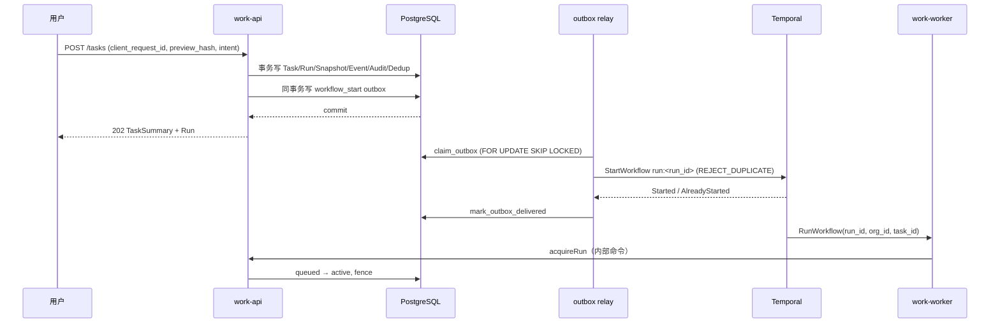
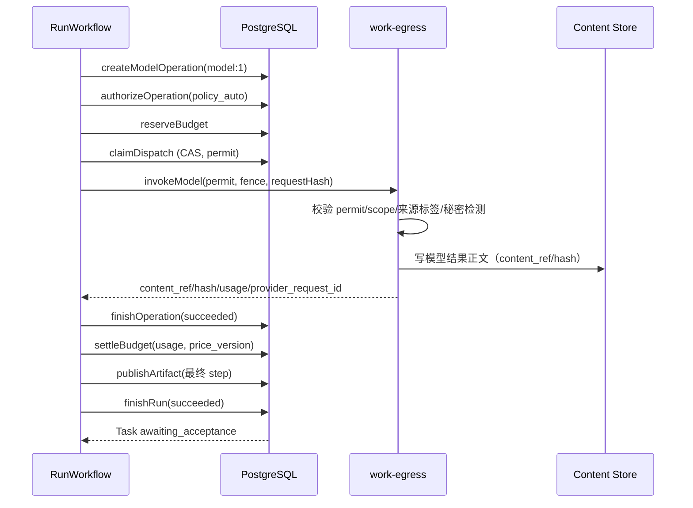
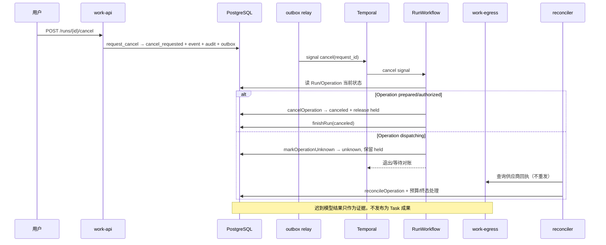
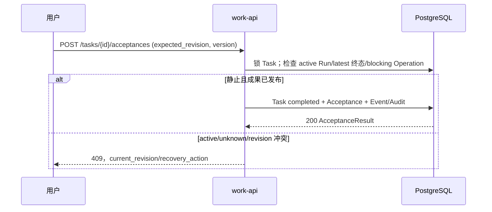

# Work R0a 控制面与持久编排详细设计（D3）

> 状态：D3 设计草案；Temporal dev 参考纵切 F01/F02/F04/F07/F21/F23 6/6，S1 参考演练 6/6（worker 重启、DB 终态偏移、执行开关/停用、outbox backlog、patched 升级、file-backed server 重启）；多节点/在途 server 重启/生产 Temporal、真实 provider 未做。
>
> 日期：2026-10-25
>
> 基线：[R0a 详细设计大纲](work-r0a-detailed-design-plan-2026-10-25.md)、[D1 数据设计](work-r0a-data-design-2026-10-25.md)、[D2 API 设计](work-r0a-api-design-2026-10-25.md)、[架构 §6/§7/§11/§14/§21](work-system-architecture-2026-10-25.md)。
>
> 资产：[RunWorkflow/Activity 契约](assets/work-r0a-orchestration-2026-10-25/RunWorkflow.contract.ts)、[故障矩阵](assets/work-r0a-orchestration-2026-10-25/fault-matrix.yaml)。

## 1. 目标与范围

D3 把 R0a 的“提交 → 派发 → 模型 → 预算 → 成果 → 采纳”做成可恢复、可对账、不可双重消费的持久流程。

**范围内**：单区域 Temporal 拓扑、每 Run 工作流、活动契约、提交/启动、派发/未知、取消/重试/预算等待、成果发布与采纳边界、outbox/SSE、对账器、功能开关/停用/版本升级、故障矩阵。

**范围外**：Temporal 部署自动化、真实供应商回执查询、R0b 本机/设备、R2 连接器、R3 通用 DAG/Step、区域灾备演练、生产容量/SLO。它们属于 D4/D6 或后续阶段。

## 2. 结论与工作假设

| ID | 设计选择 | 理由 |
|---|---|---|
| D3-01 | R0a 优先**自托管 Temporal**：同区域、独立 PostgreSQL 数据库/角色、namespace `work-r0a`、task queue `work-r0a-run`、mTLS、历史保留 7 天 | 数据驻留、独立持久化、可验证 S1；若平台无运维能力，改用托管 Temporal，但必须有书面驻留/留存/DPA，工作流契约不变 |
| D3-02 | **每 Run 一个 `RunWorkflow`**，workflow ID `run:<run_id>`，启动策略 `REJECT_DUPLICATE`；R0a 不做 TaskWorkflow | 固定单步/有界模型循环；重试创建新 Run/新 workflow；采纳在 workflow 之外 |
| D3-03 | Temporal history 只放 Run/Task/Operation ID、哈希、公开状态；不放 goal、正文、提示词、路径、连接器数据或密钥 | 业务事实在 PostgreSQL；history 不是内容存储 |
| D3-04 | R0a 最多 **3 个顺序 model Operation**，逻辑键 `model:<n>`；不做通用 DAG/Step | 满足“大纲→初稿”一类文本任务，同时保持有界、可计量、可审批 |
| D3-05 | 派发后不自动重放模型调用；超时/断网进入 `unknown`，保留预算，由对账器核实 | 付费外部动作不能靠无限重试“碰运气” |
| D3-06 | 预算耗尽进入 `waiting(budget)`，workflow 等 `budget_available/resume` 信号，最长 24h；恢复前重新校验策略/预留 | 不无预算派发；不把等待变成无限容器 |
| D3-07 | R0a golden path **没有手工审批**，使用 `policy_auto`；批准信号/命令保留给 R0b/R2 | 与产品范围一致；F03 只测内部审批路径 |
| D3-08 | 工作流版本 `r0a-v1`；升级使用补丁/worker 版本化，不改变运行中 workflow 的行为；新 Run 才使用新版本 | 避免升级时改变在途语义 |
| D3-09 | 超时基线：Run 30m、模型活动 15m、心跳 30s、预算等待 24h；可配置 | 文本任务有界；超时后进入 unknown 而非无限重试 |
| D3-10 | Outbox backlog 最旧 >5m 或积压 >1000 时，新提交返回 503 `service_degraded`；已有 Run 继续 | 防止无限接收但无法启动的 Run |

## 3. 模块边界与依赖

| 模块 | 职责 | 不允许 |
|---|---|---|
| `work-api` | 领域命令、查询、SSE（初期）、授权/预算/采纳 | 直接调用 Temporal、直接改账本/状态表 |
| `work-worker` | Temporal workflow/activities、outbox relay、对账器 | 绕过领域函数改事实；在 history 放正文 |
| `work-runner` | 每 Run 沙箱/Pi 生命周期 | 租户归属、模型路由、预算决策 |
| `work-egress` | 模型/工具出口、供应商鉴权、usage、价表版本 | 直接改业务事实、记录正文日志 |
| Content Store | 输入、检查点、成果正文 | 授权判断、事件正文 |
| Temporal | 等待点、定时器、活动重试、history | 业务事实源、权限/预算权威 |
| SSE | Task 事件流 | 事件事实源、跨 Task 游标 |

依赖规则：

- API 提交只写 PostgreSQL/outbox；**不直接启动 Temporal**。
- Outbox relay 是唯一启动 workflow/发送取消信号的入口。
- Activities 只调用 D1 领域命令；不直接写表。
- Reconciler 只调用同一组领域命令，不手工改数据库绕过已批准内容/预算。
- Runner 只通过 egress 访问模型；egress 不持有长期业务凭据之外的供应商 Key。

## 4. Temporal 拓扑与版本

| 项 | R0a 设计 |
|---|---|
| Namespace | `work-r0a`（按环境/区域隔离） |
| Task queue | `work-r0a-run`；workflow 与 activities 同队列，便于小规模试点 |
| 持久化 | 独立 Temporal PostgreSQL 数据库/角色；不与业务表混权限 |
| 连接 | mTLS/工作负载身份；不暴露公网 |
| History 保留 | 7 天；业务终态与事件在 Work PG |
| Workflow ID | `run:<run_id>`；同一 Run 只启动一次 |
| 版本 | `r0a-v1`；升级用 patching/worker versioning，运行中 workflow 保持旧行为 |
| Worker 部署 | 至少 2 副本；activity 心跳；重启不丢 workflow 等待点 |
| 归档/可见性 | 仅运维只读；不把 history 当审计/计费来源 |

**Workflow 与 Run 的关系**：

- Run 进入 `queued` 后由 outbox 启动；workflow 的 `acquireRun` 把 Run 置 `active`。
- Run 终态以 PostgreSQL 为准；workflow 完成标志不是业务终态。
- Workflow 失败/丢失时，以 Run/Operation 表与对账器恢复，不重放已消费许可。
- Retry 创建新 Run/新 workflow；Run ID 和 workflow ID 永不复用。

## 5. RunWorkflow 契约

### 5.1 输入、信号与查询

```ts
interface RunWorkflowInput {
  runId: string;
  taskId: string;
  orgId: string;
  workflowVersion: 'r0a-v1';
}
```

| 类型 | 名称 | 语义 |
|---|---|---|
| Signal | `cancel(requestId, reason?)` | 唤醒提示；DB `run.cancel_requested` 是权威 |
| Signal | `budgetAvailable(requestId, accountKey, periodId)` | 预算补充提示；恢复前重新校验 |
| Signal | `resume(requestId, reason)` | 对账/运维恢复提示 |
| Signal | `approvalDecided(...)` | 仅供 R0b/R2；R0a golden path 不触发 |
| Query | `status` | 调试用：Run/Operation/wait reason；不是业务查询 API |

### 5.2 步骤

```text
prepareRun
  → acquireRun（queued → active，fence）
  → for step 1..min(3, plannedSteps):
       createModelOperation(model:<n>)
       authorizeOperation(policy_auto)
       reserveBudget
       claimDispatch（CAS）
       invokeModel（egress，携带 permit/fence/requestHash）
       finishOperation(succeeded|failed)
       settleBudget
  → publishArtifact（最终正文）
  → finishRun(succeeded)
```

- 中间 step 的正文作为 Content Store 检查点/引用，只有最终版本发布为 ArtifactVersion。
- 每一步预算、Operation、审计独立；前一步失败不自动开始下一步。
- 取消在 step 之间生效；已 dispatching 的 step 只能转 unknown/核对，不能假装停止。
- 模型失败：`finishOperation(failed)`，按规则释放/结算，`finishRun(failed)`；Task 保持 open，可重试。
- 模型超时/断网：`markOperationUnknown`，保留预算，Run 进入 `waiting(reconcile)` 或结束等待；不自动付费重发。
- 预算耗尽：`waitRun(budget)`，等待 `budgetAvailable`/`resume`；恢复前重新读取策略/账户/许可。
- 所有步骤无阻塞 Operation 后，`finishRun(succeeded)` 使 Task 进入 `awaiting_acceptance`。

### 5.3 提交/启动时序



- Workflow start 使用固定 ID；`AlreadyStarted` 视为成功，不再创建第二个 Run。
- 启动/ACK 丢失由 outbox 重试；重试不重新创建 Run。
- 若 Temporal 不可用，Run 保持 queued，outbox 积压；超过 backlog 阈值时新提交 503，已有 Run 不丢。
- 启动重试超过阈值（10 次/15 分钟）时，以 `finish_run(failed, workflow_start_timeout)` 显式失败并告警，不静默丢弃。

### 5.4 模型成功时序



## 6. Activity 契约

完整 TypeScript 契约见 [RunWorkflow.contract.ts](assets/work-r0a-orchestration-2026-10-25/RunWorkflow.contract.ts)。

| Activity | 关键输入 | 输出/副作用 | 幂等键 | 重试/超时 |
|---|---|---|---|---|
| `prepareRun` | Run/Task/org | PreparedRun | run_id | 3 次；10s；domain 错误不重试 |
| `acquireRun` | run_id/org | active + fence | run_id/fence | 3 次；10s；非 current 不重试 |
| `createModelOperation` | run_id/org/logical_key/request_hash | operation_id | run_id + logical_key | 5 次；10s；同 key/hash 幂等 |
| `authorizeOperation` | operation_id/org/policy_epoch | prepared → authorized | operation_id | 5 次；10s；waiting_approval → `approval_required` |
| `reserveBudget` | account/period/operation/amount | reservation_id | operation_id + reservation_seq | 3 次；10s；budget_exhausted → wait |
| `claimDispatch` | operation/fence/consumer | dispatch_attempt 或 null | operation_id + CAS | 3 次；10s；null 表示未胜出 |
| `invokeModel` | permit/fence/request_hash/input/checkpoint | content_ref/hash/usage | run + operation + request_hash | **1 次**；15m；心跳 30s；派发后不自动重试 |
| `finishOperation` | operation/outcome/provider_request_id | dispatching → succeeded/failed | operation_id | 5 次；10s；非 dispatching 不重试 |
| `settleBudget` | reservation/amount/price/usage/revision | settle 分录 | operation + settlement_revision | 5 次；10s；revision 冲突不重试 |
| `publishArtifact` | task/run/content/hash | artifact/version | task + logical_name + content_hash | 5 次；30s；同 hash 幂等 |
| `finishRun` | run/outcome/reason | Run/Task 终态 | run_id | 5 次；10s；非 current 不重试 |
| `markOperationUnknown` | operation/reason | dispatching → unknown | operation_id | 5 次；10s；不释放预算 |
| `cancelOperation` | operation/actor/reason | prepared/authorized → canceled；dispatching → unknown | operation_id | 5 次；10s；终态幂等 |
| `waitRun` | run/reason | active → waiting | run_id | 5 次；10s |
| `resumeRun` | run | waiting → active | run_id | 5 次；10s |
| `reconcileOperation` | operation/resolution/evidence | reconciled/unresolved + 预算处理 | operation_id + evidence | 5 次；10s；不重发外部请求 |

**错误分类**：

- `domain_terminal`：Run/Operation 不可继续，结束 workflow，写终态/事件，不重试。
- `domain_wait`：预算/审批等待，进入 waiting，等待信号/定时器。
- `transient`：DB/Temporal/Content Store/供应商限流或 5xx；活动按策略重试。
- `unknown`：派发后超时/断网/回执丢失；进入 unknown，不自动重试，交对账器。

## 7. 派发、未知与对账

### 7.1 派发

- 顺序：Task 行锁 → Run 行锁 → Operation 行锁；`claim_dispatch` CAS 只有胜者获得 `dispatch_attempt_id`/permit。
- 读取到 `dispatching` 不等于获得发送许可；接管 worker 不能继承发送权。
- Egress/invokeModel 必须校验 permit、fence、request_hash 与当前 Operation；不一致拒绝。
- 派发事务达到部署持久性边界后才发送；进程崩溃前后统一按 unknown 处理。

### 7.2 未知

| 场景 | Operation | 预算 | Run/Task | 下一步 |
|---|---|---|---|---|
| 派发前失败 | failed/canceled | 释放/结算 0 | Run failed/canceled | 可重试 |
| 派发后超时/断网 | unknown | 保留 held | Run waiting(reconcile) | 对账器查询供应商 |
| 确认未发送 | reconciled | 释放 | Run 可结束/重试 | 不重发旧许可 |
| 确认已发送且可用 | reconciled | 结算 | 可发布/完成 | 只发布确认内容 |
| 无法确认 | unresolved | 保留 held | Task 阻塞 | 告警/人工核对，不重放 |

- `reconcileOperation` 只处理确认结果；不创建新的 provider 请求。
- 若 Run 已 cancel_requested，迟到的成功结果只作为证据/审计，不发布为 Task 成果。
- 若 Run 仍 current 且未取消，对账器可在确认后走 `publishArtifact`/`finishRun`；所有动作仍经领域命令。

### 7.3 对账器

建议每 30 秒运行，按租户/批次限流：

- queued Run 未启动/outbox 未投递 → 重试 StartWorkflow（固定 ID）。
- active/waiting Run 无 workflow/心跳过期 → 查询 Temporal；无派发可重启，有派发则核对。
- dispatching 超过 2× 模型超时 → `markOperationUnknown`。
- unknown/unresolved → 查询供应商；写入 resolution/evidence；必要时告警。
- waiting(budget) → 检查账户；有额度发送 `budgetAvailable`/`resume`。
- cancel_requested 无 workflow → 结束 Run；有 pending Operation → cancel/unknown。
- outbox 积压/最旧年龄 → 告警；达到阈值时提交入口 503。
- 终态 Run 的 active 指针/未结算费用 → 用领域命令收尾。

对账器只调用 D1 领域命令；不得直接更新状态/账本，不得把 unknown 直接退回 authorized。

## 8. 取消、重试、预算等待与审批

### 8.1 取消

1. API `request_cancel` 写 `run.cancel_requested`、事件、audit、outbox cancel signal；返回 202，不宣称进程已停止。
2. Relay 发送 cancel signal；workflow 重新读取 DB。
3. 若 Run 已终态：忽略信号。
4. 若 Operation prepared/authorized：`cancelOperation` 取消并释放 held 预算。
5. 若 Operation dispatching：`markOperationUnknown`；保留预算；等待对账。
6. 无阻塞 Operation 后 `finishRun(canceled)`；Task 保持 open，可重试。
7. 迟到模型结果/上传不发布；计量/审计保留。

### 8.2 重试

- API `create_run` 检查 active Run/阻塞 Operation；新 Run 沿用 Task 快照（或显式新快照）。
- 新 Run ID/新 workflow ID；旧 workflow 终态/被停止；不复用旧 permit/approval/budget。
- 旧 Run 的迟到回执不能覆盖新 Run 或已完成 Task。

### 8.3 预算等待

- `reserveBudget` 返回 `budget_exhausted` → `waitRun(budget)`，workflow 等待 `budgetAvailable`/`resume`，最长 24h。
- 恢复时重新读取策略、账户、许可；重新 reserve 成功后才派发。
- 24h 超时 → `finishRun(failed, budget_wait_timeout)`；Task 保持 open，可重试。
- 预算调整/补充是服务方运营动作；R0a 不做预算写 UI。

### 8.4 审批

- R0a golden path 无手工审批；`authorizeOperation` 使用 `policy_auto`，写 Operation/audit/event。
- D1 的 approval 命令保留；R0b/R2 接入时：
  - `request_approval` 落库 → workflow `waitRun(approval)`；
  - 决定先写业务库，再 signal；唤醒后重新读 revision/params_hash/expiry；
  - 批准过期/撤销与批准并发由 DB CAS 决胜；陈旧批准不得派发。
- F03 在 R0a 只测内部审批路径；不假装 R0a 有审批 UI。

### 8.5 取消/未知时序



## 9. 成果与采纳

- `publishArtifact` 只发布最终 step 的正文；同 logical_name/content_hash 幂等。
- `finishRun(succeeded)` 只在成果提交、必要核账、fence、当前授权检查后执行；Task → awaiting_acceptance。
- 采纳在 workflow 之外：API `accept_task` 检查 revision、active Run、latest Run 终态、无阻塞 Operation、成果已发布。
- 存在 unknown/unresolved 时不允许采纳；UI 显示 reconciling，不提供“重试”或“完成”假动作。
- 取消后的迟到成果/上传只保留证据，不改变 Task 验收。



## 10. Outbox、SSE 与 Inbox

- `submit_task` 同事务写 TaskEvent 与 workflow_start outbox；`request_cancel` 写 cancel_signal outbox。
- Outbox payload 带 `kind`：
  - `task_event`：aggregate_type=`task`，投递 SSE；
  - `start_workflow`：aggregate_type=`run`，启动 `run:<run_id>`；
  - `cancel_signal`：aggregate_type=`run`，发送 cancel signal。
- Relay 用 `FOR UPDATE SKIP LOCKED` 领取；至少一次；处理后 `mark_outbox_delivered`。
- StartWorkflow 的 `AlreadyStarted` 视为成功；不创建第二个 Run。
- SSE 只投递公开 TaskEvent；每 Task `aggregate_seq` 单调；客户端按 event_id 去重；Last-Event-ID 补读；游标过期 409 `resync_required`。
- Inbox 先轮询；跨 Task SSE 后置。
- Outbox backlog 阈值触发新提交 503；不静默丢事件。

## 11. 功能开关、停用与升级

- **组织开关**：`work_r0a_enabled` 随 bootstrap 返回；关闭时新提交/新 Run 拒绝，已有 Run 可读/取消/核对。
- **Kill switch**：停止新提交与派发；保留查询/采纳/审计；不自动恢复；恢复需显式操作并审计。
- **组织停用**：提升 execution epoch；拒绝新许可/派发；在途动作按 unknown 核对；解除停用不自动恢复席位/grant/旧操作。
- **Worker/Workflow 升级**：`r0a-v1`；运行中 workflow 保持旧行为；新 Run 用新版本；升级前 drain，回滚不重写 history。
- **配置**：超时、预算等待、outbox backlog 阈值、模型最大步数可配置；配置变更写审计。

## 12. 故障矩阵

完整机器可读矩阵见 [fault-matrix.yaml](assets/work-r0a-orchestration-2026-10-25/fault-matrix.yaml)。

| ID | 场景 | 必须保持 |
|---|---|---|
| F01 | 提交事务成功、启动 Temporal 前退出 | 一个 Task/Run；outbox 恢复启动；无丢失 |
| F02 | 启动成功、Relay 未记 ACK | 固定 workflow ID 去重；不启动第二个 Run |
| F03 | 批准与到期/撤销并发（R0a 内部路径） | 一个权威决定；陈旧批准不得派发；R0a golden path 无手工审批 |
| F04 | 模型受理后断网、无回执 | Operation unknown；保留预留；不自动付费重发 |
| F07 | 取消后模型结果/上传完成 | 不发布迟到成果；计量/审计不丢；预算不双扣 |
| F21 | dispatching 提交确认丢失/崩溃 | 只有 CAS 胜者发送；接管不盲重发；unknown 保留预留 |
| F23 | 幂等记录过期/Task 删除后重放 | 跨 Task 持久记录返回原关联/删除状态；不创建新收费 Task |
| D3-R01 | Relay 崩溃/backlog | 新提交 503；已有 Run 继续；不丢 outbox |
| D3-R02 | Worker 在非幂等活动崩溃 | 不自动重放模型；unknown 对账；一次派发 |
| D3-R03 | 预算耗尽后补充 | Run waiting(budget)；补充前不派发；恢复后一次预留 |
| D3-R04 | Run active/unknown 时采纳 | 409；Task/成果不变；UI 不显示假完成 |
| D3-R05 | 派发中组织停用 | 新派发 0；在途 unknown/canceled；解除后不自动重放 |

## 13. D3 对 D1/D2 的增量

这些增量是 D3 实现/DR2 前的待办，当前 D1 20/20 冒烟不包含：

1. **D1 命令**：`wait_run`、`resume_run`、`mark_operation_unknown`、`reconcile_operation`。D1 已有 Run.wait_reason、Operation unknown 状态与状态迁移，但缺命令。
2. **Outbox 约定**：`submit_task` 同事务写 `start_workflow` outbox（aggregate_type=run）；`request_cancel` 写 `cancel_signal` outbox；payload 带 `kind`。D1 当前只有 TaskEvent outbox。
3. **对账索引/告警**：outbox `(aggregate_type, available_at)`、dispatching/unknown 年龄、workflow start 重试计数；D1 有部分索引，需补查询视角。
4. **启动失败收尾**：超过阈值用 `finish_run(failed, workflow_start_timeout)`，写事件/audit；D1 有 finish_run，需上层策略。
5. **D1 冒烟扩展**：F01/F02/F04/F07/F21/F23 的数据库侧断言；当前 20/20 只覆盖单线程 golden path、审批/取消与 RLS。
6. **D2 公开 API**：无变化；取消/采纳/SSE 语义不变，internal workflow signal 不出现在公开 OpenAPI。
7. **D4 依赖**：invokeModel 必须校验 permit/fence/requestHash；egress 返回 provider_request_id/usage/unknown；D4 补齐。

## 14. 验收标准

D3 完成（DR2）需要：

- RunWorkflow/Activity 契约通过类型检查；设计评审无 P0。
- D1 增量命令实现并通过冒烟（含 F01/F02/F04/F21/F23 数据库侧）。
- 使用 Temporal 测试环境执行：提交/启动、模型成功、取消、超时 unknown、预算等待/恢复、worker 崩溃、DB/Temporal 偏移。
- 并发/故障下：单派发、单次扣费、无第二个 Run、无迟到成果发布、unknown 不被自动重发。
- Outbox backlog/kill switch/org suspend 可演练。
- Temporal history 中无正文/密钥；SSE 事件无正文。
- 对账器只通过领域命令恢复；无直接表写。

### 14.1 参考纵切验证（2026-10-25）

- 环境：Temporal CLI 1.9.1 / Server 1.32.0 dev（in-memory）、Node 22 Linux 容器、PostgreSQL 16、D1 R0a schema、faux model。
- 结果：F01/F02/F04/F07/F21/F23 **6/6** 通过；normal workflow smoke 1/1。
  - F01：提交后不启动 relay；outbox 后补启动，仍只有一个 Task/Run/workflow。
  - F02：start 成功但 relay 未 ACK；重试遇 `AlreadyStarted`，不创建第二个 Run。
  - F04：provider accepted 后无回执 → Operation unknown、预算保留 100、无 artifact、无自动重放。
  - F07：cancel 后迟到模型结果不发布 artifact；run canceled、Operation unknown、审计保留。
  - F21：claim 后崩溃 → 一个 dispatch attempt、provider 调用 0、takeover claim 返回 null。
  - F23：Task 删除标记后重放 → `task_deleted`，不创建新 Task/收费。
- **S1 参考演练（6/6）**：
  - S1-R01：worker 停止/重启后，hold workflow 继续；resume 后只发布 1 个 artifact。
  - S1-R02：DB 先置 Run failed，workflow resume 后发布被拒；无迟到 artifact，Temporal workflow FAILED。
  - S1-R03：`execution_enabled=false`/`operator_suspended=true` 阻断 submit/acquire；恢复需显式操作。
  - S1-R04：旧 outbox start 行使新提交 `outbox_backlog`；清理后恢复。
  - S1-R05：v1 worker 停止后切 v2；旧 workflow 保持 v1 artifact `draft.md`，新 workflow 使用 `draft-v2.md`。
  - S1-R06：file-backed Temporal server 重启后，已完成 workflow 仍为 COMPLETED，Work DB task 仍 awaiting_acceptance。
- 边界：F04/F07/F21 使用测试 `faultMode` 直接启动 workflow，不经过 outbox；F23 是数据库幂等断言；S1-R01 只验证 worker 重启，不做 Temporal server 重启/多节点/version patch；未接真实 provider、sandbox、KMS。
- 资产：[work-temporal-slice-2026-10-25](assets/work-temporal-slice-2026-10-25/README.md)。

## 15. 未决与风险

1. **Temporal 托管/运维**：自托管需要 S1 多节点拓扑、在途 workflow 的 server 重启、备份与监控；当前验证 worker 重启、`patched` 升级、已完成 workflow 的 file-backed server 重启与 DB 终态偏移。
2. **D1 增量已实现**：wait/resume/unknown/reconcile/workflow-start/cancel outbox 已通过 34/34；仍需 Temporal 集成/正式评审与 S1 拓扑/升级。
3. **供应商回执查询**：不同供应商对 unknown 的查询能力不同；无法确认时保持 unresolved，不释放预算。
4. **预算等待信号权限**：谁可以补预算/发 resume 需运营权限与审计；R0a 无预算写 UI。
5. **Workflow 版本/Worker 发布**：`patched` 升级已验证；worker versioning 部署、正式 drain/回滚演练未做。
6. **Outbox 顺序/DLQ**：start/cancel/task_event 的相对顺序与 poison 事件处理未定；当前依赖 DB 状态幂等。
7. **SSE 多实例/背压**：长连接、游标保留、重连风暴未实现。
8. **人工审批**：R0a 不覆盖 F03 的完整审批 UI/通知；待 R0b/R2。
9. **超时数值**：Run/模型/预算等待是初始建议，需产品与试点数据校准。
10. **对账收尾策略**：确认已发送后的发布/完成由对账器还是新 workflow 执行，需在 D4 定案；无论哪种都不得重发。
11. **Temporal history 驻留**：即使不含正文，仍需区域/保留/访问审计。
12. **D1 直方/容量**：Temporal 与 PG 的吞吐、history 大小、outbox 延迟未压测。

## 16. 交付物与下一步

- [RunWorkflow.contract.ts](assets/work-r0a-orchestration-2026-10-25/RunWorkflow.contract.ts)：workflow/activity/signal/query/retry/错误分类契约。
- [fault-matrix.yaml](assets/work-r0a-orchestration-2026-10-25/fault-matrix.yaml)：F01/F02/F03/F04/F07/F21/F23 + D3 专项。
- 下一步：S1 拓扑/升级/DB-Temporal 偏移、outbox backlog/停用演练、真实 provider/sandbox；随后 D4/D6 评审。参考纵切见 [README](assets/work-temporal-slice-2026-10-25/README.md)。
