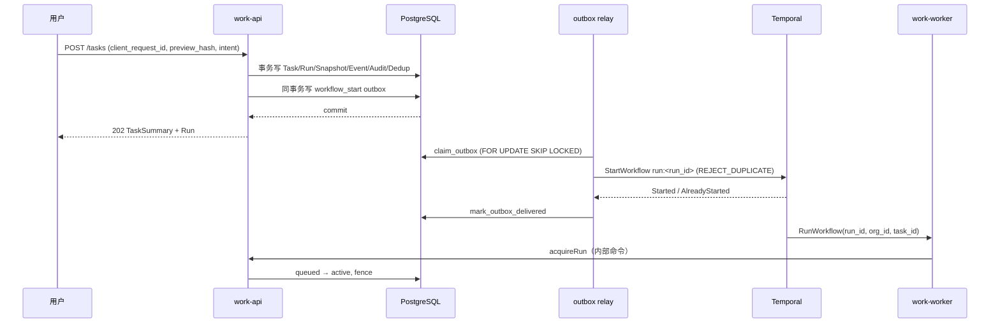
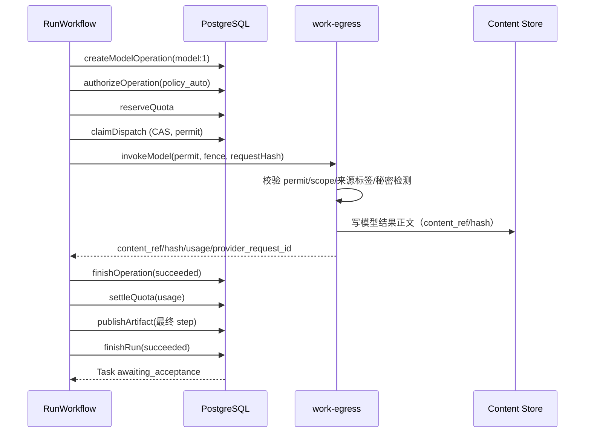
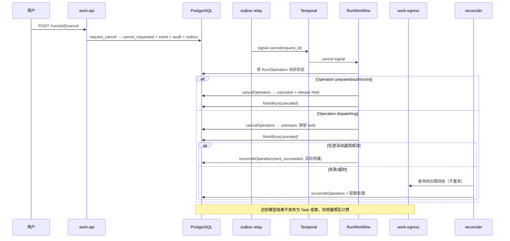
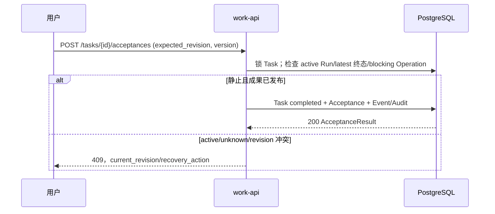

# Work R0a 控制面与持久编排详细设计（D3）

> 状态：D3 可评审草案（2026-10-26 修订：取消四时点、派发后失败一律 unknown、迟到用量计费、跨组织租约 relay）；Temporal dev 参考纵切 F01/F02/F04/F07/F21/F23 + D3-R06–R09 10/10，S1 参考演练 R01–R05 本轮复跑通过、R06 未复跑；多节点/在途 server 重启/生产 Temporal、真实 provider 未做。
>
> 日期：2026-10-25
>
> 基线：[R0a 详细设计大纲](work-r0a-detailed-design-plan-2026-10-25.md)、[D1 数据设计](work-r0a-data-design-2026-10-25.md)、[D2 API 设计](work-r0a-api-design-2026-10-25.md)、[架构 §6/§7/§11/§14/§21](work-system-architecture-2026-10-25.md)。
>
> 资产：[RunWorkflow/Activity 契约](assets/work-r0a-orchestration-2026-10-25/RunWorkflow.contract.ts)、[故障矩阵](assets/work-r0a-orchestration-2026-10-25/fault-matrix.yaml)。

## 1. 目标与范围

D3 把 R0a 的“提交 → 派发 → 模型 → 配额 → 成果 → 采纳”做成可恢复、可对账、不可双重消费的持久流程。

**范围内**：单区域 Temporal 拓扑、每 Run 工作流、活动契约、提交/启动、派发/未知、取消/重试/配额等待、成果发布与采纳边界、outbox/SSE、对账器、功能开关/停用/版本升级、故障矩阵。

**范围外**：Temporal 部署自动化、真实供应商回执查询、R0b 本机/设备、R2 连接器、R3 通用 DAG/Step、区域灾备演练、生产容量/SLO。它们属于 D4/D6 或后续阶段。

## 2. 结论与工作假设

| ID | 设计选择 | 理由 |
|---|---|---|
| D3-01 | R0a **采用自托管 Temporal**（U3 于 2026-10-26 定 A）：同区域、独立 PostgreSQL 数据库/角色、namespace `work-r0a`、task queue `work-r0a-run`、mTLS、历史保留 7 天 | 数据驻留、独立持久化、可验证 S1；若平台对 9 项承诺任一项答"否"，才改用托管 Temporal（须有书面驻留/留存/DPA）或重做控制面调度；工作流契约不变 |
| D3-02 | **每 Run 一个 `RunWorkflow`**，workflow ID `run:<run_id>`，启动策略 `REJECT_DUPLICATE`；R0a 不做 TaskWorkflow | 固定单步/有界模型循环；重试创建新 Run/新 workflow；采纳在 workflow 之外 |
| D3-03 | Temporal history 只放 Run/Task/Operation ID、哈希、公开状态；不放 goal、正文、提示词、路径、连接器数据或密钥 | 业务事实在 PostgreSQL；history 不是内容存储 |
| D3-04 | R0a 最多 **3 个顺序 model Operation**，逻辑键 `model:<n>`；不做通用 DAG/Step | 满足“大纲→初稿”一类文本任务，同时保持有界、可计量、可审批 |
| D3-05 | 派发后不自动重放模型调用；超时/断网进入 `unknown`，保留配额，由对账器核实 | 付费外部动作不能靠无限重试“碰运气” |
| D3-06 | 配额耗尽进入 `waiting(quota)`，workflow 等 `quota_available/resume` 信号，最长 24h；恢复前重新校验策略/预留 | 不无配额派发；不把等待变成无限容器 |
| D3-07 | R0a golden path **没有手工审批**，使用 `policy_auto`；批准信号/命令保留给 R0b/R2 | 与产品范围一致；F03 只测内部审批路径 |
| D3-08 | 工作流版本 `r0a-v1`；升级使用补丁/worker 版本化，不改变运行中 workflow 的行为；新 Run 才使用新版本 | 避免升级时改变在途语义 |
| D3-09 | 超时基线：Run 30m、模型活动 15m、心跳 30s、配额等待 24h；可配置 | 文本任务有界；超时后进入 unknown 而非无限重试 |
| D3-10 | Outbox backlog 最旧 >5m 或积压 >1000 时，新提交返回 503 `service_degraded`；已有 Run 继续 | 防止无限接收但无法启动的 Run |

## 3. 模块边界与依赖

| 模块 | 职责 | 不允许 |
|---|---|---|
| `work-api` | 领域命令、查询、SSE（初期）、授权/配额/采纳 | 直接调用 Temporal、直接改账本/状态表 |
| `work-worker` | Temporal workflow/activities、outbox relay、对账器 | 绕过领域函数改事实；在 history 放正文 |
| `work-runner` | 每 Run 沙箱/Pi 生命周期 | 租户归属、模型路由、配额决策 |
| `work-egress` | 模型/工具出口、供应商鉴权、usage、价表版本 | 直接改业务事实、记录正文日志 |
| Content Store | 输入、检查点、成果正文 | 授权判断、事件正文 |
| Temporal | 等待点、定时器、活动重试、history | 业务事实源、权限/配额权威 |
| SSE | Task 事件流 | 事件事实源、跨 Task 游标 |

依赖规则：

- API 提交只写 PostgreSQL/outbox；**不直接启动 Temporal**。
- Outbox relay 是唯一启动 workflow/发送取消信号的入口。
- Activities 只调用 D1 领域命令；不直接写表。
- Reconciler 只调用同一组领域命令，不手工改数据库绕过已批准内容/配额。
- Runner 只通过 egress 访问模型；egress 不持有长期业务凭据之外的供应商 Key。

## 4. Temporal 拓扑与版本

| 项 | R0a 设计 |
|---|---|
| Namespace | `work-r0a`（按环境/区域隔离） |
| Task queue | `work-r0a-run`；workflow 与 activities 同队列，便于小规模试点 |
| 持久化 | 独立 Temporal PostgreSQL 数据库/角色；不与业务表混权限 |
| 连接 | mTLS/工作负载身份；不暴露公网 |
| History 保留 | 7 天；业务终态与事件在 Work PG |
| Workflow ID | `run:<run_id>`；同一 Run 只启动一次 |
| 版本 | `r0a-v1`；升级用 patching/worker versioning，运行中 workflow 保持旧行为 |
| Worker 部署 | 至少 2 副本；activity 心跳；重启不丢 workflow 等待点 |
| 归档/可见性 | 仅运维只读；不把 history 当审计/计费来源 |

### 4.1 托管决策单（U3，2026-10-26）

| 维度 | 自托管（**已选定 A**） | ~~托管 Temporal Cloud（回退路线 B，已废弃）~~ |
|---|---|---|
| 数据驻留 | 同区域、独立 PG/角色，可控 | 依赖供应商区域；需 DPA/驻留/留存书面承诺 |
| 运维 | 平台需提供多节点、值班、备份/升级 | 供应商 SLA；仍需本团队处理 workflow/worker 与 namespace 配额 |
| 成本 | 基础设施 + 人力 | 按用量/席位；试点期可能更低，但需预算 |
| 升级/versioning | 自控版本，需演练 drain | 供应商窗口；仍要 worker versioning |
| 故障排查 | 可查 server/PG/history | 受供应商支持流程约束 |
| 迁移 | 自托管可导出/迁移 | 迁出成本与合同约束需先确认 |

**决定（2026-10-26）：采用自托管**（同区、独立 PG、mTLS、7 天 history、≥2 worker 副本），与 D3-01 一致；A/B 比较到此为止，不再重开。仍**待平台书面确认**多节点拓扑、值班/告警、PG 备份恢复与 ≥15 分钟 drain 窗口等 9 项承诺（逐条见 [U3 决策征询单 §3](work-r0a-temporal-hosting-decision-request-2026-10-26.md)）；确认前 U3/C22 保持未关闭。若任一项被判"否"，才回退到托管路线（须先取得驻留/留存/DPA 书面承诺）或重做控制面调度——两条都需要新 ADR 与 E4 重排。工作流契约和本设计的取消/对账语义不因托管方式改变。

未确认前，E4 不得按“已排期”承诺；U3 与 C22 保持未关闭（选定 A 只消除了选型不确定，没有消除对平台的资源与运维依赖）。

为把“等平台答复”变成可签收动作，已发出 [U3 决策征询单](work-r0a-temporal-hosting-decision-request-2026-10-26.md)：自托管路线列出平台必须逐条承诺的 9 项（多副本、独立 PG、内网 mTLS、备份 RPO/RTO、**≥15 分钟 drain 窗口**、值班、`temporal_*` 告警接入、namespace 配额、演练排期），托管路线列出法务必须先答的 6 项（驻留、history 保留与个人数据判定、训练条款、退出条款、DPA/认证、计费口径），并写明期望答复日 2026-11-14 与三种不答复后果。选 A 之后的四项演练就是 C22 的关闭动作。

**Workflow 与 Run 的关系**：

- Run 进入 `queued` 后由 outbox 启动；workflow 的 `acquireRun` 把 Run 置 `active`。
- Run 终态以 PostgreSQL 为准；workflow 完成标志不是业务终态。
- Workflow 失败/丢失时，以 Run/Operation 表与对账器恢复，不重放已消费许可。
- Retry 创建新 Run/新 workflow；Run ID 和 workflow ID 永不复用。

## 5. RunWorkflow 契约

### 5.0 D3' 执行片段协议（F0-R1 设计已签）

本节按[重做计划](work-r0a-architecture-rebuild-plan-2026-10-28.md#跨语言执行契约)提出 Go/Node 接口，**不是 D3' 全部完成或已签收**。后续 §5.1–§6 与 `RunWorkflow.contract.ts` 保留旧 `r0a-v1` 的历史协议；其中同队列部署、直接 `invokeModel` 入口及旧 bigint 参数不能直接当作新 wire contract。其余领域活动仍需逐项与 D1 对齐，不在本次消息 Schema 中假定已经完成。

资产：

- [AdvanceRuntime.contract.ts](assets/work-r0a-orchestration-2026-10-25/AdvanceRuntime.contract.ts)：TS 消息类型、单次执行与超时建议；无 Temporal SDK 依赖。
- [advance-runtime.schema.json](assets/work-r0a-orchestration-2026-10-25/advance-runtime.schema.json)：JSON Schema Draft-07，作为本轮 wire 形状校验基线。
- [advance-runtime.test.mjs](assets/work-r0a-orchestration-2026-10-25/advance-runtime.test.mjs)：结构正负例；复用前端已有 Ajv，不安装新依赖。TS 类型不能替代运行时验证，Go codec 双向与实际 Temporal payload 测试仍待实现。

#### 消息与控制权

Go 保持唯一 RunWorkflow，领域活动在 Go 队列执行；Node Activity worker 只接收 `work-r0a-runtime` 上的 `advanceRuntime`。Node 不自行创建 Run/Operation、不做业务状态迁移、不注册第二套 workflow。一个片段使用新的 executionId 和独占子进程；worker 重启不得重用其发送权。

| 消息 | 语义 | 返回后允许的动作 |
|---|---|---|
| `advance_request / plan` | 无 permit/intent，只从已确认 canonical checkpoint 或初始 snapshot 推进 Pi 到下一个提交点；不调用供应商 | `MODEL_REQUEST` 只提出下一次请求；Go 验证持久意图后登记/授权/预留/claim |
| `advance_request / execute` | 必须有 checkpoint、持久意图及完整 permit；一个片段至多发送一个模型 Operation | 成功返回 `CHECKPOINTED` 与可信回执引用；Go 核对后确认 Operation、记用量并结算，再启动 plan 片段 |
| `MODEL_REQUEST` | 必须有 checkpoint、request 引用、requestHash、`model:1..3` 逻辑键 | 返回消息不是授权，不能直接发模型 |
| `CHECKPOINTED` | 必须有 checkpoint 与回执引用；回执由受信任出口保存 | 只有回执与账本绑定一致才补确认/收尾；不是仅凭 Node 自报成功 |
| `WAITING_RECONCILE` | 只有绑定本 execute 请求的 Operation 结果未知时使用；checkpoint 可以为空 | 保留预留、停止推进，Go 按 DB 当前状态等待或收尾 |
| `FINISHED` | 仅 plan 片段在已确认的最后回执之后提出；必须有 checkpoint 与最终成果引用 | Go 检查无阻塞 Operation、用量/结算与授权，然后发布；不是 Runtime 宣告 Run succeeded |
| `FAILED / CANCELED` | 表示本片段结束，原因仅枚举；不直接代表 Run 或外部请求终态 | Go 重读许可/账本/持久回执，按失败分类恢复；不能据此释放已派发预留 |
| `runtime_heartbeat / runtime_cancel` | 绑定 executionId 的监督消息；无正文、token 或自由文本 | 心跳对应子进程活性；取消只停止本片段，不证明供应商取消 |

父进程必须检查请求/响应配对：plan 不接受 CHECKPOINTED/WAITING_RECONCILE；execute 不接受 MODEL_REQUEST/FINISHED；响应 executionId 必须匹配，未知结果的 operationId 必须匹配 permit。结构校验器**不完成这些关联检查**，也不证明租户身份有效。

身份启动/刷新使用 [D4 §6.2](work-r0a-runtime-egress-design-2026-10-25.md#62-f0-r4-身份签发与父子凭据隔离设计已签已复核)的私有管道，不复用本节 Temporal 消息；父进程真实续租后才刷新 audience capability，子进程心跳本身不产生新权限。授权服务不可用、launcher 未达到内核前提或 capability 已失效时拒绝新读写/发送，不能因 activity 尚未超时继续调用。

#### 引用、整数与信任边界

- 所有对象拒绝未知字段；不接受 prompt/messages/content/reasoning、错误堆栈或任意 metadata。消息编码为 UTF-8 JSON，单帧最多 16 KiB；大小限制由接收边界在解析前执行，Schema 本身不限制编码字节数。
- `StoredReference` 为 `{refId: UUID, hash: sha256}`，不是 URL、路径或 bearer token。内容代理按可信身份解析引用，核验 org/task/run、对象类型、hash 与生命周期；必须拒绝其他租户即使形状合法的引用。旧 `content://` 引用须由受信任适配层映射，不能通过改字符串前缀伪装为授权。
- fence 是无前导零的十进制字符串，保留 PG bigint 精度；Go/Node 接收端还须解析并拒绝超过有符号 bigint 上限的值，Schema 的位数限制不代替数值范围检查。deadline/heartbeat sequence 是 JSON 安全整数，拒绝溢出，接收端同时校验实际期限与序号单调。
- requestHash 绑定冻结的 provider/model、消息/模板版本引用、参数与输出限制，不能只是某个正文 hash；规范化算法及参与字段在 F0-R3 签收。permit.requestHash 与 intent.requestHash 必须相等，且与可信存储/账本复算结果一致。
- Schema 不能证明无敏感内容隐写进合法 ID 字符串，也不能证明引用归属。ID/版本只从服务端记录取得，不透传模型生成标识或任意错误文本；history 脱敏仍需实际采样测试。
- Canonical checkpoint 与模型意图/回执是 Content Store 的版本化内容，不在 Temporal history。恢复先核账、补真实回执；不能把 SDK aborted 占位回执持久化为已执行结果。内容 Schema 与恢复算法草案见 [D4 §8.1](work-r0a-runtime-egress-design-2026-10-25.md#81-f0-r3-canonical-state请求与可信回执设计已签)，仍须 F0-R3 签收与真实 Pi 恢复验证。

#### 超时、取消与重复投递

数值已随 F0-R1 设计签收（2026-10-28），按试点真实数据校准，位于 `RUNTIME_ACTIVITY_DRAFT`：start-to-close 16m，schedule-to-close 17m，为模型最长 15m 留出持久化/回收时间；心跳超时 30s、子进程活性间隔 10s、取消 grace 5s。实际有效 deadline 取请求、当前执行授权与 Run 剩余活跃预算的最小值；配额等待独立计时，不把旧 30m Run timeout 用作允许等待 24h 的 workflow 总期限。

`maximumAttempts=1` 仅禁用 SDK 自动重试，**不是 exactly-once 证明**。重复 activity 投递、响应丢失与旧子进程仍活着的情况都必须通过片段所有权和出口持久发送门闩处理；D1/出口持久化尚未签收前，不得实现真实收费链路。任何 execute 片段超时都先核账，不能直接新建片段重发同许可。

Go cancel signal 先读 DB，再请求取消 activity；父进程通过私有 IPC 投递 RuntimeCancel，在 grace 后回收仍未退出的子进程。Go 不依赖 activity 已确认取消才停止新许可；若旧进程无法确认退出，先让片段身份在出口失效并按账本对账。父进程崩溃/心跳超时、重复心跳、旧 executionId、过期 permit、成功后 checkpoint 写失败均列入真实故障矩阵。

池容量不足、drain 中、运行时版本不兼容时，父进程在 `claim_runtime_execution` **之前**把片段退回为可重试的调度失败，不排队占住 slot，也不记为业务失败；已 claim 后无法启动只能走撤销/到期。本地回收完成不等于外部已停止：gate 已消费按 unknown 对账，未消费仍须同锁封口才能证明 not_sent。并发/预算、回收、drain 与升级约束见 [D4 §6.5](work-r0a-runtime-egress-design-2026-10-25.md#65-f0-r6-池并发资源预算与回收设计已签)，PR 负例见 [D4 §6.6](work-r0a-runtime-egress-design-2026-10-25.md#66-f0-r6-负例验收合同)。

#### 运行结构检查

从仓库根目录执行：

```sh
node --test docs/plan/assets/work-r0a-orchestration-2026-10-25/advance-runtime.test.mjs
node src/frontend/node_modules/typescript/bin/tsc --noEmit --strict --skipLibCheck --target ES2022 --module ESNext docs/plan/assets/work-r0a-orchestration-2026-10-25/AdvanceRuntime.contract.ts
```

以上仅验证消息结构与 TS 类型，不运行 Go、Pi、Temporal、出口或 OS 隔离；结果在项目文档记录，不能用来关闭[D4 的 Phase 0 签收项](work-r0a-runtime-egress-design-2026-10-25.md#61-phase-0-执行与安全签收清单2026-10-28-设计签收)。

### 5.0.1 所有权、去重与恢复矩阵（F0-R2/F0-R3，设计已签）

持久表/命令与锁序见 [D1 §5.4](work-r0a-data-design-2026-10-25.md#54-f0-r2-片段所有权与发送去重增量设计已签未迁移)，Content Store 文档与可信回执见 [D4 §8.1](work-r0a-runtime-egress-design-2026-10-25.md#81-f0-r3-canonical-state请求与可信回执设计已签)。恢复由 Go 的领域活动发起；Node 不能从 schema 合法或 activity 重试自行推导派发资格。

恢复先读取同一 Run 的 Task/Run/Operation、片段/gate、已提交 head；缺任一权威记录、数据库不可达、hash/版本/引用归属冲突时停止推进并告警，不降级为“从头再跑”。持久回执验证在事务外读不可变版本，应用时在事务内重新校验账本绑定。以下动作均以 current Run/取消状态为前提；终态 Run 只允许义务收尾，不重新设为 active。

| 窗口 | 可证明事实 | 恢复动作 | 新模型请求 |
|---|---|---|---|
| 注册片段后、领取前退出 | registered，gate 不存在 | 原执行期限内可领取；过期先显式 expire，再注册新 execution；未确认旧片段失效不得并行 | 无自动发送 |
| 领取 ACK 丢失/子进程启动不明 | active 绑定 holder，但未证明启动情况 | 同 holder 查状态，不再 fork；新父进程换 holder，等租约/硬期限后核账 | 禁止接管旧进程发送权 |
| 意图对象写成功、head CAS 前退出 | 只有未提交候选 | 按固定 slot 找同 hash 候选并验来源；当前 holder 可补 CAS，旧 holder 失效后由新片段重建 | 先提交 pending，再授权 |
| claim_dispatch ACK 丢失 | Operation 已 dispatching，可回读 attempt | 只恢复领域许可；仍须有效 execution 与 gate 首次消费。若片段已失效，走 seal/核对，不把同 consumer 的原 attempt 当 won | 只允许有效片段首次消费 |
| consume 与 seal/取消竞争 | 在同锁序下决定谁先提交 | seal 先赢则 not_sent 可证明；consume 先赢则在途/unknown | seal 后旧许可不可发；consume 不再授权第二次 |
| consume 提交后 ACK 丢失或发送前崩溃 | gate=consumed，无法证明是否已发送 | 查固定 receipt slot/供应商；无证据则 unknown/unresolved，保留配额 | 禁止 |
| 正文写成功、回执未落地 | 有正文但无可信终态证据 | 核对供应商/可信出口观察，不能只据正文确认成功；无法确认仍 unresolved | 禁止 |
| 回执已写、attach 未提交/ACK 丢失 | 固定 slot 有可信不可变回执 | 按原元组补 attach；若出现冲突隔离，不覆盖 | 禁止重发，可补确认 |
| Operation/usage 已确认、settle/head 未完成 | 外部成功确定，内部步骤缺失 | 从账本读缺失步骤，幂等补核账及 canonical head；不用 markOperationUnknown | 核账完成前禁止下一次 |
| 旧 checkpoint 指向 pending，但回执已确认 | head 落后于可信外部事实 | 新 plan 片段从旧 head+receipt 重建 ready checkpoint，校验顺序和哈希，CAS 成功后恢复 Pi | 只允许新的下一逻辑键 |
| 仅旧片段过期后迟到成功，Run 仍 current 且未取消 | gate 已消费且回执可信，旧 execution 无提交权 | 补确认/核账；拒绝旧片段写 head，由新 plan 片段补 head 并恢复；最终发布仍需完整领域检查 | 核账/head 恢复后才允许下一逻辑键 |
| Run 取消后迟到成功 | gate 已消费且回执可信 | 保持取消；补用量/结算，拒绝旧片段写 head、禁止发布 | 禁止 |
| Task tombstone 或恢复后 gate 可能丢失 | 正文留存已终止，或派发权威不完整 | 保留最小计量证据/去重 tombstone；关闭派发，按 DR 核对，不凭“空记录”重新发送 | 禁止 |

#### 故障验收合同

下列条目均为**待执行的真实集成验收**。Schema 测试和纯 gate 模型只能先验证字段/规则，不得把顺序枚举说成数据库并发已通过。

| ID | 注入点 | 必须断言 |
|---|---|---|
| RR-01 | 两个 Node holder 并发领取同片段；旧 seq 续租；租约过期续租 | 一个有效 holder；重复/旧心跳不续命；旧片段不能消费 gate/写 head |
| RR-02 | 两个 egress 并发 consume，及同 invocation RPC 重试 | PG 实际只插入一个 gate、只有一次 won；上游最多一个请求，不依赖进程内去重 |
| RR-03 | consume 的 commit/响应前后杀 Go/egress | commit 未确认不发送；commit 已提交但 ACK 丢失不再 won；无回执保持预留 |
| RR-04 | seal/取消与 consume 并发 | 与线性化顺序一致；不能在 consumed 后证明 not_sent；取消后不发布 |
| RR-05 | 断网/5xx/部分回答/供应商 ID 缺失 | 无完整可信证据不伪造成功/拒绝；不跨模型/供应商重发 |
| RR-06 | 正文 put、receipt put、attach commit 各点退出 | 按固定 slot 补挂，不全库扫描猜测；正文单独存在不能证明成功；回执冲突拒绝 |
| RR-07 | finish/record_usage/settle/head CAS 各提交点丢 ACK | 不重复用量、不重复扣配额、succeeded 不回退 unknown、head 不覆盖新版本 |
| RR-08 | 第二/第三模型轮、Pi 恢复、含伪造 model_output 来源 | 每轮独立 Operation/许可；使用已确认公开回执；无隐藏重试/摘要调用、无原始 reasoning |
| RR-09 | stale execution/hash/base revision/跨 org 引用 | 拒绝接管、越权读写及 head 分叉；无正文/凭据出现在 history/日志 |
| RR-10 | 取消/删除后迟到回执，及备份恢复到 consume 之前 | 计量义务保留、正文不复活、发布为零；派发保持禁用直至权威核对完成 |

执行命令（设计结构与纯模型，不调用外部服务）：

```sh
node --test docs/plan/assets/work-r0a-orchestration-2026-10-25/runtime-recovery.test.mjs
node src/frontend/node_modules/typescript/bin/tsc --noEmit --strict --skipLibCheck --target ES2022 --module ESNext docs/plan/assets/work-r0a-orchestration-2026-10-25/RuntimeRecovery.contract.ts
```

### 5.1 输入、信号与查询

```ts
interface RunWorkflowInput {
  runId: string;
  taskId: string;
  orgId: string;
  workflowVersion: 'r0a-v1';
}
```

| 类型 | 名称 | 语义 |
|---|---|---|
| Signal | `cancel(requestId, reason?)` | 唤醒提示；DB `run.cancel_requested` 是权威 |
| Signal | `quotaAvailable(requestId, accountKey, periodId)` | 配额补充提示；恢复前重新校验 |
| Signal | `resume(requestId, reason)` | 对账/运维恢复提示 |
| Signal | `approvalDecided(...)` | 仅供 R0b/R2；R0a golden path 不触发 |
| Query | `status` | 调试用：Run/Operation/wait reason；不是业务查询 API |

### 5.2 步骤

```text
prepareRun
  → acquireRun（queued → active，fence）
  → for step 1..min(3, plannedSteps):
       createModelOperation(model:<n>)
       authorizeOperation(policy_auto)
       reserveQuota
       claimDispatch（CAS）
       invokeModel（egress，携带 permit/fence/requestHash）
       finishOperation(succeeded|failed)
       settleQuota
  → publishArtifact（最终正文）
  → finishRun(succeeded)
```

- 中间 step 的正文作为 Content Store 检查点/引用，只有最终版本发布为 ArtifactVersion。
- 每一步配额、Operation、审计独立；前一步失败不自动开始下一步。
- 取消在 step 之间生效；已 dispatching 的 step 只能转 unknown/核对，不能假装停止。
- 模型失败：`finishOperation(failed)`，按规则释放/结算，`finishRun(failed)`；Task 保持 open，可重试。
- 模型超时/断网：`markOperationUnknown`，保留配额，Run 进入 `waiting(reconcile)` 或结束等待；不自动付费重发。
- 配额耗尽：`waitRun(quota)`，等待 `quotaAvailable`/`resume`；恢复前重新读取策略/账户/许可。
- 所有步骤无阻塞 Operation 后，`finishRun(succeeded)` 使 Task 进入 `awaiting_acceptance`。

### 5.3 提交/启动时序



- Workflow start 使用固定 ID；`AlreadyStarted` 视为成功，不再创建第二个 Run。
- 启动/ACK 丢失由 outbox 重试；重试不重新创建 Run。
- 若 Temporal 不可用，Run 保持 queued，outbox 积压；超过 backlog 阈值时新提交 503，已有 Run 不丢。
- 启动重试超过阈值（10 次/15 分钟）时，以 `finish_run(failed, workflow_start_timeout)` 显式失败并告警，不静默丢弃。

### 5.4 模型成功时序



## 6. Activity 契约

完整 TypeScript 契约见 [RunWorkflow.contract.ts](assets/work-r0a-orchestration-2026-10-25/RunWorkflow.contract.ts)。

| Activity | 关键输入 | 输出/副作用 | 幂等键 | 重试/超时 |
|---|---|---|---|---|
| `prepareRun` | Run/Task/org | PreparedRun | run_id | 3 次；10s；domain 错误不重试 |
| `acquireRun` | run_id/org | active + fence | run_id/fence | 3 次；10s；非 current 不重试 |
| `createModelOperation` | run_id/org/logical_key/request_hash | operation_id | run_id + logical_key | 5 次；10s；同 key/hash 幂等 |
| `authorizeOperation` | operation_id/org/policy_epoch | prepared → authorized | operation_id | 5 次；10s；waiting_approval → `approval_required` |
| `reserveQuota` | account/period/operation/amount_tokens | reservation_id | operation_id + reservation_seq | 3 次；10s；quota_exhausted → wait |
| `claimDispatch` | operation/fence/consumer | dispatch_attempt 或 null | operation_id + CAS | 3 次；10s；null 表示未胜出 |
| `invokeModel` | permit/fence/request_hash/input/checkpoint | content_ref/hash/usage | run + operation + request_hash | **1 次**；15m；心跳 30s；派发后不自动重试 |
| `finishOperation` | operation/outcome/provider_request_id | dispatching → succeeded/failed | operation_id | 5 次；10s；非 dispatching 不重试 |
| `settleQuota` | reservation/amount_tokens/usage/revision | settle 分录 | operation + settlement_revision | 5 次；10s；revision 冲突不重试 |
| `publishArtifact` | task/run/content/hash | artifact/version | task + logical_name + content_hash | 5 次；30s；同 hash 幂等 |
| `finishRun` | run/outcome/reason | Run/Task 终态 | run_id | 5 次；10s；非 current 不重试 |
| `markOperationUnknown` | operation/reason | dispatching → unknown | operation_id | 5 次；10s；不释放配额 |
| `cancelOperation` | operation/actor/reason | prepared/authorized → canceled；dispatching → unknown | operation_id | 5 次；10s；终态幂等 |
| `waitRun` | run/reason | active → waiting | run_id | 5 次；10s |
| `resumeRun` | run | waiting → active | run_id | 5 次；10s |
| `reconcileOperation` | operation/resolution/evidence | reconciled/unresolved + 配额处理 | operation_id + evidence | 5 次；10s；不重发外部请求 |

**错误分类**：

- `domain_terminal`：Run/Operation 不可继续，结束 workflow，写终态/事件，不重试。
- `domain_wait`：配额/审批等待，进入 waiting，等待信号/定时器。
- `transient`：DB/Temporal/Content Store/供应商限流或 5xx；活动按策略重试。
- `unknown`：派发后超时/断网/回执丢失；进入 unknown，不自动重试，交对账器。

## 7. 派发、未知与对账

### 7.1 派发

- 顺序：Task 行锁 → Run 行锁 → Operation 行锁；`claim_dispatch` CAS 只有胜者获得 `dispatch_attempt_id`/permit。
- 读取到 `dispatching` 不等于获得发送许可；接管 worker 不能继承发送权。
- Egress/invokeModel 必须校验 permit、fence、request_hash 与当前 Operation；不一致拒绝。
- 派发事务达到部署持久性边界后才发送；进程崩溃前后统一按 unknown 处理。

### 7.2 未知

| 场景 | Operation | 配额 | Run/Task | 下一步 |
|---|---|---|---|---|
| 派发前失败 | failed/canceled | 释放/结算 0 | Run failed/canceled | 可重试 |
| 派发后超时/断网 | unknown | 保留 held | Run waiting(reconcile) | 对账器查询供应商 |
| 确认未发送 | reconciled | 释放 | Run 可结束/重试 | 不重发旧许可 |
| 确认已发送且可用 | reconciled | 结算 | 可发布/完成 | 只发布确认内容 |
| 无法确认 | unresolved | 保留 held | Task 阻塞 | 告警/人工核对，不重放 |

- `reconcileOperation` 只处理确认结果；不创建新的 provider 请求。
- 若 Run 已 cancel_requested，迟到的成功结果不发布为 Task 成果，但其用量按 `sent_succeeded` 对账计费（供应商确实执行过，不得按 not_sent 释放而少计费）。
- 派发许可（`claim_dispatch` 非 NULL）之后，`invokeModel` 的**任何**失败——供应商无回执、worker 崩溃、启动/心跳超时、未知错误——都进入 `markOperationUnknown` + `waitRun(reconcile)`；只有供应商明确拒绝且可证明未执行时才可走 failed。
- `claim_dispatch` 返回 NULL 时 workflow 重读 Operation/Run：authorized 且 Run cancel_requested → `cancelOperation` + `finishRun(canceled)`；已由其他 consumer/fence 派发 → 不动（结果归属派发方，崩溃由对账器接管）；**不得**把别人的 dispatching 标为 unknown。
- 若 Run 仍 current 且未取消，对账器可在确认后走 `publishArtifact`/`finishRun`；所有动作仍经领域命令。

### 7.3 对账器

建议每 30 秒运行，按租户/批次限流：

- queued Run 未启动/outbox 未投递 → 重试 StartWorkflow（固定 ID）。
- active/waiting Run 无 workflow/心跳过期 → 查询 Temporal；无派发可重启，有派发则核对。
- dispatching 超过 2× 模型超时 → `markOperationUnknown`。
- unknown/unresolved → 查询供应商；写入 resolution/evidence；必要时告警。
- waiting(quota) → 检查账户；有额度发送 `quotaAvailable`/`resume`。
- cancel_requested 无 workflow → 结束 Run；有 pending Operation → cancel/unknown。
- outbox 积压/最旧年龄 → 告警；达到阈值时提交入口 503。
- 终态 Run 的 active 指针/未结算费用 → 用领域命令收尾。

对账器只调用 D1 领域命令；不得直接更新状态/账本，不得把 unknown 直接退回 authorized。

## 8. 取消、重试、配额等待与审批

### 8.1 取消

1. API `request_cancel` 写 `run.cancel_requested`、事件、audit、outbox cancel signal；返回 202，不宣称进程已停止。
2. Relay 发送 cancel signal；workflow 重新读取 DB。信号可能丢失或晚于 DB，因此 workflow 在四个时点都以 DB 为准：
   - **启动前**：`acquire_run` 对 cancel_requested/终态 Run 原样返回（不 bump fence）→ `finishRun(canceled)`，不创建 Operation；
   - **派发前**：claim 前检查信号；`claim_dispatch` 因 Run 非 active 返回 NULL 时重读（见 §7.2）；
   - **派发中**：见第 5 条；
   - **结果后/发布前**：`settle` 后重读 Run；cancel_requested → `finishRun(canceled)` 不发布；已终态 → workflow 以 superseded 正常结束。
3. 若 Run 已终态：忽略信号。
4. 若 Operation prepared/authorized：`cancelOperation` 取消、过期待决审批并释放 held 配额。
5. 若 Operation dispatching：`cancelOperation` 将其置 unknown（保留预留），立即 `finishRun(canceled)`；随后等待在途活动结束：成功 → `reconcile_operation(sent_succeeded, 实际用量)`；失败/超时 → 保持 unknown 交对账器。
6. 无阻塞 Operation 后 `finishRun(canceled)`；Task 保持 open，可重试。`finish_run(succeeded)` 遇 cancel_requested 拒绝（`run_cancel_requested`）。
7. 迟到模型结果/上传不发布；用量计费、审计保留。
8. 取消原因只存枚举码（如 `user_requested`）；信号里的非枚举文本由 workflow 归一，不进入事件/审计。

### 8.2 重试

- API `create_run` 检查 active Run/阻塞 Operation；新 Run 沿用 Task 快照（或显式新快照）。
- 新 Run ID/新 workflow ID；旧 workflow 终态/被停止；不复用旧 permit/approval/quota。
- 旧 Run 的迟到回执不能覆盖新 Run 或已完成 Task。

### 8.3 配额等待

- `reserveQuota` 返回 `quota_exhausted` → `waitRun(quota)`，workflow 等待 `quotaAvailable`/`resume`，最长 24h。
- 恢复时重新读取策略、账户、许可；重新 reserve 成功后才派发。
- 24h 超时 → `finishRun(failed, quota_wait_timeout)`；Task 保持 open，可重试。
- 配额调整/补充是服务方运营动作；R0a 不做配额写 UI。

### 8.4 审批

- R0a golden path 无手工审批；`authorizeOperation` 使用 `policy_auto`，写 Operation/audit/event。
- D1 的 approval 命令保留；R0b/R2 接入时：
  - `request_approval` 落库 → workflow `waitRun(approval)`；
  - 决定先写业务库，再 signal；唤醒后重新读 revision/params_hash/expiry；
  - 批准过期/撤销与批准并发由 DB CAS 决胜；陈旧批准不得派发。
- F03 在 R0a 只测内部审批路径；不假装 R0a 有审批 UI。

### 8.5 取消/未知时序



## 9. 成果与采纳

- `publishArtifact` 只发布最终 step 的正文；同 logical_name/content_hash 幂等。
- `finishRun(succeeded)` 只在成果提交、必要核账、fence、当前授权检查后执行；Task → awaiting_acceptance。
- 采纳在 workflow 之外：API `accept_task` 检查 revision、active Run、latest Run 终态、无阻塞 Operation、成果已发布。
- 存在 unknown/unresolved 时不允许采纳；UI 显示 reconciling，不提供“重试”或“完成”假动作。
- 取消后的迟到成果/上传只保留证据，不改变 Task 验收。



## 10. Outbox、SSE 与 Inbox

- `submit_task` 同事务写 TaskEvent 与 workflow_start outbox；`request_cancel` 写 cancel_signal outbox。
- Outbox payload 带 `kind`：
  - `task_event`：aggregate_type=`task`，基线经 relay 投递 SSE；单实例直读候选见 §10.1；
  - `start_workflow`：aggregate_type=`run`，启动 `run:<run_id>`；
  - `cancel_signal`：aggregate_type=`run`，发送 cancel signal。
- Relay 跨组织运行（不设 `app.org_id`）：`claim_outbox(relay_id, limit, lease_seconds)` 以 `FOR UPDATE SKIP LOCKED` 领取并写租约（`claimed_by/claimed_until`），短事务提交后才调用 Temporal（不在持锁事务里做网络调用，Temporal 调用带 deadline）；逐行 `mark_outbox_delivered(event_id, relay_id)` / `mark_outbox_failed(event_id, relay_id, code, retryable)`，非租约持有者 ACK 得 `outbox_lease_lost`。至少一次。
- 同聚合头部行未投递（在途/退避/**死信**）即阻塞后续行；start_workflow 死信时 Run queued→failed、cancel_requested→canceled（`dispatch_dead_letter`），同 Run 后续消息 superseded；运维 `requeue`（Run 已非 queued 的 start 拒绝）或 `skip`，均需理由并审计。
- cancel signal 遇 Temporal NotFound：仅当 DB 已显示 Run 终态才视为投递，否则按可重试失败处理。
- StartWorkflow 的 `AlreadyStarted` 视为成功；不创建第二个 Run。
- SSE 只投递公开 TaskEvent；每 Task `aggregate_seq` 单调；客户端按 event_id 去重；Last-Event-ID 补读；游标过期 409 `resync_required`。
- Inbox 先轮询；跨 Task SSE 后置。
- Outbox backlog 阈值触发新提交 503；不静默丢事件。

### 10.1 EX-SSE：单实例 DB 直读 SSE（候选设计修订）

本项只评估事件传输方式：以 API 轮询 `work.task_event` 替代上文 `task_event` 经 relay 转发 SSE。目标是在单实例演示环境减少一条投递链与故障环节；不是用现有实现反向证明设计已获豁免。候选授权、验收证据与采纳状态只在[项目文档 §4.5](work-project.md#45-候选设计修订与验收证据)维护；证据齐备并经 John 确认后才修订正式基线，涉及身份/留存边界变化须另经 Lily 复核。

**适用范围与不变量**：

- 仅单 API 实例、单区域演示环境；先申报并实测并发连接数、事件速率、轮询周期与 DB 资源预算，再称为可承载的低流量范围，不用“当前用户少”代替容量证据。
- PostgreSQL 仍为唯一事件事实源；业务事务继续原子写 `task_event/outbox`，不删除 outbox，不修改领域幂等、单聚合顺序或死信规则。
- 候选模式下 relay 对 `task_event` 的 ACK 只表示路由记录已处理，**不表示浏览器收到**；状态可见延迟按 DB commit → 浏览器观测计量，不得使用 outbox ACK 时间代替。
- relay 仍负责 `start_workflow/cancel_signal/content_shred`；SSE 可见不证明这些义务已完成。积压告警及新提交 503 的原闸门保留。
- 首次订阅和 409 恢复都必须将快照与事件游标组成无缺口协议；未知/跨 Task 游标不能跳过授权。只投递公开 DTO；身份撤销、正文保护与留存要求不因直读而放宽。

| 验收 ID | 验证方法 | 通过条件 |
|---|---|---|
| EX-SSE-01 | 本地 PG + HTTP 测试：新事件、Last-Event-ID、未知/跨 Task 游标、无会话/跨 owner | 只见授权 Task 事件；补读有序，非法游标受控恢复，公开事件无正文/内部秘密 |
| EX-SSE-02 | 浏览器在首次快照→建流、409 快照→重连两个窗口插入最终事件 | 最终状态与成果不漏；重复事件按 event_id 去重，恢复游标确实被客户端消费 |
| EX-SSE-03 | 隔离环境停止 relay、继续写 TaskEvent，再恢复 relay；对比 DB 与浏览器 | SSE 可独立补读；outbox 留存且恢复处理；不把 ACK 当客户端送达，也不丢启动/取消/粉碎义务 |
| EX-SSE-04 | 按申报峰值和重连突发压测，加入慢读客户端 | 状态可见 P95 满足现有 2s 目标；DB 连接/查询、API 内存、缓冲有界，超容量受控拒绝且不饿死业务请求 |
| EX-SSE-05 | 长连接期间会话失效/席位撤销、API 重启及事件清扫 | 按已签撤权传播边界终止或重新验权；重启可恢复，清扫后游标失效能重新同步，正文不进入事件 |

**退出条件**：引入多 API 实例、超出实测容量或持续不能满足状态可见 SLO 时，停止扩大该模式的准入范围，重新评估共享唤醒/独立 SSE 投递；候选方案不是自动扩容开关。迁移仍沿用 DB 事件与客户端游标，不双重生成事件；在替代方式通过前不宣称多实例就绪。游标、授权或资源边界负例失败时，先修复，不以改传输名义豁免。

## 11. 非 Run 后台作业编排

R0a 的编排不止"每个 Run 一个 workflow"。下面这些常驻/周期性作业与 Run 共用同一套数据库与 Temporal 集群，必须单独规定触发、租约、公平与停止行为——否则要么挤占 Run 容量，要么留下"任务删了但正文还在 Content Store"这类合规缺口。

### 11.1 作业清单

| 作业 | 触发 | 数据库入口（D1） | 幂等 / 租约 | 失败处理 | 停止语义 |
|---|---|---|---|---|---|
| Outbox relay | 常驻循环 | `claim_outbox` → `mark_outbox_delivered` / `mark_outbox_failed` | 行级租约 `claimed_by/claimed_until`；非持有者 ACK → `outbox_lease_lost` | 2^n 秒退避（≤300s），第 10 次或不可重试 → 死信 + 审计；死信继续阻塞同聚合 | kill switch **不停 relay**：停投递等于丢事件 |
| Content shredder | 消费 `kind=content_shred` outbox 行 | 复用 `claim_outbox`/`mark_outbox_*`；正文删除走 Content Store API | 按事件租约；同引用只投递一次（D1 删除与到期清扫都带"共享引用不粉碎"守卫） | 删除失败按可重试失败退避；死信不阻塞任务侧事件（不同聚合） | **停用不取消清理**：留存/删除是义务，不随功能开关关闭 |
| 目录投影同步 | Temporal Schedule，逐 org 一轮 | `sync_org_projection` / `sync_member_projection`（仅 `work_directory`） | 修订号单调；同/旧 revision 重放被拒 → 视为已应用 | 单 org 失败不影响其他 org；连续多轮失败 → 告警 + 管理页显示数据陈旧 | 停用后仍应继续同步（撤权要靠它生效），但只写投影不动 Run |
| 审计导出 worker | 领取 `queued` 作业 | `claim_audit_export` → `complete_audit_export` / `fail_audit_export` | 租约 `lease_owner/lease_until`；非持有者收尾 → `audit_export_lease_lost`；租约过期可重领 | Content Store 失败 → `failed` + `error_code`；不重复发放下载凭证 | 停新作业；已 ready 的文件仍可一次性下载（管理员要拿审计） |
| 到期清扫 | Temporal Schedule，逐 org | `expire_due_audit_exports` / `expire_due_inputs` / `shred_due_audit_exports` | 条件状态更新，重复运行返回 0 行 | 单 org 事务失败整体回滚后重试 | 同上：清扫属留存义务 |
| 死信运维 | 人工（支持/值班） | `requeue_outbox_dead_letter` / `skip_outbox_dead_letter`（`work_ops`） | 需理由 + 审计；stale start 拒绝重排 | — | — |

### 11.2 统一运行规则

- **只用领域函数**：作业角色没有事实表 DML；`work_worker`/`work_directory` 只有指定函数的 `EXECUTE`（D1 §4）。清扫、投递、投影写入都经函数，保证审计与状态机不绕过。
- **短事务、不在持锁事务里做网络调用**：领取在短事务内完成并提交，之后才调用 Temporal / Content Store；与 relay 同规则。外部调用一律带 deadline。
- **租约与接管**：所有领取都带持有者与到期时间；只有租约过期才允许接管；接管不得重复外部副作用——导出正文按作业 ID 固定对象名（重放覆盖），但写入前须检查 Content Store 对象 etag/版本与 DB 记录一致（存储围栏），防止并发 worker 覆盖他人写入；内容删除本身幂等。
- **租户公平**：跨组织可见性只给 relay（专门的 relay RLS 策略）。其余作业**每 org 一个事务、一个上下文**，调度层轮转 org 并限制每轮行数；因此吞吐上限是 `org 数 × 每轮上限 / 周期`，单个大组织不能饿死其他组织。
- **队列与容量隔离**：后台作业使用独立任务队列（`r0a-background`）与独立 worker 部署、独立副本数与自动扩缩，不与 Run worker 抢槽位；作业 worker 崩溃不影响在途 Run。
- **不消耗用户配额**：后台作业不是模型调用（导出、清扫、同步），不计入 token 配额。
- **可观测**：每类作业上报最近成功时间、积压量、失败率与租约接管次数；心跳缺失或积压越限告警。指标与告警名见 D6 遥测契约（`work:r0a` 规则组）。
- **审计与无正文**：投影同步、导出、清扫都写审计事件，只含 ID/计数/引用，不含正文（D6 日志扫描门禁覆盖同样断言）。
- **时钟**：清扫与租约使用数据库时间（`now()`），不用应用时钟，避免多副本时钟偏差导致提前过期或租约永不失效。

### 11.3 停止/恢复矩阵

| 开关 | relay | shredder | 投影同步 | 导出 worker | 清扫 | 新提交/派发 |
|---|---|---|---|---|---|---|
| 组织 flag 关闭 | 继续 | 继续 | 继续 | 停新作业，可完成在途 | 继续 | 拒绝 |
| Kill switch | 继续 | 继续 | 继续 | 停新作业 | 继续 | 拒绝 |
| 组织停用 | 继续（该组织事件仍要投递） | 继续 | 继续（撤权要靠它） | 停该组织新作业 | 继续 | 拒绝 |
| Worker drain（升级） | 租约到期后由其他副本接管 | 同 | 同 | 同 | Schedule 重试 | 不影响 |

结论：**只有"产生新工作"的动作可停，履行留存与投递义务的动作不可停**。这是 R0a 停止语义里最容易被误实现的一条，验收要单独测。

### 11.4 尚未闭合

- Content shredder 需要平台给出"按引用删除 + 删除确认"的 Content Store 接口与共享引用计数口径（D4/平台）；R0a 侧只有 outbox 请求与 ACK，没有删除结果的二次核对。
- 孤儿对象（文件写成功但 DB 收尾失败）在 R0a 用"固定对象名重放覆盖 + 存储围栏"抑制：重放前检查对象版本与 DB 记录一致，不一致则报错而非覆盖；**不做全库扫描对账**；孤儿扫描推到 R1 运维作业。
- **投影同步节奏与撤权新鲜度**：见 §11.5（2026-10-27 随 D-07 A 定案，不再是未闭合项）。
- 后台作业本身没有独立的死信队列：仍复用 outbox 死信 + `work_ops` 手工处置，R0a 不新增 DLQ 表。

### 11.5 撤权新鲜度与手工取消（D-07 A，2026-10-27 定案）

- **节奏**：投影同步增量 **5 分钟**一轮，每日一次全量校对；`WorkDirectoryProjectionStale` 在滞后 > **600 秒（2 个增量周期）**且持续 5 分钟时 page（阈值来源：D6 遥测契约）。
- **执行方式 = A**：失权只拦新工作（`create_input`/`submit_task`/`retry_task`/所有权转移即拒）。**在途 Run 不自动取消**——值班看到 `entitlement_lost` 审计与滞后告警后，按[试点运营 Runbook §5.2](work-r0a-pilot-operations-runbook-2026-10-26.md)用 `work.ops_cancel_run`（只授 `work_ops`，工单号必填）手工处置；已派发给供应商的请求照常进入 unknown/对账，不假装停止。owner 本人在职时仍用常规 `request_cancel`。
- **已接受风险**：撤权到人工取消之间的窗口内，在途 Run 继续消耗该组织 token 配额。写进风险登记与产品文案，不作为缺陷处理。
- **B 方案（投影同步附带定向取消意图）推到 R0b**：`EntitlementNarrowingHint` 类型保留但 R0a 不消费；届时补取消策略（哪些状态取消、每轮上限、幂等键）与告警，不改 D1 命令语义。
- **实现红线**：投影写入不直接改 Run 状态；`work_directory` 角色拿不到 Run 写权限。

### 11.6 EX-DIR：单机 systemd 目录同步（候选设计修订）

本项只评估用 systemd timer + oneshot service 承载目录投影同步，替代 §11.1 的 Temporal Schedule 及该作业的队列宿主；不将其推广到 RunWorkflow、对账器、审计导出或其他义务作业。收益是单机部署/排障更简单、目录同步不依赖 Temporal 可用性；代价是单机故障域与漏跑补偿、互斥、监控、切换责任必须显式补齐。候选的证据与采纳状态只在[项目文档 §4.5](work-project.md#45-候选设计修订与验收证据)维护。

**适用范围与不变量**：

- 仅单机演示环境，一个有效目录同步执行者；incremental、full 和人工补跑必须共用互斥域，不能以“同一 oneshot 不会重入”证明不同 service 之间互斥。
- 正常增量周期仍为 300s，每日全量不变；日历 timer 应使用持久补跑或等价机制，增量需开机追补。错过触发不得被记为成功；单轮超时和连续失败要有有界重试/补跑责任，不无限占住下一轮。
- 保留 `work_directory` 最小权限、逐 org 事务与故障隔离、权威组织发现、修订单调、缺席只收窄、不取消在途 Run。旧 full 与新同步交错不得用最新水位包装旧 present 集合；调度互斥不能替代数据层的快照绑定检查。
- 保留 Host SessionVerifier 严格 fail closed；目录失败/积压/过期要阻断新工作。健康判断依据持久的完整成功记录与失败状态，不以 timer active、进程退出码或单个成功 org 代替整轮新鲜度。
- kill switch/组织停用不停止同步；安全冻结/DR 按独立恢复程序处置，不构成日常停用例外。只在已签 D-07 范围内保留在途人工取消。
- unit、启动参数和非秘密部署配置必须可重复部署；凭据正文不入仓。主备切换先停止并确认旧执行者失效，再启新执行者；不能双调度，也不能为恢复方便放宽数据库角色。

| 验收 ID | 验证方法 | 通过条件 |
|---|---|---|
| EX-DIR-01 | 本地 Go + PG 测试：首次发现、增量/full、撤席位、gap/成员失败及单 org 失败 | 只经目录角色写投影；失败不推进水位，其他 org 继续，operator_suspended 不被覆盖 |
| EX-DIR-02 | 目标主机检查版本化 unit 与实际 timer，并跨停机/开机验证补跑 | 300s 增量/每日 full 生效；漏跑可追补，成功与失败可核查，无秘密出现在取证材料 |
| EX-DIR-03 | incremental/full/人工补跑并发，叠加超时、进程中断、旧 full 迟到 | 同一互斥域生效；无误撤新成员、修订回退或无限挂起；重跑可恢复，旧快照被数据层拒绝 |
| EX-DIR-04 | Host 故障/投影过期、timer 停止、仅部分 org 成功 | 无假新鲜状态；新工作被阻断；按既有新鲜度阈值触发告警及恢复通知，补跑 full 可消除故障 |
| EX-DIR-05 | kill switch/组织停用与主备切换 | 同步义务继续、在途不自动取消；切换不产生两个有效执行者，不提升数据库权限 |

**退出条件**：要求目录同步多机高可用、单机恢复不能满足撤权/运维目标、组织规模超出实测批次预算时，停止扩大该模式的准入范围，重新评估 Temporal Schedule 或等价受控调度。变更前后共用领域命令、水位与互斥责任，先停止旧调度再启动新调度；不能凭“迁到 Temporal”认定投影新鲜度或快照竞态已修复。

## 12. 功能开关、停用与升级

- **组织开关**：`work_r0a_enabled` 随 bootstrap 返回；关闭时新提交/新 Run 拒绝，已有 Run 可读/取消/核对。
- **Kill switch**：停止新提交与派发；保留查询/采纳/审计；不自动恢复；恢复需显式操作并审计。
- **组织停用**：提升 execution epoch；拒绝新许可/派发；在途动作按 unknown 核对；解除停用不自动恢复席位/grant/旧操作。
- **Worker/Workflow 升级**：`r0a-v1`；运行中 workflow 保持旧行为；新 Run 用新版本；升级前 drain，回滚不重写 history。
- **配置**：超时、配额等待、outbox backlog 阈值、模型最大步数可配置；配置变更写审计。

## 13. 故障矩阵

完整机器可读矩阵见 [fault-matrix.yaml](assets/work-r0a-orchestration-2026-10-25/fault-matrix.yaml)。

| ID | 场景 | 必须保持 |
|---|---|---|
| F01 | 提交事务成功、启动 Temporal 前退出 | 一个 Task/Run；outbox 恢复启动；无丢失 |
| F02 | 启动成功、Relay 未记 ACK | 固定 workflow ID 去重；不启动第二个 Run |
| F03 | 批准与到期/撤销并发（R0a 内部路径） | 一个权威决定；陈旧批准不得派发；R0a golden path 无手工审批 |
| F04 | 模型受理后断网、无回执 | Operation unknown；保留预留；不自动付费重发 |
| F07 | 取消后模型结果/上传完成 | 不发布迟到成果；迟到用量按 sent_succeeded 结算（不少计）；审计不丢；配额不双扣 |
| F21 | dispatching 提交确认丢失/崩溃 | 只有 CAS 胜者发送；接管不盲重发；unknown 保留预留 |
| F23 | 幂等记录过期/Task 删除后重放 | 跨 Task 持久记录返回原关联/删除状态；不创建新收费 Task |
| D3-R01 | Relay 崩溃/backlog | 新提交 503；已有 Run 继续；不丢 outbox |
| D3-R02 | Worker 在非幂等活动崩溃 | 不自动重放模型；unknown 对账；一次派发 |
| D3-R03 | 配额耗尽后补充 | Run waiting(quota)；补充前不派发；恢复后一次预留 |
| D3-R04 | Run active/unknown 时采纳 | 409；Task/成果不变；UI 不显示假完成 |
| D3-R05 | 派发中组织停用 | 新派发 0；在途 unknown/canceled；解除后不自动重放 |
| D3-R06 | 工作流启动前取消 | acquire 不 bump fence；Run canceled；0 Operation、0 派发 |
| D3-R07 | 授权/预留后、claim 前仅 DB 取消 | claim 返回 NULL 后重读；Operation canceled、预留释放；0 派发 |
| D3-R08 | 派发后 worker 停止心跳 | 心跳超时 → unknown + waiting(reconcile)；不按 not_sent 释放 |
| D3-R09 | 单 relay 跨多组织 | 一次领取多组织 start；各 Run 只在本组织执行；租户读隔离 |
| D3-N01 | Shredder 领取 content_shred 后崩溃 | 租约过期后可重领；不重复投递新事件；任务不会因清理失败复活 |
| D3-N02 | 同一 content_ref 被两个输入共享，其中一个到期 | 只过期不粉碎；两者都失效后才投递一次删除 |
| D3-N03 | 导出 worker 写完文件但 complete 前崩溃 | 固定对象名覆盖重放；租约过期后可重领；不产生第二份文件、不重复下载凭证 |
| D3-N04 | 清扫与凭证兑换并发（文件刚被判过期） | 兑换要求 `status='ready'` 且未过期；清扫只能改 ready→expired；已发放未兑换凭证随过期失效 |
| D3-N05 | 目录投影连续失败 / 单 org 抛错 | 其他 org 继续同步；同 revision 重放被拒但不算失败；滞后越限告警；管理页显示陈旧而非假数据 |
| D3-N06 | Kill switch 或组织停用期间的义务作业 | 新提交/新导出停止；relay、shredder、投影同步、清扫继续；恢复后不重放已完成的外部动作 |

证据分三层，不合并计数：F/D3-R 例有 Temporal dev 切片执行记录（§15.1）；**D3-N02/N03/N04/N05 的数据库侧交错**已由 [r0a-concurrency-smoke.py](assets/work-r0a-design-2026-10-25/r0a-concurrency-smoke.py) 多连接实测（数字见 [D1 §6.1](work-r0a-data-design-2026-10-25.md)，矩阵里逐例记在 `measured` 字段）；崩溃注入（D3-N01 与 D3-N03 的进程被杀、D3-N06 的开关演练）、真实 Content Store 删除确认与真实 IdP 重放节奏**仍未执行**——因此 D3-N 组不能记作“已通过”。

## 14. D3 对 D1/D2 的增量

2026-10-26 复核：本节的早期版本写的是"D1 20/20 冒烟不包含这些"，现已过期，按当前状态重写。

**已在 D1 落地并有负例（PG16 冒烟 114/114，另有 7 组多连接竞态）**

1. `wait_run`/`resume_run`/`mark_operation_unknown`/`reconcile_operation` 与 Run `wait_reason`、Operation `unknown/unresolved` 迁移。
2. Outbox `kind`：`submit_task` 同事务写 `start_workflow`、`request_cancel` 写 `cancel_signal`、删除/清扫写 `content_shred`；`task_event` 与三类信号共用 `outbox_seq` 单聚合有序。
3. Relay 跨组织租约：`claim_outbox` 的 `claimed_by/claimed_until`、非持有者 ACK 拒绝、退避与第 10 次死信、死信阻塞同聚合、start 死信收尾 Run、`work_ops` 重排/跳过并审计。
4. 作业租约：`claim_audit_export` 的 `lease_owner/lease_until` 与 `audit_export_lease_lost`；到期清扫 `expire_due_*`/`shred_due_audit_exports` 的条件更新幂等——单持有者与清扫独占已由并发脚本实测（§15.2）。
5. 配额/派发 CAS 与 fence：`acquire_run`、`claim_dispatch`、`reserve/settle/adjust/release` 账目单调；启动前取消不 bump fence。

**仍待实施（不属于设计层，DR2/E4/E5 验证）**

6. Temporal 侧真实调度：Schedule 定义、`r0a-background` 队列与独立 worker 部署、多副本租约接管在真实时钟偏差下的行为（C22）。
7. Content Store 的删除确认与共享引用计数（§11.4）；孤儿对象对账作业。
8. 目录投影同步的调度周期、失败重试与全量回填窗口；与 D-07 收窄策略联动。
9. D2 公开 API 不因本节改变：取消/采纳/SSE 语义不变，workflow signal 与内部作业不进公开契约。

## 15. 验收标准

D3 完成（DR2）需要：

- RunWorkflow/Activity 契约通过类型检查；设计评审无 P0。
- D1 增量命令实现并通过冒烟（含 F01/F02/F04/F21/F23 数据库侧）。
- 使用 Temporal 测试环境执行：提交/启动、模型成功、取消、超时 unknown、配额等待/恢复、worker 崩溃、DB/Temporal 偏移。
- 并发/故障下：单派发、单次扣费、无第二个 Run、无迟到成果发布、unknown 不被自动重发。
- Outbox backlog/kill switch/org suspend 可演练。
- Temporal history 中无正文/密钥；SSE 事件无正文。
- 对账器只通过领域命令恢复；无直接表写。

### 15.1 参考纵切验证（2026-10-25，2026-10-26 修订后复跑）

- 环境：Temporal CLI 1.9.1 / Server 1.32.0 dev（in-memory）、Node 22 Linux 容器、PostgreSQL 16、D1 R0a schema、faux model。
- 结果：F01/F02/F04/F07/F21/F23 + D3-R06–R09 **10/10** 通过（连续 3 次）；normal workflow smoke 1/1；RLS 连接池 3/3；10 并发负载 1/1。
  - F01：提交后不启动 relay；outbox 后补启动，仍只有一个 Task/Run/workflow。
  - F02：start 成功但 relay 崩溃未 ACK；租约内另一 relay 领不到；租约过期后被接管，遇 `AlreadyStarted` 视为投递，不创建第二个 Run。
  - F04：provider accepted 后无回执 → Operation unknown、配额保留 100、无 artifact、无自动重放。
  - F07：派发中取消 → run canceled、Operation 先 unknown；迟到结果不发布 artifact，但按 sent_succeeded 对账，预留 settled=80；非枚举取消原因归一为 `user_requested`。
  - D3-R06/R07/R08/R09：启动前取消、claim 前仅 DB 取消、心跳超时 → unknown、跨组织单 relay（见 §13）。
  - F21：claim 后崩溃 → 一个 dispatch attempt、provider 调用 0、takeover claim 返回 null。
  - F23：Task 删除标记后重放 → `task_deleted`，不创建新 Task/收费。
- **S1 参考演练（R01–R05 本轮复跑通过；R06 沿用 2026-10-25 结果，未复跑）**：
  - S1-R01：worker 停止/重启后，hold workflow 继续；resume 后只发布 1 个 artifact。
  - S1-R02：DB 先置 Run failed，workflow resume 后发布前重读 DB，判 superseded 正常结束（COMPLETED）；无迟到 artifact。
  - S1-R03：`execution_enabled=false`/`operator_suspended=true` 阻断 submit/acquire；恢复需显式操作。
  - S1-R04：旧 outbox start 行使新提交 `outbox_backlog`；清理后恢复。
  - S1-R05：v1 worker 停止后切 v2；旧 workflow 保持 v1 artifact `draft.md`，新 workflow 使用 `draft-v2.md`。
  - S1-R06：file-backed Temporal server 重启后，已完成 workflow 仍为 COMPLETED，Work DB task 仍 awaiting_acceptance。
- 边界：F04/F07/F21/D3-R07/D3-R08 使用测试 `faultMode` 直接启动 workflow，不经过 outbox；F23 是数据库幂等断言；S1-R01 只验证 worker 重启，不做 Temporal server 重启/多节点/version patch；切片为缩短测试把 activity 超时/心跳改为 30s/3s（设计基线为模型 15m、心跳 30s），D3-R08 不证明生产超时值；未接真实 provider、sandbox、KMS。
- 资产：[work-temporal-slice-2026-10-25](assets/work-temporal-slice-2026-10-25/README.md)。

### 15.2 数据库侧并发竞态（2026-10-26）

编排关心的交错在数据库层就能测，不需要等 Temporal worker 就位。[r0a-concurrency-smoke.py](assets/work-r0a-design-2026-10-25/r0a-concurrency-smoke.py) 用多连接同时打同一组领域命令，完整数字见 [D1 §6.1](work-r0a-data-design-2026-10-25.md)；与 D3 相关的三条结论：

1. **作业只有一个持有者**：10 个并发 `claim_audit_export` → 1 胜、9 个 `audit_export_not_claimable`；租约过期后新持有者收尾成功、旧持有者得 `audit_export_lease_lost`。§11.2 的"租约 + 只有当前持有者能收尾"不是纸面约定。
2. **清扫不重复也不漏**：3 个并发 `expire_due_inputs` 只有一个领到 4 行（`FOR UPDATE` 串行化），2 个共享引用各投递一次 `content_shred`；义务作业（§11.3）在并发下不产生第二条删除请求。
3. **一次性凭证真的只有一次**：5 个并发兑换同一令牌 → 1 成功、4 `download_token_invalid`，`downloaded_at` 恰一行。

同批竞态测出并修复了目录投影的丢更新（低修订号覆盖高修订号，修复前 8 个修订号全部"成功"而终态停在 5/6）。这直接改变 D3-N05 与 D-07 的判断依据：修复前并发重放可把已撤的席位覆盖回去，撤权在 Work 侧并不单调。

仍然没测到的：进程被杀（D3-N01/N03 的崩溃窗口）、真实时钟偏差下的租约、Temporal Schedule 与独立 worker 部署（§11.4、C22）。

## 16. 未决与风险

1. **Temporal 托管/运维**：自托管需要 S1 多节点拓扑、在途 workflow 的 server 重启、备份与监控；当前验证 worker 重启、`patched` 升级、已完成 workflow 的 file-backed server 重启与 DB 终态偏移。
2. **D1 增量已实现**：wait/resume/unknown/reconcile/workflow-start/cancel outbox 已通过 34/34（2026-10-26 修订后冒烟 114/114）；仍需 Temporal 集成/正式评审与 S1 拓扑/升级。
3. **供应商回执查询**：不同供应商对 unknown 的查询能力不同；无法确认时保持 unresolved，不释放配额。
4. **配额等待信号权限**：谁可以补配额/发 resume 需运营权限与审计；R0a 无配额写 UI。
5. **Workflow 版本/Worker 发布**：`patched` 升级已验证；worker versioning 部署、正式 drain/回滚演练未做。
6. ~~Outbox 顺序/DLQ~~：**已定并实现于 D1（2026-10-26 修订）**：`outbox_seq` 单聚合严格有序（头部未投递——在途租约/退避/死信——即阻塞同聚合后续行；跨聚合不保证）；`mark_outbox_failed` 2^n 秒退避（≤300s），第 10 次（约 13.5 分钟）或不可重试即死信 + 审计；**死信继续阻塞同聚合**，start_workflow 死信同时收尾 Run（queued→failed / cancel_requested→canceled）并 supersede 同 Run 后续消息；`requeue_outbox_dead_letter`/`skip_outbox_dead_letter` 仅 `work_ops`、需理由、审计；relay 租约 + 跨组织策略见 §10。PG 冒烟 114/114、竞态 7/7、Temporal 切片 faults 10/10、s1 4/4 回归通过。告警 `WorkOutboxDeadLetters`，处置见[试点运营 runbook §6](work-r0a-pilot-operations-runbook-2026-10-26.md)。
7. **SSE 多实例/背压**：长连接、游标保留、重连风暴未实现。
8. **人工审批**：R0a 不覆盖 F03 的完整审批 UI/通知；待 R0b/R2。
9. **超时数值**：Run/模型/配额等待是初始建议，需产品与试点数据校准。
10. **对账收尾策略**：确认已发送后的发布/完成由对账器还是新 workflow 执行，需在 D4 定案；无论哪种都不得重发。
11. **Temporal history 驻留**：即使不含正文，仍需区域/保留/访问审计。
12. **D1 直方/容量**：Temporal 与 PG 的吞吐、history 大小、outbox 延迟未压测。
13. **义务作业被误停**：relay/shredder/投影同步/清扫必须跨 kill switch 与组织停用继续运行（§11.3）。D3-N06 只写在矩阵里，未执行；实现若把它们并入"产生新工作"的开关，事件会丢、正文会留。
14. **Content Store 删除确认缺失**：shredder 只有投递与 ACK，没有"确实删掉了"的二次核对；孤儿对象扫描推到 R1（§11.4）。
15. **投影同步新鲜度未定**：周期与全量回填窗口影响撤权生效时间，与 D-07 一起定；当前只能保证"下一次动作被拦"。竞态还要求投影写入本身单调（§15.2 的修复项）——否则并发重放会把刚撤掉的席位覆盖回去，"下一次动作被拦"也就不成立。

## 17. 交付物与下一步

- [RunWorkflow.contract.ts](assets/work-r0a-orchestration-2026-10-25/RunWorkflow.contract.ts)：workflow/activity/signal/query/retry/错误分类契约。
- [background-jobs.contract.ts](assets/work-r0a-orchestration-2026-10-25/background-jobs.contract.ts)：§11 六类后台作业的调度参数、租约/幂等键、错误分类与停止语义（类型契约，不含 Temporal 运行时）。
- [fault-matrix.yaml](assets/work-r0a-orchestration-2026-10-25/fault-matrix.yaml)：F01/F02/F03/F04/F07/F21/F23 + D3 专项 + D3-N 后台作业用例。
- 下一步：S1 拓扑/升级/DB-Temporal 偏移、outbox backlog/停用演练、后台作业租约接管与"义务作业不可停"演练（D3-N01–N06）、真实 provider/sandbox；随后 D4/D6 评审。参考纵切见 [README](assets/work-temporal-slice-2026-10-25/README.md)。
