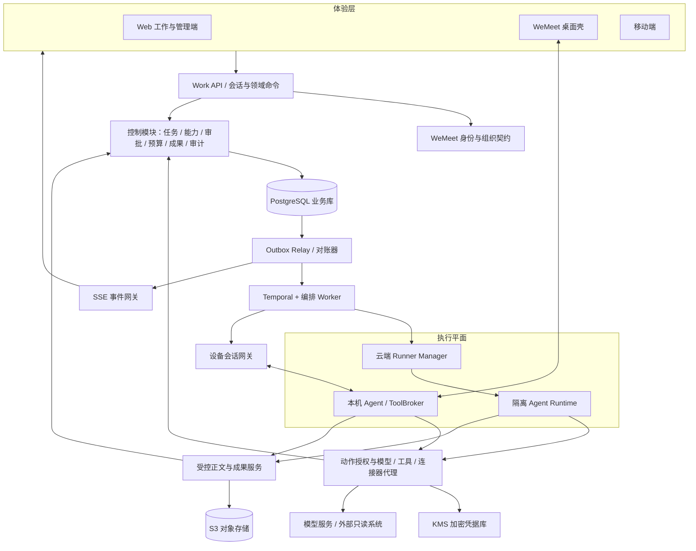
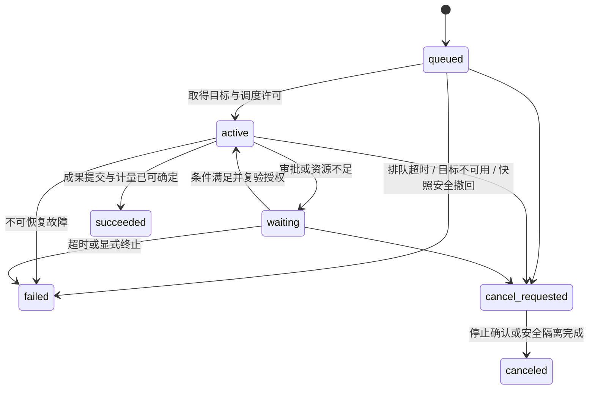
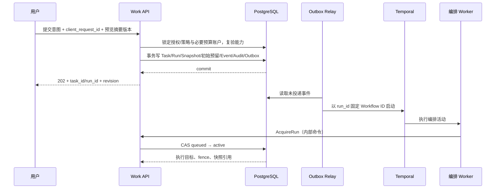

# WeMeet 工作系统架构设计

> 版本：v2.5（clean-slate 目标架构；归档H01–H12/S1–S6脚本副本）
>
> 日期：2026-10-25
>
> 状态：架构提案，待评审与技术验证；不是当前系统实现说明，也不是上线证明。
>
> 设计前提：**不考虑当前实现，不继承现有服务、数据库、接口、执行器、目录结构及部署方式。** 技术选择以产品目标、安全、可靠性和长期演进成本为依据。
>
> 需求基线：[产品设计](work-product-design-2026-10-25.md)、[R0 UX](work-ux-design-r0-2026-10-25.md)、[扩展 UX](work-ux-design-extensions-2026-10-25.md)。原型用于说明交互，不作为权限、计费或隔离机制的权威定义。
>
> 交付范围：目标架构、领域与部署边界、技术选型、数据模型、关键协议、执行流程、安全不变量、故障恢复、容量目标与阶段路线。详细 DDL/OpenAPI、供应商采购、部署配置和迁移方案另行交付。

## 目录

- [0. 架构结论](#0-架构结论)
- [1. 需求与边界](#1-需求与边界)
- [2. 总体架构](#2-总体架构)
- [3. 技术选型与取舍](#3-技术选型与取舍)
- [4. 领域边界与所有权](#4-领域边界与所有权)
- [5. 数据模型与一致性](#5-数据模型与一致性)
- [6. 任务运行与动作状态机](#6-任务运行与动作状态机)
- [7. 持久编排与故障恢复](#7-持久编排与故障恢复)
- [8. 能力解析与上下文装配](#8-能力解析与上下文装配)
- [9. 云端执行](#9-云端执行)
- [10. 本机与远程设备执行](#10-本机与远程设备执行)
- [11. 授权审批与撤销](#11-授权审批与撤销)
- [12. 模型与连接器网关](#12-模型与连接器网关)
- [13. 成果版本与项目上下文](#13-成果版本与项目上下文)
- [14. 预算计量与调度](#14-预算计量与调度)
- [15. API与事件契约](#15-api与事件契约)
- [16. 客户端与管理端](#16-客户端与管理端)
- [17. 安全隐私与数据生命周期](#17-安全隐私与数据生命周期)
- [18. 部署拓扑与灾难恢复](#18-部署拓扑与灾难恢复)
- [19. 可观测性与质量目标](#19-可观测性与质量目标)
- [20. 阶段落地与服务拆分](#20-阶段落地与服务拆分)
- [21. 架构验收与技术验证](#21-架构验收与技术验证)
- [22. 需求追踪与交付闸门](#22-需求追踪与交付闸门)

## 0. 架构结论

**Work 是一个以任务与成果为中心、由持久工作流驱动、受策略约束的企业 Agent 系统；不是聊天服务附带工具调用。**

采用五个相互配合的部分：

1. **体验层**：工作首页、任务工作区、成果工作区、扩展能力、管理后台；同一 WeMeet 身份与组织。
2. **控制平面**：任务、能力快照、授权审批、预算、成果元数据和审计；模块化单体起步，统一事务边界。
3. **持久编排层**：保存执行进度、等待审批/设备、定时重试与恢复；不替代业务数据库。
4. **执行平面**：云端隔离运行、本机受控运行、远程本人设备派发；执行器无权决定租户权限和预算。
5. **受控数据出口**：模型网关、连接器代理、成果代理；模型与不可信代码不能直接获得凭据或任意网络访问。

### 0.1 核心决策

| 编号 | 选择 | 原因与代价 |
|---|---|---|
| A01 | 模块化控制平面，不按每张表拆微服务 | 提交、授权、预算需要强一致；允许按负载/信任域拆进程 |
| A02 | PostgreSQL 是业务事实源 | 状态、审批、预算和成果采纳必须可事务约束 |
| A03 | Temporal 管持久编排，业务变更通过领域命令完成 | 长任务、人工等待、设备断线需要持久恢复；接受额外基础设施成本 |
| A04 | Task、Run、Operation、Artifact 分离 | 用户验收、执行尝试、外部副作用与交付物是不同生命周期 |
| A05 | 所有模型/工具动作经受控代理 | Runtime 只提出动作；策略、审批、预算和审计在模型之外强制执行 |
| A06 | 不承诺外部副作用 exactly-once | 内部去重可以做到；外部未知结果必须核对，不能盲重试 |
| A07 | 能力版本冻结，授权实时收窄 | 可复现不等于永久许可；旧快照不能绕过撤权 |
| A08 | 本机目录授权不等于 OS 沙箱 | 默认只提供类型化文件工具；任意 Shell/脚本必须另有隔离条件 |
| A09 | 成果版本不可覆盖，正文与元数据分开 | 支持版本采纳、来源、删除与不同驻留位置 |
| A10 | 单写主 + 多可用区；区域写恢复要求同步灾备安全账本 | 不做多区域双写；安全记录不丢失优先于网络分区时可用性，缺乏同步保护时禁止自动跨域恢复写入 |
| A11 | R1 单 Run 提示组合，R3 才启用确定性 DAG | 工作流引擎的存在不代表提前暴露产品链式能力 |
| A12 | 按安全边界拆部署，按真实瓶颈拆服务 | R0 无需 Kafka、向量库、独立搜索集群和多 Agent 协作框架 |
| A13 | 端云共用 Pi agent-core + Work 适配层，候选准入通过后落地 | 复用开源模型循环，不接管租户/审批/预算/恢复；主Runtime改为TypeScript/Node，见§3.2–§3.9 |

### 0.2 选择标准

“最优”不是技术组件最多，而是在以下目标之间取得平衡：

- 权限不可被模型、客户端或陈旧快照扩大。
- 刷新、断线、进程退出不丢业务事实，不重复收费或重复产生副作用。
- 云端与本机共享契约，但不抹平数据驻留和 OS 能力差异。
- R0 能以少量部署单元交付，R3/R4 不需推翻 Task/Run/Artifact 模型。
- 更换模型、连接器或编排 SDK 时，业务语义不改变。

## 1. 需求与边界

### 1.1 必须保留的产品约束

| 需求 | 架构约束 |
|---|---|
| WeMeet 单一产品品牌与账号 | 共享逻辑身份和组织契约，不创建第二套用户体系；不要求复用当前代码 |
| 工作/任务用词分层 | Work 表示产品域，Task 表示可执行、可验收的请求；Run 表示一次执行 |
| `＋` 中选择套件/技能，连接器独立入口 | 前端只表达选择意图；所有选择由服务端解析和验证 |
| 一个主套件，最多 3 个补充技能 | 单一解析器去重、检查冲突/环境/预算；套件内技能不占补充上限 |
| 所有任务均可验收 | Run 成功仅进入待验收；Task 完成由验收命令决定 |
| 原始本机文件默认不上传 | 控制面只存目录引用；正文出设备和成果同步分别授权 |
| 默认权限/自动审批/计划批准后 | 模式决定审批触发，不授予新的资源权限；无完全访问 |
| R0a 云端、R0b 本机、R2b 远程 | 同一协议，多种执行目标；断线不自动切云端/另一设备 |
| R1 提示组合、R3 项目链式 | R1 不把技能映射为工作流步骤；R3 使用版本化执行图 |
| 组织治理 | 席位、能力开通、审批策略、预算、审计独立控制 |

### 1.2 不继承与不在本次范围

- 不假设现有后端语言、框架、模型网关、设备协调器或数据库是合适的。
- 不沿用已有 API 路径、表名、历史 DTO 或旧执行器协议；本文路径均为建议新契约。
- 不设计当前系统的迁移、双跑与发布补丁；另立迁移设计，不能让过渡成本主导目标架构。
- 不重新讨论已确定的品牌、场景与阶段；不增加开放市场、电脑控制或无人值守功能。
- 不把原型中的“保存即启用”“提前开启分享”“关闭审计”等模拟控件解释为真实权限规则。

### 1.3 对产品文档歧义的架构裁定

以下作为本架构的评审基线；涉及体验调整的内容应在实现前回写产品/UX，不在此宣称已经获得用户测试验证。

| 问题 | 本架构采用的规则 |
|---|---|
| 本机文件夹在部分表格写 R0a | 以路线图为准：R0a 云端；本机授权与执行 R0b |
| 草稿“自动保存”是否跨设备 | R0 草稿仅当前客户端、按账号/组织隔离；同步草稿是后续独立能力 |
| “编辑即版本”与“手动保存” | 输入形成可变编辑草稿；显式保存提交一个不可变版本；采纳绑定具体版本 |
| 撤销席位只阻止新任务还是停止执行 | 安全撤权同时阻止新动作并取消相关运行；不能继续以旧席位执行 |
| 预算耗尽在途任务是否继续 | 已预留额度的在途调用可结算；不允许发起无额度的新调用；安全停用不受预算预留豁免 |
| 本机离线时“立即撤销” | 服务端立即拒绝新许可；在线设备下推停止；离线设备受短租约约束，不能保证已发出的外部动作被撤回 |
| 手机云端提交/授权/编辑范围 | 系统契约支持云端提交，R0 手机仅查看/审批，创建能力按产品放行；R0 不做手机本机执行、成果编辑和连接器新授权 |
| 计划批准模式 | 只有目标执行器和已开通阶段具备计划能力时才出现；R0a 不展示 |
| 本机“不上传”与远程模型 | 文件不整体上传不等于内容不外发；摘录/提示提交远程模型必须另行披露并获准 |
| 留存“默认 365 天” | 审计 365 天作为设计基线；任务/正文留存是待商用定案策略，不能当作已确认合同 |

## 2. 总体架构

### 2.1 逻辑拓扑



图中的模块是逻辑边界，不等于一图标一个微服务。客户端不直接访问 Temporal、业务库、凭据库或执行节点。

### 2.2 平面职责

| 平面 | 决定什么 | 不决定什么 |
|---|---|---|
| 控制平面 | 谁能做、运行哪一版本、预算、审批、成果是否发布 | 模型如何生成文本 |
| 编排层 | 何时调度、何时等待、何时恢复、清理与超时 | 绕过领域状态、授予资源访问 |
| 执行平面 | 在许可范围内计算、读取、生成候选成果 | 租户归属、角色、自动扩权、擅自切换模型/设备 |
| 数据出口 | 实际访问来源、注入凭据、记录计量 | 自行扩大 scope 或跳过审批 |
| 体验层 | 展示、收集意图、显式确认 | 构造最终能力快照、设置可信角色或最终账单 |

### 2.3 初期部署单元

- `work-api`：领域模块 + 查询接口；无模型 SDK 和执行子进程。
- `work-worker`：Outbox、Temporal 编排、对账、事件投递；与 API 共享领域库和业务数据库访问规则。
- `work-egress`：受控模型/工具出口，独立网络与凭据权限；通过内部领域接口登记动作，不直接任意改业务表。
- `work-runner`：隔离执行环境的生命周期管理；Runtime 为每个 Run/恢复点建立的独立进程/沙箱。
- R0b 增加 `work-device-gateway` 与设备 Agent；R2a 增加隔离的连接器适配器进程；R4a 增加内容转换/扫描工作池。
- SSE 可先随 API 部署，长连接数量达到容量阈值再独立；业务事件仍由同一事实源恢复。

## 3. 技术选型与取舍

| 层 | 推荐 | 选择依据与限制 |
|---|---|---|
| Web UI | TypeScript + React；TanStack Query 管服务端状态 | 类型契约、复杂工作区和组件生态；不将服务端业务状态复制到多个 store |
| 桌面壳 | Electron + 同一 Web UI | 跨端交互与 Web 共享；关闭 Node integration，开启 context isolation/sandbox |
| 控制面/编排/网关 | Go；HTTP/JSON、内部 gRPC | 长连接、资源占用、并发与静态契约适合控制面；不用它承担模型生态适配 |
| Agent Runtime | TypeScript/Node + Pi agent-core + Work Adapter，端云同核 | 可替换streamFn与全部工具；不引入完整coding-agent；会话恢复与治理由Work负责；§3.8准入门槛H01–H10/H12已执行，H11未触发 |
| 本机 Agent / ToolBroker | Rust 守护进程 + 独立受限Node sidecar | OS 文件句柄、进程与协议安全；Rust/Node均不是沙箱；不在Electron渲染层运行Agent |
| 数据处理/转换工具 | Python等审核后的隔离工具进程 | 仅按工具需要引入，不作为默认端云Agent循环宿主 |
| 持久编排 | Temporal，Go SDK | 审批等待、定时器、重放恢复、Worker 升级；承受独立运维与历史存储成本 |
| 业务数据库 | PostgreSQL | 事务、唯一约束、RLS、JSONB、全文检索；不以 NoSQL 分摊强一致账本 |
| 正文/成果 | S3 兼容对象存储 + 元数据代理 | 版本化、分层存储、驻留；本机未同步正文保留在设备 |
| 设备本地状态 | SQLite + OS 密钥库 | 动作日志/重连游标持久化；目录许可重启失效 |
| 缓存/通知唤醒 | Redis，可选 | 限流、非权威缓存、事件唤醒；丢失不影响许可/预算正确性 |
| 凭据 | KMS 信封加密 + 独立凭据访问域 | 云端托管 KMS，私有化使用等效密钥服务；仅复杂动态凭据场景再引入 Vault |
| 搜索 | PostgreSQL 元数据索引/全文检索 | R0 不检索全文成果、不需要独立 ES；R3 检索质量确有需求再评估 pgvector |
| 运维 | OCI 镜像 + Kubernetes + OpenTelemetry | 隔离执行池、配额、统一观测；不依赖特定云的私有接口 |

### 3.1 不采用的默认方案

- **全部 Serverless HTTP**：短请求适合入口，不适合跨小时审批、设备连接和有状态恢复。
- **单一后台队列完成一切**：投递队列不能替代运行状态、审批定时器和外部副作用对账。
- **纯 Event Sourcing / 全系统 CQRS**：R0 没有必要重建所有状态；采用关系事实表 + 追加事件 + 可重建查询投影。
- **Kafka 起步**：业务吞吐不要求；Outbox + Temporal + 可恢复事件流已满足初期需求。
- **通用 Agent 图框架作为业务引擎**：模型 SDK 的循环与企业任务生命周期分开，避免审批/预算语义被 SDK 隐藏。
- **所有代码用同一种语言**：Go控制面、Rust本机安全边界、TypeScript体验/Harness职责不同；Python只用于按需隔离工具。UI与Harness虽然同为TS，必须运行在不同信任域，不能共享宿主文件或密钥权限。
- **直接依赖供应商 Assistant 线程作为 Task**：无法统一本机执行、审批、成果采纳、驻留和审计。

Temporal 即使托管也必须满足元数据驻留；私有化必须随交付包含对应编排服务。不能对轻量版偷偷改成“内存队列”，形成另一套恢复语义。

### 3.2 执行器与 Harness 的选型结论

**引入开源 Harness，但只引入内核库；端云默认使用同一个内核，不集成整套编码 CLI 作为 Work 产品执行器。**

| 位置 | 选型 | 自建/保留的部分 |
|---|---|---|
| 端侧 | Rust Device Agent/ToolBroker + 独立Node进程中的 Pi agent-core + Work Adapter | OS授权/隔离、设备身份、租约、journal、审批接口、模型出口、成果落盘 |
| 云侧 | Go Runner Manager + 隔离OCI中的同一Node/Pi Runtime | PostgreSQL账本、Temporal业务编排、工具/模型网关、内容存储、计量 |
| 条件备选（不进入默认实现） | OpenAI Agents SDK TypeScript，使用自定义Model/工具 | 只有触发§3.8定义的“首选失败”条件时才启动评估；不作为依赖、模块或并行运行时，不预先安装或适配 |
| Python方案 | Pydantic AI core或OpenAI Agents SDK Python适合Python优先系统，但不作为本次第二套主Runtime | Python保留给数据解析/计算/转换工具，不因工具生态要求把云侧Harness另起一套 |

v1.1中的Python主Runtime是未完成Harness调研时的架构候选；本次根据端云共享、Windows分发和可控模型/工具入口，主动调整为TS/Node，**不是因当前仓库已经使用某个执行器而复用**。

以下结论属于技术选型推荐，不是已安装、运行验证或生产批准；§3.8的硬性实验未通过不能上线。

Harness在此指单次运行中的模型循环、工具调用协议、消息状态和上下文处理，不等于以下任何一项：

- Temporal业务工作流、Task状态、用户验收、审批账本。
- OS沙箱、目录权限、连接器凭据服务。
- CLI/TUI、代码仓库自动发现、自动安装扩展、Git工作流。
- 多租户产品后台、商业预算和灾备事实源。

### 3.3 选型门槛

按硬门槛筛选，不用星标数量、编码排行榜或没有实测依据的百分制代替判断。

| 门槛 | 对Work的意义 |
|---|---|
| 底层可嵌入、工具集合可全部替换 | 不能仅自动批准/拒绝内建Shell；必须保证所有实际工具经Broker |
| 模型传输可接管 | 每次收费调用、压缩/摘要调用均经Work Gateway与Operation账本 |
| Windows原生分发可行 | 不要求用户安装WSL、开发环境或登录厂商个人账号；是否达成须打包验证 |
| 端云状态与协议可共用 | 本机内容在设备装配，云端内容在云端；不能用“云侧推理+本机工具”替代全部本机模式 |
| 可安全暂停、释放进程、恢复 | Session/RunState/JSONL只是恢复材料，不能以此声称外部动作exactly-once |
| 开源许可与运行时再分发清楚 | SDK包装层许可证不等于附带CLI、模型服务和依赖均可无条件分发 |
| 默认行为可封闭 | 不自动发现用户目录、技能、记忆、MCP；不带隐藏联网/追踪/付费重试 |
| 升级可控 | 固定版本/digest、合同测试、可替换适配层，不维护深度产品fork |

### 3.4 候选对比

证据来自本轮官方文档及源码读取，revision见§3.9；“可接入”不等于已验证Work兼容。代码快照中的版本号不是经过本项目验证的稳定性承诺。

| 候选 | 可嵌入层与许可 | 已核实的能力与默认行为 | 本次判断 |
|---|---|---|---|
| **Pi agent-core** | 通用TS Agent/loop库；MIT；所查包1.4.0、Node≥22.19 | 调用方提供streamFn、tools；before/after工具钩子、上下文变换、轮次终止；消息状态主要在内存 | **端云首选**；控制面最薄，但持久状态/暂停适配需Work自行完成 |
| Pi coding-agent SDK / RPC | SDK是进程内编码会话，RPC是完整进程JSONL控制；MIT | SDK可禁默认工具/定制资源加载；带会话、压缩、扩展等；默认Bash在Windows依赖Git Bash；coding层有自动重试 | 不作默认内核；即使关闭Shell也要处理隐式配置、摘要、预热等额外调用；RPC不是天然的Broker接口 |
| OpenAI Agents SDK TS / Python | 进程内库；MIT；TS所查0.21.0/Node≥22，Python0.24.0/Python≥3.10 | 自定义Model/ModelProvider、工具默认空、Session/可序列化RunState、人机审批；默认追踪有第三方导出路径，底层客户端重试另查 | **条件备选（仅TS）**；恢复抽象更齐全，但须关闭外部追踪、全部重试并接管模型传输；不进入默认实现，触发条件见§3.8 |
| Pydantic AI core / AI Harness | Python；MIT；所查Python≥3.11 | core提供类型化Agent；Harness按capabilities组合文件/规划/记忆/子Agent等，workspace须显式提供；Temporal集成会把模型/工具置于activities | 仅在将来确需Python优先Runtime时考虑；本次不作第二套主Runtime。不自动套用完整Coder/Researcher，不把原生持久集成直接接入Work，以免第二套编排及正文进入历史 |
| LangChain Deep Agents | Python/TS独立实现；MIT；所查Python0.7.32/Python≥3.11 | 基于LangGraph，默认装配文件/execute/子Agent工具；tools=[]不能移除全部内建能力；默认虚拟文件状态不等于宿主磁盘 | 长研究任务备选，不选R0/R1核心；剥离默认能力与LangGraph/Temporal重叠成本较高 |
| OpenHands Software Agent SDK | 可独立嵌入的Python SDK；MIT；所查1.58.2/Python≥3.12 | 自定义/客户端工具、持久Conversation；默认Think/Finish及条件性工具，存在SOUL.md读取和LLM重试默认行为 | 更偏软件工程工作区，不以完整平台进入办公MVP；SDK许可与平台其他部分分开审查 |
| Codex SDK | TS启动CLI/JSONL，Python启动app-server/RPC；Codex仓库Apache-2.0 | 原生Windows运行时路径、持久thread、动态/MCP工具；所查自定义provider wire API为Responses，HTTP/stream有默认重试 | 不作多模型办公内核；可日后作为明确隔离的编码专用执行目标。不能把任意Chat Completions兼容接口直接当成Responses兼容 |
| Claude Agent SDK | Python包装层LICENSE为MIT，README又声明SDK使用受商业条款约束；TS许可证直接指商业条款；依赖Claude Code运行时 | Python包捆绑CLI，支持工具/权限hooks与会话恢复；allowed_tools是自动批准列表而非移除未列工具；官方provider生态以Claude为中心 | 不作为可自主替换模型的开源底座；可用于单独评审的Claude专属部署，不能笼统标成“整套MIT开源Harness” |

重要区别：Pi没有整个框架级持久保证，并不代表不能安全恢复；OpenAI/Pydantic/OpenHands有持久接口，也不代表可在失联后自动重放收费调用。选型必须看**可控制边界**，不是看README是否出现“durable”。

### 3.5 为什么端云共用 Pi 内核

1. Work R0/R1是办公目标与方法组合，模型循环不需要自带Git、终端UI、浏览器或多Agent子系统；Pi agent-core开放的streamFn与工具数组恰好匹配Work代理边界。
2. 与客户端共用TS类型但不共进程，可少维护一套消息/工具/状态适配；端侧Node不必继承完整Python模型SDK依赖。
3. 云端执行并没有要求Harness必须Python；真正的数据计算仍可调用隔离Python工具，且其权限独立。
4. 端云使用同一`work-runtime`版本、模型/工具契约和测试集，平台差异只在宿主适配器、存储和Broker传输。
5. 相比完整coding-agent，需要自建会话/压缩接入，但这些正是本架构要求自行管控的授权与恢复边界；不为省会话代码而接受隐含工具权限。

代价：不是“装一个npm包就得到企业执行器”。Work仍需Driver、GatewayStreamAdapter、BrokerToolAdapter、状态保存、预算和安全配置；Pi API演进与暂停语义是关键风险。首选失败的判定条件统一见§3.8；只有命中时OpenAI Agents SDK TS才进入一次条件性备选评估，不在代码库、依赖树或部署中预先引入第二套Harness。

```text
端侧
Rust Supervisor / 本地状态与许可
  └─ 独立受限Node进程
       └─ Work Driver + Pi Agent + Work adapters
            ├─ model request → Rust Broker → Work模型网关 / 已批准私有模型
            └─ tool request  → Rust Broker → 目录/计算/成果工具

云侧
Go / Temporal：派发、等待、取消、核对
  └─ Runner隔离OCI
       └─ 同一 Work Driver + Pi Agent + Work adapters
            ├─ model request → Work模型网关
            └─ tool request  → Work工具/连接器/成果代理
```

端侧不是仅为云端Harness提供远程Shell；具备本地装配和本地检查点的完整受控循环。R2b手机只是控制端，Harness仍在选中的目标设备运行。

### 3.6 Pi 接入约束与恢复契约

**只依赖agent-core及其必要pi-ai消息/类型依赖，不默认依赖coding-agent、TUI、pi-mcp、codemode或实验性pi-durable。** pi-ai的provider适配能力可以评估，但Runtime不得直接持供应商Key；标准模型路径由自定义streamFn接Work Gateway，不同时维护Go网关和Node中两套自动路由策略。

| Work适配部分 | 责任 |
|---|---|
| Driver | 绑定org/task/run/fence/runtime_version；启动、checkpoint、挂起与恢复；限轮次/时间 |
| GatewayStreamAdapter | 为每个model request固定Operation key、获取许可、处理流/最终回执；unknown停止，不在streamFn内重发 |
| BrokerToolAdapter | 工具schema来自Work审核目录；执行前登记Operation；实际文件/网络由Broker执行 |
| CanonicalStateStore | 自有schema的消息/来源引用、已完成回执、待处理工具集合、提交点；端侧加密本地、云侧受控Content Store |
| PublicEventAdapter | 将Pi事件转换成Work事件；只发布公开回答/工具摘要，不暴露原始reasoning、路径或SDK内部状态 |

所查Pi实现需要特别处理：

- `Agent.subscribe()`监听器会被await，`message_end`在工具preflight前形成处理屏障；裸`agentLoop()`/`agentLoopContinue()`事件流只是观察，不等待异步消费者持久化。**首选Agent类，不拿裸事件监听当防重放屏障。**
- `beforeToolCall`可以阻断，但抛出工具错误通常会变成发回模型的error；`terminate:true`仅当整批工具结果都标记终止时才跳过下一轮。不能把“待审批”伪装为普通工具错误并期待模型自己等。
- 全局工具执行显式设为`sequential`；初期不并发执行同一模型响应里的多项工具。即便顺序执行，审批/unknown发生后仍须Driver阻止整批剩余动作和下一次模型请求，streamFn与Broker分别守卫。H07确认：未设`sequential`时Pi会先并行预检整批工具，撤权/预算/租约钩子会在任何执行前全部通过；生产必须顺序执行并在提交前再次复验。
- `continue()`不等于任意断点恢复，尤其不能直接把以assistant工具请求结尾的半轮交给它重跑；先从Work账本核对并补齐该轮真实工具回执，再构造合法上下文继续。
- `finishTurn`/prepareRequest可作为受控轮次边界；驱动器仍需在模型完整响应、工具派发前、工具回执后落自己的checkpoint，不能只在turn_end保存。
- 所查适配器对未知provider默认按OpenAI语义发送`store`、developer角色与`max_completion_tokens`；接入DashScope等兼容服务必须显式固定compat profile（`max_tokens`字段、关闭`store`/developer角色/`reasoning_effort`），不能依赖自动探测。本次H02已按此配置。

建议的Adapter合同（Work设计，不是Pi现有API承诺）：

```text
advance(checkpoint_ref, receipts, execution_envelope)
  → MODEL_REQUEST | TOOL_REQUEST | WAITING_APPROVAL
    | WAITING_RECONCILE | CHECKPOINTED | FINISHED | FAILED
```

审批/unknown流程：先持久化assistant请求与pending_tool_calls，再登记Work审批/核对状态，停止剩余派发与后续模型请求；保存非终态checkpoint后释放Runtime。恢复时先核对已派发工具：完成则复用真实回执，未派发则获取新许可，unknown仍等待。SDK为中止循环产生的“aborted/blocked”占位消息不能持久化为已执行回执，也不能触发新模型调用。**此安全分段方式必须通过H03/H04实验；不能仅以hook存在证明已经做到。**

Operation key由Work生成，例如`(run_id, turn_seq, model_request_seq)`和`(run_id, turn_seq, tool_call_index)`，同时绑定参数hash；供应商tool_call_id仅是关联字段，不作为唯一长期幂等身份。压缩、摘要、复核同样使用自己的model_request序号和预算，不能出现无账目的后台调用。

会话与上下文策略：

- Work保存版本化canonical state，不直接把整个SDK对象图作为跨版本协议，也不把JSONL session当业务账本。
- 保留必要的工具请求/结果及上下文引用；compaction在显式提交点进行，产生新上下文版本且保留审计链，不能删除安全约束或凭据范围。
- R0先按输入/token上限控制上下文，超过时明确拒绝/请求精简；自动摘要成熟后再启用，且每次有Operation/费用记录。
- 推理内容和公开输出分流；若某模型恢复必须依赖不符合Work留存政策的reasoning块，应禁用该模式或该模型，不偷偷持久化原始思维链。
- 不加载工作目录或用户home中的AGENTS.md、技能、配置、MCP服务器或个人登录凭据；任务只消费服务端解析的能力快照。

### 3.7 分发、许可证和版本治理

- 端侧将固定Node LTS、Work Runtime bundle、必要依赖随签名包分发；不要求用户全局npm安装，不在启动时下载npm包，不依赖个人订阅登录。
- H01实测：Node 24 + Pi/依赖bundle约161MB；用户级安装、快捷方式、卸载与内嵌哈希校验可行；自签名只证明签名与篡改检测机制，正式发布仍需可信CA/EV签名与时间戳。
- Pi包要求Node≥22.19仅是上游声明；Windows x64基本启动已由H01验证，ARM64、隔离profile兼容性与生产安装器仍需验证，不能因为Electron自带Node就把Harness塞进主进程。
- 云侧使用同一bundle与锁定依赖的OCI镜像，平台native依赖分别构建；不宣传Windows包和Linux镜像是同一二进制。
- 保留MIT/Apache等许可证和NOTICE，审查pi-ai及其他传递依赖、Node与打包附件；开源许可证不授予模型服务、商标或任意再训练权利。
- 默认不fork；固定semver + lockfile integrity +源码revision +镜像digest；所有升级先跑强制准入H01–H10/H12。H11只在§3.8“首选失败”条件命中后触发，不纳入日常升级矩阵。长运行绑定旧runtime_version，恢复使用对应兼容版本，不自动迁移半轮状态。
- 第三方遥测一律关闭或替换为受控出口。OpenAI Agents SDK作为备选时明确设置`OPENAI_AGENTS_DISABLE_TRACING=1`并移除默认exporter；不能把自建processor“追加”后仍保留外发。
- Coding-agent会话重试、底层provider HTTP重试、流重连和工作流重试是不同层；逐层审核。禁用一次外层重试不代表没有重复付费调用。
- Pi durable虽为开源持久任务方向，但所查README标注实验性；本次不让它与Temporal/Work账本同时持有业务恢复权。

### 3.8 Harness 准入实验

本轮完成源码/官方文档研究，并在仓库外实验目录安装了Pi 1.4.0核对导出API；H03–H05/H12以faux/mock模型执行，H02以qwen3.8-flash、deepseek-chat、doubao-seed-2-1-lite各执行3次真实流式请求，H01以161MB用户级安装包在模拟干净环境执行安装/签名/启动/卸载，H06在非管理员Windows上以AppContainer+Node permission model执行隔离对照，H07–H09以mock控制账本/端云适配/上下文场景执行，H10以真实Pi 1.3.0与1.4.0做跨版本恢复，H11因H03–H05通过而未触发；S1–S6已执行首轮（见§21.2）。故仍不宣称包体、延迟、内存、多供应商兼容或生产崩溃恢复已经达标。实验运行产物不进入仓库；可复现脚本副本见[assets/harness-lab](assets/harness-lab/README.md)，不预装任何备选Harness。

| ID | 实验 | 通过条件 |
|---|---|---|
| H01 | Windows干净环境安装/卸载、签名与原生Node sidecar启动 | 无WSL/Git Bash/用户Python/npm依赖；设备/权限profile可用，失败无降级宿主执行 |
| H02 | Qwen、一个已批准OpenAI-compatible模型与目标本地模型的工具/流式测试 | 真实协议矩阵通过；Chat Completions/Responses差异明确；所有请求经网关 |
| H03 | 工具审批暂停、关闭进程、重新启动恢复；同轮多个工具 | 无等待进程常驻要求；未批准工具不执行；余下批次与下一轮均停止；已执行工具不重跑 |
| H04 | 模型已收费断流、工具完成回执丢失、checkpoint前后崩溃 | unknown等待核对；原Operation保留，无自动付费重发或合成成功回执 |
| H05 | 临时HOME/CWD放配置、技能、MCP、个人凭据；网络监测 | 不加载非快照资源；无供应商直连、追踪外发或后台摘要/预热 |
| H06 | 宿主目录越界、reparse point、Node子进程、任意HTTP尝试 | OS profile与Broker阻止；TS钩子绕过不意味着得到宿主权限 |
| H07 | 撤权、租约到期、预算耗尽与模型/工具批次竞争 | 守住§11–§14；token流停止不当作外部副作用已取消 |
| H08 | 端云同一用例与同一快照 | 工具/权限/事件语义一致；本机正文/checkpoint不因共享Harness外传 |
| H09 | 上下文溢出、压缩、推理模型输出与恶意来源 | 超限/摘要显式、摘要有费用记录；不泄露reasoning、不扩大工具 |
| H10 | Pi小版本升级、恢复旧checkpoint、回退镜像 | 版本兼容可判定；升级不自动重放半轮或更改已批准动作 |
| H11（条件备选） | 仅在下方“首选失败”条件命中时，与OpenAI Agents SDK TS跑相同golden tasks | 比较质量、费用、启动/内存/包体、适配代码量与维护成本；**不参与默认准入，不要求预先安装或适配** |
| H12 | 全部网络请求与工具回执对账 | 每个收费调用恰有Work Operation关联；允许at-least-once消息，不产生第二次未知副作用 |

执行顺序与前置条件：

- H03/H04/H05/H12可用faux/mock模型提供者先行，不需要付费Key；H02需要已批准的模型Key与实验预算，由产品/商务先定案再执行。
- H02–H05/H12是R0a云端Runtime的go/no-go；H01/H06/H08是R0b本机Runtime的go/no-go；H07/H09/H10已执行（见下表）。
- 失败时不默认增加第二套云端Python Harness；开发任务与生产接入在验证后单独安排。

首轮执行记录（2026-10-25；Windows x64 / Node 24.15.0 / Pi agent-core 1.4.0 / faux脚本模型；实验目录`temp/harness-lab/experiments`，不进入仓库）：

| 实验 | 结果 | 关键证据 |
|---|---|---|
| H01 | 部分通过（干净环境模拟/自签名） | 161MB用户级安装包（node.exe+Pi依赖bundle）：安装写文件、开始菜单快捷方式与HKCU卸载项；PATH仅System32、临时HOME下启动已安装sidecar，node.exe为包内二进制，Pi文本+工具用例通过，无npm/python/git调用、0网络、0授权外读取；篡改node.exe或缺文件时哈希校验exit 3，PATH含系统Node也不降级；自签名+中段篡改→`HashMismatch`；卸载删除文件/快捷方式/注册表。未验证可信CA/时间戳、MSI/EXE安装器与回滚、干净VM、已安装sidecar的AppContainer profile。 |
| H02 | 部分通过（三家云端provider/两种协议） | Qwen与DeepSeek走Chat Completions，豆包走Responses；各3次流式请求均200并带usage（Qwen 1126、DeepSeek 743、豆包1383 tokens）：文本流与工具调用（get_time→2轮）全部通过；Qwen `reasoning_content`与豆包reasoning summary均与公共文本分离；Runtime不持Key，运行期网络仅连127.0.0.1。无本地模型（确认无本地部署）；未测云端网关鉴权/配额/限流。 |
| H03 | 通过（mock） | 3工具同轮：A执行1次，B进入待审批，其后的C被阻止；进程正常退出，无常驻等待；重启批准后B、C各执行1次，A不重跑，仅发起1次续接模型请求。反证：仅靠工具结果的`terminate`时，B被阻止后Pi仍发起下一轮请求，必须由Driver在轮次边界停止。 |
| H04 | 通过（mock日志） | 已受理模型断流→Operation unknown、预留保留、无自动重试；工具完成但回执丢失→从journal恢复回执且不重跑；派发前崩溃→安全派发1次；模型消息未落检查点→Operation unknown且不重发；journal仅`started`→unknown且不合成成功回执。 |
| H05 | 通过（mock） | 临时HOME/CWD放入`.pi`配置、技能、`.mcp.json`、`.npmrc`、AWS/SSH凭据、`.env`，且HOME/USERPROFILE确已生效：0次读取、0次网络连接、0个子进程，转写与输出不含注入值；两轮对话恰有2次模型请求，无后台摘要/预热。agent-core静态扫描无配置/MCP/遥测代码。 |
| H06 | 部分通过（AppContainer+permission） | 非管理员Windows创建AppContainer profile并运行Node：允许目录读写成功；grant外secret、用户目录、junction目标均`EPERM`/`ERR_ACCESS_DENIED`；默认无网络能力，loopback `ETIMEDOUT`、外网`EACCES`；叠加`--permission`后子进程spawn被`ERR_ACCESS_DENIED`拒绝。对照组：普通进程可读secret/junction/user、可spawn cmd、可连loopback；仅permission model时**junction读取成功**且loopback可连。 |
| H07 | 通过（mock控制账本） | 5场景：批次内撤权后仅已提交工具生效、后续工具阻止且无下一轮模型请求；提交前撤权无副作用；预算耗尽/租约过期阻止后续工具；流式中止保持模型Operation unknown、不重试、不把token停止当作副作用已取消；发现未设`sequential`时Pi会先并行预检全部工具，生产必须顺序+提交前复验。 |
| H08 | 通过（mock端云适配） | 同一用例/快照在local与cloud的规范化事件序列、终态和工具副作用一致；本机文件secret与checkpoint未出现在模型上下文或云端状态，仅获准摘录跨端；审批拒绝在两端同态。 |
| H09 | 通过（mock上下文/恶意来源） | 超限显式摘要：独立summary Operation与cost=5；关闭摘要时返回`context_overflow`且0次provider调用；公共文本不含reasoning；未注册工具被拒绝、工具集不变、无副作用。 |
| H10 | 通过（真实1.3.0↔1.4.0） | 1.3.0写入pending审批checkpoint，1.4.0升级恢复：A不重跑、B执行1次、审批哈希不变、仅1次续接模型请求；反向回退同样通过；schemaVersion=99或runtimeVersion主版本不匹配时拒绝恢复且无执行。 |
| H11 | 未触发（条件不满足） | H03–H05硬门槛均通过，按§3.8前提不启动OpenAI Agents SDK备选；未安装、未适配、未运行。 |
| H12 | 通过（mock/内存账本） | 正常两轮Run：2次收费模型调用与2个模型Operation、1个工具Operation一一对应，收费=结算=12单位；同一模型/工具回执各投递3次只结算1次；重复outbox、重复命令与双消费者竞争均被抑制，副作用各1次；unknown经查询结算不新增attempt或收费；人为制造的孤儿收费与无收费Operation均被审计发现。 |

**首轮实验阶段状态：已收口（2026-10-25）。** H01、H02、H06为部分通过；H03–H05、H07–H10、H12为通过；H11未触发；S1–S6已执行首轮（部分通过，见§21.2）。收口只表示Harness准入实验批次结束，不表示S7通过或系统开发/生产安全就绪；未覆盖项见下段。

这些结果只覆盖Pi内核与Work Adapter在脚本模型、单机进程边界上的行为，不覆盖S1–S6的生产验证（真实PG/Temporal/账本、并发消费者、真实设备/网关、容量）与H11条件备选（未触发），不能据此宣布Harness准入通过。H07–H10结论限于mock控制账本/端云适配/上下文场景与Work自有checkpoint：H07未接真实DB/租约/预算；H08未接真实设备与云端内容存储；H09使用字符估算与mock摘要，未接真实tokenizer/压缩；H10使用真实Pi 1.3.0/1.4.0但未验证容器镜像回退与半轮迁移。H02覆盖三家云端provider与两种线协议：Chat Completions使用`messages`/通用delta，usage在Qwen为`completion_tokens_details.reasoning_tokens`、在DeepSeek为`prompt_cache_hit_tokens`/`miss`；Responses使用`input`/`response.*`类型化事件，usage为`output_tokens_details.reasoning_tokens`，并返回reasoning summary与`encrypted_content`。网关必须按API类型归一消息、工具调用、reasoning与usage，`encrypted_content`不得进入公共输出或默认留存；DeepSeek对请求模型`deepseek-chat`返回`model=deepseek-flash`，快照只能记录请求别名与响应元数据。本地网关代持Key，但未验证云端网关鉴权、配额、超时与回退。H01的结论限于当前Windows上的模拟干净环境与自签名：安装器为PowerShell用户级而非MSI/EXE，未验证干净VM、每机器安装、回滚、可信CA/EV签名与时间戳；“无WSL/Python/npm依赖”以PATH仅System32、sidecar不调用且spawn被权限模型阻断为准，`wsl.exe`仍存在于System32但未被使用。H06的结论限于单机AppContainer+Node permission model：AppContainer单独可阻止文件/目录/网络，但不阻止子进程创建（未加`--permission`时spawn挂起）；Node permission model单独可被junction绕过且不限制网络；未验证Rust Broker、句柄级TOCTOU、AppLocker/Job组合、生产网络能力与签名安装。豆包示例中的内置`web_search`未启用：provider-side内置工具绕过Work工具目录与审批，R0a不开放。H12的对账结论限于内存账本与模拟投递：未验证PostgreSQL唯一约束/事务、多进程并发消费者、供应商幂等与查询接口、真实网络边界。

**首选失败的判定条件**（本节为唯一定义，其他章节引用）：满足任一即判定Pi首选失败，启动H11备选评估——

1. H03、H04或H05任一硬门槛未通过，且无法通过Work Adapter层修复。
2. 修复需要改写Pi核心调度（agent-loop）或持续维护深度fork。
3. Pi依赖无法封闭（存在不可关闭的联网、自动发现或后台调用）。

### 3.9 官方证据与读取基线

调研记录日期：2026-10-25。以下为本轮读取的源码revision（不是发布日期，也不承诺是已投产版本）。最终依赖锁定需要再次核对发布包与源码一致性。

| 编号 | 官方证据 | 本轮读取基线 / 用途 |
|---|---|---|
| E01 | [Pi agent-core README](https://github.com/earendil-works/pi/blob/38ff99177fba21e9c57a670f4e95adcf407c99c7/packages/agent/README.md)、[package.json](https://github.com/earendil-works/pi/blob/38ff99177fba21e9c57a670f4e95adcf407c99c7/packages/agent/package.json)、[loop源码](https://github.com/earendil-works/pi/blob/38ff99177fba21e9c57a670f4e95adcf407c99c7/packages/agent/src/agent-loop.ts) | `38ff99177fba`；Agent/streamFn/工具钩子、await屏障、终止/继续限制；包1.4.0 |
| E02 | [Pi coding SDK](https://github.com/earendil-works/pi/blob/38ff99177fba21e9c57a670f4e95adcf407c99c7/packages/coding-agent/docs/sdk.md)、[Windows](https://github.com/earendil-works/pi/blob/38ff99177fba21e9c57a670f4e95adcf407c99c7/packages/coding-agent/docs/windows.md)、[设置](https://github.com/earendil-works/pi/blob/38ff99177fba21e9c57a670f4e95adcf407c99c7/packages/coding-agent/docs/settings.md)、[durable](https://github.com/earendil-works/pi/blob/38ff99177fba21e9c57a670f4e95adcf407c99c7/packages/durable/README.md) | 同一revision；SDK与完整CLI/RPC、Git Bash、重试和实验性durability区别 |
| E03 | [OpenAI Agents SDK TS](https://github.com/openai/openai-agents-js/tree/be4f1f9a)、[官方文档](https://openai.github.io/openai-agents-js/)、[Python](https://github.com/openai/openai-agents-python/tree/0dc4cf15) | TS `be4f1f9a`、Python `0dc4cf15`；模型/工具扩展、RunState、许可与追踪 |
| E04 | [Pydantic AI Harness](https://github.com/pydantic/pydantic-ai/blob/4ee11516b5be6b767654304ec8fe346b81369597/src/pydantic_ai_harness/README.md)、[Temporal集成](https://pydantic.dev/docs/ai/capabilities/durable_execution/temporal/) | `4ee11516b5be`；core/Harness区别、显式capabilities与workspace；集成历史承载范围需隔离 |
| E05 | [Deep Agents Python](https://github.com/langchain-ai/deepagents/tree/793ac5af/libs/deepagents)、[TS包](https://github.com/langchain-ai/deepagentsjs/blob/144abf24/libs/deepagents/package.json) | Python `793ac5af`、TS `144abf24`；默认middleware/工具与两种实现的差异 |
| E06 | [OpenHands SDK](https://github.com/OpenHands/software-agent-sdk/tree/d2ee0cde)、[Agent默认行为](https://github.com/OpenHands/software-agent-sdk/blob/d2ee0cde/openhands-sdk/openhands/sdk/agent/base.py) | `d2ee0cde`；SDK而非整个平台、工具/持久会话/默认资源读取 |
| E07 | [Codex TS SDK](https://github.com/openai/codex/blob/970111f6cb62cc02fe36a82ea7d71b37a2889c97/sdk/typescript/README.md)、[Provider配置](https://github.com/openai/codex/blob/970111f6cb62cc02fe36a82ea7d71b37a2889c97/codex-rs/model-provider-info/src/lib.rs) | `970111f6cb62`；CLI承载、wire API与重试边界 |
| E08 | [Claude SDK概览](https://code.claude.com/docs/en/agent-sdk/overview)、[TS许可证](https://github.com/anthropics/claude-agent-sdk-typescript/blob/019515d3268e6f94946eb2d8e9edc1ea79c5a6aa/LICENSE.md)、[Python README](https://github.com/anthropics/claude-agent-sdk-python/blob/0e89b298e771259378a6cd3734e00d323dff5703/README.md)、[Python LICENSE](https://github.com/anthropics/claude-agent-sdk-python/blob/0e89b298e771259378a6cd3734e00d323dff5703/LICENSE) | TS `019515d3268e`、Python `0e89b298e771`；包装层MIT与实际使用/运行时商业条款分别核对 |

本次选型不比较模型本身的文档质量/价格，也不购买模型服务；Qwen/Claude/OpenAI等模型选择另以同一golden tasks评估，Harness选择不替代模型准入。

## 4. 领域边界与所有权

### 4.1 控制面模块

| 模块 | 拥有的事实 | 对外领域能力 |
|---|---|---|
| Access & Governance | Work 开通、席位、策略版本、撤销 epoch | ResolveAccess、GrantSeat、RevokeAccess |
| Task & Run | Task、Run、运行指针、状态转换 | SubmitTask、RetryRun、CancelRun、CompleteTask |
| Capability Registry | 定义、版本、安装、启用、发布指针 | ResolveCapabilities、PublishVersion、RollbackRelease |
| Approval | 申请、决定、动作摘要、到期与消费记录 | RequestApproval、DecideApproval、RevokeApproval |
| Budget & Metering | 额度、预留、调用计量、结算 | Reserve、Settle、Release、Reconcile |
| Artifact & Content | 正文引用、版本、主成果、采纳、来源 | Stage、Finalize、CommitVersion、AdoptVersion |
| Device | 配对、公钥、会话、租约、设备能力 | PairDevice、AcquireLease、ReconcileJournal |
| Connector | 定义、账号连接引用、授权范围、状态 | ConnectAccount、RestrictGrant、RevokeGrant |
| Project（R3） | 成员关系、上下文版本、来源引用、执行图 | ResolveContext、CommitContext、CompilePlan |
| Audit & Delivery | 审计、领域事件、用户通知投递 | AppendAudit、ReplayEvents、DeliverNotification |

模块拥有自己的表和写操作；其他模块通过领域接口调用。不通过互相修改表绕过不变量，少数跨模块事务由应用服务显式组合。

### 4.2 WeMeet 平台边界

共享的是**逻辑契约**：`subject_id`、`org_id`、成员资格、身份强度、会话撤销、组织生命周期；是否由外部 IAM、统一平台服务或新模块承载，在平台级方案定案，不假定任何现有实现。

- 身份服务拥有认证与组织成员事实；Work 拥有自己的席位、执行策略、任务与成果。
- 会话的主组织由服务端绑定。请求头/URL 中的 `org_id` 只能作为待校验资源定位，不能决定可信租户。
- 身份停用与离职经可靠事件传入 Work；敏感动作在接受许可前要求成员资格仍有效，权威服务不可确认且超出约定新鲜度则拒绝。
- `org.work_grant.read/write` 可作为与产品一致的逻辑权限名，但不沿用既有代码注册方式；能力发布、审计导出与席位管理分别授权。
- 日后会议/消息/文档通过授权引用与事件连接 Work；不共享任务表，不直接跨库 JOIN。
- Work 的治理预算不等于商业发票；结算记录可供统一计费使用，统一计费故障不改变已预留调用的执行正确性。

## 5. 数据模型与一致性

### 5.1 核心实体

所有租户事实表均含 `org_id`、创建时间及版本字段；ID 采用不可预测的 UUID。下列为概念模型，不是沿用现有表结构。

| 实体 | 核心字段 / 约束 |
|---|---|
| Task | owner、goal_ref、output_contract、active_run_id、completion_state、parent_task/version_ref、revision |
| Run | task_id、attempt_no、snapshot_id、target、lifecycle、wait_reason、fence、control_revision、workflow_id |
| CapabilitySnapshot | 解析版本、固定技能/套件版本、模型路由、工具上限、来源引用、scope上限、摘要哈希；不可变 |
| Operation | run_id、logical_key、kind、request_hash、budget_reservation_id、dispatch_state、dispatch_attempt_id、consumer_id、provider_request_id、receipt_ref |
| SubmissionDeduplication | org_id、subject_id、operation_type、client_request_id、request_hash、task_id/删除标记；跨Task唯一 |
| ApprovalRequest / Decision | operation/plan_hash、actor、scope、expires_at、policy_epoch、decision；不可变决定 |
| CapabilityDefinition / Version | kind、owner_org、content_hash、dependencies、environment、published_pointer |
| CapabilityInstallation / Enablement | definition/version 引用、组织安装与成员启用状态；不混合账号 grant |
| ConnectorConnection / Grant | principal、provider、credential_ref、resource_selector、allowed_actions、revision、status |
| Device / DeviceSession | owner、public_key、boot_id、protocol_version、attestation、revoked_at |
| WorkspaceGrant | device_id、owner、session_id、root_ref、allowed_tools、expires_at；服务端无绝对路径 |
| ExecutionLease | run_id、device/session_id、fence、expires_at、last_receipt_seq |
| BudgetAccount / Reservation / Entry | account、period、整数金额/币种、reserved/settled、operation_id；不可覆盖账目 |
| Artifact / ArtifactVersion | task_id、logical_name、version_no、content_ref、location、hash、size、state、provenance |
| Acceptance | task_id、artifact_version_id 或 completion_reason、actor、revision；保留历次决定 |
| Project / ContextVersion（R3） | membership、brief_ref、sources_ref、plan_version；版本不可覆盖 |
| TaskEvent / AuditEvent / Outbox | aggregate_id、sequence、event_id、schema_version、payload_ref、delivery_state |

Task 的初始快照固定；用户重试默认沿用同一快照，新版本重试明确创建新快照并保留关联，不能覆盖历史 Run 的快照。

### 5.2 必须由数据库保证的约束

1. 所有跨实体引用使用包含 `org_id` 的复合 FK，禁止同一 UUID 意外关联其他租户。
2. 同一 Task 的 `attempt_no` 唯一；通过锁定 Task 行分配并更新 `active_run_id`。
3. 同一 Task 不得出现两个可发起新动作的 Run；旧 Run 有未核对动作时，禁止创建可执行的后继 Run。
4. `Operation(org_id, run_id, logical_key)` 唯一；同 key 不同参数哈希返回冲突。
5. `ApprovalDecision(request_id)` 使用 CAS 决定一次；重复同决定返回原结果，相反决定冲突。
6. `ArtifactVersion(artifact_id, version_no)` 唯一；正文哈希、字节数和媒体类型不可事后修改。
7. 采纳必须引用同租户、同任务、已发布且可访问的版本；同时检查Task revision、相关Run终态及无未核对动作门槛（§13.2）。
8. 预算结算按 `operation_id + settlement_revision` 唯一；修正通过追加冲销记录，不能重复扣费。
9. 业务状态变更、审计/outbox写入在同一事务内完成，不能先成功返回再补审计。
10. 提交去重记录按`(org_id, subject_id, operation_type, client_request_id)`跨Task唯一，关联原Task/请求哈希；不能以Task ID本身作为去重作用域。

不在 JSONB 内隐藏可由关系约束保护的租户、状态、权限与金额字段；JSONB 用于版本化快照、扩展 manifest 和结构化风险说明。

### 5.3 多租户隔离

- 应用鉴权是第一道；PostgreSQL RLS 是纵深防御，不替代资源级授权。
- 每事务 `SET LOCAL` 可信租户上下文；连接池归还后不残留租户变量。业务角色非表 owner、不具备 `BYPASSRLS`，相关表强制 RLS。
- 身份初始化、跨租户运维和迁移使用独立、审计化的受限角色，不能供普通 API 使用。
- 对象存储 key、缓存 key、队列分区、索引过滤均绑定租户；对象前缀不是授权机制。
- Redis、全文检索和通知投影不作为访问许可来源；每次返回正文或敏感资源再检验权限。

### 5.4 正文位置

PostgreSQL 存关系与索引；任务输入、模型检查点、解析后的来源和成果正文存加密 Content Store，事件只带引用。

- 控制面的 Task goal 可能含用户主动输入的敏感信息，按正文等级保护，不写日志/分析事件。
- `location=local_only` 的版本只在设备保存正文；控制面保留不含路径/正文的版本标识和必要元数据。
- 本机敏感文件名和摘录不会因为“元数据”标签而自动上传；展示使用用户认可的别名。
- 跨租户不共用可观察的内容去重 key；同租户按哈希去重也必须保留独立授权与删除引用。

## 6. 任务运行与动作状态机

### 6.1 Task 与 Run

不以一个万能 `status` 混合验收、等待、离线与失败。

- Task：`open / awaiting_acceptance / completed / canceled / archived`，外加当前 Run 引用与验收记录。
- Run：`queued / active / waiting / cancel_requested / succeeded / failed / canceled`。
- `wait_reason`：`approval / input / budget / device / provider / reconcile`；仅 `waiting` 时有效。
- UI 从 Task + active Run +等待原因得到产品状态；投影转换属于控制面，不由各客户端各自猜测。



- 当前Run `succeeded` 后，只有`active_run_id`仍匹配且Task处于允许迁移的`open`时，才CAS进入`awaiting_acceptance`；不能覆盖已完成、取消或归档状态，也不能直接标记用户任务完成。
- `queued` 到 `failed` 的条件（排队上限、目标设备不可用时限、快照被安全撤回）由控制面配置并在失败原因中说明；排队中的Run没有已派发Operation，可直接终态。
- Run `failed` 后 Task 仍可 `open`，UI 显示“失败”；重新执行产生新 Run。`awaiting_acceptance` 的Task发起新Run时同一事务CAS回到 `open` 并更新 `active_run_id`，与采纳互斥（§13.2）。Run终态回写均检查active_run_id和Task revision，旧Run迟到结果不改变新Run的产品状态。
- 权限撤销先禁止新动作并将 Run 置停止处理中；用户可见“访问已撤销”，执行事实收敛后再标记终态。
- `cancel_requested` 期间不能给出“已停止”的假确认；设备无法核对时显示停止待确认。
- 取消后已发布成果保留只读；迟到候选输出不进入正式成果，仍保留必要执行回执以核账。

### 6.2 Operation 状态

一次 Run 内可有多轮模型调用和多个工具动作；每一个外部可计费或有副作用的动作均有独立 Operation。

```text
prepared → waiting_approval → authorized → dispatching → succeeded / failed
                                                └──→ unknown → reconciled / unresolved
prepared / waiting_approval / authorized → canceled（尚未 dispatch）
```

`unknown` 不是“失败后重试”的别名。它表示系统不能证明外部动作是否已完成，须查供应商回执或设备日志。`authorized → dispatching` 的许可消费规则以§11.3为唯一权威定义。

| 情况 | 行为 |
|---|---|
| 确证尚未实际派发 | 可安全取消或重新交付同一 Operation；没有回执不构成未派发证明 |
| 供应商接受幂等键 | 仅在供应商幂等保留窗口与作用域仍有效时，重发同一 key、同一请求哈希 |
| 供应商可查询 request_id | 查询后补回执和结算 |
| 不支持幂等/查询且连接中断 | 标记 unknown，禁止自动重新收费或写入 |
| 用户仍要求再次执行 | 明确可能重复的后果，单独审计授权；无法安全处理的动作不支持再次执行 |
| 取消后外部结果返回 | 只完成审计/计费核对，不发布为当前任务成果 |

## 7. 持久编排与故障恢复

### 7.1 PostgreSQL 与 Temporal 的分工

| 状态 | 权威位置 |
|---|---|
| Task、Run、审批、预算、采纳、可见事件 | Work PostgreSQL |
| 当前工作流等待点、活动重试、定时器、历史重放 | Temporal |
| 模型循环检查点/输入/工具结果正文 | 受控 Content Store 或本机加密日志 |
| 外部实际执行结果 | 外部回执 + Operation 账本，不能仅靠 Workflow 完成标志 |

Temporal history 只传不透明 ID、哈希和非敏感状态，不嵌入提示词、模型文本、目录路径、连接器数据或密钥。

### 7.2 提交与启动协议



- 网络内的外部校验在事务前完成；提交事务检查所读 grant/policy revision 未变化，不持锁等外部 API。
- `202` 只意味着请求持久受理，不意味着模型已开始或已计费。
- Relay 至少一次投递；启动使用稳定 Workflow ID 和拒绝复用策略，已存在则检查原运行，不重新启动。
- Run ID 永不复用。即使 Temporal history 清理，业务终态 tombstone 和 Worker 的 AcquireRun CAS 仍禁止旧命令再次执行。
- Temporal 不可用时提交仍可落库，Outbox 即是积压队列；未投递事件超过设定 backlog 数量或最旧事件年龄超过恢复窗口时，提交入口返回 `503`/`service_degraded` 并停止接收新 Run，不无限接收。已落库未启动的Run按§6.1排队超时规则处理。

### 7.3 审批、超时与重放

审批请求落库后，Workflow 等待持久信号或定时器；不让一个 Worker/模型连接挂起数小时。

- 审批决定先写业务库，再通过 outbox 通知；Signal 是唤醒提示，不是直接授权凭证。
- 唤醒后 Worker 重新读审批状态、到期时间、参数哈希和当前策略；丢 Signal 可由对账器重新唤醒。
- 审批超时与用户批准竞争，通过同一 DB revision CAS 决胜；迟到决定返回冲突和当前状态。
- Activities 使用固定 Operation ID。SDK 自动重试只用于纯查询、明确幂等内部命令、同一运行状态查询。
- 模型付费调用、外部写入和本机执行均由 Operation ledger 判断是否可再派发，不继承 SDK 默认无限重试。
- 长运行按阶段做 checkpoint/continue-as-new，控制 Temporal history；Run 身份与 Operation key 不变。

### 7.4 对账与恢复器

持续扫描：已提交未启动 Run、已决定未恢复审批、过期租约、消费者已失联或超时的dispatching、unknown动作、未结算费用、上传孤儿、已提交未通知事件。悬挂dispatching不能直接退回authorized，须按§11.3核对派发窗口。

恢复不是“清状态重跑”：对账器只能调用同一领域命令，不能人工改数据库绕过已批准内容和预算。

## 8. 能力解析与上下文装配

### 8.1 服务端解析

Composer 提交 `suite_id/version`、补充技能、连接器选择、执行目标和输入引用，不提交可信 system prompt。

解析器依次：

1. 读取组织开通、席位、发布指针与可用执行能力。
2. 校验同租户可见性、版本可用性、签名/哈希、平台与工具兼容。
3. 去重补充技能，检查 ≤3、互斥、输出标准和执行目标一致。
4. 校验必需连接器的具体资源范围、scope、当前账号授权与外发策略。
5. 用固定 `resolver_version` 组合系统策略、主套件、技能、用户意图和数据区；数据不能覆盖工具许可。
6. 计算真实模型 token 预算，固定模型路由与 max_output；用户字符上限不能代替 token 检查。
7. 生成不可变 Snapshot 与用户可读的执行边界摘要。

预览可以在客户端交互期间请求；提交必须重新解析。若权限、模型目的地、费用上界或来源范围有实质变化，返回 `preview_stale` 及新摘要，要求重新确认，不能静默修改执行。

### 8.2 快照内容

- 套件/技能明确版本与内容哈希，不仅是可变 ID。
- 解析器版本、Agent Runtime profile、工具 schema 版本、模型路由与价格版本。
- 输入引用与摘要哈希、连接器资源选择器、只读/写入上限、预估费用与输出限制。
- 原策略 revision 用于解释当时决定；不是执行时持续有效的授权。
- 如供应商不支持固定模型版本，只能记录当时部署别名与响应元数据，不声称生成结果可逐字复现。

### 8.3 上下文装配

- 只取用户选择且当前可访问的来源；模型不能临时发现另一个租户/项目并自动读取。
- 远程数据经代理拉取，记录来源版本/ETag/访问时间和授权引用；供应商不提供版本时标明不可固定。
- 本机内容只在设备装配，发送远程模型的摘录单独过外发策略；允许远程推理不意味着允许成果云同步。
- Token 不足时报告超限或显式提出摘要方案，不静默截断政策、验收要求和来源证据。
- R3 前不建通用长期记忆或默认向量索引；R3 检索只覆盖显式项目来源，查询与返回片段均做授权。

### 8.4 R1 与 R3

R1：一个 Run，一个模型循环，有序技能只是提示组成，不设技能级工作流/费用账户/审批步骤。

R3：一个 Run 对应一份不可变 PlanVersion；每个 Step 有输入/输出 schema、依赖与确定性边界。模型可提出计划，但编译器验证环路、节点数、允许工具、预算和审批点，再交用户确认。

- 首版 DAG 受限串行/小扇出，不支持自修改无限循环。
- Step 产物先提交版本并通过 schema 校验，再产生下一步活动。
- 失败停止下游，保留已产出版本；“从失败处继续”创建新的 Run 并显式引用已确认可复用输出。
- 外部副作用不因重放自动补偿；补偿是另一项需要独立授权的动作。

## 9. 云端执行

### 9.1 执行协议

- Runner Manager 只接受已授权 Run 的启动命令；绑定 Runtime image digest、快照引用、fence和生命周期预算。
- Runtime使用与端侧相同的Node/Pi内核和Work Adapter，拉取必要输入，循环提出 `ModelCall` 或 `ToolCall`；每次经 Operation 授权和计量；不运行完整coding CLI或用户安装的扩展。
- 模型供应商 Key 由网关注入，Runtime 不拿长期凭据；Runtime 对所有内部接口均只有本 Run 的短期身份。
- R0a 仅文本生成与受控工具，不运行用户任意代码；输入文件和生成内容均不当作可信代码。
- 等待审批时持久检查点后释放计算资源，恢复时建立新沙箱；不是保留一个无限寿命容器。

### 9.2 隔离层级

| 负载 | 推荐隔离 | 网络与文件 |
|---|---|---|
| 受控 Agent Runtime、纯文本生成 | 每 Run 进程/Pod，gVisor 等强化容器边界 | 非 root、只读镜像、无宿主挂载、临时可写目录、仅代理出口 |
| 经批准的生成代码/高风险解析 | Kata/等效 microVM 沙箱 | 无宿主权限，无任意出网，限定 CPU/内存/PID/时间 |
| Office/PDF/图片转换（R4a） | 独立 microVM/隔离转换池 | 不可访问 Work 业务凭据、连接器及用户会话 |

基础 Kubernetes namespace、Pod 或 Docker 本身不被描述为足够隔离任意恶意代码；若基础设施不能提供所需沙箱 profile，则该工具不开放。

### 9.3 生命周期

`allocated → ready → executing → checkpointed/waiting → finalizing → destroyed`。

Runner 输出成功回执只说明计算完成；控制面在成果提交、必要核账、fence和当前授权检查后决定 Run 是否成功。沙箱被销毁不代表任务已取消，运行事实必须落库。

## 10. 本机与远程设备执行

### 10.1 桌面信任边界

```text
Web UI（不可信渲染）
  → Electron 主进程：用户手势、受限 IPC、系统文件选择器
  → Rust Device Agent：设备身份、短租约、持久动作日志
      ├─ 设备侧 Node/Pi Agent Runtime：受限模型循环、上下文装配
      │    └─ 只经受控IPC向Broker请求文件/模型动作
      ├─ ToolBroker：路径/参数/权限/计量检查
      │    └─ 类型化文件工具 或 独立隔离的计算工具子进程
      └─ 本地加密检查点存储：保存/恢复Runtime状态
```

设备侧Node/Pi Runtime由Rust Supervisor安装/启动固定签名版本，不能加载用户环境中的任意npm包、个人配置或扩展；其身份与执行Python/生成脚本的工具子进程分开。Runtime无用户目录挂载、任意宿主文件读写、模型Key或直接网络权限；只接收Broker批准的正文数据及模型结果，通过受限profile/OS IPC执行。暂存目录限当前Run，主目录句柄不传给Runtime；不能因Node具备fs/child_process模块就假定工具白名单能代替OS隔离。

上下文、模型循环与检查点都留在设备。远程模型请求由Broker检查外发策略后经模型出口发送；本机模型也经Broker代理。Rust按Run/fence保存加密检查点和Operation引用，重启先对账、重新授权，再按§3.6恢复Pi循环；不为恢复本机任务把整份检查点上传云端。若设备无法运行此受限profile，则禁止本机Agent模式，而不是以普通宿主Node/Electron主进程替代。

- 不暴露 `exec(command)`、`readFile(any_path)` 之类万能 IPC。
- 本地通道使用受 OS ACL 保护的命名管道/Unix socket；握手绑定同一用户会话和一次性令牌，不开放无鉴权 localhost HTTP。
- 桌面壳与设备 Agent 独立版本，协议兼容通过握手协商；更新在无活跃执行时进行。
- 设备 Agent 生命周期：随 WeMeet 桌面安装器一同安装为当前用户的用户态进程（不是系统服务，不要求管理员权限）；由桌面壳在用户登录后按需启动并监督，桌面壳退出后 Agent 在无活跃 Run/租约时自行退出。Agent 与 Node Runtime 的更新由 Agent 自身校验签名后替换，无活跃 Run 才切换版本；更新失败保留旧版本可用，不进入半更新状态。
- 平台范围：R0b 目标为 Windows x64（ARM64 随 H01 验证）；本节 OS 隔离描述均针对 Windows。macOS 的 App Sandbox / 受限 profile 等价性未评估，在验证前不宣布 macOS 本机执行；Web/云端执行不受此限制。
- 控制端只能引用 `workspace_grant_id`；绝对路径和 OS 句柄留在设备，本地日志不默认上传。

### 10.2 目录授权与命令执行

目录授权由用户在系统选择器完成；Broker 获得稳定 root handle/identity，定义读取及成果子目录写入范围。

每次文件动作：规范化相对路径 → 拒绝绝对路径/盘符/UNC/ADS 等越界形式 → 按 OS 句柄解析并限制 symlink/reparse point → 校验目标实际位于授权根下 → 对同一已验证句柄执行；不能仅检查字符串前缀再二次打开。

- R0b 默认支持 list/read/search 等类型化文件操作；写入仅限声明的成果目录，需对应审批。
- UI 可展示等价命令与目的，但底层不把模型提供的 Shell 字符串直接解释执行。
- 需要 Python/脚本计算时，仅使用受审核工具模板和满足 OS 隔离能力的执行 profile；不能满足隔离就拒绝，不退化为管理员 Shell。
- Windows Job Object 仅管理进程树/资源，不阻止文件与网络越界；需受限 token、ACL/允许目录以及 AppContainer 或 VM 等能力的实际验证。
- H06 实测（Windows，非管理员 AppContainer + Node permission model）：AppContainer 阻止授权外目录、用户目录、junction 目标与网络，但不阻止子进程创建；必须叠加 Job/AppLocker 或 Node permission model。Node permission model 单独可被 junction 绕过且不限制网络，不能替代 OS 容器。生产 Broker 仍需句柄级路径校验与受控出口。
- 不声称可抵抗已完全控制用户操作系统的攻击者；企业设备管理员/EDR与设备合规属于另一个安全边界。
- 重新登录、Agent 重启或 `boot_id` 改变即失效旧目录许可；恢复运行需重新确认，不通过持久化路径默默续权。

### 10.3 配对与目标设备

首次配对采用用户在已登录桌面上确认的短时、单次 challenge；设备生成私钥并保存在 OS 密钥库，服务端只保存公钥/证书。

设备主动建立 TLS/mTLS 长连接，不向互联网开放入站端口。mTLS 只认证设备，运行授权仍检查 owner、组织、会话、Run和工具范围。

远程派发 R2b 只到当前用户已配对、已授权的设备；默认不接受跨人设备执行。手机不持有目标电脑密钥，不通过手机扩大目标目录许可。

### 10.4 租约、fencing与离线

- Run 取得一个单调递增 `fence`，绑定 `device_id + session_id + boot_id`。
- 设备日志在动作执行前记录 `operation_id/fence/request_hash` 并 fsync，完成后写回执再上报；回执按本地递增序号重传。
- 服务端接受回执时同时检查租约、版本和唯一 Operation ID；旧 fence 结果只能作为历史核对证据，不更新当前任务成果。
- 心跳建议 10 秒、租约建议 30 秒；使用服务端到期与本机单调时钟，休眠恢复先重新握手。这些数值是待验证配置，不是网络条件无关的承诺。
- 默认安全模式要求在线领取每个动作许可；已有许可仍有短有效期。断线后不接受新审批、不领取新工具动作；租约到期停止/杀掉可控进程树。
- 外部请求一旦发出可能无法撤回；磁盘中断也可能留下部分文件，因此先写临时文件，确认后原子提交，不以停止进程证明无副作用。

**租约过期不等于原设备已经停止。** 云端不能仅凭失联将同一个有副作用动作派发到另一设备。重连先上传 journal、核对最后动作与成果；未知期间保持 `waiting(reconcile)`。

### 10.5 本机内容与模型

两种执行配置：

1. 本机工具 + 远程模型：工具读取发生在设备；经过明确许可的最小摘录通过模型网关发送，UI披露供应商/区域/留存。
2. 本机工具 + 本机/私有模型：模型端点也在允许数据区域内；可禁止任何正文外发。

配置 2 不自动意味着完全离线自治：本架构默认仍需要治理许可与租约。未来离线自治需独立定义离线额度、撤销延迟和风险边界，不作为 R0b 的隐含能力。

## 11. 授权审批与撤销

### 11.1 分层许可

同一Policy Evaluator按动作类型选择不同策略，不把执行席位/预算错误地要求到治理与历史阅读上。

| 策略域 | 必要条件 | 不依赖 |
|---|---|---|
| 执行动作 | 下列执行许可交集；与目标不相关的条件不适用 | 不以治理角色替代执行许可 |
| 客户治理 | 活跃管理员身份、可信主组织、细分管理权限、平台允许的治理状态 | 个人Work执行席位、活跃Run、执行预算 |
| 内容查看/导出 | 活跃身份、当前对象ACL、留存/删除与安全访问策略 | 活跃Run、执行预算；额度用尽不剥夺仍获授权的历史读取 |
| 服务方组织开停 | 平台operator权限、目标组织管理范围、受审计的开停命令 | 客户Work席位、成员正文读取权 |

```text
有效执行许可 = 当前组织执行开通
             ∩ 当前成员资格与 Work 席位
             ∩ 当前角色/资源 ACL
             ∩ 当前组织策略
             ∩ 能力快照允许上限
             ∩ 当前连接器或目录 grant（相关动作）
             ∩ 当前 Run 与设备租约（设备动作）
             ∩ 本次审批范围
             ∩ 本次预算许可（可计费/受配额动作）
```

服务方停用是组织执行开通的上界，客户管理员不能通过修改策略或授予席位解除；停用后治理中的查看/导出/安全撤销可按独立权限保留，增权或启动执行不可用。安全性身份/席位撤销可一并禁止相关内容读取；单纯预算耗尽或商业额度用尽则保留当前仍获授权的历史访问，两者不能混用。

上述Evaluator同时用于UI可用性、提交和实际资源访问；UI结果只是提示。控制面为最终授权者，ToolBroker/网关为强制执行点。

策略字段采用显式 schema：环境集合、工具集合、资源选择器、scope集合、审批要求、外发目的地、输出上限；不允许自由脚本作为初期组织策略。

### 11.2 审批对象绑定

审批包含 `run_id`、`operation_id`或计划版本、规范化参数哈希、具体资源范围、数据目的地、风险等级、执行者、expiry和策略epoch。

- 默认只允许任务所有者审批；组织管理员不能因拥有席位管理权而代批成员文件动作。
- 修改命令、路径、目标、scope、模型外发位置或计划都改变哈希，需要新的批准。
- 拒绝/过期不可解释为批准；恢复时必须读取当前决定。
- 同类只读批准限当前 Task/Run，最多 24 小时且不跨终态；它是动作集合规则，不是 `allow_all`。
- 计划批准后仅计划覆盖的只读步骤自动；任何写入仍逐次审批。
- 成果写入与用户主动下载区别处理：用户的“保存/导出”点击可构成该次明确意图，但 Agent 自动写盘不继承这项批准。

### 11.3 消费许可的线性化点

本节是派发许可消费规则的唯一权威定义；§6.2、§7.4、§18.3 与 F21 的相关描述均以本节为准。

服务端派发前，在事务中检验最新 policy/grant/seat epoch、Run fence、未消费审批和预算，再以CAS将 Operation 从 authorized 改为 dispatching，写入本次`dispatch_attempt_id`与唯一消费者身份。

- 此事务须满足该部署形态声明的**提交持久性边界**（§18.2：有灾备副本时含灾备故障域WAL落盘，无灾备时为同区多AZ同步副本）确认后才可发包；它是“已获准派发”的边界，与撤销事务有确定顺序。只有取得本次CAS胜出确认的消费者可以发送一次；读取到dispatching状态不等于获得发送许可。
- 提交响应丢失、消费者崩溃或接管都不能重新消费该许可。持久提交与发包无法原子化：发包前/后退出可能留下同样的dispatching，统一视为“可能已发送”。
- 悬挂dispatching进入unknown核对并保留预留；只有确证未发送，或供应商的幂等保障仍有效，才能建立受控的后续dispatch attempt。不能只换一个消费者租约就重发。
- 撤销先提交则新派发拒绝；派发先提交则可能有一个已在途动作，系统尽力取消，但不能宣称逆转外部副作用。
- 设备动作使用绑定设备、Operation、哈希、fence和短有效期的签名许可，Broker原子登记消费；同一命令可重传，但Broker依据持久journal去重，只允许一次本地执行，许可不能转给其他动作。
- 权限更新通知用于快速失效，但不只靠缓存广播保证安全；网关每次消费必须使用权威当前版本。

### 11.4 撤销类型

| 撤销 | 立即服务端效果 | 对已有运行 |
|---|---|---|
| 成员离职/席位撤销/组织停用 | 拒绝新提交、新动作与相关正文访问 | 取消、停止派发、要求设备核对；不等待客户端刷新 |
| 连接器撤销 | 停止该 grant 的调用与 refresh | 依赖动作暂停/终止；未受影响成果按原权限保留 |
| 目录撤销 | Broker失效root许可 | 停止相关本机读取/写入，清理未提交文件 |
| 普通能力下架 | 禁止新任务选择；历史版本可读 | 已解析运行按策略继续，仍受当前授权 |
| 安全撤回某能力版本 | 禁止该哈希所有新动作 | 终止或暂停相关运行；不能以快照固定为由继续 |
| 普通预算降低 | 禁止超过新可用额度的预留 | 已消费许可完成结算，其余调用等待预算 |

分享仅 R4a以后可用；能力未交付时任何管理员策略均不能提前开启。审计不能被普通策略开关关闭。

## 12. 模型与连接器网关

### 12.1 模型出口

模型网关统一负责模型路由、协议适配、限流、token/费用上界、供应商超时与回执；密钥只在网关安全域。

- 路由由组织允许列表和任务快照固定；供应商故障不静默切换到不同区域/条款的模型。模型准入必须验证客户数据禁训练条款、保留/删除能力与驻留区域，不能只按模型质量选型。
- 模型出口同时支持Chat Completions与Responses两类线协议：请求结构（`messages` vs `input`）、流事件（通用delta vs `response.*`类型化事件）、工具调用与usage字段均不同；网关在入库前归一为Work Operation与计量模型，reasoning summary与`encrypted_content`不得进入公共输出或默认留存。
- 来源读取许可与正文外发许可分离：任务输入、来源摘录及衍生内容带数据分类与允许目的地，装配时继承更严格分类，不因模型改写自动降级。
- 外发前由可信Broker/网关执行分类检查、秘密检测和目的地策略；本机原始内容先在设备判断，不能先发云端再检查。不允许的分类、无法可靠处理的数据或不明目的地一律阻断/请求明确裁定，不仅提示警告继续。
- 外发策略分阶段：R0a 只有用户主动输入的任务目标与内置模板，策略按**来源标签分类**（用户输入/系统模板）加**秘密模式检测**（密钥、令牌、证书等固定模式）执行，不承诺自由文本的字段级脱敏；R0b 本机摘录增加目录级分类与用户逐次披露；R2a 连接器来源进入时才引入内容级分类/脱敏引擎，并作为R2a必建项（§20.1）。各阶段未具备的能力对应分类一律阻断，不以“警告后继续”过渡。
- 每次调用检查实际装配后的内容与当前外发策略；脱敏后引用、哈希和来源追踪保持关联。需要原文而不允许外发时只能选择已获准的本地/私有处理，不能自动扩大模型允许范围。
- 内部 model call 请求关联 Operation、reservation和内容引用；SDK内部自动付费重试关闭。
- tool call 输出必须经 JSON schema、工具注册表和参数规范化校验；风险等级由工具定义与参数推导，不相信模型自报“安全”。
- 记录模型部署标识、请求 ID、token数、价格版本与响应状态，默认不记录提示/回答正文日志。
- 供应商输出按公开回答、结构化工具请求与内部reasoning分通道；只允许公开回答进入用户SSE和成果，工具请求进入Broker审核。原始思维链/reasoning不转发、不作为用户成果持久化；执行说明另生成面向用户的简短摘要。
- 如 provider不支持查询与幂等，外发超时为unknown；不得以“只读生成没有副作用”为由再次收费。
- 对本地/私有 BYO 模型同样执行资源与token限制；不会因不用平台Key而绕过审计与并发治理。

### 12.2 连接器授权

OAuth流程采用 PKCE、state绑定用户/组织/回调会话、严格redirect allowlist；服务端换取token并加密保存。API Key也仅进入凭据服务，UI不回显完整值。

拆分：

- `ConnectorDefinition`：供应商、审核工具、scope映射、固定API目标、可支持资源粒度。
- `Connection`：某用户在某组织的账号连接及credential_ref。
- `Grant`：当前准许的操作与资源范围，带revision、过期和撤销状态。
- `TaskSelection`：本任务选择的子集；重新连接不自动扩到供应商的全部scope。

供应商 OAuth scope 往往宽于项目/空间。只有适配器可以在请求与返回结果上强制校验资源选择器，才能对外承诺该粒度；不能隔离就拒绝提供“仅此项目”的虚假选项。

### 12.3 调用与撤销

1. 获取已授权的 Operation；代理校验租户、grant revision、资源选择器和当前kill switch。
2. 凭据服务返回仅供适配器使用的访问token，Runtime只看到数据结果。
3. 适配器执行固定方法和目标，限制分页、响应字节、超时、重定向、频率。
4. 最小化结果、记录来源和使用范围，返回正文引用及可读来源摘要。

- 只读操作不凭 HTTP GET 判断：供应商API语义可能有副作用，必须逐工具审核。
- 不接受模型给任意URL让代理附加凭据；防SSRF、DNS rebinding、跨域重定向与内部网段访问。
- Refresh token串行化并按revision更新；撤销与refresh竞争时，撤销不能被晚到refresh重新置为有效。
- 重新授权保留上次已确认范围供用户检查；新scope、账号或资源必须显式确认，不自动全选。
- R2a仅一个已验证只读供应商；外部写入需额外幂等、补偿、审批和风险评估，不复用“只读自动”。

## 13. 成果版本与项目上下文

### 13.1 成果提交协议

```text
创建上传会话（绑定run/fence/type/size上限）
  → 临时区上传正文
  → 校验hash/类型/尺寸/安全策略
  → 复制或封存为不可变对象
  → 事务写 ArtifactVersion + provenance + event
  → 对用户发布
```

数据库与对象存储无跨系统原子事务，采用staging/finalize协议：重复finalize返回同一版本；上传完成但数据库未提交则暂不可见，对账器重试或回收孤儿。已正式发布的对象不能被同一上传会话覆盖。

- Finalize检查当前Run/fence/授权和取消状态；无效输出隔离或清理，不更新正式成果。
- 单版本/单任务大小与格式由versioned output profile约束，超限明确失败或要求拆分，不静默截断。
- R0只允许Markdown/TXT/CSV/JSON；允许JSON文件不等于R3步骤schema能力。Markdown禁用原始HTML、脚本协议和自动外链图片/字体等资源加载；外部资源须经批准的代理或用户显式打开，不能让预览客户端绕过受控出口泄露内容。
- 本机local-only版本使用设备receipt与本地content_ref；服务端只能验证签名/元数据，不声称已扫描或保管正文。

### 13.2 编辑与采纳

- 编辑草稿与不可变成果版本分开；自动保存编辑草稿，不为每次击键产生正式版本。
- 保存用 `If-Match/base_version`，冲突返回409，不做最后写入覆盖；复制为新版本可由用户显式选择。
- 恢复旧内容是创建新版本或重新采纳旧版本，不篡改旧对象。
- 采纳事务锁定Task及当前Run，验证Task revision、候选版本访问权/published状态；当前Run必须已终态且该Task无dispatching/unknown未核对动作，才允许追加Acceptance并完成Task。R3中间成果可预览，不在Run执行中将Task采纳完成。
- 用户想在执行/重试期间采纳已有版本，先请求停止当前Run，待停止与动作核对完成，再显式采纳；服务端返回`run_not_quiescent`说明，不能边继续收费边完成任务。“停止本次运行并保留验收”保持Task为open，区别于“取消任务”将Task置canceled；不能取消Task后又通过采纳复活。采纳与新建Run共用Task锁/CAS，相互排斥。
- 已取消/归档Task只读，不能通过采纳恢复执行；失败但未取消且已安全静止的Task可采纳其已发布成果。重新采纳已完成Task时也不得存在新的活动Run。
- 编辑已采纳版本产生新版本但不自动改采纳；重新采纳需要显式动作。
- “无需采纳/无成果确认完成”独立记录reason，不计入主成果采纳数。
- “基于此成果继续”创建新Task，引用父Task与版本；重新解析权限和预算，不继承原运行许可。

### 13.3 来源和分享

Provenance记录 `source_ref/version/hash`、connector/grant引用、run/step、模型/技能版本；展示仅向有来源访问权的用户开放。

分享成果与分享来源分别授权：获得报告不能自动读取报告引用的原文件。源访问被撤销时，后续读取来源受阻；已生成衍生报告是否保留由明确数据策略裁定，不能假定撤销能“撤回读者已经看过的文本”。

R4a分享/正文下载走权限校验代理以支持实时拒绝新请求；如使用短时对象URL，必须标明有效期内撤销延迟。已下载字节无法撤回，不能对外承诺删除用户本地副本。

### 13.4 富成果

R4a转换器与主API隔离；HTML在独立无会话origin内sandbox/CSP预览，禁止脚本/同源凭据；Office宏、外链和嵌入对象不执行；上传与转换产物分别验证。

R4b工作台消费同一ArtifactVersion契约，不另建无法追溯的文件系统。多人实时编辑如有需求使用独立编辑草稿/协作会话，导出或保存仍产生不可变版本，不提前在R0引入CRDT。

### 13.5 项目与检索

R3 Project承载brief、source refs、context versions、计划与任务引用；成员权限引用组织身份但有明确项目ACL。Task不是项目成员权限的自动副本。

检索按授权项目/来源限定候选，返回时再次校验；不得先全租户向量检索再把不允许片段送模型过滤。源删除/撤权后使索引失效并排队清理；服务端授权先阻止读取，不等待异步索引删除完成。

## 14. 预算计量与调度

### 14.1 配额与账本分离

- 席位：谁可使用。
- 并发：何时启动，超额排队。
- 预算：可消费多少，耗尽暂停新动作。
- 供应商限流：外部容量限制，不能通过重试制造额外请求。

金额使用整数最小计费单位+币种和price_version；禁止浮点累计。token/计算时长等原始计量独立记录。

### 14.2 预留与结算

```text
可用额度 = period_limit - 已结算金额 - 未释放预留
```

- 提交可建立首个模型调用的预留及Run上限；不承诺整段未知Agent循环价格。
- 每个模型/工具调用在派发前预留最坏成本；组织日/月、用户上限与Run上限在同一事务按固定顺序锁定。
- 模型输入tokens+max_output、工具时间/次数限制定义上界。无可验证上界的供应商不能宣传硬预算，必须排除或显式接受有界超支策略。
- 回执按Operation结算，释放未使用余量。账单后续调整追加修正，不覆写历史。
- 等待审批可释放尚未派发预留，恢复时重新预留；unknown操作的预留不可按超时自动释放。
- 持久化 `period_id`；跨日完成归入原预留账期，避免双扣/跨期规避。运行总额仍跨账期累计。
- 预算降低后，已有授权调用允许结算；后续动作等待新额度。组织安全停用则停止许可，不因有预留继续执行。

### 14.3 调度

租户公平队列 → 用户并发上限 → 供应商/Runner容量 → 目标设备可用 → AcquireRun。

初期每用户最多3个活动执行槽作为可配置目标，非硬编码；审批等待释放计算槽，但同Task仍占唯一活跃Run身份。队列、等待中任务也有组织数量上限，防止无限积压。

调度器通过事务claim与租约工作；Temporal task queue并不是租户公平性策略。延迟/限流使用有界退避，不跳过审批，不为“重试”建立新收费操作。

## 15. API与事件契约

以下路径为新设计草案，不声明仓库已有实现；采用 OpenAPI 3.1、JSON Schema 与版本化内部 Protobuf 落实。

### 15.1 用户与管理API

| 接口 | 语义 |
|---|---|
| `GET /work/v1/bootstrap` | 已认证组织、身份权限、阶段能力、限制、执行目标与说明 |
| `POST /work/v1/task-previews` | 解析选择，返回边界摘要/hash、不可用原因与费用上界 |
| `POST /work/v1/tasks` | 幂等提交；服务端重验；202返回Task/Run与revision |
| `GET /work/v1/tasks?cursor=...` | 本人可见列表，按授权/阶段查询 |
| `POST /work/v1/tasks/{id}/runs` | 新Run重试；明确快照/目标，先检查旧动作安全终结 |
| `POST /work/v1/runs/{id}/cancel` | 幂等请求取消，不谎报进程已停止 |
| `POST /work/v1/approvals/{id}/decisions` | 提交批准/拒绝，携带expected_revision与内容hash |
| `POST /work/v1/artifacts/{id}/versions` | 创建保存版本，指定base revision与上传引用 |
| `POST /work/v1/tasks/{id}/acceptances` | 采纳固定版本或确认完成理由 |
| `GET /work/v1/tasks/{id}/events` | SSE与Last-Event-ID恢复 |
| `GET /work/v1/inbox` / `GET /work/v1/inbox/events` | 跨Task“需要你”投影：待审批、待验收、失败；独立cursor与SSE，不复用单Task seq |
| `POST /work/v1/connector-connections` | 创建受控授权流程，不返回长效token |
| `POST /work/v1/connector-grants/{id}/revoke` | 撤销、停止新调用并写审计 |
| `POST /work/v1/devices/pairings` | 显式设备配对挑战 |
| `GET /work/v1/admin/overview` | 当前主组织的治理元数据，不返回成员正文 |
| `/work/v1/admin/seats`、`/budgets`、`/policies` | 分权限管理与revision CAS；不能从请求伪造主组织 |
| `POST /work/v1/admin/audit-exports` | 审计导出作业，权限复验、一次性受控下载 |
| `POST /work/v1/operator/organizations/{id}/suspend` | 服务方在明确管理范围内停用组织执行；提升epoch、禁止新许可并停止派发 |
| `POST /work/v1/operator/organizations/{id}/resume` | 服务方显式恢复组织执行上界；不自动恢复已撤销席位/grant，不重放旧操作 |

提交示例只含意图：

```json
{
  "client_request_id": "req-example-01",
  "preview_hash": "sha256:example",
  "input_ref": "input-example",
  "target": {"kind": "cloud", "profile": "text-v1"},
  "suite": {"id": "suite-example", "version": 2},
  "supplemental_skills": [],
  "connectors": [],
  "permission_mode": "ask",
  "output": {"format": "markdown"}
}
```

`org_id`、owner、能力许可、价格和最终快照均由服务端确定。示例中suite只在R1+合法；R0a收到非空suite或connector必须拒绝，不只在UI隐藏。

### 15.2 幂等与冲突

- 幂等只有一个键：请求体 `client_request_id`（客户端生成的UUID），作用域为 `(org_id, subject_id, operation_type)`；不另设 `Idempotency-Key` 请求头。若客户端同时携带该头且与 `client_request_id` 不同，返回 `400 idempotency_key_mismatch`。
- 服务端保存规范化请求hash和最初结果；同key同payload返回原结果，同key不同payload返回409；原请求已受理但响应丢失，可安全查询。
- 提交入口以`(org_id, subject_id, operation_type, client_request_id)`跨Task建立持久唯一约束，事务内绑定原Task ID和请求哈希，避免短期幂等缓存过期后再次创建收费任务。Task删除后保留不含正文的去重tombstone，重放返回原关联或已删除状态，不重新执行。
- 更新接口携带revision/If-Match；状态变化后的审批、采纳、策略保存返回明确冲突而不是覆盖。

错误结构：`code`、安全可展示message、`retryable`、`correlation_id`、`current_revision`、`recovery_action`。区分可安全重新请求与可重复执行外部动作，不以一个通用“重试”按钮混淆。

代表错误：`scope_unavailable`、`preview_stale`、`policy_changed`、`approval_expired`、`budget_exhausted`、`device_offline`、`execution_unknown`、`version_conflict`、`content_local_only`、`protocol_unsupported`。

### 15.3 用户事件

持久事件信封：`event_id`、`task_id`、`run_id`、`aggregate_seq`、`schema_version`、`occurred_at`、`type`、非敏感payload/正文引用。

- 每个Task在状态事务内分配单调sequence；不要求整个系统全局有序。
- SSE至少一次，客户端按event_id/seq去重；断线重连用Last-Event-ID从持久事件补读。
- 游标超出保留窗口时返回`resync_required`，重取Task快照与新游标，不无限补历史。
- 全任务“需要你”使用独立inbox投影和cursor；不能把多个Task的seq当成一个全局游标。
- 增量模型文本只来自已过滤的公开回答通道，不透传原始reasoning或工具结果；作为临时体验流按chunk offset显示，最终文本以ArtifactVersion为准。丢chunk不能影响审批、计费、终态或成果。
- SSE建立/续接检查会话；撤权后关闭订阅并拒绝正文补读；不得把token写在URL查询串。

### 15.4 设备通道

单个外向WebSocket/mTLS连接承载 `hello / lease / command / receipt / cancel / heartbeat / reconcile`；每条信封绑定device/session/run/fence/operation/seq。

服务端保存命令与消费事实；socket写入成功不是执行成功。普通消息ACK只用于流控；设备仅在收到包含session/receipt序号与恢复generation的`journal_release`后清理对应journal，该确认必须在回执、计量和去重事实满足§18.2提交持久性边界后发出。unknown操作不得释放journal；回复丢失可重新查询释放水位。消息大小、频率与积压上限均有约束。

协议演进采用major/minor、required_features和版本化tool manifest；客户端不能理解影响权限/输出的字段时拒绝执行，不“忽略未知字段”后降低安全。

## 16. 客户端与管理端

### 16.1 工作区客户端

- 同一领域SDK驱动Web/桌面/手机视图；API DTO生成TypeScript类型，禁止UI自行构造可信权限。
- 服务端状态由查询缓存与事件revision同步；输入草稿、选项弹窗和布局是本地状态。
- R0草稿按org/subject/设备隔离；Web仅在组织允许时用IndexedDB保留，桌面用加密本地存储；退出/切身份清理相应缓存。
- 浏览器端本地加密不能防同源XSS，不把“加密IndexedDB”当成安全边界；敏感租户可禁用持久草稿。
- 不把访问token、目录绝对路径、连接器密钥放入localStorage；桌面密钥交OS密钥库。
- 首次使用完成记录可存用户偏好，跳过不代表授予目录、连接器或模型外发许可。
- `bootstrap`与执行器feature intersection决定入口；R0a无本机/扩展/计划，R1 `＋`增加套件/技能，R2a连接器独立，R3项目独立。

### 16.2 交互约束

- 点击套件/示例/首次使用结束只预填；目录确认只授权，不触发提交。
- 提交按钮点击后可立即展示“提交中”，但只有持久API返回后才展示“已受理”。
- 本机未同步成果在其他设备显示“内容仅在原设备”，不构造假在线预览或自动上传。
- 任务列表/归档/成果各有加载、空、权限丢失、内容过期状态；不可用动作说明原因而非假成功toast。
- 组件使用语义按钮/可选组、焦点归还、可中止的等待状态，目标WCAG 2.1 AA；桌面/移动端支持矩阵不能由屏宽单独决定。

### 16.3 管理端

管理端是同一身份体系下的独立入口，非个人Composer的一部分。

- 权限读取、席位写入、预算策略、能力发布、审计导出分别校验；普通管理员不默认获得成员成果正文。
- 席位授予在事务中检查上限与唯一成员，不能用“当前人数+1”前端计算；撤销立即影响许可，不等刷新。
- 只允许给已有有效成员授予Work席位；邀请组织成员属于身份系统流程，不因姓名/邮箱输入而直接创建治理角色。
- 发布套件经过draft → reviewed → published，管理员回滚只移动发布指针；已冻结运行继续引用旧版本，安全撤回除外。
- 审计导出是作业：提交、处理中、可下载、失败、过期；每次下载复验，CSV防公式注入，导出本身写审计。
- 预算参数变更说明影响已有预留和后续调用；组织归档、撤权不得显示“仅新任务受影响”。

### 16.4 历史与自动化扩展

历史是只读查询契约：版本/来源/权限/留存仍有效，不通过旧记录入口重新执行。如何导入当前历史属于迁移项目，目标架构只规定所需契约。

R5b定时任务复用SubmitTask：触发实例有唯一occurrence_id，代表明确委托身份与有效授权，每次独立Task/Run/预算；组织撤权后调度不得继续。日历重复、时区/DST、漏触发/补跑策略必须显式定义，不仅依赖cron文本。

## 17. 安全隐私与数据生命周期

### 17.1 威胁模型

| 威胁 | 强制边界 |
|---|---|
| 文件/连接器提示注入 | 外部内容只作数据；模型输出不能授予工具；调用参数、资源、批准均独立校验 |
| 跨租户IDOR | 会话绑定租户、资源ACL、复合FK、RLS、正文代理与缓存隔离 |
| SDK自动联网或密钥外泄 | Runtime无长效密钥、默认拒绝出网、受控egress |
| 宿主文件越权 | 句柄级root约束、链接防逃逸、受控工具，不允许运行任意宿主命令 |
| 审批替换/重放 | 绑定参数hash、Run、fence、expiry、一次性消费与当前epoch |
| 重试造成重复写/重复收费 | Operation ledger、provider幂等/查询、unknown暂停 |
| 恶意HTML/Office/CSV | 隔离转换预览、CSP、公式/宏策略、媒体类型验证 |
| 伪造设备/窃取会话 | 显式配对、OS密钥库、mTLS、短租约、撤销与协议校验 |
| 供应链风险 | 固定镜像digest、签名、依赖扫描、受审核工具目录，用户技能不能执行安装脚本 |
| 管理员越权看正文 | 治理与内容读取分权、显式break-glass审批与审计 |

提示隔离和模型防注入能力不能形成绝对安全保证；安全来自模型之外的最小工具权限和实际执行约束。

### 17.2 数据分级

| 类别 | 保存位置 | 可进入日志/分析 |
|---|---|---|
| 身份、组织、席位、计费 | 关系库，受租户策略保护 | 仅必要内部/伪匿名ID及聚合 |
| 任务输入、摘录、模型输出、编辑草稿 | 加密Content Store或设备本地 | 不进入普通日志/埋点 |
| 连接器/模型凭据 | 独立加密凭据域 | 永不 |
| 目录绝对路径 | 设备本地 | 不上传；日志使用不透明引用 |
| 审批命令参数 | 审批安全存储，展示脱敏 | 不将含敏感值的完整命令进入通用遥测 |
| 审计 | 专用表/不可变归档 | 必要身份与动作元数据；导出受独立权限 |
| Temporal历史 | 业务ID、引用与控制状态 | 不含正文；错误消息也须脱敏 |

### 17.3 留存、删除与备份

- 任务/成果、输入/检查点、事件、计量、审计分别定义retention_policy_id，不能统一一个TTL删除所有账本。
- 不可变版本表示禁止覆盖，不表示永久保存；到期/删除通过tombstone立即阻止读取，再异步清除对象、索引、缓存和副本。
- 审计按合同/法规保留最小必要记录；用户删除任务不删除撤权与账单事实。禁止用审计列夹带正文。
- 备份有独立到期与恢复流程；恢复后先重放删除/撤权tombstone，再对用户开放；密钥删除需考虑其他合法引用与legal hold。
- 模型供应商侧的留存/删除由合同与API能力约束，不能仅删除Work对象就宣称第三方已删除。
- 每租户指定home_region；正文、索引、备份、编排元数据、可观测数据及模型出口都必须符合驻留策略。
- 云端导出/本机同步都由用户显式触发并审计；共享链接撤销不会撤回已下载副本。

## 18. 部署拓扑与灾难恢复

### 18.1 环境形态

| 形态 | 控制与编排 | 执行/正文 | 外部依赖 |
|---|---|---|---|
| SaaS共享 | 区域Work服务、共享PG逻辑租户隔离、多AZ | 独立Run沙箱、租户对象命名空间、用户设备 | 受策略批准的模型/连接器 |
| 专属租户 | 独立部署/数据库/密钥或专用执行池 | 指定区域与隔离配额 | 单独allowlist |
| 私有化 | 客户环境内API/PG/Temporal/密钥服务 | 客户对象存储、客户设备/模型 | 可完全禁止正文向平台外发 |

三者使用同一领域模型/协议，不以私有化为由删除审批、审计或预算。无平台联网部署需要自己的组织身份与密钥服务契约；不能把云端许可证服务变成隐性数据出口。

### 18.2 区域拓扑

- API/编排Worker多副本；PostgreSQL单写主、多AZ同步高可用。每个部署形态必须显式声明一个**提交持久性边界**，派发许可（§11.3）、预算预留/结算、提交去重、撤权和删除tombstone的事务都以该边界的落盘确认为准：
  - 承诺区域灾备写恢复的SaaS/专属租户：边界 = 本区同步副本 + 允许驻留的独立灾备故障域WAL落盘。
  - 不承诺区域灾备的试点/私有化：边界 = 同区多AZ（或客户声明的等效故障域）同步副本；此时§18.3 的 RPO=0 只在该故障域内成立，区域级故障按冻结流程处理。
  - 任何形态都不允许把边界降为单实例异步提交。
  Temporal使用独立持久化数据库/角色，不能与业务表混为一套权限。
- 上述安全事实统一采用同一持久性边界，避免选择性复制形成跨日志原子性缺口。边界内副本不可确认时停止新的执行许可，不自动降级为异步提交；仍是单写主，不是跨区域双写。
- 模型出口、连接器、转换器和运行池独立network policy、service identity及资源配额；执行池不可到达PG或KMS管理接口。
- 设备网关无粘性业务状态；断连后可连另一实例并恢复journal，不能因实例切换生成新Run。
- 对象存储启用版本和恢复策略；Redis可丢失；事件消费者可从outbox/领域日志补偿。
- CI/CD发布镜像与协议兼容清单；运行时镜像只读固定digest，更新不修改活跃Run。

### 18.3 灾难恢复

灾备分开定义安全账本与可恢复内容，不能给所有存储统一一个RPO：

| 数据 | 恢复约束 |
|---|---|
| 业务库安全事实 | 在该部署形态声明的提交持久性边界（§18.2）内，已确认提交RPO=0；派发/预算/撤权/删除记录必须一起恢复 |
| Temporal历史、正文与分析投影 | 初期目标RPO≤5分钟；缺失正文/检查点显式标记，不得以再次收费生成来冒充恢复 |
| 恢复服务时间 | 目标RTO≤60分钟，但恢复写入以账本完整、旧主隔离和权限核对完成为前提；正确性优先于时限 |

区域灾备形态采用§18.2的同步灾备副本，代价是跨故障域提交延迟和分区时执行不可用。未声明灾备边界的试点/私有化不能承诺区域故障后自动恢复写入；只能在其声明的持久性故障边界内恢复，超出边界保持停止并人工核账。

恢复流程：

1. 停止全局入口/调度；证明旧主已隔离后轮换execution generation，阻断旧egress。不能只靠DNS切换完成fencing。
2. 提升包含已确认安全事务的业务库副本，核对WAL连续性/持久水位；恢复Temporal、对象与密钥引用。
3. 从同一安全账本恢复撤权/删除tombstone与提交去重记录；对所有在途及悬挂dispatching操作进行核对，不仅扫描已有unknown行。
4. 核对供应商请求、设备journal和账单；无法证明已发送与否的动作保持unknown，其预算预留不释放。
5. 仅在权限/删除水位完整后开放只读；预算账本与提交去重完整后才开放该租户的新Task。安全可确认的Run才继续。

**若只能恢复较旧备份，恢复点后的Operation可能整行消失。** 此时不能因“现存表没有unknown”而放行；冻结受影响的租户执行、预算账户和去重命名空间，从仍存活的副本/WAL及外部回执恢复缺失事实。无法证明完整时不得自动开放新预留、释放旧预算或重放动作；删除/撤权记录缺失时也不得开放相关正文。

Temporal和业务库不要求同一备份时间点；恢复器以安全账本为准拒绝工作流历史重放副作用。设备journal清理须遵守§15.4的持久性边界ACK，而非普通socket确认。多个故障域同时丢失、管理员误恢复旧快照等超出RPO=0承诺边界的事件，按上述冻结流程处理。

### 18.4 发布策略

编排Worker采用工作流版本路由，既有工作流固定兼容路径；DB采用expand/contract，旧客户端不理解required_features则只读/提示升级。

产品阶段开关属于租户entitlement而非随意的前端flag；发布回滚只停止新版本选择，不撤掉正在使用的历史定义、正文或计量能力。安全问题通过显式kill switch收敛，不强行完成正在未知的动作。

## 19. 可观测性与质量目标

### 19.1 设计容量基线

以下是压测规划，不是当前测量结论。

| 阶段 | 假设负载 | 需要验证 |
|---|---|---|
| 设计伙伴R0 | 3组织、20席位、≤10并发Run | 状态正确、审批和费用可核对 |
| 首次生产规模 | 100组织、2,000连接、100命令请求/秒、50并发Run | PG事务争用、SSE恢复、网关配额 |
| 扩展验证 | 1,000组织、20,000连接、500并发Run | 独立事件/设备网关、租户公平与运行池弹性 |

50个平均4分钟的Run槽，理论约12.5次完成/分钟；运行调用率、模型token吞吐、用户并发和连接数不是同一容量指标。执行池按CPU/内存profile测量，模型瓶颈按供应商token/request配额测量，不能用API QPS代表整个系统吞吐。

### 19.2 服务目标

| 指标 | 初始目标与口径 |
|---|---|
| 首屏可交互 | P95≤1.5s，在明确设备/网络/数据量profile下 |
| 本地点击反馈 | ≤100ms；与后端持久受理分开 |
| 提交受理 | P95≤500ms，不包含模型开始与完成；预览外部授权检查单独量度 |
| 状态可见 | DB提交至在线客户端展示P95≤2s，重连补读另测 |
| 控制API可用性 | 月度99.9%内部目标；不把第三方模型生成成功率混入同一SLO |
| 在线撤权 | 服务端新许可立即拒绝；停止通知P95≤2s；在途边界见§11 |
| 本机失联 | 租约建议30s，过期不再执行新动作；不保证远程外部请求被回滚 |
| 恢复正确性 | 幂等重复投递不新建Run/收费操作；unknown无自动重发 |

时间指标必须附流量、窗口和分位数；设计阶段不填写伪造“实测通过”。

### 19.3 观测数据

统一关联 `org_id(受限)`、task/run/operation/approval/reservation IDs、workflow_id、fence、trace_id；用户内容、路径与token不进入trace attributes。

仪表盘与告警：

- 提交拒绝与排队时间、outbox lag、工作流启动/活动失败率、审批等待。
- unknown动作数量与年龄、重复Operation冲突、过期fence拒绝、孤儿成果。
- 预算预留与未结算账龄、供应商费用差异、孤立预留。
- 设备断线/租约失效/停止确认延迟；执行池与连接器超时。
- Run技术成功率与Task验收率分别计算；主成果采纳不统计“无需采纳”。

用户分析事件来自已提交领域事实，按event_id去重；点击按钮不是审批成功，收到token不是模型操作完成，静态演示不是活跃用户记录。

### 19.4 质量治理

模型/工具/提示/解析器发布都用固定golden tasks与安全负例评估；保留成本、延迟、准确性、来源、格式和用户验收多个维度。

模型回归、系统恢复测试、UX可用性测试三者分开签收。模型版本有不同输出是预期变化，跨租户读取、自动扩scope与未知动作重发必须为零容忍缺陷。

## 20. 阶段落地与服务拆分

### 20.1 实施切片

| 阶段 | 必须建设 | 不提前建设 | 退出证据 |
|---|---|---|---|
| 架构验证 | 提交/outbox/Temporal/Operation最小闭环、权限与预算原型、沙箱实验、Harness准入H03–H05/H12（mock模型） | 全量业务页面、商业采购承诺 | §21关键故障用例；H03–H05/H12 go/no-go；S1–S6首轮部分通过 |
| R0a | 身份契约、模块化API、任务/运行/审批/预算账本、模型出口（来源标签分类+秘密检测）、文本成果、SSE、云端受控Node/Pi运行 | 本机、连接器、套件注册UI、通用DAG、向量库、内容级脱敏引擎 | 云端任务生成→验收；费用/权限/重放可核对；H02部分通过；H07/H09/H10通过 |
| R0b | Rust设备Agent、目录授权、类型化工具、journal/租约、治理管理面、Windows受限Node sidecar | 任意宿主Shell、离线自治、远程派发、macOS本机执行 | 目录逃逸负例、断线/撤权、管理员流程；H01/H06部分通过；H08通过 |
| R1 | Registry/解析器版本、单Run组合、组织发布/回滚、补充技能限制 | 技能级DAG、多Agent、开放脚本安装 | 相同快照、冲突/下架/撤回行为 |
| R2a | 首个只读适配器、credential_ref、资源scope、撤销/refresh、来源、内容级分类/脱敏引擎 | 通用MCP平台、外部写入 | 端到端授权/撤销/过期/SSRF测试；外发分类负例 |
| R2b | 本人远程设备派发、跨端审批、重连核对 | 云端接管、本机文件自动上传 | 双设备/断线/迟到消息测试 |
| R3 | Project、ContextVersion、PlanVersion/Step、schema与来源检索 | 无限自修改图、自动补偿 | 多步错误停止、引用ACL、计划变更审批 |
| R4a/R4b | 隔离转换、富成果、分享代理、版本化编辑工作台 | 不受限Office执行、默认跨租户协作 | 格式安全、分享撤回、编辑冲突 |
| R5a/b/c | 来源回链、委托调度、精选能力生态分别立项 | 自动沿用旧授权的无人值守执行 | 各自风险与业务验证 |

R0a也需要最小策略和计量，不把安全控制放到R0b补；R0b补的是本机及可用的客户管理体验。

### 20.2 何时拆服务

- SSE连接占用影响命令延迟：独立事件网关，事件事实仍在业务库。
- 设备连接/长时间掉线引起网关压力：独立设备网关，租约命令仍由控制面裁决。
- 连接器限流/外部故障与模型出口相互影响：分开适配器进程/工作池，而非复制授权逻辑。
- 计量写入达到PG瓶颈：先批量化可异步计量、保留同步额度预留；只有证据充分才拆账本服务并引入预留协议。
- 租户驻留/规模要求：按home_region和租户分片，单租户业务事务留在同一分片。

拆分条件必须可观测；不按路线图日期预先拆出不存在流量的微服务。

## 21. 架构验收与技术验证

### 21.1 必须通过的故障用例

| ID | 注入场景 | 必须保持 |
|---|---|---|
| F01 | Task事务成功、启动Temporal前进程退出 | 一个Task/Run；outbox恢复启动，无丢失 |
| F02 | 启动成功但Relay未记ACK | 固定Workflow ID去重，不再开始第二个Run |
| F03 | 批准与到期/撤销并发 | 一个权威决定；陈旧批准不得派发 |
| F04 | 模型受理后断网，无回执 | Operation unknown，保留预留，不自动付费重发 |
| F05 | 设备完成写入，回执丢失 | journal核对，同Operation不重复写入 |
| F06 | 设备失联，另一设备请求领取 | 不因租约过期自动重放未知动作 |
| F07 | 取消后模型结果或上传完成 | 不发布迟到成果；计量与审计不丢 |
| F08 | 并发预留最后一笔组织额度 | 不超卖；拒绝者无外部派发 |
| F09 | 授权刷新与撤销竞争 | grant不可被晚到refresh恢复 |
| F10 | 上传成功、finalize事务失败 | 不展示未提交成果；可重试同一会话 |
| F11 | 双端编辑/采纳同版本 | revision冲突，不静默覆盖/改变验收 |
| F12 | SSE重连/历史游标过期 | 去重补读或快照重同步，不丢审批状态 |
| F13 | symlink/reparse point在检查后切换 | 句柄约束下无越界读写 |
| F14 | 恶意来源要求更换账号/工具/目的地 | 模型之外的策略拒绝，无自动扩权 |
| F15 | 故障后仅剩外部请求之前的旧备份，Operation整行丢失 | 冻结受影响租户执行/预算/去重；未证明账本与撤权/删除完整前不恢复写入或正文访问 |
| F16 | 组织/成员停用，任务还持旧快照 | 新动作和相关正文访问立即拒绝 |
| F17 | connector supplier只支持粗scope | 不伪装精细授权；不满足选择器即拒绝 |
| F18 | R0a请求携带R1/R2a参数 | 服务端拒绝，不依赖隐藏UI |
| F19 | 跨账号恢复草稿/本机目录许可 | 不泄露草稿，旧root许可不能复用 |
| F20 | 桌面休眠/Agent升级/重启 | boot/session变化重鉴权重授权，不继续旧动作 |
| F21 | dispatching提交确认丢失或提交后发包前/后崩溃 | 只有CAS胜者发送；接管不盲重发，unknown保留预留并核对 |
| F22 | 运行中/重试中采纳旧版或R3中间版本 | 静止门槛阻止提前完成；旧Run回执不覆盖已完成Task |
| F23 | 短期幂等记录过期或Task删除后重放提交 | 跨Task持久唯一记录返回原关联/删除状态，不创建新收费Task |
| F24 | 无执行席位的合法管理员、预算耗尽的合法读者访问 | 治理/内容策略独立判定；不要求活跃Run或执行预算；客户不能解除服务方停用 |
| F25 | 来源可读但禁止外发，或模型返回reasoning/Markdown外链 | 内容策略阻断外发；只展示公开输出，预览不自动联网 |
| F26 | 持久性边界副本断开、设备申请清理journal | 不降级安全提交；未达持久水位不发送journal_release |
| F27 | 本机Node/Harness或其依赖尝试直读宿主文件/直连网络 | OS profile阻止；仅Broker可代理授权动作，检查点不外传 |

### 21.2 技术验证包

| 验证 | 实验内容 | 决策输出 |
|---|---|---|
| S1 持久编排 | F01–F04/F07/F21/F23；工作流版本升级与DB/Temporal偏移恢复 | Temporal拓扑、派发窗口、去重/对账边界是否成立 |
| S2 Windows Broker | F05/F06/F13/F20/F27及H01/H06/H08；授权目录、Node受限profile、休眠与取消 | 可开放工具清单；AppContainer/VM是否必需 |
| S3 预算 | F08/F15、跨账期、unknown保留、供应商差价 | 最大预留、灾备冻结、硬预算可承诺范围 |
| S4 凭据/资源授权 | F09/F14/F16/F17/F24/F25；refresh、SSRF与外发策略 | 分层授权与首个适配器是否满足资源/内容隔离 |
| S5 成果/SSE/灾备 | F10–F12/F15/F22/F26、删除恢复、采纳竞争和版本访问 | 账本持久水位、一致性恢复流程、RPO/RTO实测 |
| S6 容量 | §19三档流量；模型token配额与PG争用 | Pod/DB配置和服务拆分阈值 |
| S7 Harness准入 | §3.8 强制 H01–H10/H12；H11仅在§3.8“首选失败”条件命中后作为条件备选评估 | 共用端云内核是否满足暂停、模型兼容、封闭依赖与可升级要求 |

**S1–S6首轮执行状态（2026-10-25，独立PostgreSQL 16容器）**

| 验证 | 状态 | 证据与未覆盖 |
|---|---|---|
| S1 持久编排 | 部分通过 | PG 15/15：F01/F02/F03/F04/F07/F21/F23，含并发审批单胜者、单派发CAS、跨Task去重与Task删除后重放；Temporal拓扑、工作流版本升级、DB/Temporal偏移恢复未接 |
| S2 Windows Broker | 部分通过 | 9/9：F05/F06/F20以mock journal/lease/boot验证；F13路径检查在junction切换后被绕过（漏洞证据），需Rust句柄级Broker；H01/H06/H08为既有证据；F27未复测 |
| S3 预算 | 部分通过 | PG 8/8：F08并发不超卖、跨账期结算、unknown预留、F15冻结、硬预算、价表归一；无真实供应商账单/DR副本 |
| S4 凭据/资源授权 | 部分通过 | 23/23策略：F09/F14/F16/F17/F24/F25、SSRF校验；无真实连接器、网络/DNS rebinding |
| S5 成果/SSE/灾备 | 部分通过 | PG 10/10：F10/F11/F12/F22/F26、删除tombstone；无真实对象存储、DR切换、RPO/RTO实测 |
| S6 容量 | 仅烟雾 | 50并发预留p95=238ms、100重复提交去重；§19三档容量、模型token配额、PG生产争用未测 |

本次仍只交付设计；H01–H10/H12与S1–S6已执行首轮（H11未触发），但H01/H02/H06与S1–S6均为部分通过，S6仅烟雾。收口不等于S7通过或生产就绪。产品阶段曾提出的3–5人日spike可以覆盖最小提交/编排纵切，不足以证明Windows隔离、区域灾备及全部性能目标；这些必须单独安排验证，不能打包声称已完成。

## 22. 需求追踪与交付闸门

### 22.1 追踪矩阵

| 产品能力 | 架构落点 | 验收 |
|---|---|---|
| 单一身份/组织 | §4.2/§5.3/§11 | F16/F19 |
| Composer与信任摘要 | §8/§15/§16 | F18 + 用户边界复述测试 |
| 任务与成果验收 | §5/§6/§13 | F07/F10/F11 |
| 断线/取消/重试 | §6/§7/§10 | F01–F07/F20 |
| 四态能力/版本冻结 | §8/§11/§16.3 | F14/F16/F18 |
| 默认/自动/计划审批 | §11 | F03/F14 |
| 本机隐私与授权 | §10/§17 | F13/F19/F20 |
| 连接器范围与撤销 | §12 | F09/F16/F17 |
| 组织席位/预算/审计 | §11/§14/§16.3 | F08/F16 |
| 项目/schema链式 | §8.4/§13.5 | schema负例、权限交集和Step恢复 |
| 富成果/分享/工作台 | §13.3–13.4 | 内容隔离、版本冲突、撤销访问 |
| 事件恢复/跨端 | §15.3–15.4 | F12/F20 |
| 留存/区域部署 | §17/§18 | 删除恢复、驻留审查、F15 |
| 端云执行器与Harness | §3.2–§3.9/§9.1/§10.1 | S7（H01–H10/H12）、F27 |
| 模型外发与内容策略 | §12.1/§3.6 | F25、H05/H09 |

### 22.2 架构评审后下一批交付

1. 领域模型DDL与状态迁移约束，包括复合FK、RLS、预算锁与唯一Operation键。
2. OpenAPI/内部Protobuf/设备协议/事件schema，以及权限、错误码、幂等与版本规则。
3. 三条可执行纵切：云端任务→采纳、本机授权→断线恢复、连接器scope→撤销。
4. 威胁模型与沙箱证明、供应商条款/资源授权能力核对、计量价表上界。
5. 工作流升级与区域恢复runbook、SLO测量方案、故障注入自动化。
6. 当前产品与本架构§1.3差异回写；真实用户测试与技术验证签收仍单列，不由本文件代替。

### 22.3 评审结论边界

- 本文可用于目标架构评审及实施拆解；不证明任何现有实现符合本设计。
- 品牌、角色、阶段、安全原则沿用产品意图；技术栈与部署拓扑为新推荐，不对当前仓库作兼容承诺。
- 在S1–S5关键验证、S7 Harness准入与协议评审完成前，不宣布系统开发/生产安全就绪。
- 不在本次修改生产代码、权限配置、运行环境或部署；不自动提交与推送。
