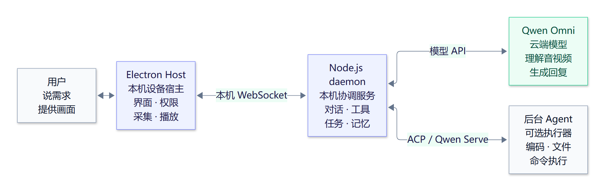
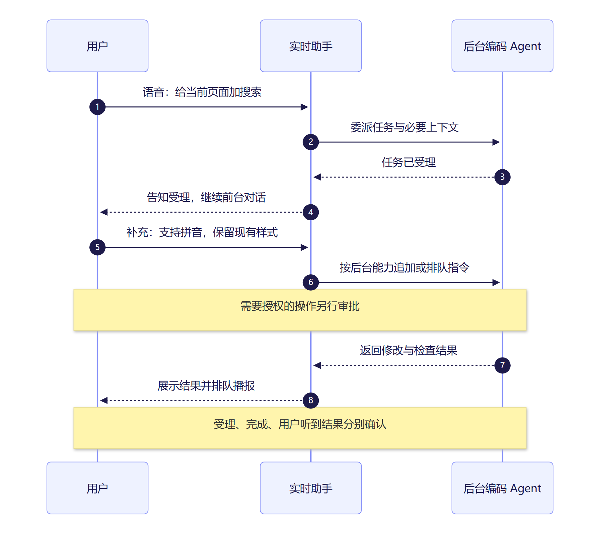
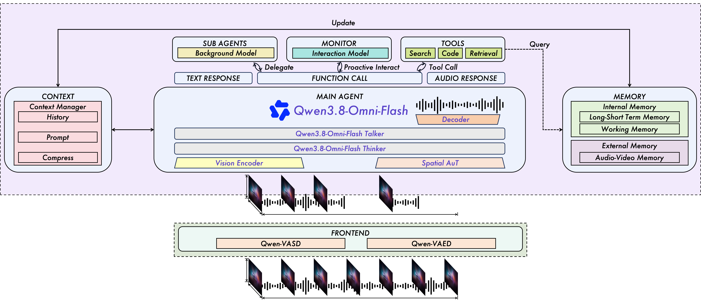
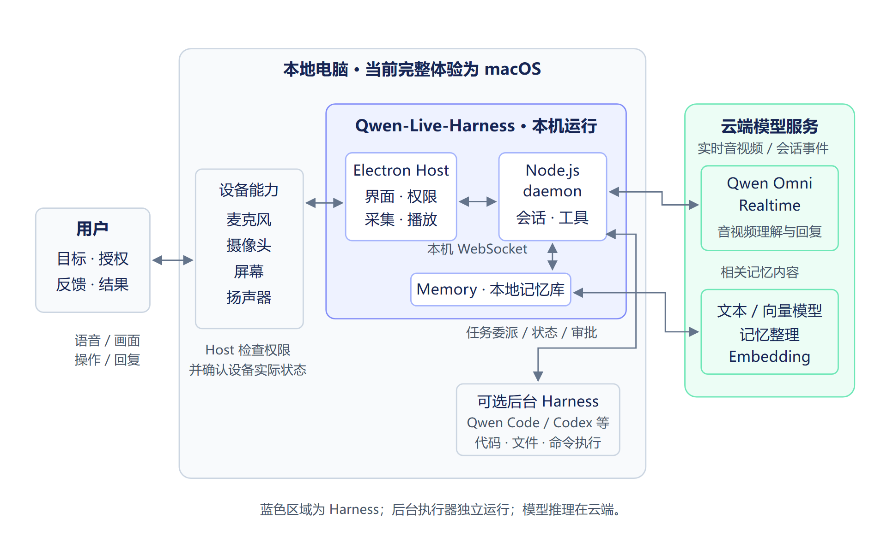
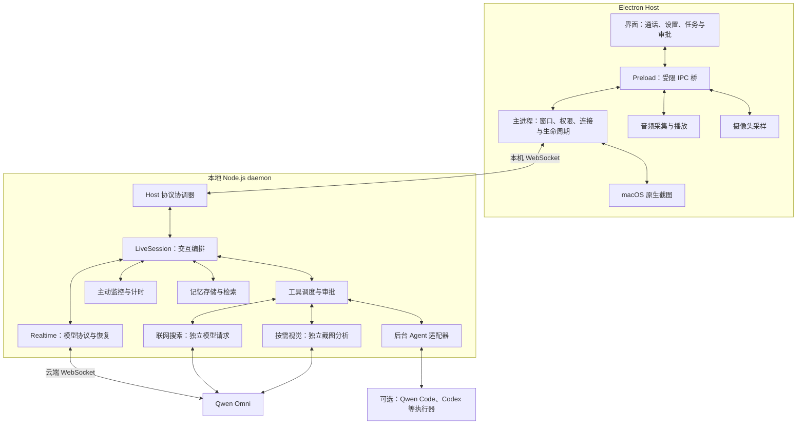
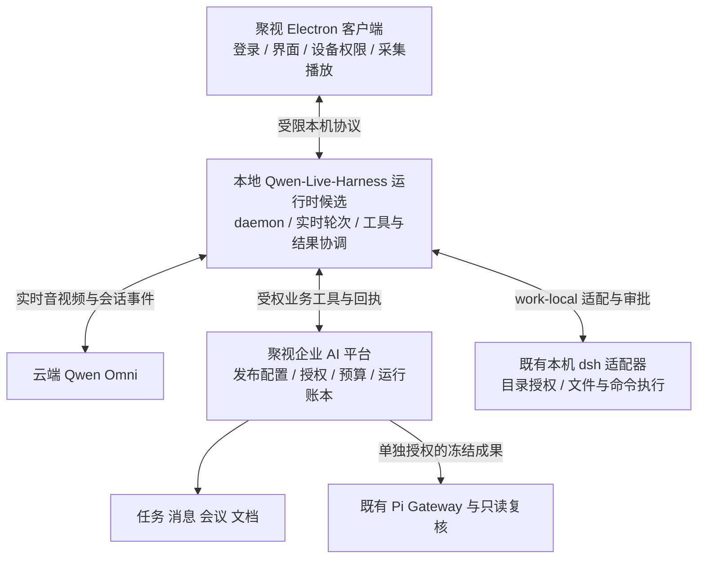

# Qwen-Live-Harness 端侧组件与通信架构

调研日期：2026-10-13。官方中文 README 核对日期：2026-10-13。源码版本：`b6ce544ebbcd7417e37e0314ec946466c49c615c`。Host 与 daemon 包版本：1.0.0。适用读者：聚视客户端、平台与 Agent 研发人员。

研究结论更新：2026-10-13。**可将 Qwen-Live-Harness 作为桌面端实时音视频 Harness 的优先基础候选，先完成接入验证。** 本文保存选型与适配建议；整体合入企业平台方案及生产采纳留待后续决策。

Qwen-Live-Harness 由 Electron Host 和本地 Node.js daemon 两部分组成。Host 承担桌面界面、系统权限、音视频采集与播放；daemon 持有云端模型连接，协调实时对话、工具、后台 Agent、主动交互和记忆。两者是独立进程，通过本机 WebSocket 通信。

官方支持的完整桌面体验为 macOS 12+，兼容 Apple Silicon 和 Intel Mac；Windows／Linux 支持仍在推进。源码中的 Host 入口会在非 `darwin` 平台退出。“端侧”指交互与协调在用户电脑运行，模型推理仍使用云端 Qwen Omni API，无需本地模型权重或 GPU。这一结构可以作为聚视实时交互 Harness 的参考，但不能直接替换现有 Android AOQ／WebRTC 实现。[官方中文 README][official-readme]

目标仓库为 [QwenLM/Qwen-Live-Harness](https://github.com/QwenLM/Qwen-Live-Harness)。下文源码链接固定到本次提交，不随 main 更新。

本文结合官方功能说明与源码审查记录组件和代码职责；真实 macOS 设备、模型音视频质量和生产接入仍需独立验证。官方使用条件不等于聚视已完成相应接入。关联方案：[企业 AI 应用与智能体平台设计方案](../plan/enterprise-ai-platform-design-2026-10-11.md)，重点对应第 6.5、7.1、8.6、16.4 和 18.4 节。

## Qwen-Live-Harness 图解介绍

**用语音和画面持续交流，把复杂工作交给后台 Agent，再接收进度与结果。**

### 三类角色如何配合



图为组件关系简图。[可编辑图源](../assets/qwen-live-harness/intro-architecture.mmd)

### 四项核心能力

| 能力 | 用户可以这样使用 |
| --- | --- |
| 🎙️ 实时交互 | 一边说、一边看屏幕或摄像头，持续讨论和澄清 |
| 🛠️ 后台委派 | 让编码 Agent 处理任务，前台仍可继续对话 |
| 🔔 主动交互 | 根据声音、画面或时间条件提醒、讲解 |
| 🧠 长期记忆 | 跨对话保留偏好和上下文，切换不同记忆库 |

四项能力由[官方 README][official-readme]说明；文件修改与命令执行依赖后台 Harness 及其授权。

### 对话式编程示例



示例流程，非实际验收记录；追加指令和审批行为取决于执行器。[可编辑图源](../assets/qwen-live-harness/intro-coding-flow.mmd)

### 可以构建哪些产品

| 产品方向 | 典型体验 | 需补充的产品能力 |
| --- | --- | --- |
| 对话式编程 | 说需求、补充要求、查看代码修改 | 仓库选择、变更预览、测试与提交策略 |
| 屏幕排障与教学 | 看错误、讲步骤、监控变化 | 日志接入、教学流程与操作工具 |
| 语音调研与报告 | 边讨论边搜索，后台整理材料 | 引用核验、文档生成与成果保存 |
| 企业办公助理 | 语音查任务、建待办、生成周报 | 业务工具、企业权限与真实回执 |

以上为产品方向，不代表仓库已有完整成品。聚视可优先接入已有任务、摘要和周报能力。

### 运行条件速览

| 维度 | 当前边界 |
| --- | --- |
| 客户端 | 完整体验支持 macOS 12+，Intel／Apple Silicon；不是 Android SDK |
| 模型 | 联网调用云端 API，无需本地 GPU；本地记忆不等于离线推理 |
| 执行器 | 后台 Harness 可选；执行文件与命令任务时需要安装、认证和授权 |
| 视觉 | 按需截图、主模型实时画面与独立 Monitor 是不同路径 |

条件与边界见[官方中文 README][official-readme]。对聚视的接入取舍见本文末尾“与聚视实时交互 Harness 的对应”。

### 官方模型与工具关系图



来源：[官方 README 配图][official-image]。这是模型与工具的概念示意，不是产品界面截图，也不是 Host／daemon 源码组件清单。

## 总体架构

**Qwen-Live-Harness 位于用户的本地设备上，连接设备交互、云端模型与可选后台执行器。** 用户提供目标和授权；本机采集、协调、执行并呈现结果；云端模型完成理解和生成。[官方架构说明][official-readme]



图中蓝色区域是 Qwen-Live-Harness，包含 Host、daemon 与其记忆能力；可选后台 Harness 是独立执行器，云端模型是外部服务。[可编辑图源](../assets/qwen-live-harness/overall-architecture.svg)

| 主要组件 | 所在位置 | 主要职责与核心功能 |
| --- | --- | --- |
| Electron Host | 本机 Harness | 界面、系统权限、音视频采集与播放，提供实时交互入口 |
| Node.js daemon | 本机 Harness | 管理实时会话、上下文、工具与审批，协调前台对话和后台工作 |
| 工具与后台适配器 | daemon 内 | 调度搜索、视觉分析和任务委派，接收进度、授权请求与结果 |
| Proactive | daemon 内 | 观察声音、画面或时间条件，主动提醒和讲解 |
| Memory | daemon 内，本地库持久存储 | 跨对话保留与检索偏好和上下文；整理与向量化调用云端模型 |
| 可选后台 Harness | 本机独立执行器 | 按自身能力和权限执行代码、文件与命令任务，向 daemon 返回状态 |
| 云端模型 | 外部模型服务 | Omni 理解音视频并生成回复和工具调用；文本／向量模型支持记忆处理 |

设备权限与实际执行由本机负责，模型产生工具调用不代表操作已经成功。持续音视频经本机 daemon 连接云端，后台执行器可自行连接其模型服务，图中未展开该链路。记忆库保存在本地，相关内容仍可能发送到云端处理。

总体架构描述部署位置和职责边界；下一节进一步展开 Host 与 daemon 的内部组件。

## 总体组件结构



图中呈现核心依赖与通信路径。联网搜索和按需视觉由 daemon 调度独立模型请求，不依赖后台编码 Agent；图中的 Qwen Omni 节点表示模型服务，不表示共享同一连接。Memory、主动监控等子系统也可能发起自己的模型请求，不能把所有推理视为同一个主会话。[官方架构说明][official-readme]与源码中的 `realtime/web-search.ts`、`realtime/visual-analysis.ts` 对应。

后台 Harness 是可选执行器。初始化时不接入后台 Harness，仍可使用实时音视频、联网搜索、按需视觉、Proactive 和 Memory；文件修改、命令执行等任务则依赖已安装并登录的后台 Harness，其能力与权限由该执行器决定。前台对话可以在后台任务运行期间继续，任务结果完成后排队返回主会话播报。[官方运行边界][official-readme]

## Electron Host 组件

Host 源码位于 `packages/qwen-live-harness-host`，分成 renderer、preload、main 和 native 四层。组装入口为 [src/main/index.ts](https://github.com/John-Shao/Qwen-Live-Harness/blob/b6ce544ebbcd7417e37e0314ec946466c49c615c/packages/qwen-live-harness-host/src/main/index.ts)。

| 组件 | 主要源码，相对于 Host 包 | 职责 |
| --- | --- | --- |
| 界面层 | `src/renderer/live-view.ts`、`settings-panel.ts`、`subagents-view.ts`、`memory-panel.ts` | 展示通话状态、静音、设备选择、音色、任务进度、审批和记忆库管理 |
| Preload 桥 | `src/preload/index.ts`、`src/shared/host-api.ts` | 向界面暴露有限 API，将操作和状态通过 Electron IPC 传递 |
| 音频引擎 | `src/preload/audio-engine.ts`、`audio-output-queue.ts`、`audio-output-resampler.ts` | 麦克风采集、音频处理、播放队列、重采样和播放确认 |
| 摄像头引擎 | `src/preload/camera-engine.ts` | 摄像头启动、预览、按帧率采样、JPEG 编码和静态拍照 |
| 原生截图 | `src/main/appshot-capture.ts`、`native-appshot.ts`、`src/native/appshot.mm` | 获取屏幕或窗口图像及辅助功能文本，处理 macOS 截图与辅助功能权限 |
| daemon 连接与生命周期 | `src/main/daemon-connection.ts`、`daemon-bootstrap.ts`、`daemon-lifecycle.ts` | 发现和连接 daemon、握手、重连、按需启动及确认退出 |
| 桌面宿主管理 | `src/main/index.ts`、`subagents-windows.ts`、`global-shortcut.ts`、`overlay-position.ts` 等 | 管理悬浮窗口、托盘、快捷键、多显示器布局、权限与设置持久化 |

### 界面与受限桥接

renderer 使用 TypeScript、HTML 和 CSS，`main.ts` 创建 `LiveView`，订阅宿主状态与输入音量。界面通过 `window.qwenLiveHarnessHost` 调用 preload 提供的 API，例如开始／结束通话、静音、选择视觉源、修改设置和打开任务面板。

窗口启用 `contextIsolation` 和 sandbox，关闭 `nodeIntegration`。主进程校验 IPC 的发送者、参数、长度与会话身份，界面不直接获得无限制的 Node.js 或文件系统访问能力。参见 [preload/index.ts](https://github.com/John-Shao/Qwen-Live-Harness/blob/b6ce544ebbcd7417e37e0314ec946466c49c615c/packages/qwen-live-harness-host/src/preload/index.ts)。

### 音视频与原生能力

音视频引擎位于 preload 层。音频使用 `AudioContext`／`AudioWorklet`，包含输入设备管理、采集生命周期、输出排队与流式重采样，并向主进程报告播放开始和完成。模型连接按 16 kHz 输入、24 kHz 输出配置音频，Host 处理实际设备采样率与播放采样率的差异。

摄像头使用 `getUserMedia`，通过 canvas 按配置帧率采样并编码为 JPEG。屏幕与窗口截图通过 Objective-C++ 的 N-API 原生模块完成；`native-appshot.ts` 加载 `.node` 模块，`AppshotCaptureService` 负责请求串行化、结果校验与临时资产管理。

这部分包含 macOS 原生依赖，是跨平台迁移需要重新适配的主要范围。参见 [audio-engine.ts](https://github.com/John-Shao/Qwen-Live-Harness/blob/b6ce544ebbcd7417e37e0314ec946466c49c615c/packages/qwen-live-harness-host/src/preload/audio-engine.ts)、[camera-engine.ts](https://github.com/John-Shao/Qwen-Live-Harness/blob/b6ce544ebbcd7417e37e0314ec946466c49c615c/packages/qwen-live-harness-host/src/preload/camera-engine.ts)、[native-appshot.ts](https://github.com/John-Shao/Qwen-Live-Harness/blob/b6ce544ebbcd7417e37e0314ec946466c49c615c/packages/qwen-live-harness-host/src/main/native-appshot.ts)。

### 视觉输入与分析路径

视觉来源可以选择显示器或摄像头。On Demand 与 Live Feed 是用户选择的采集模式，Proactive Monitor 是独立的观察任务，三者的模型输入与结果用途不同。

| 路径 | 图像交给谁 | 用途与采样条件 |
| --- | --- | --- |
| On Demand 按需截图 | 独立视觉子智能体，分析结果返回主对话 | 回答一次画面问题；截取所选显示器的完整画面或摄像头画面，不要求后台 Harness |
| Live Feed 实时画面 | 主实时模型 | 持续提供画面上下文；官方默认配置为 1 FPS、720p，不代表实际上传帧率或所有设备的固定值 |
| Proactive Monitor | 独立监控模型会话 | 对所选来源持续观察并触发提醒或解说；固定按 1 FPS、每轮 2 秒观察，通知等待当前对话及播放结束后播报 |

Monitor 的观察与通知受采样、推理和播报排队影响，可能延迟或误判，不适合作为安全关键报警系统。观察画面不会自动打开网页或操作应用；这类执行仍需要对应工具与权限。[官方视觉路径与采样说明][official-readme]

## 本地 Node.js daemon 组件

daemon 源码位于 `packages/qwen-live-harness`。`index.ts` 提供 CLI 入口；[daemon.ts](https://github.com/John-Shao/Qwen-Live-Harness/blob/b6ce544ebbcd7417e37e0314ec946466c49c615c/packages/qwen-live-harness/src/daemon.ts) 创建服务、加载配置、初始化组件并清理资源。内部以 `LiveSession` 为中心组织交互。

| 组件 | 主要源码，相对于 daemon 包 | 职责 |
| --- | --- | --- |
| 配置与启动 | `src/index.ts`、`config.ts`、`startup.ts`、`lifecycle.ts` | CLI、模型与执行器配置、实例发现、启动互斥及退出 |
| Host 协议协调器 | `src/host/qwen-live-harness-host-coordinator.ts`、`types.ts` | Host 握手、能力与状态同步、媒体收发、截图请求和播放回执 |
| 实时交互编排器 | `src/orchestrator/live-session.ts` | 管理通话生命周期，连接媒体、模型、工具、后台任务和记忆 |
| 模型协议与恢复 | `src/realtime/realtime-session.ts`、`recovering-session.ts` | `session.update`、VAD、打断、完整工具调用、结果回传、续答和有限恢复 |
| 独立搜索与按需视觉 | `src/realtime/web-search.ts`、`visual-analysis.ts` | 发起独立搜索或截图分析请求，将结果交回主对话；不依赖后台编码 Agent |
| 工具与身份映射 | `src/tools/definitions.ts`、`dispatcher.ts`、`handles.ts` | 工具 schema、handler 分派、超时回执，以及 session／job／asset 标识映射 |
| 后台执行器接入 | `src/adaptor/registry.ts`、`acp-adaptor.ts`、`qwen-code-adaptor.ts` | 通过 ACP 或 REST／SSE 对接后台 Agent，统一任务、进度及审批事件 |
| 审批与任务展示 | `src/permissions/permission-broker.ts`、`src/subagents/ledger.ts` | 管理待审批操作、决定转发、任务状态和界面快照 |
| 结果回流与播报 | `src/orchestrator/injector.ts`、`result-speech.ts`、`session-reports.ts` | 排队后台结果、注入上下文，在合适时机安排播报 |
| 主动交互 | `src/proactive/scheduler.ts`、`task-manager.ts`、`realtime-monitor.ts` | 音视频条件监控、持续讲解、计时提醒、冷却与通知交付 |
| 长期记忆 | `src/memory/service.ts`、`session.ts`、`store.ts`、`retrieval.ts`、`updater.ts` | 记忆库、本地 SQLite 与文件存储、对话记录、检索、embedding 和整理 |
| 日志诊断 | `src/log/session-log.ts`、`runtime-failure.ts`、`debug-archive.ts` | 会话 JSONL、故障记录及可选调试归档 |

### LiveSession 与结果注入

`LiveSession` 管理当前交互如何推进：接收 Host 输入、建立实时模型会话、分派工具、观察后台任务，并把结果返回界面和对话。它使用会话 epoch 与 generation 隔离过期事件，分别处理停止、恢复、审批和结果播报。

`Injector` 协调后台信息何时进入前台。用户正在讲话、模型响应进行中或 Host 尚未播放完时，注入窗口关闭；条件满足后再注入上下文或安排播报。后台详情可以作为静默上下文保留，是否需要播报另行决定。模型接受了播报请求不等于用户已经听到，实际播放状态依赖 Host 回执。

参见 [live-session.ts](https://github.com/John-Shao/Qwen-Live-Harness/blob/b6ce544ebbcd7417e37e0314ec946466c49c615c/packages/qwen-live-harness/src/orchestrator/live-session.ts)、[injector.ts](https://github.com/John-Shao/Qwen-Live-Harness/blob/b6ce544ebbcd7417e37e0314ec946466c49c615c/packages/qwen-live-harness/src/orchestrator/injector.ts)。

### 工具与后台 Agent

内置工具主要包括截图 `appshot`、搜索 `web_search`、会话创建和查询、任务委派 `handoff`、状态查询 `session_monitor`、停止 `session_stop`、审批响应以及主动监控工具。工具定义和实际 handler 分开，由 `ToolDispatcher` 返回可序列化回执。

`BackendRegistry` 管理可用后台执行器，`BackendAdaptor` 声明图片输入、审批转发、追加指令和事件交付等能力。ACP 适配器通过本地子进程的标准输入输出通信；Qwen Code 适配器支持 Qwen Serve REST／SSE，并有单独的终端发现和授权指令机制。

官方 README 列出的后台接入方式如下。使用前需安装并登录目标 Harness，在初始化向导中选择；不同执行器和版本的工具、图片支持及审批行为仍需分别验证。

| 后台 Harness | 协议 | 接入方式 |
| --- | --- | --- |
| Qwen Code | Qwen Serve REST／SSE 或原生 ACP | 默认托管本机 Serve，也可连接已有 Serve 或运行 `qwen --acp` |
| Qoder CLI | 原生 ACP | `qodercli --acp` |
| Codex | ACP 适配器 | `@agentclientprotocol/codex-acp` |
| Claude Code | ACP 适配器 | `@agentclientprotocol/claude-agent-acp` |
| Gemini CLI | 原生 ACP | `gemini --experimental-acp` |

ACP 使用本机标准输入／输出传输 JSON-RPC。Codex 和 Claude Code 的适配器由 `npx` 启动，首次使用可能下载依赖；表中的接入方式是官方支持说明，不构成聚视已完成兼容验收。[官方后台接入矩阵][official-readme]

接入已运行的 Qwen Code 终端使用独立 Qwen peer 协议，提供终端发现、经授权发送文字指令和按需接收报告。发现终端不等于得到执行权限，也不等于接管该终端已有工作；该通道与受托管理任务的 ACP／Serve 连接分开。应用不会自动接管任意终端。[官方 Qwen 终端接入说明][official-daemon]

受理、完成与播报分开管理。普通挂断保留后台任务观察，通话自身的搜索和主动监控则随通话清理；整个应用退出还会清理 daemon 与执行器连接。参见 [适配器契约](https://github.com/John-Shao/Qwen-Live-Harness/blob/b6ce544ebbcd7417e37e0314ec946466c49c615c/packages/qwen-live-harness/src/adaptor/types.ts)。

### Memory 与 Proactive

Memory 由本地记忆库、对话记录、工作记忆、检索、embedding、可选视觉观察和整理队列组成，支持创建、切换和重命名多个记忆库。SQLite 与文件保留本地数据，embedding、整理和可选视觉观察仍会将相关内容发送到配置的云端模型 API；本地存储不等于离线推理。[官方 Memory 边界][official-readme]

Proactive 管理通话范围内的音视频条件监控、持续讲解和计时提醒，包含任务 generation、冷却、重复触发抑制与通知交付状态。它不能直接代替企业平台的持久化 Schedule、周期去重和预授权成果交付。

参见 [MemoryService](https://github.com/John-Shao/Qwen-Live-Harness/blob/b6ce544ebbcd7417e37e0314ec946466c49c615c/packages/qwen-live-harness/src/memory/service.ts)、[ProactiveScheduler](https://github.com/John-Shao/Qwen-Live-Harness/blob/b6ce544ebbcd7417e37e0314ec946466c49c615c/packages/qwen-live-harness/src/proactive/scheduler.ts)。

## Host 与 daemon 的通信

本机连接为 `127.0.0.1:<port>/live/host`，Host 协议版本为 v9。Host 从发现文件取得连接信息，连接时校验 token／实例身份，并进行协议与能力握手。控制消息使用 JSON，音频使用带身份字段的二进制帧；图像通过控制消息传递。

| 方向 | 数据 |
| --- | --- |
| Host → daemon | 开始／结束通话、静音和设置操作、PCM 音频、图像、设备状态、播放开始／完成回执 |
| daemon → Host | 回复音频、通话状态、任务与审批信息、截图请求、设置结果和退出通知 |

媒体路径为：**麦克风／摄像头 → Host → 本地 daemon → 云端 Omni → daemon → Host 播放**。Host 不直接调用模型 API，API Key 和实时模型连接由 daemon 管理。

Host 与 daemon 的协议分别在两侧维护，变更时需要共同验证。会话 epoch 防止旧通话事件进入新通话，output ID 用于关联实际播放回执。参见 [Host 连接实现](https://github.com/John-Shao/Qwen-Live-Harness/blob/b6ce544ebbcd7417e37e0314ec946466c49c615c/packages/qwen-live-harness-host/src/main/daemon-connection.ts)、[daemon 协议定义](https://github.com/John-Shao/Qwen-Live-Harness/blob/b6ce544ebbcd7417e37e0314ec946466c49c615c/packages/qwen-live-harness/src/host/types.ts)。

## 启动与生命周期

### 环境与配置条件

| 范围 | 官方要求 |
| --- | --- |
| 完整桌面运行 | macOS 12+，Apple Silicon 或 Intel Mac，Node.js 22.13+ 和 npm；需要连接阿里云百炼 DashScope API，无需本地 GPU 或模型权重 |
| 源码开发与 Host 构建 | 在上述环境基础上安装 Xcode 命令行工具，并提供可用的 Node.js headers；Host 依赖单独安装 |
| 模型凭据 | Key 需有权访问所用 Omni Realtime 及相关文本模型；初始化支持北京和新加坡，两地域 Key 不能混用，模型可用范围和费用以对应地域控制台为准 |
| 系统权限 | 连接、设备和权限就绪后开始交互；授予麦克风与所选视觉来源所需权限，不因配置允许采集就认定权限已授予 |

默认配置文件为 `~/.qwen-live-harness/config.json`，可由设置页打开；手动编辑后需重启应用。高级参数与排障见[官方配置指南][official-config]。这些条件来自调研版本的[官方快速开始与开发说明][official-readme]。

### 安装运行与源码开发

安装版的最小入口如下；包版本固定为本次调研的 1.0.0，实际部署时还需确保 Host 与 daemon 使用配套版本。

```sh
npm install -g qwen-live-harness@1.0.0
qwen-live-harness init
qwen-live-harness
```

源码开发则在对应版本的仓库根目录分别执行 `npm ci` 和 `npm ci --prefix packages/qwen-live-harness-host`。`npm run init` 只完成源码配置，不下载安装 Host；`npm start` 构建并启动源码 daemon 和 Host，不依赖全局 CLI 或已安装的 Host。调试前退出已有实例，使用 `npm start -- --debug` 开启诊断，`Ctrl+C` 退出。Host 与 daemon 可以分别开发调试，但必须使用配套版本。[官方开发入口][official-readme]

### 进程与会话生命周期

源码开发入口 `scripts/start-dev.mjs` 负责构建并启动 daemon 与 Electron Host。安装后的 CLI 通过启动模块进入同一产品入口；用户直接打开 Host 时，`HostDaemonBootstrap` 可以根据已登记的运行路径按需启动 daemon。普通连接重试不会反复启动新 daemon。

daemon 初始化后台执行器注册表、MemoryService、Host 协议协调器和 LiveSession，然后监听本机端口并发布发现信息。Host 完成握手后同步能力、设备状态和设置，开始通话时才进入相应实时交互生命周期。

“结束通话”和“退出应用”具有不同作用域：前者结束当前媒体会话并保留界面，后者协调 Host 与 daemon 退出，并清理其管理的资源。参见 [Host 开发说明](https://github.com/John-Shao/Qwen-Live-Harness/blob/b6ce544ebbcd7417e37e0314ec946466c49c615c/packages/qwen-live-harness-host/README.md)。

调试归档可能包含原始音视频、私人对话和屏幕内容。提交故障材料前应检查脱敏，API Key 的字段过滤不能清除画面或声音中的秘密。官方建议附版本、系统环境、后台类型、复现步骤和脱敏日志。[官方问题反馈说明][official-readme]

## 与聚视实时交互 Harness 的对应

### 桌面端基础选型结论

桌面端与上游 Host＋本地 daemon 的架构匹配，建议优先验证其音视频交互、轮次与工具协调、后台任务和结果播报。企业身份、发布配置、预算、运行账本和成果继续由聚视平台管理；现有 dsh 承担本机执行，Pi 保留只读复核。[现有 Work Agent 分工](../features/work-agent-architecture.md)

官方完整体验目前支持 macOS 12+，Windows／Linux 支持正在推进。该方向可以作为选型依据，但未来支持说明不构成本项目的发布日期或能力承诺；聚视现有 Windows Electron 客户端也不因此自动具备该实时能力。[官方支持范围][official-readme]

### 建议的桌面接入关系



图为研究建议，尚未完成接入。媒体由桌面本机 daemon 连接供应商，业务服务器承载配置和工具控制流；dsh 的模型调用继续走原 Broker，Pi 使用独立 Gateway。

| 范围 | 建议采用方式 |
| --- | --- |
| 实时音视频、VAD、打断、工具续答 | 优先复用，验证真实设备与模型事件行为 |
| 后台受理、进度、审批和结果播报 | 复用协调机制，适配聚视任务契约；受理、完成与实际播放分别确认 |
| Host 与 daemon | macOS PoC 先使用上游配套组件；产品阶段将媒体与桥接能力融入聚视 Electron 宿主，daemon 作为受管独立进程 |
| 本地执行与复核 | 对接现有 dsh／`work-local/v1`，保留目录授权与命令审批；Pi 不增加写权限 |
| 企业业务与治理 | 发布快照、主体权限、action_id、回执、预算和成果由原领域服务管理 |
| Memory 与 Proactive | 按主体、企业策略和明确范围启用；不自动吸收全部企业资料，也不代替持久化 Schedule |
| Windows／Linux 系统能力 | 独立适配采集、播放、截图、权限、设备路由、快捷键与打包，逐平台验收 |

上游包不是现成的聚视插件。应固定上游提交及 Host／daemon 配套版本，把企业工具、dsh 和操作系统适配放在明确边界中，便于升级回归。后台 CLI 的升级和工具范围不能由临时下载最新版本来决定。

### 接入验证闭环

| 阶段 | 最小闭环 | 验证重点 |
| --- | --- | --- |
| 实时基础 | 语音＋屏幕／摄像头理解，打断与重连 | 建连、语音结束到实际播放的 p50／p95；播放回执和旧回调隔离 |
| 企业工具 | 语音查询或创建任务，取得真实唯一回执 | 当前主体与来源权限；重复调用、超时和撤权不产生额外写入 |
| 后台长工作 | 受理任务、挂断、后台继续、在 Work 取得成果 | 挂断不误取消已授权 Run；状态、成果与单独取消入口一致 |

macOS 验证可先推进，Windows／Linux 需要各自真实构建、设备和业务链路证据。必要能力缺失时不开放相应入口，可选能力按明确配置降级；不能借用 macOS 结果宣布跨平台交付。

### 生产采纳前的适配条件

| 条件 | 待验证或补齐的内容 |
| --- | --- |
| 凭据与计量 | 验证桌面 WebSocket 的短期／受限凭据、撤销与用量来源；不向 renderer 或个人配置下发企业主密钥 |
| 配置与权限 | 本机运行时接收平台发布快照，按客户端能力和授权交集注册工具；业务调用逐次鉴权 |
| 幂等与恢复 | 写操作使用稳定 action_id，未知结果查询原回执；进程内模型重连不等于进程重启或跨设备恢复 |
| 生命周期 | 挂断、取消后台任务、退出应用与退出账号分别处理；已明确受理的办公工作有独立账本 |
| 发行与升级 | 验证配套版本、两进程协议、任务身份、播放回执和各平台系统能力；保留可验证的回退路径 |

先依据这些闭环形成桌面选型证据，再评估整体合入企业平台设计的职责、工作包和发布门槛。本研究不作为既有办公技能或 Android 通话继续实施的前置依赖。

### Android 对应与边界

聚视方案保留 Android AOQ／WebRTC 直连供应商。采用该边界时，Host 的界面与设备职责由 Android 宿主承接，daemon 中的实时轮次、工具结果回传及播放协调职责主要落在 App；企业业务执行、持久化 Run、授权和成果交付继续由服务端承担。

| Qwen-Live-Harness 职责 | 聚视中的对应位置 |
| --- | --- |
| Host 界面、设备权限、采集与播放 | Android App、通话界面与媒体客户端 |
| Realtime 轮次、打断、工具输出与续答 | 现有 `OmniCallClient`／`OmniCallTools` 及后续实时协调模块 |
| 后台任务受理、状态和结果回流 | App 云端业务工具桥接与平台 Run 接口 |
| 审批与执行器适配 | 现有 dsh／Pi／Broker 授权边界及平台适配层 |
| 记忆、自动化与跨设备恢复 | 按平台主体、来源和持久化契约单独建设 |

优先参考组件之间的职责划分、后台结果与前台语音的协调、播放回执和旧事件隔离机制。模型传输、macOS 原生能力、本地记忆和进程内任务映射需要按聚视已有架构适配，不能直接视为 Android SDK 或企业平台运行基础。

## 官方参考与许可证

以下资料固定到 `b6ce544ebbcd7417e37e0314ec946466c49c615c`，对应本次调研版本。用户提供的 main 链接可用于后续复核最新版本，不替代本文的固定基线。

- [官方中文 README][official-readme]：功能、运行边界、视觉路径、接入矩阵与开发入口。
- [官方配置指南][official-config]：参数、记忆管理和排障。
- [daemon 开发指南][official-daemon]：工具与执行器适配、Qwen 终端接入、协议和测试。
- [Host 开发指南][official-host]：系统权限、音视频、原生截图、窗口与打包。
- [Apache License 2.0][official-license]：项目许可证；源码复用或发行时需保留适用的版权、许可证及第三方声明，具体随原文件和发行内容核对。

[official-readme]: https://github.com/QwenLM/Qwen-Live-Harness/blob/b6ce544ebbcd7417e37e0314ec946466c49c615c/README_ZH.md
[official-config]: https://github.com/QwenLM/Qwen-Live-Harness/blob/b6ce544ebbcd7417e37e0314ec946466c49c615c/docs/configuration_ZH.md
[official-daemon]: https://github.com/QwenLM/Qwen-Live-Harness/blob/b6ce544ebbcd7417e37e0314ec946466c49c615c/packages/qwen-live-harness/README_ZH.md
[official-host]: https://github.com/QwenLM/Qwen-Live-Harness/blob/b6ce544ebbcd7417e37e0314ec946466c49c615c/packages/qwen-live-harness-host/README_ZH.md
[official-license]: https://github.com/QwenLM/Qwen-Live-Harness/blob/b6ce544ebbcd7417e37e0314ec946466c49c615c/LICENSE
[official-image]: https://qianwen-res.oss-cn-beijing.aliyuncs.com/Qwen3.8-Omni-Flash/fig3.png
