# PC 端 AI 助手 UX 设计审查

日期：2026-10-21  
审查对象：主窗口 `/assistant`、通话页 `/ai-call`、通话浮窗入口、桌面标题栏入口  
审查方式：代码走查 + Playwright 截图 + 模拟 Realtime 事件 + 1024/1440 宽度与明暗主题检查  
边界：本次未连接真实模型和真实设备，WebRTC 使用可控假实现，重点验证界面状态与交互，不把截图当作模型质量结论。

## 1. 结论

改造前的主窗口 `/assistant` 只是可联通 Realtime 的**工程原型**，不能作为正式产品界面交付。主要问题不是功能缺失，而是用户看不到“这是一个可以持续对话的 AI 助手”：

- 冷启动时没有一级导航栏，页面像脱离应用的独立弹窗；
- 全部使用 inline style，与现有设计系统脱节；
- 消息是“你：/AI：”纯文本段落，没有气泡、角色、时间、流式光标；
- 没有空状态、连接中、断线、重试、停止生成等状态；
- 单行输入框，没有 Enter/Shift+Enter 约定；
- 新回复不会自动滚动到可见区域；
- 组件卸载不清理 WebRTC 和 AudioContext；
- 浏览器中“AI 打电话”按钮直接禁用，也没有替代路径；
- 通话页存在结束后文案矛盾、历史标题取错、历史时间 Invalid Date、读屏 Markdown 原样显示等问题。

本轮按“先让助手像一个产品，再补通话页遗留问题”的顺序完成改造。

| 维度 | 改造前 | 改造后 |
|---|---:|---:|
| 信息架构 | 1/5 | 4/5 |
| 视觉一致性 | 1/5 | 4/5 |
| 状态反馈 | 1/5 | 4/5 |
| 输入效率 | 2/5 | 4/5 |
| 无障碍 | 1/5 | 4/5 |
| 容错与恢复 | 1/5 | 3/5 |
| 桌面/窄窗适配 | 2/5 | 4/5 |

## 2. 改造前

### 2.1 空闲态

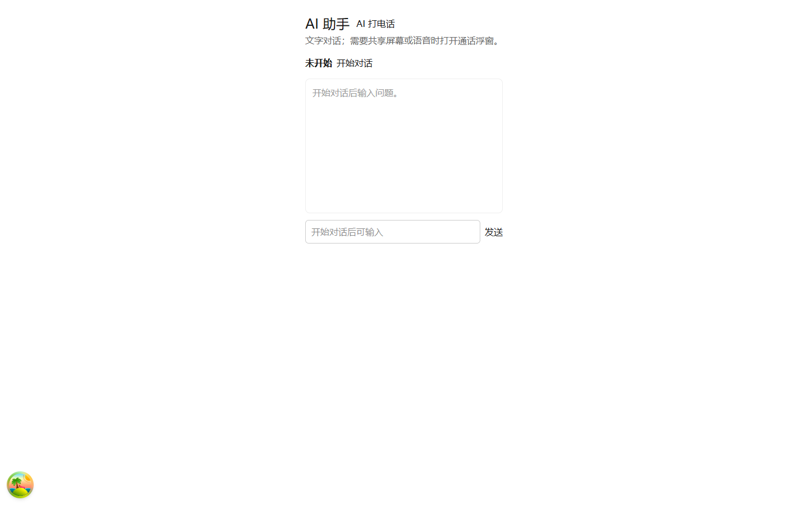

问题：

- 一级导航栏消失，用户无法从 AI 助手回到消息、会议等模块；
- 页面标题、状态、操作、消息区全部挤在一个 840px 的窄容器里；
- 大面积空白，唯一的开始入口是一个普通文本按钮；
- “AI 打电话”与“AI 助手”并排，但浏览器中前者是禁用状态，没有解释；
- 输入框在未连接时仍占据主视觉，像“坏了”的聊天页。

### 2.2 已连接

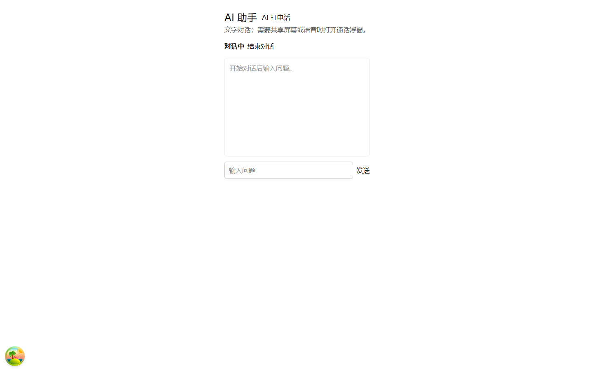

问题：

- “对话中 结束对话”是同一行普通文字，没有状态胶囊和操作层级；
- 没有连接中/断线/重试状态；
- 消息区没有空状态引导，仍然写着“开始对话后输入问题”，与“对话中”矛盾。

### 2.3 回复

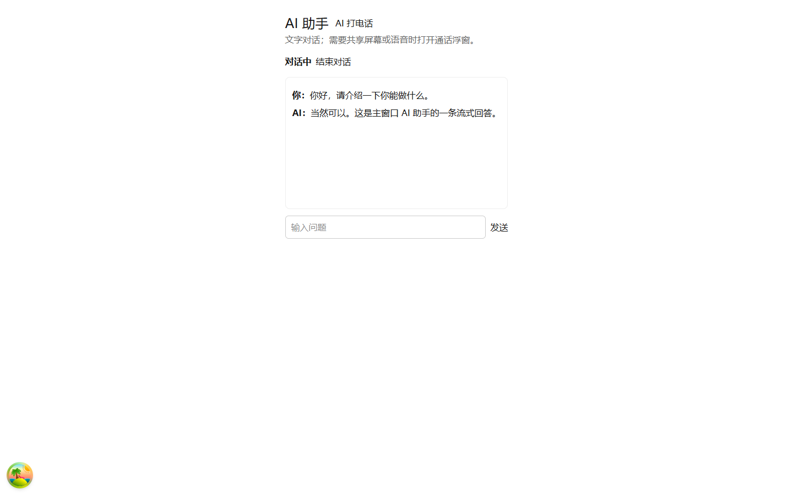

问题：

- `你：...` / `AI：...` 纯文本，没有气泡、角色图像、时间；
- Markdown 原样显示（如 `**重点**`），长回复没有可读的排版；
- 没有流式光标、“正在回复”提示、停止生成；
- 回复变长时不会自动滚动，用户可能看不到最新内容；
- 输入框仍是单行，长问题无法换行。

## 3. 改造后

### 3.1 空闲态与主动引导

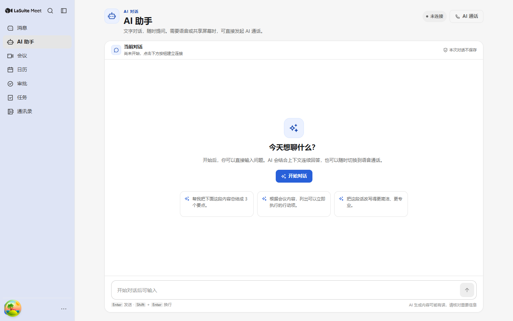

- 保留完整一级导航，冷启动/硬刷新不再丢失应用外壳；
- 页面明确分为“页头（身份、状态、AI 通话入口）→ 对话卡片 → 输入区”；
- 空状态给出“今天想聊什么？”和 3 个可点击任务示例；
- 未连接时输入框禁用，并明确提示“开始对话后可输入”，不再伪装成可用。

### 3.2 已连接

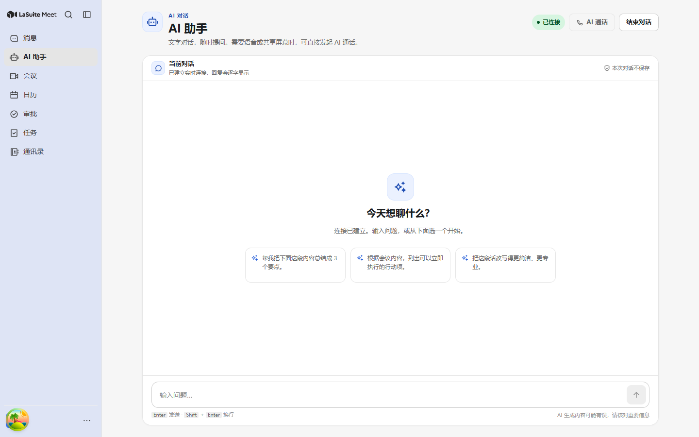

- 状态胶囊用颜色区分未连接/连接中/已连接/失败/已结束；
- 已连接时提供“结束对话”，空闲时把主操作收敛到空状态里的“开始对话”；
- 顶部“AI 通话”在桌面客户端打开浮窗，在浏览器降级打开 `/ai-call`，不再是禁用死按钮；
- 对话区顶部显示当前会话状态和“本次对话不保存”的隐私说明。

### 3.3 流式回复

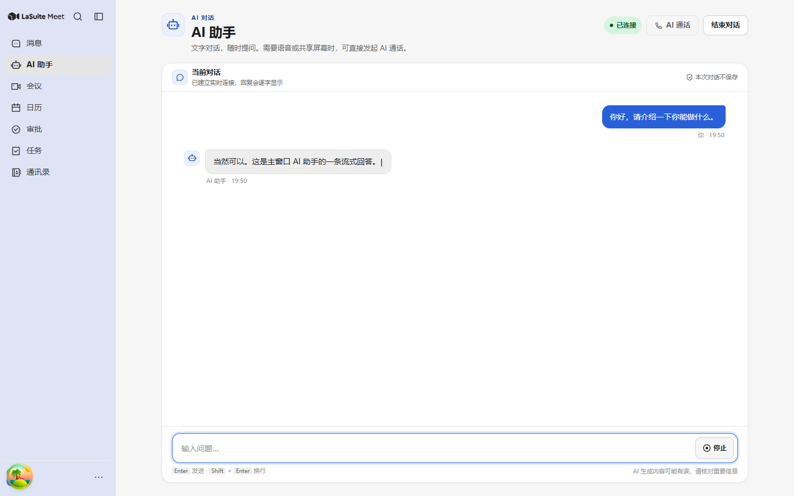

- 用户消息右对齐、AI 消息左对齐，带头像、角色和时间；
- 流式回复末尾有闪烁光标；
- 等待首个 token 时显示三点“正在回复”，不会空白卡住；
- 回复中发送按钮切换为“停止”，可主动结束本回合；
- Assistant 内容使用 Markdown 渲染，支持列表、粗体、行内代码、代码块和链接。

### 3.4 完整回复

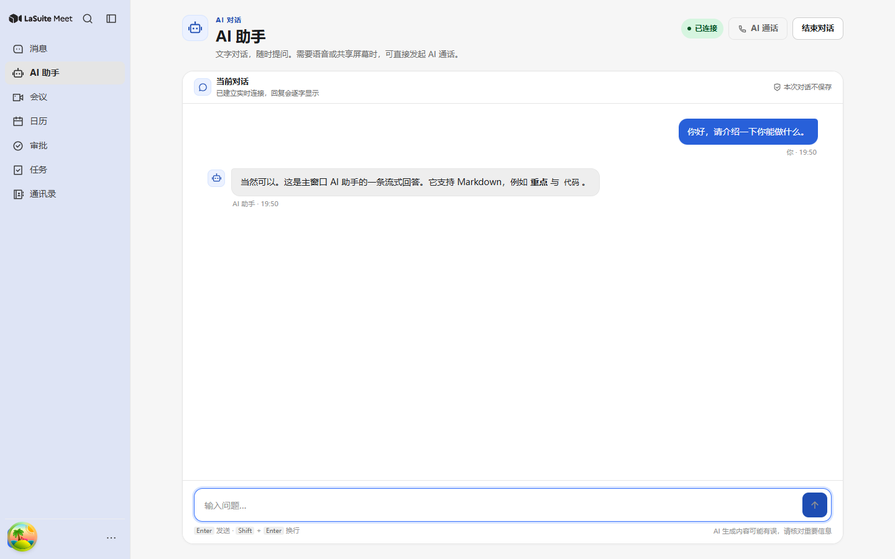

### 3.5 深色主题

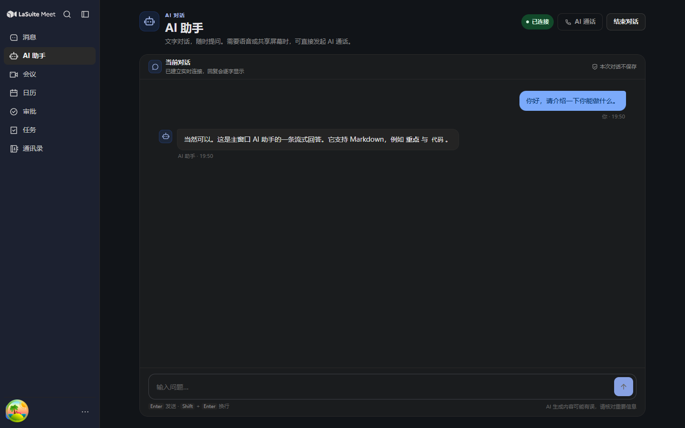

### 3.6 1024 宽度

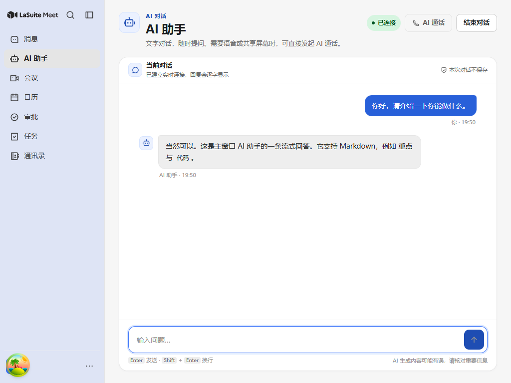

## 4. 主要问题与修复

### P0

| 问题 | 修复 |
|---|---|
| 冷启动没有一级导航 | 用 `Screen` 包裹 `/assistant` 和 `/ai-call`，挂载时恢复 `showHeader`；`/ai-call-float` 不受影响 |
| 页面是 inline style 原型 | 全部改为 Panda 语义 token（`surface.*`、`text.*`、`border.*`、`action.*`、`status.*`），自动适配深色 |
| 消息是纯文本段落 | 气泡 + 角色 + 时间 + Markdown + 流式光标 |
| 回复不自动滚动 | 监听消息/等待状态；用户主动上滚时停止跟随，发送新消息时恢复 |
| 连接无状态机 | `idle / connecting / active / error / ended` 五态，连接中可取消，失败可重试 |
| 断线无反馈 | 监听 `connectionstatechange`，断线禁用输入并给出重试入口 |
| 卸载泄漏媒体资源 | 组件卸载时关闭 DataChannel、PeerConnection、AudioContext，停止定时器 |
| 单个 responseRef 会串消息 | 按 `response_id` 维护响应 Map，delta 落入对应气泡；同一响应忽略 text/transcript 双通道重复 |
| 浏览器中“AI 打电话”死按钮 | 有 Electron bridge 时打开浮窗；否则降级到 `/ai-call` |

### P1

| 问题 | 修复 |
|---|---|
| 输入框只能单行 | 改为自动增高 textarea，Enter 发送、Shift+Enter 换行、兼容中文输入法 composing |
| 没有空状态 | 增加欢迎语、能力说明、3 个任务示例；点击示例自动建立连接并发送 |
| 没有等待/停止 | 三点等待态 + 停止生成（`response.cancel`） |
| 没有无障碍播报 | `role="status" aria-live="polite"` 播报连接和回复状态；错误使用 `role="alert"` |
| 键盘/焦点不完整 | 输入框自动聚焦；所有按钮有可读名称；focus ring 沿用全局样式 |
| 隐私说明缺失 | 页头改为“本次对话不保存”，明确不写入通话历史 |
| 读屏结果原样显示 Markdown | 通话页 transcript 和读屏卡片统一用 `react-markdown` 渲染 |
| 空闲/结束仍显示禁用控制 dock | 仅 `active/sharing` 显示底部 dock；空闲把主操作放回舞台 |
| 结束后文案矛盾 | 结束态改为“记录已保存，可以重新开始一段对话。” |
| 计时器 `1s` | 统一为 `00:01` |
| 设备菜单点击外部不关闭 | 增加 document mousedown 外部关闭 |
| 通话历史标题取 AI 文本 | 保存时优先首条用户消息，读屏会话回退为“读取屏幕：…”并写入摘要 |
| 拉取历史出现 Invalid Date | `pullAiCallHistory` 过滤无有效 `started_at` 的异常记录，并补单测 |

## 5. 页面状态设计

```text
idle
  └─ 点击“开始对话”/任务示例 → connecting
connecting
  ├─ session.updated → active
  └─ 失败/超时 → error（可重试）
active
  ├─ 发送消息 → awaiting（等待首 token）
  ├─ 首个 delta → streaming（光标 + 持续追加）
  ├─ response.done → active
  ├─ response.cancel → active（保留已生成内容）
  └─ 断线 → error
error
  └─ 重试 → connecting
active
  └─ 结束对话 → ended（保留本轮消息，不写历史）
```

交互约定：

- 未连接时输入框禁用，空状态主按钮是唯一主操作；
- 连接中显示“取消”，避免 15–20 秒无出口；
- 回复中发送按钮变为“停止”，不鼓励并发提问；
- 发生错误时，错误条紧贴输入区，用户不需要回滚页面找原因；
- 状态变化通过隐藏 live region 播报，视觉状态胶囊不承担读屏播报。

## 6. 同时修复的通话页遗留问题

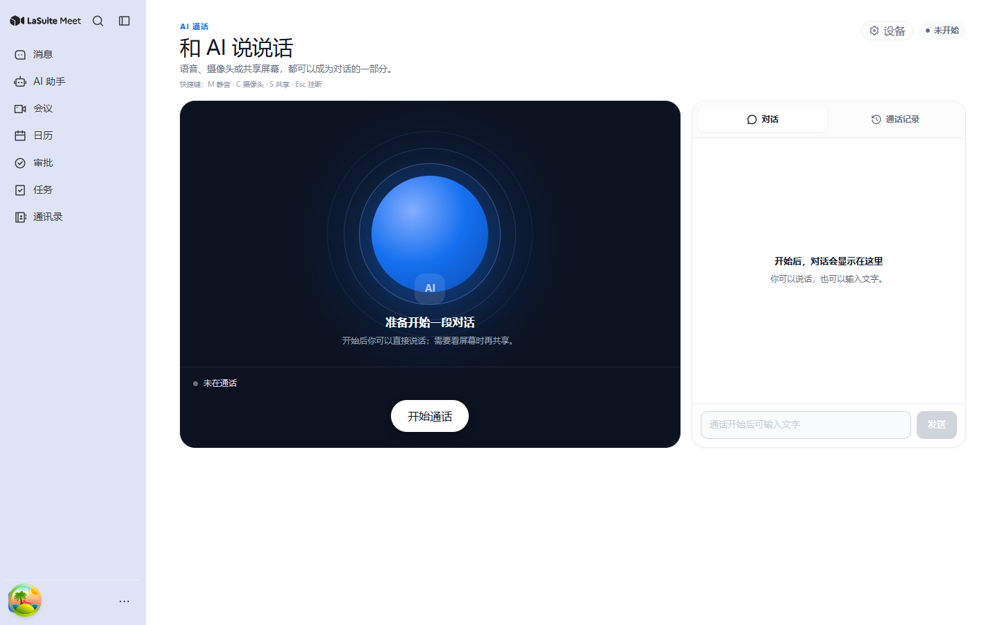

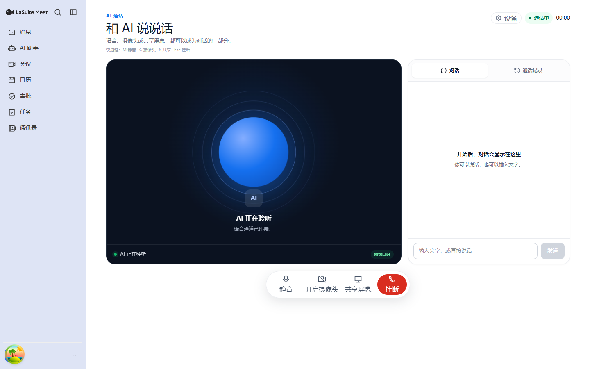

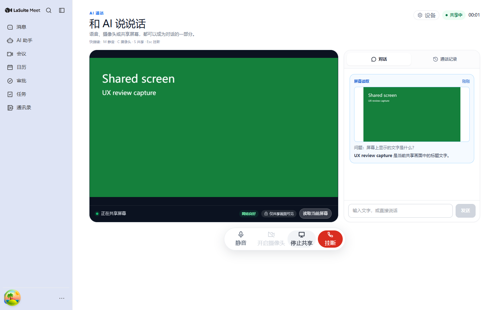

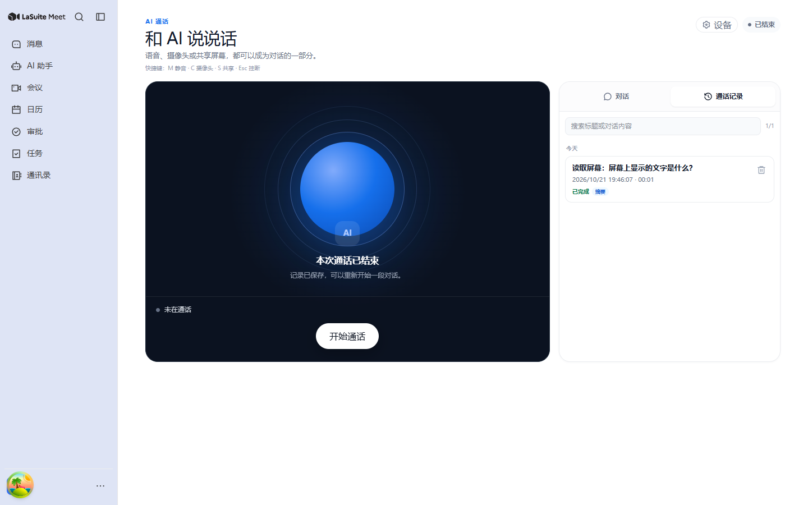

- `/ai-call` 冷启动恢复一级导航；
- 计时器从 `1s` 改为 `00:01`；
- 空闲/结束隐藏禁用控制 dock；
- 结束态文案不再说“语音通道已连接”；
- 读屏结果中的 `**...**` 正常渲染为粗体；
- 共享时增加“仅共享画面可见”隐私提示，并删除重复的“屏幕已共享”chip；
- 设备菜单支持点击外部关闭，补充 dialog 语义；
- 通话历史标题优先使用用户问题，读屏会话使用“读取屏幕：…”；
- 过滤异常历史记录，避免出现 `Invalid Date / NaN:NaN`；
- 媒体权限错误改成用户能理解的话术；
- 1024px 宽度下通话页从“压缩双栏”改为纵向堆叠，避免舞台被挤成窄条。

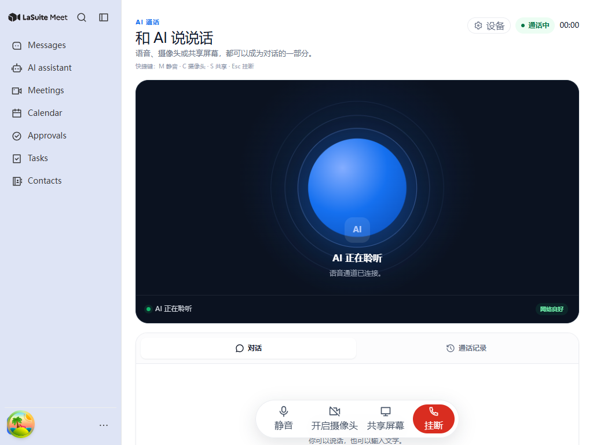

浮窗同步验证：

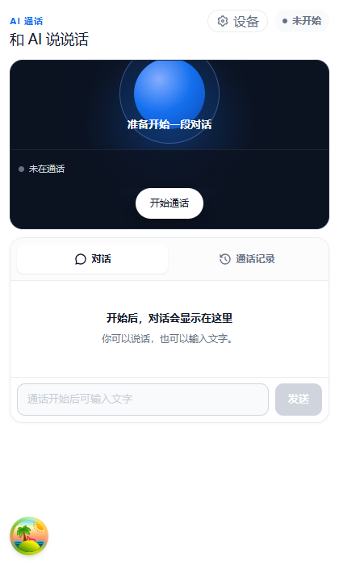

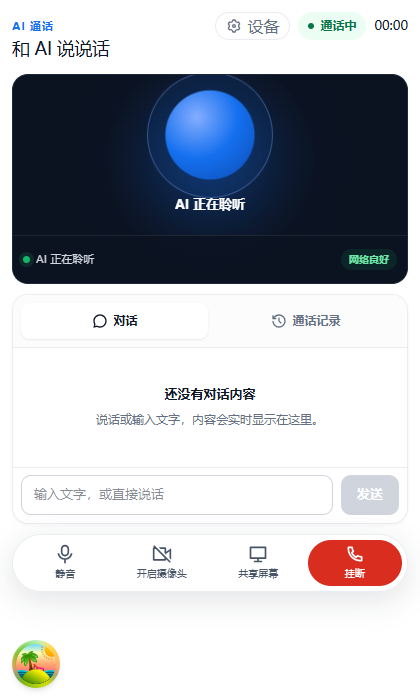

浮窗提示从“开始后，对话会显示在这里”改为通话中的“还没有对话内容”，避免已连接却仍显示未开始文案。

## 7. 验证

```text
node ./node_modules/typescript/bin/tsc -b --pretty false
node ./node_modules/eslint/bin/eslint.js src/features/ai-assistant/AiAssistantRoute.tsx \
  src/features/ai-call/AiCallRoute.tsx src/features/ai-call/sync.ts \
  src/features/ai-call/sync.test.ts --max-warnings 0
node ./node_modules/vitest/vitest.mjs run src/features/ai-call/sync.test.ts
```

结果：

```text
TypeScript: pass
ESLint: pass（changed files）
Vitest: 4 passed（含异常历史记录过滤）
Playwright: 1440×900 明/暗、1024×768 截图通过
```

截图脚本：

- `src/frontend/scripts/ux-assistant-capture.mjs`：假 Realtime、可控 delta、桌面/窄窗/主题截图；
- `src/frontend/scripts/ux-call-capture.mjs`：假媒体设备、共享、读屏、历史截图。

## 8. 仍未完成

1. **真实模型会话验证**：本轮用假 RTC 验证 UI 状态机，未在真实 Qwen/WebRTC 会话中回归；上线前需跑一次真实连接、长回复、断网重连。
2. **i18n**：页面文案目前为中文；项目有 zh/en/fr/de/nl 五套 locale，正式发布前应补齐 `assistant` 命名空间并接入 `useTranslation`。
3. **助手会话历史**：主窗口对话当前不持久化，刷新即丢失；“本次对话不保存”是有意选择，若产品要求历史，需要单独设计会话列表与清理策略。
4. **重连后的上下文**：断线重连会创建新 Realtime 会话，旧上下文不会自动恢复；当前只保留本地已显示消息。
5. **真实屏幕源选择器**：Electron 源选择仍依赖系统选择器，未在真实桌面壳内完成自动化验收。
6. **浮窗形态**：本轮未重新设计 `/ai-call-float`，仅复用 compact 样式；浮窗的置顶/最小化/关闭仍由 Electron 外壳负责。

## 9. 设计原则沉淀

- **先有状态，再有聊天**：连接、等待、流式、失败、结束都要有明确视觉，不让用户猜。
- **主操作只有一个**：空闲时“开始对话”，通话中“挂断/结束”，回复中“停止”；其余动作降级为次级按钮。
- **错误靠近操作**：错误条放在输入区上方，重试按钮就在旁边。
- **隐私说明可验证**：不写“绝对安全”，只写系统实际行为（本次对话不保存 / 仅共享画面可见）。
- **不要用禁用按钮解释世界**：浏览器没有浮窗时，降级到可用页面，而不是显示一个永远点不动的按钮。
