# PC 端 AI 打电话 UX 设计审查

日期：2026-10-21  
审查对象：`/ai-call`、`/ai-call-float`、通话历史  
审查方式：真实 WebRTC 状态 + Playwright 截图 + 代码走查  
截图环境：1440×900 桌面窗口、420×700 浮窗、Chrome 假摄像头/自动屏幕源

## 1. 结论

**功能链路可用，但当前仍是“工程原型”，不建议按现状对外。**

核心问题不是功能缺失，而是：

- 页面没有明确的“通话主舞台”；
- 通话控制是文字链接，层级过低；
- 媒体预览、读屏结果、文字对话、历史记录混在一条纵向流里；
- 桌面与浮窗没有做响应式形态；
- 缺少静音、音量、网络/重连、权限、键盘等通话产品必备反馈；
- 视觉上几乎没有使用现有设计系统。

建议评级：

| 维度 | 评分 | 判断 |
|---|---:|---|
| 功能可发现性 | 2/5 | 能找到，但不像“打电话” |
| 信息架构 | 1/5 | 通话、对话、历史没有分层 |
| 通话主界面 | 2/5 | 无固定舞台和控制栏 |
| 媒体状态反馈 | 2/5 | 有预览，但无静音/音量/质量 |
| 读屏体验 | 2/5 | 有结果，但重复且技术化 |
| 历史记录 | 2/5 | 原始列表，缺标题/摘要/分组 |
| 浮窗适配 | 1/5 | 只是把桌面页缩小 |
| 无障碍 | 1/5 | 文本按钮、缺 live region/焦点规范 |
| 视觉一致性 | 1/5 | inline style，未使用设计系统 |
| 文案 | 2/5 | 原型文案直接暴露给用户 |

## 2. 现状截图

### 空闲态

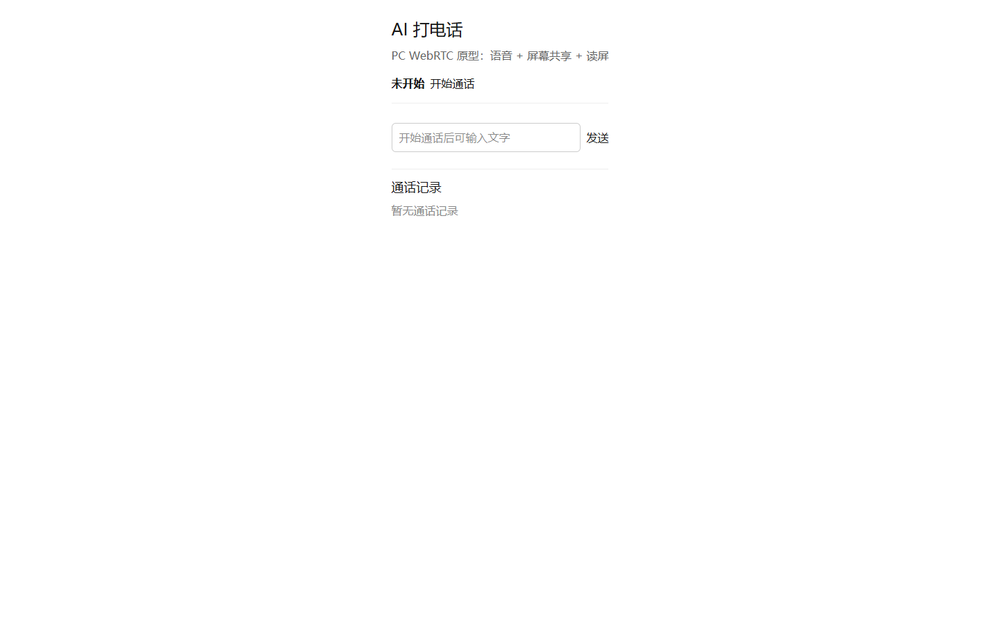

问题：

- 大面积空白，主操作只是普通文本按钮；
- “PC WebRTC 原型”是开发说明，不应出现在产品界面；
- 文字输入在未通话时仍占据主视觉，误导用户以为这是聊天页；
- 历史记录与主操作同权重。

### 音频通话

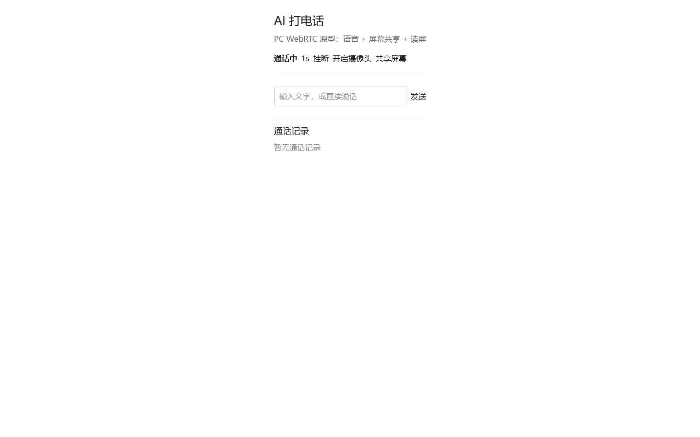

问题：

- “通话中 1s 挂断 开启摄像头 共享屏幕”全部挤在一行；
- 没有静音、扬声器、音量、网络质量、重连状态；
- 没有 AI 说话/聆听的视觉反馈；
- 挂断不是明确的危险操作，也没有主按钮层级。

### 共享屏幕 + 读屏

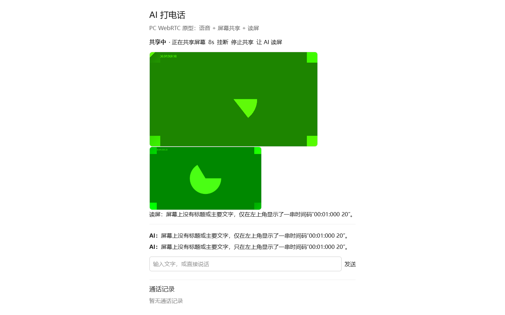

问题：

- 屏幕预览和读屏截图重复出现，占用大量空间；
- 同一条读屏答案出现三次：
  - “读屏：……”
  - “AI：……”
  - “AI：……”
- “让 AI 读屏”是技术动作，用户不知道什么时候该点；
- 共享状态只靠一行小字，缺少持续、明显的共享中提示；
- 两个绿色画面是测试假源，但也暴露出：没有“画面来源/尺寸/帧率”的媒体信息。

### 通话历史

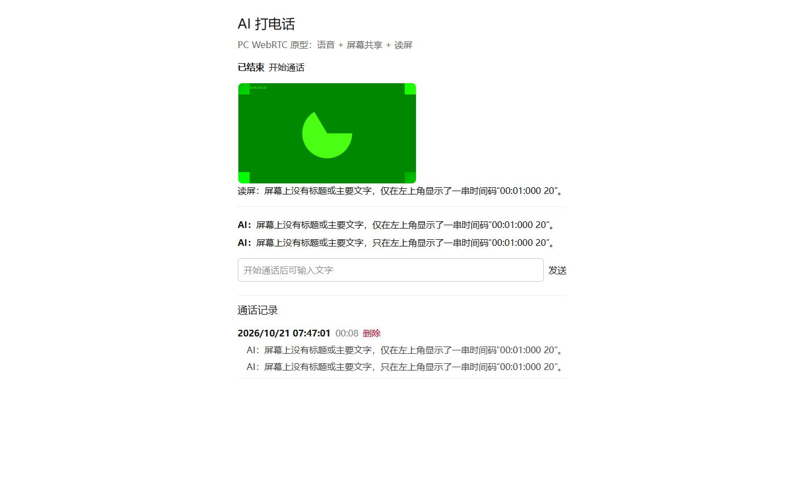

问题：

- 只有日期、时长、删除；
- 没有标题、摘要、待办、截图数量、状态徽标；
- 删除是裸文本，容易误触；
- 历史与当前通话混在同一页；
- 没有今天/昨天分组、搜索、筛选、同步状态。

### 浮窗空闲

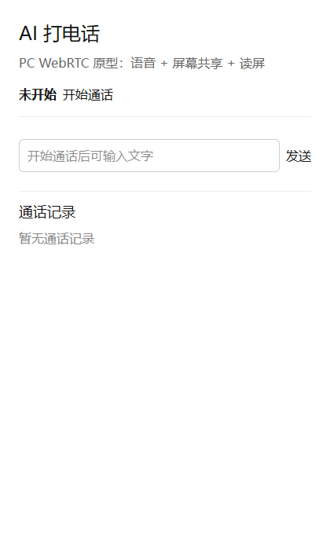

### 浮窗通话

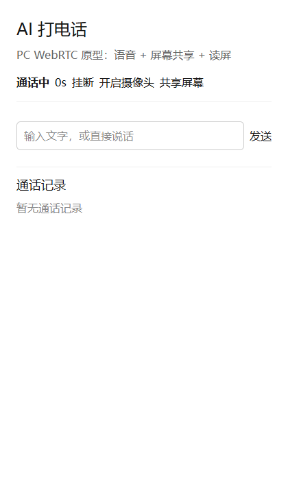

问题：

- 直接把桌面单列布局缩到 420px；
- 标题、说明、历史、输入框都保留，真正通话区域被挤压；
- 没有紧凑控制 dock；
- 历史不应在浮窗中常驻；
- 没有最小化/关闭/置顶等浮窗专属操作。

## 3. 主要 UX 问题

### P0：必须先修

1. **没有“通话舞台”**
   - 媒体画面、AI 状态、控制栏没有固定位置；
   - 预览出现/消失会把下面内容整体推移。

2. **控制层级错误**
   - 挂断、静音、摄像头、共享都是同样大小的文本按钮；
   - 没有主操作（挂断）与次级操作（共享/摄像头）的区分。

3. **读屏结果重复**
   - 同一条答案进入“读屏结果”和 AI 消息两遍；
   - 需要只保留一个结果卡片，并区分“用户提问 / 截图 / AI 回答”。

4. **浮窗只是缩小的桌面页**
   - 420px 下历史常驻、输入框常驻、标题过大；
   - 必须做 compact 模式。

5. **产品文案暴露实现**
   - “PC WebRTC 原型”
   - “让 AI 读屏”
   - 应改为用户任务语言。

### P1：进入正式评审前

6. **缺少音频通话核心反馈**
   - 静音/取消静音；
   - 麦克风音量；
   - AI 说话状态；
   - 网络质量/重连；
   - 音频设备选择。

7. **缺少媒体来源信息**
   - 摄像头/屏幕来源名称；
   - 分辨率、帧率；
   - 共享暂停/恢复。

8. **历史记录不像“通话记录”**
   - 标题（首条用户消息/摘要）；
   - 时间、时长、状态、截图数；
   - 摘要/待办徽标；
   - 分组、搜索、筛选；
   - 同步中/已同步/本地失败状态。

9. **空状态没有引导**
   - 空闲态应解释“能做什么、会共享什么、何时开始”；
   - 历史空态应给出“完成一次通话后出现在这里”。

10. **状态变化没有动效/强调**
    - connecting、connected、sharing、reconnecting 需要明确的状态条；
    - 共享开始/停止需要 toast 或持续 badge。

### P2：体验优化

11. **键盘与无障碍**
    - 快捷键：`M` 静音、`C` 摄像头、`S` 共享、`Esc` 结束；
    - 所有按钮至少 44px；
    - 焦点环、`aria-live`、状态播报；
    - 图标按钮必须有可读标签。

12. **视觉一致性**
    - 当前全是 inline style；
    - 应使用现有 Panda/设计 token、圆角、间距、颜色；
    - 主按钮/次按钮/危险按钮统一。

13. **隐私提示**
    - 共享开始时明确“对方/模型将看到你选择的屏幕”；
    - 读屏截图是否上传、保留多久，需要说明。

## 4. 建议的信息架构

### 桌面 ≥ 1024px

```text
┌────────────────────────────────────────────────────────────┐
│ AI 通话 · 状态 · 计时                    最小化  关闭      │
├──────────────────────────────┬─────────────────────────────┤
│                              │  对话 / 摘要 / 历史 Tab      │
│       通话舞台               │                             │
│  AI 状态 / 屏幕 / 摄像头     │  transcript                 │
│                              │  read_screen 卡片           │
│                              │                             │
├──────────────────────────────┴─────────────────────────────┤
│   [麦克风] [摄像头] [共享屏幕] [字幕]        [挂断]        │
└────────────────────────────────────────────────────────────┘
```

### 浮窗 360–480px

```text
┌────────────────────────────┐
│ AI 通话       00:12   — ×  │
├────────────────────────────┤
│                            │
│      通话舞台 / 屏幕       │
│                            │
├────────────────────────────┤
│  🎙  📷  🖥  💬      ⏹     │
├────────────────────────────┤
│  最近一句 AI 回复（1–2 行）│
└────────────────────────────┘
```

历史不常驻浮窗；通过顶部“历史”按钮打开抽屉或独立面板。

## 5. 关键组件建议

### 5.1 通话控制栏

- 主操作：挂断（红色/危险，固定右侧）；
- 次操作：麦克风、摄像头、共享、字幕；
- 每个按钮：
  - 图标 + tooltip；
  - 开启/关闭状态明显；
  - 权限失败时按钮旁显示原因；
  - 键盘可达。

### 5.2 媒体舞台

- 固定 16:9 或 4:3 区域；
- 音频通话时显示 AI 状态视觉（聆听/思考/说话）；
- 摄像头画面作为小窗；
- 屏幕共享时主画面为屏幕，摄像头缩到角落；
- 读屏截图作为“证据卡片”，不重复塞进消息流。

### 5.3 读屏结果卡片

```text
┌ 屏幕读取 · 刚刚 ──────────────┐
│ [缩略图]                      │
│ 问题：这个页面在说什么？      │
│ 回答：……                      │
│ [查看原图] [复制]             │
└───────────────────────────────┘
```

### 5.4 通话记录卡片

```text
┌───────────────────────────────┐
│ 通话标题（首条消息/摘要）      │
│ 今天 14:32 · 03:18 · 已完成    │
│ 摘要 ✓   待办 2               │
│ [继续通话]             [⋯]    │
└───────────────────────────────┘
```

### 5.5 空状态

- 空闲：
  - “开始后，AI 会通过麦克风与你对话。共享屏幕后，它可以读取你选择的画面。”
- 历史空：
  - “还没有通话记录。完成一次 AI 通话后会出现在这里。”

## 6. 文案建议

| 当前 | 建议 |
|---|---|
| PC WebRTC 原型：语音 + 屏幕共享 + 读屏 | 用语音和屏幕与 AI 对话 |
| 开始通话 | 开始 AI 通话 |
| 共享屏幕 | 共享屏幕给 AI |
| 让 AI 读屏 | 读取当前屏幕 |
| 共享中 · 正在共享屏幕 8s | 正在共享 · 08s |
| 读屏：…… | 屏幕读取结果 |
| 关闭摄像头 | 关闭摄像头（保持） |
| 通话记录 | 最近通话 |
| 暂无通话记录 | 完成一次通话后会出现在这里 |

## 7. 优先级建议

### P0（下一轮必须）

1. 固定通话舞台 + 底部控制 dock；
2. 桌面/浮窗两套布局；
3. 读屏结果只保留一处；
4. 历史从主通话页移出（Tab/抽屉）；
5. 移除“原型”文案。

### P1（正式验收前）

1. 静音、音量、网络/重连、AI 状态；
2. 媒体来源/分辨率/帧率；
3. 历史卡片、分组、摘要/待办；
4. 无障碍与键盘；
5. 共享隐私提示。

### P2（后续）

1. 设备选择；
2. 字幕样式；
3. 通话中搜索；
4. 主题/紧凑模式。

## 8. 验收清单

- [ ] 空闲/连接中/通话中/共享中/重连/结束状态均有明确视觉；
- [ ] 挂断是唯一主危险操作；
- [ ] 麦克风/摄像头/共享开启状态可区分；
- [ ] 共享开始时显示来源和隐私提示；
- [ ] 读屏结果不重复；
- [ ] 浮窗在 360px 宽度下无需横向滚动；
- [ ] 键盘可完成开始/静音/共享/挂断；
- [ ] 历史记录可读，不显示技术 ID；
- [ ] 空状态有明确下一步；
- [ ] 所有按钮有 44px 点击区域和 focus ring；
- [ ] 状态变化通过 `aria-live` 播报。

## 9. 保留的优点

- 实时文字记录；
- 屏幕读取结果直接回到对话；
- 摄像头/屏幕本地预览；
- 浮窗独立入口；
- 主窗口通话中胶囊；
- 本地历史在同步失败时仍可用。

## 10. 最终建议

不要继续在现有单列原型上叠加功能。  
先把 `/ai-call` 重构成：

```text
固定通话舞台
+ 底部控制栏
+ 右侧对话/历史 Tab
+ 420px 紧凑浮窗
```

这是投入最小、收益最大的一轮 UX 重构。

## 11. 修复落地（2026-10-21）

已完成一轮 P0/P1 UX 重构，并补充真实媒体 smoke 断言。

### 已修复

- 新增**固定通话舞台**：AI 状态、摄像头、屏幕共享共用同一舞台；
- 新增**底部控制 dock**：静音、摄像头、共享、挂断分层；
- 新增**静音/取消静音**，并断言麦克风 `track.enabled`；
- 新增**对话/通话记录 Tab**，历史不再常驻主页面；
- 历史改为卡片：标题、时间、时长、状态、展开、删除；
- 新增**屏幕读取卡片**：截图 + 问题 + 回答；
- 读屏结果不再重复进入 AI 消息气泡；
- 浮窗使用 `compact` 模式，隐藏说明文字、压缩舞台和控制栏；
- 移除“PC WebRTC 原型”“让 AI 读屏”等实现文案；
- 按钮增加 aria-label、aria-pressed、focus-visible、44px 左右点击区域；
- 使用独立 `AiCallRoute.css`，不再在 JSX 中堆 inline style。

### 修复后截图

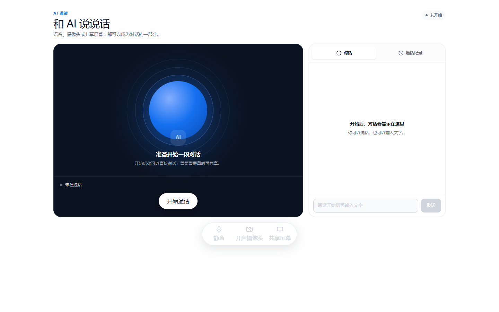

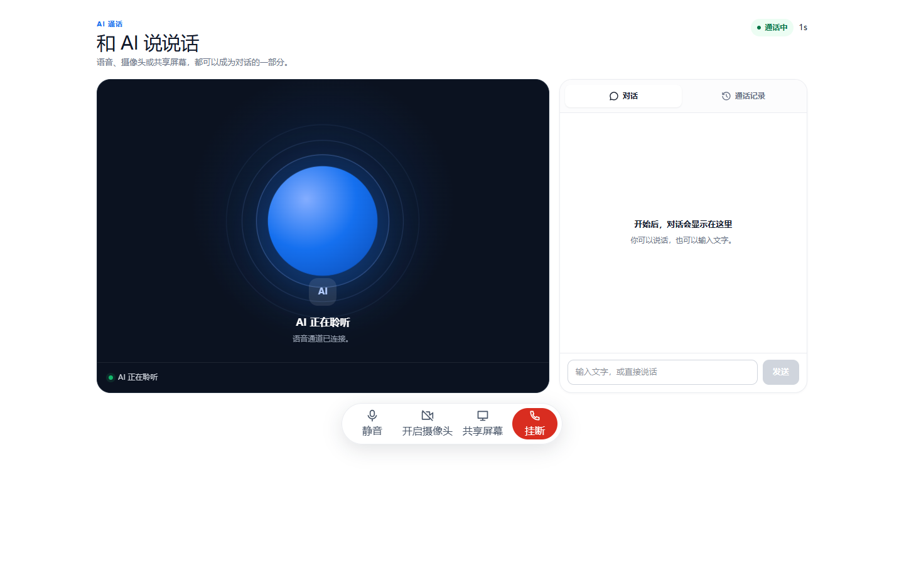

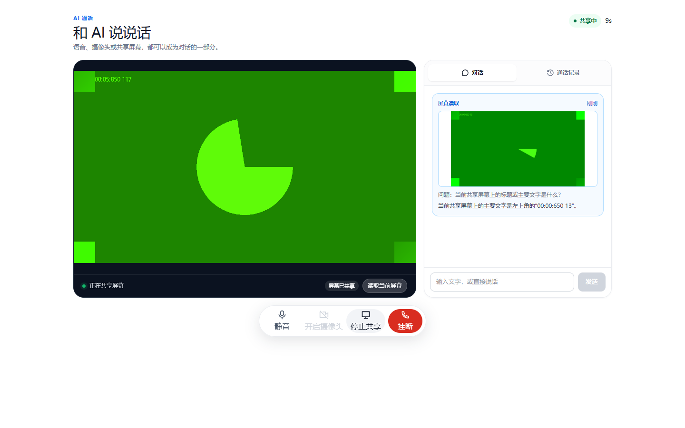

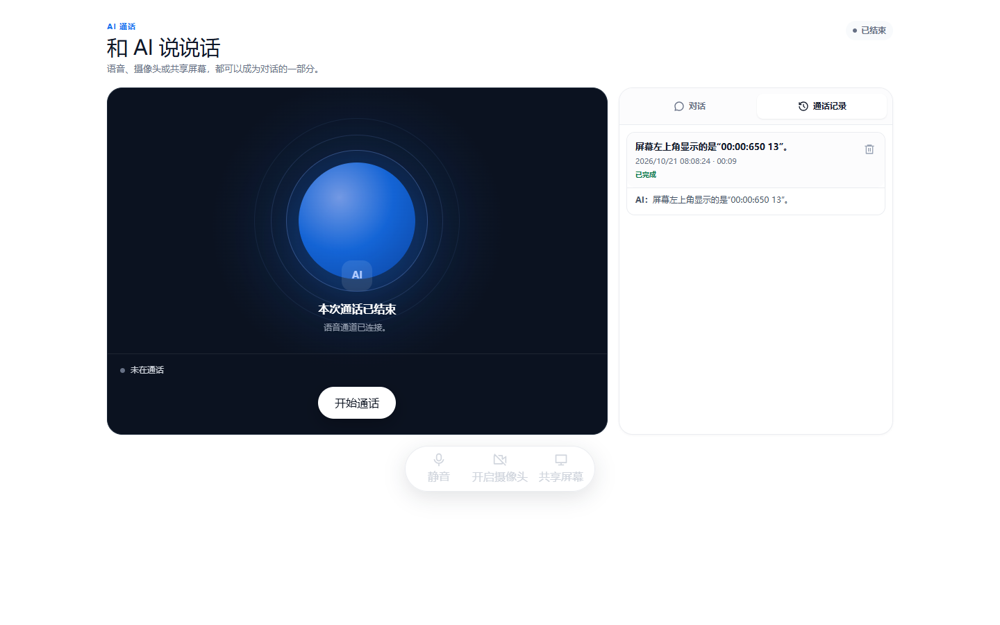

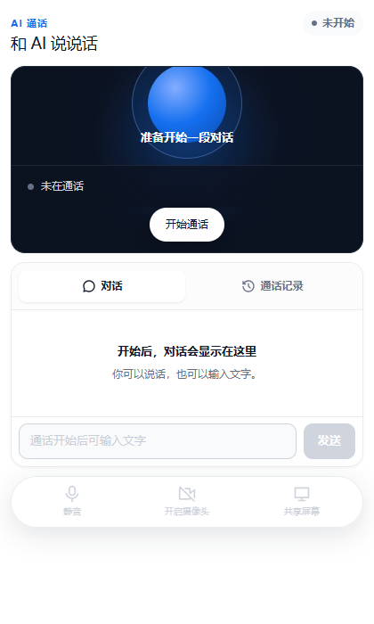

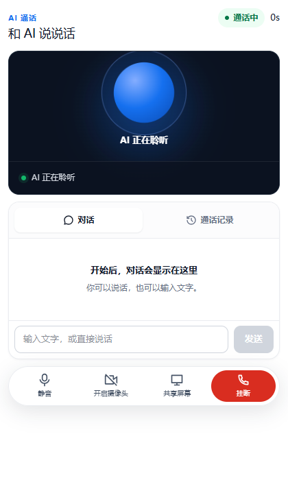

### 仍未完成

- 网络质量、重连、设备选择；
- 键盘快捷键；
- 历史分组/搜索/摘要/待办徽标；
- 真实摄像头画质、真实屏幕源选择器、弱网；
- 生产环境同步接口部署。

### 验证

```text
audio: live
mic muted and restored
camera: live / sender video / preview visible
screen: live / displaySurface monitor / sender video / preview visible
read screen: 成功，仅一张读取卡片
history saved / persisted
ended
```
